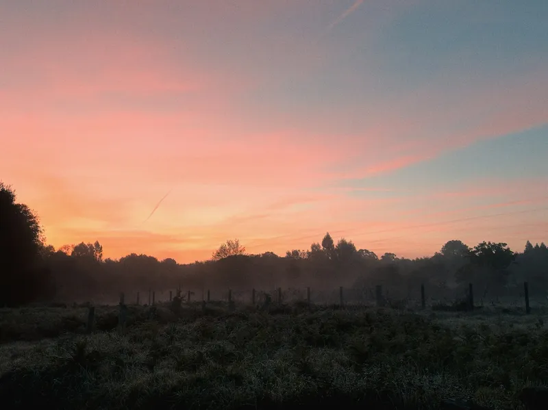

# AI CONTEXT & PROJECT DOSSIER

> **Project:** Ex-Risaldar Major M. K. Pawar NDA & Defence Academy  
> **Repository:** `https://github.com/vikashsinghpro95-sudo/NDAResident.git` (`main` branch)  
> **Workspace Paths:**  
> - Primary: `/Users/macbookpro/Developement/NDA Project ` (with trailing space)  
> - Counterpart: `/Users/macbookpro/Developement/NDA Project`  
> **Last Updated:** November 2026  

---

## 1. Project Overview & Institutional Profile

The **Ex-Risaldar Major M. K. Pawar NDA & Defence Academy** is a premier residential defence and STEM preparatory academy located in Pune / Lonavala foothills, Maharashtra, India. 

### Core Leadership & Three-Generation Lineage
1. **First Generation (The Great War Sapper):** Bombay Engineering Group (BEG). Gallant military engineering service recognized with an award of 85 acres in Sangli district by the British Indian Government.
2. **Second Generation (The Cavalryman):** Ex-Risaldar Major M. K. Pawar. 32 years of decorated active service in **Skinner's Horse** (1st Duke of York's Own Lancers) and **The President's Bodyguard (PBG)**.
3. **Third Generation (The Academic Director):** Prof. Ravindra Pawar. 17+ years leading premier STEM & defence coaching (Director, Kota Rankers Point, Pune). Bridges competitive science instruction with regimental discipline.

---

## 2. Technology Stack & Architecture

- **Architecture:** Static Web Architecture (Zero dependencies, fast load time, high accessibility).
- **Frontend Core:** Semantic HTML5, Vanilla CSS3 (Custom Properties & Design Tokens), Vanilla ES6+ JavaScript.
- **Typography:** Self-hosted web fonts (`assets/fonts/` and `Fonts/`):
  - Primary Sans: `Inter` (UI, body, data chips, tables)
  - Display / Editorial Serif: `Fraunces` / `Mileast` / `Transcity` (Regimental titles, hero titles, archival headers)
- **Deployment & Hosting:**
  - GitHub Actions Pages workflow (`.github/workflows/static.yml`)
  - Netlify hosting configs (`netlify.toml`, `_headers`)
  - SEO artifacts (`sitemap.xml`, `robots.txt`)

---

## 3. Design System & UI/UX Standards

### Color Tokens & Theme (`assets/css/tokens.css`, `variables.css`)
- **Backgrounds:**
  - Header & Navigation: Clean White (`#ffffff`)
  - Footer: Clean White (`#ffffff`) with Yellow highlights, Black text, and Yellow CTA buttons
  - Surface Primary: `#ffffff`
  - Surface Secondary: Muted parchment/warm regimental neutral (`#f8f9fa`, `#f4f5f7`)
  - Accent Gold/Yellow: `#f59e0b` / `#fbbf24` / `#f3b23e`
  - Brand Navy / Deep Black: `#0a0e17` / `#000000` / `#111827`
- **Buttons & Badges:**
  - Yellow background, 2px solid black stroke/border (`border: 2px solid #000`), bold black text, subtle 2px–3px offset box-shadow for tactical contrast.
- **Card Styling:**
  - Clean borders, purposeful spacing scale (8, 16, 24, 32, 48px), responsive fluid layouts with CSS Grid and Flexbox.

### Key Section Implementations (`index.html`)
- **Header / Navigation:**
  - Sticky white navbar with regimental badge, quick anchors, admissions pill, and mobile drawer.
- **Hero Section (File 00):**
  - Left column: Headline (`BUILD YOUR FUTURE IN THE ARMED FORCES`), admissions open alert, mission briefing, primary & secondary CTAs.
  - Right column: Cadet portrait in military tactical frame with subtle sunrise mist plate.
- **Three Generations (File 01):**
  - Interactive, accessible Regimental Dossier tabs (`GEN 01`, `GEN 02`, `GEN 03`) allowing seamless switching without slow scroll-hijack.
- **Cadet Cadence (File 02):**
  - Live Command Station HUD with a digital synchronized 24-hr clock, active formation tracker, day progress meter, quick filter chips (Dawn, Classes, Drill, Taps), and a clean vertical cadence timeline stream.
- **Accredited Programmes (File 03):**
  - 7 Structured cards with curated imagery, eligibility criteria, duration, and direct syllabus links.

---

## 4. Website Page Inventory

| File | Purpose / Contents |
|---|---|
| `index.html` | Flagship landing page: Hero, Dossiers, Cadet Cadence, Programmes, Campus brief, Enquiry form. |
| `about.html` | Regimental lineage, BEG, Skinner's Horse, Kota academic leadership, Vision, Advisory Council. |
| `courses.html` | Complete program catalog (NDA Foundation, SSB Guidance, CDS, AFCAT, IMU-CET, JEE TES, MHT-CET). |
| `campus-training.html` | Sahyadri campus, drill square, obstacle grounds, nutrition mess, dorms, daily cadence. |
| `nda-ssb.html` | Written exam blueprint (Maths + GAT), full 5-day SSB Board breakdown, GTO obstacles. |
| `achievements-gallery.html` | Cadets Hall of Fame, NDA passing out parade records, SSB selections, sports, regimental archives. |
| `admissions-contact.html` | Admission criteria, medical standards, online application form, campus location & route map. |
| `privacy-policy.html` | Data privacy, student record handling, compliance terms. |
| `terms.html` | Academy rules of conduct, fee guidelines, enrollment terms. |
| `thank-you.html` | Submission success confirmation and verification guidance. |
| `404.html` | Regimental-themed 404 error page with quick recovery routes. |
| `Website Contente.txt` | Complete verbatim text extraction across all 11 pages (81k+ characters). |

---

## 5. Curated Media Assets (`assets/img/`)

All images are optimized in modern `.webp` format with `-800.webp` responsive variants:
- **Hero & Mist:** `hero-mist-sunrise.webp`, `hero-crack-nda.jpg`
- **Lineage & History:** `archival-beg-sapper.webp`, `archival-skinners-horse.webp`, `archival-skinners-horse-portrait.webp`, `ravindra-pawar-academic.webp`
- **Cadet Training:** `cadet-group-run.webp`, `cross-country-running.webp`, `obstacle-course-climb.webp`, `teamwork-ssb-task.webp`
- **Academic & Courses:** `classroom-study.webp`, `nda-blackboard-math.webp`, `course-cds-campus.webp`, `course-afcat-plane.webp`, `course-imucet-ship.webp`, `course-cet-math-notes.webp`
- **Campus & Environment:** `western-ghats-hills.webp`, `maharashtra-sahyadri-landscape.webp`, `dormitory-cadet-beds.webp`, `topographic-map-texture.webp`

---

## 6. Git & Remote Workflow

- **Remote Origin:** `https://github.com/vikashsinghpro95-sudo/NDAResident.git`
- **Default Branch:** `main`
- **Syncing Counterparts:**
  The project exists in two sibling paths on the local machine:
  1. `/Users/macbookpro/Developement/NDA Project ` (active git repository)
  2. `/Users/macbookpro/Developement/NDA Project` (counterpart directory)
  Whenever updates are committed, sync using:
  ```bash
  rsync -av --delete --exclude='.git' "/Users/macbookpro/Developement/NDA Project /" "/Users/macbookpro/Developement/NDA Project/"
  ```

---

## 7. Guidelines for AI Assistants & Developers

1. **Maintain Design Cohesion:** Never introduce external CSS heavy frameworks that conflict with established tokens.
2. **Preserve Contrast & Layout Rules:** Always maintain the clean white background for navigation and footer, black text, and yellow action buttons with black borders.
3. **Responsive Mobile-First:** Check that tables, cadence cards, and forms work on viewports 360px–430px through 1440px.
4. **No Broken Links:** Ensure internal links reference the correct `.html` files and maintain ID anchors.

---


################################################################################
# COMPLETE CODEBASE EMBEDDED CONTEXT (HTML, CSS, JS, CONFIG)
# Single-Source-of-Truth Code Context for AI Models & Developers
################################################################################


================================================================================
## CONFIGURATION & REPOSITORY CONFIG
================================================================================


### FILE: `config.js`
```js
/**
 * ACADEMY CONFIGURATION & SINGLE SOURCE OF TRUTH
 * Ex-Risaldar Major M. K. Pawar NDA & Defence Academy, Pune
 * Domain: https://mkpawarnda.com
 *
 * NOTE ON VERIFICATION:
 * All unverified claims MUST have `verified: false`.
 * These automatically render a brass "TO CONFIRM" stamp until officially documented.
 */

export const CONFIG = {
  meta: {
    siteTitle: "Ex-Risaldar Major M. K. Pawar NDA & Defence Academy | Pune",
    shortTitle: "M. K. Pawar NDA Academy",
    tagline: "PREPARE • TRAIN • LEAD",
    supportLine: "Academic Preparation | Physical Training | Personality Development",
    dossierCode: "MKP-NDA-PUN-2026",
    established: "2026",
    domain: "https://mkpawarnda.com",
    selectionDisclaimer: "Selection is decided solely by UPSC, Services Selection Boards (SSBs), and competent Armed Forces medical boards. The Academy provides preparatory guidance, academic coaching, and physical conditioning."
  },

  contact: {
    phone: "8669099430",
    phoneDisplay: "+91 86690 99430",
    whatsapp: "918669099430",
    whatsappPrefilled: "Jai Hind Sir, I would like to enquire about admission to the M. K. Pawar NDA & Defence Academy residential program.",
    locationName: "Narhe, Pune, Maharashtra",
    coordinates: "18°26'55\"N 73°49'32\"E",
    email: "", // Empty placeholder until officially configured
    fullAddress: "Narhe Campus, Pune, Maharashtra, India",
    googleMapsEmbedUrl: "", // Empty placeholder
    socialLinks: {
      instagram: "",
      youtube: "",
      facebook: "",
      telegram: ""
    }
  },

  leadership: {
    founderDirector: {
      name: "Prof. Ravindra Pawar",
      role: "Founder & Academic Director",
      background: "Director, Kota Rankers Point, Pune",
      experienceYears: 17,
      instituteRunningYears: "10+",
      curriculumExpertise: ["Kota (Rajasthan)", "Madhya Pradesh", "Chhattisgarh", "Maharashtra State Board & CBSE"],
      pledge: "Aapka Baccha Meri Zimmedari Hai.",
      pledgeHindi: "आपका बच्चा मेरी ज़िम्मेदारी है।",
      signOff: "Jai Hind!"
    },
    memorialTribute: {
      honoree: "Ex-Risaldar Major M. K. Pawar",
      epitaph: "A Soldier. A Father. A Blessing.",
      relationship: "In loving memory of the founder's father. This academy is named as a living memorial to his service and ethos.",
      regiment: "61st Cavalry (Armoured Corps)",
      recruitmentCenter: "Jaipur",
      specialization: "Horse Riding Instructor & Equestrian Mentor",
      serviceNote: "Memorial tribute only — not active faculty or administration."
    },
    lineage: {
      generation1: {
        title: "The Great War Era",
        relation: "Grandfather",
        regiment: "Bombay Engineering Group (BEG)",
        force: "British Indian Army",
        era: "First World War Era",
        honourAward: "Honoured with 85 acres of land in Sangli district for gallant service",
        verified: true,
        illustrativeCaption: "Illustrative archival image representing BEG military engineering traditions."
      },
      generation2: {
        title: "The Cavalry Spirit",
        relation: "Father",
        honoree: "Ex-Risaldar Major M. K. Pawar",
        regiment: "61st Cavalry (Armoured Corps)",
        recruitment: "Recruited at Jaipur",
        specialty: "Renowned Horse Riding Instructor",
        verified: true,
        illustrativeCaption: "Illustrative image depicting the ceremonial cavalry saddle, riding boots, and military headgear."
      },
      generation3: {
        title: "The Classroom & Academy",
        relation: "Founder & Son",
        name: "Prof. Ravindra Pawar",
        role: "Founder & Director",
        background: "Kota Rankers Point & Pune Academic Leadership",
        focus: "Bridging rigorous academic science with military personality training.",
        verified: true,
        illustrativeCaption: "Illustrative documentary photography of structured classroom instruction."
      }
    }
  },

  conflictingFamilyRecords: {
    // KEPT INTERNAL & UNPUBLISHED AS PER EDITORIAL INSTRUCTIONS
    fatherServiceDurationVariants: [
      "Variant A: 31 years of military service",
      "Variant B: 1 year training + 3 years active service"
    ],
    fatherRankWordingVariants: ["Ex-Risaldar Major", "Risaldar"],
    grandfatherRank: "To be verified against military archives",
    armyNumber: "Unpublished - pending official record verification",
    postings: "Unpublished - pending official service record release"
  },

  coreValues: [
    { title: "Discipline", hindi: "अनुशासन", desc: "Military precision in daily routine, study schedules, and physical regimen." },
    { title: "Honesty", hindi: "सत्यनिष्ठा", desc: "Absolute integrity in academics, personal conduct, and peer fellowship." },
    { title: "Courage", hindi: "साहस", desc: "Mental resilience to face challenging exams and grueling obstacle courses." },
    { title: "Rashtra Bhakti", hindi: "राष्ट्रभक्ति", desc: "Unwavering devotion to national service in the Armed Forces of India." }
  ],

  courses: [
    {
      id: "nda",
      code: "FILE 01-A",
      title: "NDA Foundation & Written Batch",
      target: "Class 11, 12 & 12th Passed Cadets",
      duration: "1 Year / 2 Year Residential Integrated",
      exam: "UPSC NDA & NA Examination",
      curriculum: ["Mathematics (300 Marks)", "General Ability Test (GAT - 600 Marks)", "Daily Physical Training", "SSB Grooming"],
      heroTile: true,
      verified: true,
      fees: { value: "Contact admissions office", verified: false }
    },
    {
      id: "ssb",
      code: "FILE 01-B",
      title: "SSB Personality & Interview Guidance",
      target: "NDA, CDS, AFCAT & Direct Entry Call-letter holders",
      duration: "Intensive 14-Day Module / Regular Weekend Batches",
      exam: "Services Selection Board (SSB 5-Day Testing)",
      curriculum: ["Screening (OIR + PPDT)", "Psychological Battery (TAT, WAT, SRT, SD)", "GTO Obstacle Ground Drill", "Personal Interview Mock Panels"],
      heroTile: false,
      verified: true,
      fees: { value: "Contact admissions office", verified: false }
    },
    {
      id: "cds",
      code: "FILE 02-A",
      title: "CDS (Combined Defence Services)",
      target: "Graduating College Students & Graduates",
      duration: "6 Months / 1 Year",
      exam: "UPSC CDS Examination (IMA, OTA, INA, AFA)",
      curriculum: ["Elementary Mathematics", "English Language & Comprehension", "General Knowledge & Current Affairs", "SSB Orientation"],
      heroTile: false,
      verified: true,
      fees: { value: "Contact admissions office", verified: false }
    },
    {
      id: "afcat",
      code: "FILE 02-B",
      title: "AFCAT (Air Force Common Admission Test)",
      target: "Graduates aspiring for Indian Air Force Flying & Ground Duty",
      duration: "6 Months Intensive",
      exam: "IAF AFCAT Examination & EKT",
      curriculum: ["General Awareness", "Verbal Ability in English", "Numerical Ability", "Reasoning & Military Aptitude Test"],
      heroTile: false,
      verified: true,
      fees: { value: "Contact admissions office", verified: false }
    },
    {
      id: "imu-cet",
      code: "FILE 03-A",
      title: "IMU-CET & Merchant Navy Guidance",
      target: "Class 12th PCM Aspirants",
      duration: "1 Year Integrated / Crash Course",
      exam: "Indian Maritime University Common Entrance Test",
      curriculum: ["Physics, Chemistry & Mathematics", "English & General Knowledge", "General Aptitude", "Sponsorship Interview Prep"],
      heroTile: false,
      verified: true,
      fees: { value: "Contact admissions office", verified: false }
    },
    {
      id: "jee",
      code: "FILE 03-B",
      title: "JEE Main & Advanced Integrated",
      target: "Class 11 & 12 Science Aspirants (Dual Technical Route)",
      duration: "2-Year Integrated Residential Program",
      exam: "NTA JEE Main / JEE Advanced & 10+2 TES Army Entry",
      curriculum: ["Kota Rankers Point Proven Science Pedagogy", "Physics & Mathematics Mastery", "Daily Problem Practice (DPP)", "All-India Testing Series"],
      heroTile: false,
      verified: true,
      fees: { value: "Contact admissions office", verified: false }
    },
    {
      id: "cet",
      code: "FILE 03-C",
      title: "MHT-CET & State Engineering Batch",
      target: "Maharashtra State Board & CBSE Students",
      duration: "1 Year / 2 Year Module",
      exam: "MHT-CET Engineering & Technology",
      curriculum: ["Physics & Mathematics High-Yield Problem Solving", "Chemistry Speed Modules", "Speed & Accuracy Mock Exams"],
      heroTile: false,
      verified: true,
      fees: { value: "Contact admissions office", verified: false }
    }
  ],

  facilities: [
    { name: "Cadet Residential Dormitories", spec: "Segregated iron beds, individual study desks, footlockers", verified: false },
    { name: "Regimental Mess & Nutrition", spec: "Balanced high-protein cadet diet planned for physical endurance", verified: false },
    { name: "Obstacle Course (GTO Ground)", spec: "Tarzan swing, rope climbing, tiger leap, balance beams", verified: false },
    { name: "Digital & Scientific Classrooms", spec: "Audio-visual projection, acoustics, Kota methodology", verified: false },
    { name: "Standard 400m Running Track", spec: "Red soil stamina training circuit", verified: false },
    { name: "SSB Group Discussion Chamber", spec: "Circular conference layout with digital recording", verified: false },
    { name: "Medical & First Aid Post", spec: "Routine health monitoring and sports injury management", verified: false },
    { name: "Library & Current Affairs Reading Room", spec: "Military periodicals, defence yearbooks, competitive journals", verified: false }
  ],

  routine0530: [
    { time: "05:00", activity: "First Bugle (Stand-To & Wash)", desc: "Cadets prepare gear, uniforms, and inspection shoes.", verified: false },
    { time: "05:30", activity: "Reveille & Ground Muster", desc: "Fall in at the main parade ground for attendance and warm-up.", verified: false },
    { time: "06:00 - 07:15", activity: "Physical Training & Cross-Country", desc: "Calisthenics, distance running, interval sprints, and obstacle drills.", verified: false },
    { time: "07:30 - 08:15", activity: "Cadet Mess Breakfast", desc: "High-protein breakfast, milk, eggs/sprouts, nuts, and hydration.", verified: false },
    { time: "08:30 - 13:00", activity: "Academic Block 1 (Maths & Science)", desc: "Rigorous lecture sessions, concept derivation, and problem-solving.", verified: false },
    { time: "13:15 - 14:00", activity: "Cadet Lunch & Regimental Rest", desc: "Nutritious balanced lunch followed by brief cognitive rest.", verified: false },
    { time: "14:15 - 16:30", activity: "Academic Block 2 (GAT, English & History)", desc: "General ability, UPSC previous year question workshops, current affairs analysis.", verified: false },
    { time: "16:45 - 18:00", activity: "Obstacle Course / Sports / Drill", desc: "SSB group tasks, basketball/volleyball, drill movement.", verified: false },
    { time: "18:30 - 20:30", activity: "Supervised Self-Study & DPP", desc: "Mandatory quiet hours: solving daily practice problem sheets.", verified: false },
    { time: "20:45 - 21:30", activity: "Cadet Dinner & News Debrief", desc: "Evening meal and 15-minute national security briefing.", verified: false },
    { time: "21:45", activity: "Roll Call & Inspection", desc: "Final verification of quarters, personal kit, and schedule for dawn.", verified: false },
    { time: "22:00", activity: "Lights Out", desc: "Sound sleep for physical recovery and cognitive retention.", verified: false }
  ],

  // EDITORIAL FLAGS (Controls visibility of sections adhering to Honesty Rules)
  flags: {
    showFees: false,           // Fees require direct counseling based on stream
    showResults: false,        // New institution: honest empty state "Verified results will be published here"
    showHostel: true,
    showArmyNumber: false,     // Unverified military archive record
    showFaculty: false,        // Faculty names to be verified on deployment
    showTestimonials: false    // Zero fake testimonials!
  },

  events: [], // Config driven: empty state handled cleanly

  testimonials: [] // Pure empty state: NO fake reviews or ratings
};

// Expose globally for vanilla browser scripts
if (typeof window !== "undefined") {
  window.ACADEMY_CONFIG = CONFIG;
}

```


### FILE: `_headers`
```_headers
/*
  X-Frame-Options: DENY
  X-Content-Type-Options: nosniff
  X-XSS-Protection: 1; mode=block
  Referrer-Policy: strict-origin-when-cross-origin

/assets/fonts/*
  Cache-Control: public, max-age=31536000, immutable

/assets/img/*
  Cache-Control: public, max-age=2592000

/assets/css/*
  Cache-Control: public, max-age=604800

/assets/js/*
  Cache-Control: public, max-age=604800


```


### FILE: `netlify.toml`
```toml
[[headers]]
  for = "/*"
  [headers.values]
    X-Frame-Options = "DENY"
    X-Content-Type-Options = "nosniff"
    X-XSS-Protection = "1; mode=block"
    Referrer-Policy = "strict-origin-when-cross-origin"
    Permissions-Policy = "camera=(), microphone=(), geolocation=()"

[[headers]]
  for = "/assets/fonts/*"
  [headers.values]
    Cache-Control = "public, max-age=31536000, immutable"

[[headers]]
  for = "/assets/img/*"
  [headers.values]
    Cache-Control = "public, max-age=2592000"

[[headers]]
  for = "/assets/css/*"
  [headers.values]
    Cache-Control = "public, max-age=604800, stale-while-revalidate=86400"

[[headers]]
  for = "/assets/js/*"
  [headers.values]
    Cache-Control = "public, max-age=604800, stale-while-revalidate=86400"


```


### FILE: `robots.txt`
```txt
User-agent: *
Allow: /
Disallow: /thank-you.html

Sitemap: https://mkpawarnda.com/sitemap.xml


```


### FILE: `sitemap.xml`
```xml
<?xml version="1.0" encoding="UTF-8"?>
<urlset xmlns="http://www.sitemaps.org/schemas/sitemap/0.9">
  <url>
    <loc>https://mkpawarnda.com/</loc>
    <lastmod>2026-11-21</lastmod>
    <changefreq>weekly</changefreq>
    <priority>1.0</priority>
  </url>
  <url>
    <loc>https://mkpawarnda.com/about.html</loc>
    <lastmod>2026-11-21</lastmod>
    <changefreq>monthly</changefreq>
    <priority>0.8</priority>
  </url>
  <url>
    <loc>https://mkpawarnda.com/courses.html</loc>
    <lastmod>2026-11-21</lastmod>
    <changefreq>weekly</changefreq>
    <priority>0.9</priority>
  </url>
  <url>
    <loc>https://mkpawarnda.com/nda-ssb.html</loc>
    <lastmod>2026-11-21</lastmod>
    <changefreq>weekly</changefreq>
    <priority>0.9</priority>
  </url>
  <url>
    <loc>https://mkpawarnda.com/campus-training.html</loc>
    <lastmod>2026-11-21</lastmod>
    <changefreq>monthly</changefreq>
    <priority>0.8</priority>
  </url>
  <url>
    <loc>https://mkpawarnda.com/achievements-gallery.html</loc>
    <lastmod>2026-11-21</lastmod>
    <changefreq>monthly</changefreq>
    <priority>0.7</priority>
  </url>
  <url>
    <loc>https://mkpawarnda.com/admissions-contact.html</loc>
    <lastmod>2026-11-21</lastmod>
    <changefreq>weekly</changefreq>
    <priority>0.9</priority>
  </url>
  <url>
    <loc>https://mkpawarnda.com/privacy-policy.html</loc>
    <lastmod>2026-11-21</lastmod>
    <changefreq>yearly</changefreq>
    <priority>0.3</priority>
  </url>
  <url>
    <loc>https://mkpawarnda.com/terms.html</loc>
    <lastmod>2026-11-21</lastmod>
    <changefreq>yearly</changefreq>
    <priority>0.3</priority>
  </url>
</urlset>


```


### FILE: `.github/workflows/static.yml`
```yaml
# Simple workflow for deploying static content to GitHub Pages
name: Deploy static content to Pages

on:
  # Runs on pushes targeting the default branch
  push:
    branches: ["main"]

  # Allows you to run this workflow manually from the Actions tab
  workflow_dispatch:

# Sets permissions of the GITHUB_TOKEN to allow deployment to GitHub Pages
permissions:
  contents: read
  pages: write
  id-token: write

# Allow only one concurrent deployment, skipping runs queued between the run in-progress and latest queued.
# However, do NOT cancel in-progress runs as we want to allow these production deployments to complete.
concurrency:
  group: "pages"
  cancel-in-progress: false

jobs:
  # Single deploy job since we're just deploying
  deploy:
    environment:
      name: github-pages
      url: ${{ steps.deployment.outputs.page_url }}
    runs-on: ubuntu-latest
    steps:
      - name: Checkout
        uses: actions/checkout@v4
      - name: Setup Pages
        uses: actions/configure-pages@v5
      - name: Upload artifact
        uses: actions/upload-pages-artifact@v3
        with:
          # Upload entire repository
          path: '.'
      - name: Deploy to GitHub Pages
        id: deployment
        uses: actions/deploy-pages@v5

```


================================================================================
## CSS ARCHITECTURE & DESIGN SYSTEM
================================================================================


### FILE: `assets/css/tokens.css`
```css
/* ==========================================================================
   DESIGN TOKENS — MK PAWAR NDA ACADEMY (v2 — NAVY / YELLOW / WHITE)
   "THE SERVICE FILE" — Redesigned with Transcity font system
   ========================================================================== */

:root {
  /* ── BRAND PALETTE ─────────────────────────────────────────────── */
  --navy:          #0A1628;        /* Primary deep navy (backgrounds, headers) */
  --navy-mid:      #112240;        /* Slightly lighter navy for sections */
  --navy-light:    #1B3461;        /* Card/surface navy */
  --navy-border:   rgba(255,255,255,0.1);
  --navy-border-soft: rgba(255,255,255,0.06);

  --yellow:        #F5C518;        /* Primary yellow accent */
  --yellow-hover:  #E6B800;        /* Darker on hover */
  --yellow-pale:   #FDF6CC;        /* Pale yellow tint backgrounds */
  --yellow-glow:   rgba(245,197,24,0.25);
  --yellow-bg:     rgba(245,197,24,0.08);

  --white:         #FFFFFF;
  --off-white:     #F8F9FA;        /* Page canvas (NOT pure white — very slightly warm) */
  --light-grey:    #EEF0F4;        /* Dividers, card backgrounds in light mode */
  --mid-grey:      #9AA5B4;        /* Muted text, metadata */
  --dark-grey:     #2D3748;        /* Body text on white */

  --saffron:       #E8590C;        /* Reserved CTA accent only */
  --field-green:   #1A7F4E;        /* Success / green accent */

  /* Tricolor: footer ONLY */
  --tri-saffron:   #FF9933;
  --tri-white:     #FFFFFF;
  --tri-green:     #138808;

  /* ── TYPOGRAPHY ─────────────────────────────────────────────────── */
  --font-display:  'Mileast', 'Transcity', Georgia, serif;          /* Headlines, stamps, titles */
  --font-sans:     'Mileast', 'Plus Jakarta Sans', -apple-system, sans-serif; /* Whole site everywhere */
  --font-mono:     'JetBrains Mono', 'SF Mono', 'Courier New', monospace;
  --font-deva:     'Noto Serif Devanagari', serif;

  /* ── FLUID TYPE SCALE ───────────────────────────────────────────── */
  --text-hero:       clamp(3rem, 9vw + 0.5rem, 7.5rem);
  --text-hero-sm:    clamp(2rem, 5vw + 0.5rem, 4.5rem);
  --text-h1:         clamp(2.25rem, 4.5vw + 0.5rem, 4.5rem);
  --text-h2:         clamp(1.75rem, 3vw + 0.25rem, 3rem);
  --text-h3:         clamp(1.25rem, 1.8vw + 0.2rem, 2rem);
  --text-h4:         clamp(1.05rem, 1.2vw + 0.1rem, 1.4rem);
  --text-body-lg:    clamp(1.05rem, 1vw + 0.4rem, 1.25rem);
  --text-body:       1rem;
  --text-sm:         0.875rem;
  --text-mono:       0.8125rem;
  --text-micro:      0.6875rem;

  /* ── TRANSCITY WEIGHT MODULATION (via font-variation-settings or letter-spacing) */
  --tc-tight:        -0.04em;   /* Tight headlines */
  --tc-normal:       -0.01em;   /* Normal display */
  --tc-wide:          0.06em;   /* Wide stamps / labels */
  --tc-ultrawide:     0.14em;   /* Section markers */

  /* ── SPACING ────────────────────────────────────────────────────── */
  --s-2xs:   4px;
  --s-xs:    8px;
  --s-sm:    12px;
  --s-md:    16px;
  --s-lg:    24px;
  --s-xl:    32px;
  --s-2xl:   48px;
  --s-3xl:   64px;
  --s-4xl:   96px;
  --s-5xl:   128px;
  --s-6xl:   160px;

  /* ── LAYOUT ─────────────────────────────────────────────────────── */
  --max-w:          1440px;
  --pad-x:          clamp(1.25rem, 4.5vw, 4rem);
  --header-h:       72px;
  --radius-sm:      2px;
  --radius-md:      6px;

  /* ── MOTION ─────────────────────────────────────────────────────── */
  --ease-expo:      cubic-bezier(0.16, 1, 0.3, 1);
  --ease-out:       cubic-bezier(0.25, 1, 0.5, 1);
  --dur-fast:       180ms;
  --dur-base:       350ms;
  --dur-slow:       650ms;

  /* ── Z-INDEX ─────────────────────────────────────────────────────── */
  --z-grain:    999;
  --z-cursor:   990;
  --z-header:   800;
  --z-nav:      850;
  --z-modal:    900;
  --z-content:  10;
  --z-bg:       0;

  /* ── SHADOWS ─────────────────────────────────────────────────────── */
  --shadow-sm:  0 1px 3px rgba(10,22,40,0.12), 0 1px 2px rgba(10,22,40,0.08);
  --shadow-md:  0 4px 16px rgba(10,22,40,0.14), 0 2px 4px rgba(10,22,40,0.08);
  --shadow-lg:  0 10px 40px rgba(10,22,40,0.18), 0 4px 8px rgba(10,22,40,0.1);
  --shadow-yellow: 0 0 30px rgba(245,197,24,0.3);
}

```


### FILE: `assets/css/variables.css`
```css
/**
 * ============================================================================
 * EX-RISALDAR MAJOR M. K. PAWAR NDA & DEFENCE ACADEMY
 * Professional White Background + Indian TriColor & Military Theme
 * ============================================================================
 */

:root {
  /* --- Canvas & Backgrounds (Professional White Base) --- */
  --color-white: #FFFFFF;
  --color-bg-body: #FFFFFF;
  --color-bg-surface: #FFFFFF;
  --color-bg-alt: #F8FAFC;
  --color-bg-subtle: #F1F5F9;
  --color-bg-military-tint: #F4F6F4;
  --color-cool-grey: #F8FAFC;
  --color-cool-grey-alt: #EDF2F7;

  /* --- Armed Forces Navy (Commanding & Authoritative) --- */
  --color-navy: #0A192F;
  --color-navy-night: #050C1A;
  --color-navy-deep: #030810;
  --color-navy-light: #162E51;
  --color-navy-surface: #0E2544;
  --color-navy-surface-hover: #163660;

  /* --- Indian TriColor Theme (Tiranga) --- */
  --color-saffron: #FF671F;        /* India Saffron / Kesari - Courage & Sacrifice */
  --color-saffron-deep: #E65100;
  --color-saffron-light: #FF8542;
  --color-saffron-subtle: rgba(255, 103, 31, 0.10);
  --color-saffron-border: rgba(255, 103, 31, 0.35);

  --color-green: #046A38;          /* India Green - Faith & Chivalry */
  --color-green-dark: #024E28;
  --color-green-light: #138808;
  --color-green-subtle: rgba(4, 106, 56, 0.10);
  --color-green-border: rgba(4, 106, 56, 0.35);

  --color-ashoka-blue: #000080;    /* Ashoka Chakra Navy */

  /* --- Military Brass & Regimental Gold --- */
  --color-gold: #C9971D;
  --color-gold-antique: #A97C14;
  --color-gold-light: #ECC366;
  --color-gold-pale: #FBF4E2;
  --color-gold-subtle: rgba(201, 151, 29, 0.12);
  --color-gold-border: rgba(201, 151, 29, 0.35);

  --color-parchment: #FBF9F4;
  --color-parchment-warm: #F5EFE3;
  --color-parchment-border: rgba(169, 124, 20, 0.25);

  /* --- Text & Neutral Tone Scale --- */
  --color-charcoal: #0F172A;
  --color-text-primary: #0F172A;
  --color-text-secondary: #334155;
  --color-slate-muted: #475569;
  --color-slate-light: #94A3B8;

  /* --- Borders --- */
  --color-border-subtle: #E2E8F0;
  --color-border-medium: #CBD5E1;
  --color-border-dark: rgba(255, 255, 255, 0.15);

  /* --- Patriotic & Military TriColor Gradients --- */
  --tricolor-ribbon: linear-gradient(90deg, #FF671F 0%, #FF671F 33.3%, #FFFFFF 33.3%, #FFFFFF 66.6%, #046A38 66.6%, #046A38 100%);
  --tricolor-smooth: linear-gradient(90deg, #FF671F 0%, #F5F5F5 50%, #046A38 100%);
  --tricolor-badge-bg: linear-gradient(135deg, rgba(255, 103, 31, 0.08) 0%, rgba(255, 255, 255, 0.9) 50%, rgba(4, 106, 56, 0.08) 100%);

  /* --- Modern High-End Typography --- */
  --font-display: 'Outfit', -apple-system, BlinkMacSystemFont, 'Segoe UI', Roboto, sans-serif;
  --font-editorial: 'Outfit', -apple-system, BlinkMacSystemFont, sans-serif;
  --font-regimental: 'Outfit', sans-serif;
  --font-sans: 'Plus Jakarta Sans', -apple-system, BlinkMacSystemFont, 'Segoe UI', Roboto, sans-serif;

  /* --- Fluid Type Scale --- */
  --text-xs: clamp(0.72rem, 0.7rem + 0.15vw, 0.78rem);
  --text-sm: clamp(0.82rem, 0.8rem + 0.2vw, 0.88rem);
  --text-base: clamp(0.95rem, 0.92rem + 0.2vw, 1.05rem);
  --text-md: clamp(1.08rem, 1.02rem + 0.35vw, 1.22rem);
  --text-lg: clamp(1.24rem, 1.15rem + 0.55vw, 1.48rem);
  --text-xl: clamp(1.55rem, 1.35rem + 1vw, 1.95rem);
  --text-2xl: clamp(1.95rem, 1.7rem + 1.4vw, 2.65rem);
  --text-3xl: clamp(2.45rem, 2.1rem + 2vw, 3.4rem);
  --text-hero: clamp(2.6rem, 2.2rem + 2.8vw, 4.2rem);

  /* --- Spacing Scale --- */
  --space-2: 0.125rem;
  --space-4: 0.25rem;
  --space-8: 0.5rem;
  --space-12: 0.75rem;
  --space-16: 1rem;
  --space-20: 1.25rem;
  --space-24: 1.5rem;
  --space-32: 2rem;
  --space-40: 2.5rem;
  --space-48: 3rem;
  --space-64: 4rem;
  --space-80: 5rem;
  --space-96: 6rem;
  --space-128: 8rem;

  /* --- Containers --- */
  --container-narrow: 840px;
  --container-default: 1220px;
  --container-wide: 1360px;
  --container-full: 100%;

  /* --- Elevation & Shadows (Crisp institutional) --- */
  --shadow-subtle: 0 1px 3px rgba(15, 23, 42, 0.05), 0 1px 2px rgba(15, 23, 42, 0.03);
  --shadow-card: 0 4px 14px rgba(15, 23, 42, 0.06), 0 1px 3px rgba(15, 23, 42, 0.04);
  --shadow-elevated: 0 12px 32px rgba(15, 23, 42, 0.09), 0 2px 6px rgba(15, 23, 42, 0.04);
  --shadow-saffron: 0 6px 20px rgba(255, 103, 31, 0.25);
  --shadow-navy: 0 8px 24px rgba(10, 25, 47, 0.18);

  /* --- Radii --- */
  --radius-none: 0px;
  --radius-sm: 4px;
  --radius-md: 8px;
  --radius-lg: 12px;
  --radius-pill: 9999px;

  /* --- Transitions --- */
  --transition-fast: 150ms cubic-bezier(0.16, 1, 0.3, 1);
  --transition-normal: 220ms cubic-bezier(0.16, 1, 0.3, 1);
  --transition-slow: 350ms cubic-bezier(0.16, 1, 0.3, 1);

  /* --- Z-Index --- */
  --z-base: 1;
  --z-sticky: 100;
  --z-floating: 200;
  --z-drawer: 500;
  --z-modal: 1000;
}

```


### FILE: `assets/css/fonts.css`
```css
/* ==========================================================================
   FONTS — MK PAWAR NDA ACADEMY (v2 — NAVY / YELLOW / WHITE)
   "THE SERVICE FILE" — Transcity + Plus Jakarta Sans system
   ==========================================================================

   NOTE: Noto Serif Devanagari is loaded via Google Fonts link tag in HTML:
   <link rel="preconnect" href="https://fonts.googleapis.com">
   <link rel="preconnect" href="https://fonts.gstatic.com" crossorigin>
   <link href="https://fonts.googleapis.com/css2?family=Noto+Serif+Devanagari:wght@400;600;700&display=swap" rel="stylesheet">
   ========================================================================== */

/* ── MILEAST (Primary Website Font Everywhere) ─────────────────────────── */
@font-face {
  font-family: 'Mileast';
  src: url('../fonts/Mileast.woff2') format('woff2'),
       url('../fonts/Mileast.otf')   format('opentype');
  font-weight: 400;
  font-style: normal;
  font-display: block; /* prevent FOUT */
}

@font-face {
  font-family: 'Mileast';
  src: url('../fonts/Mileast-Italic.woff2') format('woff2'),
       url('../fonts/Mileast Italic.otf') format('opentype');
  font-weight: 400;
  font-style: italic;
  font-display: block;
}

/* ── TRANSCITY (Alternative Display) ───────────────────────────────────── */
@font-face {
  font-family: 'Transcity';
  src: url('../fonts/Transcity.woff2') format('woff2'),
       url('../fonts/Transcity.otf')   format('opentype');
  font-weight: 400;
  font-style: normal;
  font-display: block;
}

/* ── CINZEL (Backup Elegant Display) ───────────────────────────────────── */
@font-face {
  font-family: 'Cinzel';
  src: url('../fonts/cinzel-600-normal.woff2') format('woff2');
  font-weight: 600;
  font-style: normal;
  font-display: swap;
}

@font-face {
  font-family: 'Cinzel';
  src: url('../fonts/cinzel-700-normal.woff2') format('woff2');
  font-weight: 700;
  font-style: normal;
  font-display: swap;
}

/* ── PLUS JAKARTA SANS (Body / UI) ─────────────────────────────────────── */
@font-face {
  font-family: 'Plus Jakarta Sans';
  src: url('../fonts/plus-jakarta-sans-400-normal.woff2') format('woff2');
  font-weight: 400;
  font-style: normal;
  font-display: swap;
}

@font-face {
  font-family: 'Plus Jakarta Sans';
  src: url('../fonts/plus-jakarta-sans-400-italic.woff2') format('woff2');
  font-weight: 400;
  font-style: italic;
  font-display: swap;
}

@font-face {
  font-family: 'Plus Jakarta Sans';
  src: url('../fonts/plus-jakarta-sans-500-normal.woff2') format('woff2');
  font-weight: 500;
  font-style: normal;
  font-display: swap;
}

@font-face {
  font-family: 'Plus Jakarta Sans';
  src: url('../fonts/plus-jakarta-sans-600-normal.woff2') format('woff2');
  font-weight: 600;
  font-style: normal;
  font-display: swap;
}

@font-face {
  font-family: 'Plus Jakarta Sans';
  src: url('../fonts/plus-jakarta-sans-600-italic.woff2') format('woff2');
  font-weight: 600;
  font-style: italic;
  font-display: swap;
}

@font-face {
  font-family: 'Plus Jakarta Sans';
  src: url('../fonts/plus-jakarta-sans-700-normal.woff2') format('woff2');
  font-weight: 700;
  font-style: normal;
  font-display: swap;
}

@font-face {
  font-family: 'Plus Jakarta Sans';
  src: url('../fonts/plus-jakarta-sans-800-normal.woff2') format('woff2');
  font-weight: 800;
  font-style: normal;
  font-display: swap;
}

/* ── MONOSPACE — System stack only (no WOFF2 available) ────────────────── */
/* var(--font-mono): 'JetBrains Mono', 'Courier New', monospace */
/* Uses OS-installed JetBrains Mono if present, otherwise Courier New fallback */

/* ── DEVANAGARI — Google Fonts (requires link tag in HTML, see note above) ─ */
/* var(--font-deva): 'Noto Serif Devanagari', serif */

```


### FILE: `assets/css/base.css`
```css
/* ==========================================================================
   BASE — MK PAWAR NDA ACADEMY (v2 — NAVY / YELLOW / WHITE)
   "THE SERVICE FILE" — Reset, Typography, Layout Primitives
   ========================================================================== */

/* ── 1. CSS RESET ───────────────────────────────────────────────────────── */
*,
*::before,
*::after {
  box-sizing: border-box;
  margin: 0;
  padding: 0;
  border: 0;
}

/* ── 2. ROOT & HTML ─────────────────────────────────────────────────────── */
html {
  font-size: 16px;
  scroll-behavior: smooth;
  -webkit-text-size-adjust: 100%;
  text-size-adjust: 100%;
  height: 100%;
  overflow-x: hidden;
  max-width: 100vw;
  width: 100%;
}

/* ── 3. BODY ────────────────────────────────────────────────────────────── */
body {
  font-family: var(--font-sans);
  font-size: var(--text-body);
  color: var(--dark-grey);
  background-color: var(--off-white);
  line-height: 1.6;
  min-height: 100%;
  position: relative;
  overflow-x: hidden;
  max-width: 100vw;
  width: 100%;
  -webkit-font-smoothing: antialiased;
  -moz-osx-font-smoothing: grayscale;
}

/* Paper grain overlay */
body::before {
  content: '';
  position: fixed;
  inset: 0;
  z-index: var(--z-grain);
  pointer-events: none;
  opacity: 0.025;
  background-image: url("data:image/svg+xml,%3Csvg xmlns='http://www.w3.org/2000/svg' width='200' height='200'%3E%3Cfilter id='noise'%3E%3CfeTurbulence type='fractalNoise' baseFrequency='0.85' numOctaves='4' stitchTiles='stitch'/%3E%3C/filter%3E%3Crect width='200' height='200' filter='url(%23noise)' opacity='1'/%3E%3C/svg%3E");
  background-repeat: repeat;
  background-size: 200px 200px;
}

/* ── 4. SKIP LINK ───────────────────────────────────────────────────────── */
.skip-link {
  position: absolute;
  top: -100%;
  left: 16px;
  z-index: calc(var(--z-modal) + 10);
  padding: 8px 16px;
  background: var(--yellow);
  color: var(--navy);
  font-family: var(--font-sans);
  font-weight: 600;
  font-size: var(--text-sm);
  text-decoration: none;
  border-radius: var(--radius-sm);
  transition: top 0.2s ease;
}

.skip-link:focus {
  top: 16px;
}

/* ── 5. FOCUS RING ──────────────────────────────────────────────────────── */
:focus-visible {
  outline: 2px solid var(--yellow);
  outline-offset: 2px;
}

/* ── 6. TYPOGRAPHY ──────────────────────────────────────────────────────── */
h1, h2, h3, h4, h5, h6 {
  font-family: var(--font-display);
  font-weight: 400;
  letter-spacing: var(--tc-normal);
  line-height: 1.1;
  color: inherit;
}

h1 { font-size: var(--text-h1); }
h2 { font-size: var(--text-h2); }
h3 { font-size: var(--text-h3); }
h4 { font-size: var(--text-h4); }
h5 { font-size: var(--text-sm); font-family: var(--font-sans); font-weight: 700; letter-spacing: 0.08em; text-transform: uppercase; }
h6 { font-size: var(--text-micro); font-family: var(--font-mono); letter-spacing: var(--tc-ultrawide); text-transform: uppercase; }

p {
  font-family: var(--font-sans);
  font-size: var(--text-body);
  line-height: 1.65;
}

p + p {
  margin-top: 1em;
}

strong, b { font-weight: 700; }
em, i { font-style: italic; }

small {
  font-size: var(--text-sm);
  color: var(--mid-grey);
}

code, kbd, samp, pre {
  font-family: var(--font-mono);
  font-size: var(--text-mono);
}

/* ── 7. LINKS ───────────────────────────────────────────────────────────── */
a {
  color: inherit;
  text-decoration: underline;
  text-underline-offset: 3px;
  text-decoration-thickness: 1px;
  transition: text-decoration-color var(--dur-fast) var(--ease-out),
              color var(--dur-fast) var(--ease-out);
}

a:hover {
  text-decoration-thickness: 2px;
}

/* ── 8. LISTS ───────────────────────────────────────────────────────────── */
ul, ol {
  padding-left: 1.25em;
}

li {
  margin-bottom: 0.4em;
  line-height: 1.6;
}

/* ── 9. IMAGES & MEDIA ──────────────────────────────────────────────────── */
img, video, svg {
  display: block;
  max-width: 100%;
}

img {
  height: auto;
}

/* ── 10. SECTION BANDS (MATCHING LIGHT/WHITE EDITORIAL THEME) ────────── */
.section--dark {
  background-color: #FFFFFF;
  color: #0B1220;
  border-bottom: 2px solid #E5E7EB;
}

.section--mid {
  background-color: #F8FAFC;
  color: #0B1220;
  border-bottom: 2px solid #E5E7EB;
}

.section--light {
  background-color: #F8FAFC;
  color: #0B1220;
  border-bottom: 2px solid #E5E7EB;
}

.section--white {
  background-color: #FFFFFF;
  color: #0B1220;
  border-bottom: 2px solid #E5E7EB;
}

/* ── 11. CONTAINER ──────────────────────────────────────────────────────── */
.container {
  max-width: var(--max-w);
  padding-left: var(--pad-x);
  padding-right: var(--pad-x);
  margin-left: auto;
  margin-right: auto;
  width: 100%;
}

/* ── 12. GRID UTILITIES ─────────────────────────────────────────────────── */
.grid-12 {
  display: grid;
  grid-template-columns: repeat(12, 1fr);
  gap: var(--s-lg);
}

@media (max-width: 1024px) {
  .grid-12 {
    grid-template-columns: repeat(6, 1fr);
  }
}

@media (max-width: 640px) {
  .grid-12 {
    grid-template-columns: 1fr;
    gap: var(--s-md);
  }
}

/* ── 13. DIVIDERS ───────────────────────────────────────────────────────── */
hr.hairline {
  border: none;
  border-top: 1px solid currentColor;
  opacity: 0.15;
  margin: var(--s-lg) 0;
}

/* Perforated divider */
.divider--perf {
  border: none;
  border-top: 2px dashed currentColor;
  opacity: 0.2;
  margin: var(--s-lg) 0;
  background: none;
}

.divider--dots {
  display: flex;
  align-items: center;
  gap: var(--s-xs);
  margin: var(--s-xl) 0;
}

.divider--dots::before,
.divider--dots::after {
  content: '';
  flex: 1;
  height: 1px;
  background: currentColor;
  opacity: 0.15;
}

.divider--dots span {
  font-family: var(--font-mono);
  font-size: var(--text-micro);
  letter-spacing: var(--tc-ultrawide);
  opacity: 0.4;
  text-transform: uppercase;
  white-space: nowrap;
}

/* ── 14. UTILITY CLASSES ────────────────────────────────────────────────── */
.sr-only {
  position: absolute;
  width: 1px;
  height: 1px;
  padding: 0;
  margin: -1px;
  overflow: hidden;
  clip: rect(0, 0, 0, 0);
  white-space: nowrap;
  border-width: 0;
}

.text-center { text-align: center; }
.text-left   { text-align: left; }
.text-right  { text-align: right; }

.text-yellow  { color: var(--yellow); }
.text-navy    { color: var(--navy); }
.text-white   { color: var(--white); }
.text-muted   { color: var(--mid-grey); }

.font-display { font-family: var(--font-display); }
.font-mono    { font-family: var(--font-mono); }
.font-sans    { font-family: var(--font-sans); }

.uppercase    { text-transform: uppercase; }
.tracking-wide { letter-spacing: var(--tc-wide); }
.tracking-uw   { letter-spacing: var(--tc-ultrawide); }

/* ── 15. SCROLLBAR ──────────────────────────────────────────────────────── */
::-webkit-scrollbar {
  width: 6px;
  height: 6px;
}

::-webkit-scrollbar-track {
  background: var(--navy);
}

::-webkit-scrollbar-thumb {
  background: var(--yellow);
  border-radius: 3px;
}

::-webkit-scrollbar-thumb:hover {
  background: var(--yellow-hover);
}

/* Firefox */
* {
  scrollbar-width: thin;
  scrollbar-color: var(--yellow) var(--navy);
}

/* ── 16. SELECTION ──────────────────────────────────────────────────────── */
::selection {
  background-color: var(--yellow);
  color: var(--navy);
}

/* ── 17. REDUCED MOTION ─────────────────────────────────────────────────── */
@media (prefers-reduced-motion: reduce) {
  *,
  *::before,
  *::after {
    animation-duration: 0.01ms !important;
    animation-iteration-count: 1 !important;
    transition-duration: 0.01ms !important;
    scroll-behavior: auto !important;
  }
}

```


### FILE: `assets/css/components.css`
```css
/* ==========================================================================
   COMPONENTS — MK PAWAR NDA ACADEMY (v2 — NAVY / YELLOW / WHITE)
   "THE SERVICE FILE" — All reusable UI components
   ========================================================================== */

/* ═══════════════════════════════════════════════════════════════════════════
   §1  HEADER & NAVIGATION (ALL-WHITE BOLD INSTITUTIONAL NAV)
   ═══════════════════════════════════════════════════════════════════════════ */

.site-header {
  position: fixed;
  top: 0;
  left: 0;
  right: 0;
  height: var(--header-h);
  z-index: var(--z-header);
  background: #FFFFFF !important;
  border-bottom: 2px solid #E5E7EB;
  box-shadow: 0 4px 20px -2px rgba(10, 22, 40, 0.08);
  transition: box-shadow var(--dur-base) var(--ease-out);
}

.site-header.scrolled {
  background: #FFFFFF !important;
  box-shadow: 0 6px 28px -4px rgba(10, 22, 40, 0.14);
}

.header-inner {
  display: flex;
  align-items: center;
  justify-content: space-between;
  height: 100%;
  max-width: var(--max-w);
  margin: 0 auto;
  padding: 0 var(--pad-x);
}

/* ── Brand ── */
.header-brand {
  display: flex;
  align-items: center;
  gap: 14px;
  text-decoration: none;
  color: var(--navy);
  flex-shrink: 0;
  transition: opacity var(--dur-fast) var(--ease-out);
}

.header-brand:hover {
  text-decoration: none;
  opacity: 0.95;
}

.header-brand .brand-crest,
.header-brand .brand-logo,
.header-brand svg {
  width: 44px;
  height: 48px;
  flex-shrink: 0;
  filter: drop-shadow(0 2px 4px rgba(10, 22, 40, 0.12));
  transition: transform var(--dur-fast) var(--ease-out);
}

.header-brand:hover .brand-crest,
.header-brand:hover .brand-logo {
  transform: scale(1.04);
}

.brand-text-group,
.brand-name {
  display: flex;
  flex-direction: column;
  line-height: 1.1;
}

.brand-super {
  font-family: var(--font-mono);
  font-size: 0.62rem;
  font-weight: 700;
  letter-spacing: 0.18em;
  color: #64748B;
  text-transform: uppercase;
  line-height: 1;
}

.brand-title,
.brand-name .brand-short {
  font-family: var(--font-display);
  font-size: 1.25rem;
  font-weight: 800;
  letter-spacing: 0.04em;
  text-transform: uppercase;
  color: var(--navy);
  line-height: 1.05;
  margin-top: 1px;
}

.brand-badge,
.brand-name .brand-tagline {
  font-family: var(--font-mono);
  font-size: 0.64rem;
  font-weight: 700;
  letter-spacing: 0.14em;
  text-transform: uppercase;
  color: #B8892B;
  margin-top: 2px;
}

/* ── Primary nav ── */
.nav-primary {
  display: flex;
  align-items: center;
  gap: clamp(14px, 1.8vw, 28px);
  list-style: none;
  padding: 0;
  margin: 0;
}

.nav-primary a:not(.nav-cta) {
  font-family: var(--font-sans);
  font-size: 0.88rem;
  font-weight: 700;
  letter-spacing: 0.05em;
  text-transform: uppercase;
  color: var(--navy);
  text-decoration: none;
  position: relative;
  padding: 6px 2px;
  transition: color var(--dur-fast) var(--ease-out);
}

.nav-primary a:not(.nav-cta)::after {
  content: '';
  position: absolute;
  bottom: -4px;
  left: 0;
  width: 0;
  height: 3px;
  background: var(--yellow);
  border-radius: 2px;
  transition: width var(--dur-base) var(--ease-expo);
}

.nav-primary a:not(.nav-cta):hover {
  color: #B8892B;
}

.nav-primary a:not(.nav-cta):hover::after,
.nav-primary a:not(.nav-cta)[aria-current="page"]::after {
  width: 100%;
}

.nav-primary a:not(.nav-cta)[aria-current="page"] {
  color: var(--navy);
  font-weight: 800;
}

/* ── Live Batch Status Chip ── */
.nav-chip-badge {
  display: inline-flex;
  align-items: center;
  gap: 6px;
  padding: 5px 11px;
  background: #F8FAFC;
  border: 1px solid #E2E8F0;
  border-radius: 999px;
  font-family: var(--font-mono);
  font-size: 0.68rem;
  font-weight: 700;
  letter-spacing: 0.08em;
  color: var(--navy);
  text-transform: uppercase;
  white-space: nowrap;
}

.nav-pulse {
  width: 7px;
  height: 7px;
  border-radius: 50%;
  background: #16A34A;
  box-shadow: 0 0 0 2px rgba(22, 163, 74, 0.25);
  display: inline-block;
  animation: pulseGreen 2s infinite;
}

@keyframes pulseGreen {
  0% { transform: scale(0.95); box-shadow: 0 0 0 0 rgba(22, 163, 74, 0.6); }
  70% { transform: scale(1); box-shadow: 0 0 0 6px rgba(22, 163, 74, 0); }
  100% { transform: scale(0.95); box-shadow: 0 0 0 0 rgba(22, 163, 74, 0); }
}

/* ── Bold CTA button in nav ── */
.nav-cta,
.nav-primary .nav-cta,
.btn--nav-bold {
  display: inline-flex;
  align-items: center;
  justify-content: center;
  padding: 9px 20px;
  background: var(--yellow);
  color: var(--navy) !important;
  border: 2px solid var(--navy);
  font-family: var(--font-sans);
  font-size: 0.82rem;
  font-weight: 800;
  letter-spacing: 0.08em;
  text-transform: uppercase;
  text-decoration: none;
  border-radius: 2px;
  box-shadow: 2px 2px 0px var(--navy);
  transition: all var(--dur-fast) var(--ease-out);
  white-space: nowrap;
}

.nav-cta:hover,
.nav-primary .nav-cta:hover,
.btn--nav-bold:hover {
  background: #E5B810;
  color: var(--navy) !important;
  transform: translate(-1px, -1px);
  box-shadow: 3px 3px 0px var(--navy);
  text-decoration: none;
}

.nav-cta:active,
.nav-primary .nav-cta:active,
.btn--nav-bold:active {
  transform: translate(1px, 1px);
  box-shadow: 1px 1px 0px var(--navy);
}

/* ── Reading Progress Bar ── */
.header-progress-bar {
  position: fixed;
  top: var(--header-h);
  left: 0;
  height: 3px;
  background: var(--yellow);
  z-index: calc(var(--z-header) + 1);
  width: 0%;
  transition: width 0.1s ease-out;
}

/* ── Hamburger ── */
.hamburger {
  display: none;
  width: 44px;
  height: 44px;
  background: #F8FAFC;
  border: 1px solid #E2E8F0;
  cursor: pointer;
  flex-direction: column;
  align-items: center;
  justify-content: center;
  gap: 5px;
  flex-shrink: 0;
  border-radius: 4px;
  transition: background var(--dur-fast) var(--ease-out),
              border-color var(--dur-fast) var(--ease-out);
}

.hamburger:hover {
  background: #EDF2F7;
  border-color: #CBD5E1;
}

.hamburger-line {
  display: block;
  width: 22px;
  height: 2.5px;
  background: var(--navy);
  border-radius: 1px;
  transition: transform var(--dur-base) var(--ease-expo),
              opacity var(--dur-fast) var(--ease-out),
              width var(--dur-base) var(--ease-expo);
}

.hamburger.is-open .hamburger-line:nth-child(1) {
  transform: translateY(7.5px) rotate(45deg);
}

.hamburger.is-open .hamburger-line:nth-child(2) {
  opacity: 0;
  width: 0;
}

.hamburger.is-open .hamburger-line:nth-child(3) {
  transform: translateY(-7.5px) rotate(-45deg);
}

/* ── Mobile nav modal ── */
.nav-modal {
  position: fixed;
  inset: 0;
  z-index: var(--z-nav);
  background: var(--navy);
  display: flex;
  flex-direction: column;
  align-items: center;
  justify-content: center;
  gap: var(--s-xl);
  opacity: 0;
  pointer-events: none;
  transition: opacity var(--dur-base) var(--ease-out);
}

.nav-modal.is-open {
  opacity: 1;
  pointer-events: auto;
}

.nav-modal-list {
  list-style: none;
  text-align: center;
  padding: 0;
  margin: 0;
}

.nav-modal-list li {
  margin-bottom: var(--s-lg);
}

.nav-modal-list a {
  font-family: var(--font-display);
  font-size: clamp(2rem, 6vw, 3.5rem);
  letter-spacing: var(--tc-tight);
  color: var(--white);
  text-decoration: none;
  transition: color var(--dur-fast) var(--ease-out);
}

.nav-modal-list a:hover {
  color: var(--yellow);
}

.nav-modal-close {
  position: absolute;
  top: 20px;
  right: var(--pad-x);
  width: 44px;
  height: 44px;
  background: transparent;
  color: var(--white);
  cursor: pointer;
  display: flex;
  align-items: center;
  justify-content: center;
  font-size: 1.5rem;
  border-radius: var(--radius-sm);
}

@media (max-width: 1024px) {
  .nav-primary {
    display: none;
  }

  .hamburger {
    display: flex;
  }
}

@media (max-width: 480px) {
  .header-brand {
    gap: 8px;
    max-width: calc(100% - 52px);
  }

  .header-brand svg,
  .header-brand .brand-logo {
    width: 32px;
    height: 32px;
  }

  .brand-name .brand-short {
    font-size: 0.88rem;
    letter-spacing: var(--tc-normal);
    white-space: nowrap;
    overflow: hidden;
    text-overflow: ellipsis;
  }

  .brand-name .brand-tagline {
    font-size: 0.58rem;
  }

  .hamburger {
    width: 40px;
    height: 40px;
  }
}

/* ═══════════════════════════════════════════════════════════════════════════
   §2  BUTTONS (MATCHING THEME: YELLOW/WHITE + 2PX BLACK STROKE + OFFSET SHADOW)
   ═══════════════════════════════════════════════════════════════════════════ */

.btn {
  display: inline-flex;
  align-items: center;
  justify-content: center;
  gap: 8px;
  font-family: var(--font-sans);
  font-size: var(--text-sm);
  font-weight: 800;
  text-transform: uppercase;
  letter-spacing: 0.08em;
  border-radius: 2px;
  cursor: pointer;
  text-decoration: none;
  min-height: 48px;
  padding: 12px 26px;
  transition: all var(--dur-fast) var(--ease-out);
  will-change: transform;
  user-select: none;
  white-space: nowrap;
  max-width: 100%;
  -webkit-appearance: none;
  appearance: none;
}

@media (max-width: 640px) {
  .btn {
    white-space: normal;
    text-align: center;
    line-height: 1.3;
    padding: 12px 18px;
  }
}

.btn:focus-visible {
  outline: 2px solid #000000;
  outline-offset: 2px;
}

.btn:disabled {
  opacity: 0.45;
  cursor: not-allowed;
  transform: none !important;
  box-shadow: none !important;
}

/* Primary — Yellow Background + Solid Black Stroke & Text */
.btn--primary {
  background: var(--yellow) !important;
  color: #000000 !important;
  border: 2px solid #000000 !important;
  box-shadow: 2px 2px 0px #000000;
}

.btn--primary:hover {
  background: #E5B810 !important;
  color: #000000 !important;
  transform: translate(-1px, -1px);
  box-shadow: 3px 3px 0px #000000;
  text-decoration: none;
}

.btn--primary:active {
  transform: translate(1px, 1px);
  box-shadow: 1px 1px 0px #000000;
}

/* Outline / Secondary — Pure White + Solid Black Stroke & Text */
.btn--outline {
  background: #FFFFFF !important;
  color: #000000 !important;
  border: 2px solid #000000 !important;
  box-shadow: 2px 2px 0px #000000;
}

.btn--outline:hover {
  background: #F8FAFC !important;
  color: #000000 !important;
  transform: translate(-1px, -1px);
  box-shadow: 3px 3px 0px #000000;
  text-decoration: none;
}

.btn--outline:active {
  transform: translate(1px, 1px);
  box-shadow: 1px 1px 0px #000000;
}

/* Navy / Solid Dark — Solid Navy-Black + Black Stroke & White/Yellow Text */
.btn--navy {
  background: #0B1220 !important;
  color: #FFFFFF !important;
  border: 2px solid #000000 !important;
  box-shadow: 2px 2px 0px #000000;
}

.btn--navy:hover {
  background: #1E293B !important;
  color: var(--yellow) !important;
  transform: translate(-1px, -1px);
  box-shadow: 3px 3px 0px #000000;
  text-decoration: none;
}

.btn--navy:active {
  transform: translate(1px, 1px);
  box-shadow: 1px 1px 0px #000000;
}

/* Ghost — Transparent with Black Stroke */
.btn--ghost {
  background: transparent !important;
  color: #000000 !important;
  border: 2px solid #000000 !important;
}

.btn--ghost:hover {
  background: var(--yellow) !important;
  color: #000000 !important;
  transform: translate(-1px, -1px);
  box-shadow: 2px 2px 0px #000000;
  text-decoration: none;
}

/* WhatsApp — Yellow with Black Stroke & Black Icon */
.btn--whatsapp {
  background: var(--yellow) !important;
  color: #000000 !important;
  border: 2px solid #000000 !important;
  box-shadow: 2px 2px 0px #000000;
}

.btn--whatsapp::before {
  content: '';
  display: inline-block;
  width: 18px;
  height: 18px;
  background-image: url("data:image/svg+xml,%3Csvg xmlns='http://www.w3.org/2000/svg' viewBox='0 0 24 24' fill='%23000'%3E%3Cpath d='M17.472 14.382c-.297-.149-1.758-.867-2.03-.967-.273-.099-.471-.148-.67.15-.197.297-.767.966-.94 1.164-.173.199-.347.223-.644.075-.297-.15-1.255-.463-2.39-1.475-.883-.788-1.48-1.761-1.653-2.059-.173-.297-.018-.458.13-.606.134-.133.298-.347.446-.52.149-.174.198-.298.298-.497.099-.198.05-.371-.025-.52-.075-.149-.669-1.612-.916-2.207-.242-.579-.487-.5-.669-.51-.173-.008-.371-.01-.57-.01-.198 0-.52.074-.792.372-.272.297-1.04 1.016-1.04 2.479 0 1.462 1.065 2.875 1.213 3.074.149.198 2.096 3.2 5.077 4.487.709.306 1.262.489 1.694.625.712.227 1.36.195 1.871.118.571-.085 1.758-.719 2.006-1.413.248-.694.248-1.289.173-1.413-.074-.124-.272-.198-.57-.347m-5.421 7.403h-.004a9.87 9.87 0 01-5.031-1.378l-.361-.214-3.741.982.998-3.648-.235-.374a9.86 9.86 0 01-1.51-5.26c.001-5.45 4.436-9.884 9.888-9.884 2.64 0 5.122 1.03 6.988 2.898a9.825 9.825 0 012.893 6.994c-.003 5.45-4.437 9.884-9.885 9.884m8.413-18.297A11.815 11.815 0 0012.05 0C5.495 0 .16 5.335.157 11.892c0 2.096.547 4.142 1.588 5.945L.057 24l6.305-1.654a11.882 11.882 0 005.683 1.448h.005c6.554 0 11.89-5.335 11.893-11.893a11.821 11.821 0 00-3.48-8.413z'/%3E%3C/svg%3E");
  background-repeat: no-repeat;
  background-size: contain;
  flex-shrink: 0;
}

.btn--whatsapp:hover {
  background: #E5B810 !important;
  color: #000000 !important;
  transform: translate(-1px, -1px);
  box-shadow: 3px 3px 0px #000000;
  text-decoration: none;
}

/* Size variants */
.btn--sm {
  min-height: 36px;
  padding: 8px 18px;
  font-size: var(--text-micro);
}

.btn--lg {
  min-height: 56px;
  padding: 18px 36px;
  font-size: var(--text-body);
}

/* ═══════════════════════════════════════════════════════════════════════════
   §3  STAMPS (MATCHING THEME)
   ═══════════════════════════════════════════════════════════════════════════ */

.stamp {
  display: inline-block;
  font-family: var(--font-mono);
  font-size: var(--text-micro);
  font-weight: 800;
  letter-spacing: var(--tc-ultrawide);
  text-transform: uppercase;
  background: var(--yellow);
  color: #000000;
  border: 2px solid #000000;
  box-shadow: 2px 2px 0px #000000;
  padding: 4px 10px;
  transform: rotate(-1.5deg);
  border-radius: 2px;
  user-select: none;
}

.stamp--outline {
  background: #FFFFFF;
  color: #000000;
  border: 2px solid #000000;
  box-shadow: 2px 2px 0px #000000;
}

.stamp--confirm,
.stamp--to-confirm {
  background: #FEF2F2;
  color: #DC2626;
  border: 2px dashed #DC2626;
  box-shadow: none;
}

.stamp--navy {
  background: #0B1220;
  color: #FFFFFF;
  border: 2px solid #000000;
  box-shadow: 2px 2px 0px #000000;
}

.stamp--white {
  background: #FFFFFF;
  color: #000000;
  border: 2px solid #000000;
  box-shadow: 2px 2px 0px #000000;
}

.stamp--red {
  background: #FEF2F2;
  border-color: #DC2626;
  color: #DC2626;
}

.stamp--flat {
  transform: none;
}

/* ═══════════════════════════════════════════════════════════════════════════
   §4  CLOCK CHIP (MATCHING THEME)
   ═══════════════════════════════════════════════════════════════════════════ */

.clock-chip {
  display: inline-flex;
  align-items: center;
  gap: 8px;
  font-family: var(--font-mono);
  font-size: var(--text-mono);
  font-weight: 700;
  color: #000000;
  background: #FFFFFF;
  border: 2px solid #000000;
  box-shadow: 2px 2px 0px #000000;
  padding: 6px 14px;
  letter-spacing: 0.08em;
  border-radius: 2px;
}

.clock-chip-dot,
.clock-chip::before {
  content: '';
  display: block;
  width: 7px;
  height: 7px;
  border-radius: 50%;
  background: #16A34A;
  box-shadow: 0 0 0 2px rgba(22, 163, 74, 0.25);
  animation: pulse-dot 1.5s ease-in-out infinite;
  flex-shrink: 0;
}

@keyframes pulse-dot {
  0%, 100% { opacity: 1; transform: scale(1); }
  50%       { opacity: 0.4; transform: scale(0.6); }
}

/* ═══════════════════════════════════════════════════════════════════════════
   §5  FILE TAB (edge label)
   ═══════════════════════════════════════════════════════════════════════════ */

.file-tab {
  position: absolute;
  left: 0;
  top: 50%;
  transform: translateY(-50%) rotate(-90deg) translateX(-50%);
  transform-origin: center center;
  font-family: var(--font-mono);
  font-size: var(--text-micro);
  letter-spacing: var(--tc-ultrawide);
  text-transform: uppercase;
  color: #64748B;
  background: #FFFFFF;
  border: 1px solid #000000;
  padding: 2px 10px;
  white-space: nowrap;
  user-select: none;
  pointer-events: none;
}

@media (max-width: 1024px) {
  .file-tab {
    display: none;
  }
}

/* ═══════════════════════════════════════════════════════════════════════════
   §6  MARQUEE STRIP (HIGH-IMPACT YELLOW + BLACK STROKE RIBBON)
   ═══════════════════════════════════════════════════════════════════════════ */

.marquee-strip {
  overflow: hidden;
  background: var(--yellow);
  border-top: 2px solid #000000;
  border-bottom: 2px solid #000000;
  padding: 12px 0;
  user-select: none;
}

.marquee-track {
  display: flex;
  width: max-content;
  animation: marquee-scroll 30s linear infinite;
}

.marquee-strip:hover .marquee-track {
  animation-play-state: paused;
}

@keyframes marquee-scroll {
  from { transform: translateX(0); }
  to   { transform: translateX(-50%); }
}

.marquee-item {
  font-family: var(--font-sans);
  letter-spacing: var(--tc-wide);
  font-size: 0.92rem;
  font-weight: 800;
  color: #000000;
  padding: 0 24px;
  white-space: nowrap;
  text-transform: uppercase;
}

.marquee-item::after {
  content: '★';
  color: #000000;
  margin-left: 24px;
}

@media (prefers-reduced-motion: reduce) {
  .marquee-track {
    animation: none;
  }
}

/* ═══════════════════════════════════════════════════════════════════════════
   §7  SECTION HEADER PATTERN
   ═══════════════════════════════════════════════════════════════════════════ */

.section-header {
  margin-bottom: var(--s-3xl);
}

.section-label {
  font-family: var(--font-mono);
  font-size: var(--text-micro);
  letter-spacing: var(--tc-ultrawide);
  text-transform: uppercase;
  color: var(--yellow);
  display: flex;
  align-items: center;
  gap: 12px;
}

.section-label::before {
  content: '';
  display: block;
  width: 40px;
  height: 1px;
  background: var(--yellow);
  flex-shrink: 0;
}

.section-title {
  font-family: var(--font-display);
  font-size: var(--text-h1);
  letter-spacing: var(--tc-tight);
  margin-top: 12px;
  line-height: 1.0;
}

.section-subtitle {
  font-family: var(--font-sans);
  font-size: var(--text-body-lg);
  color: var(--mid-grey);
  max-width: 56ch;
  margin-top: var(--s-md);
  line-height: 1.6;
}

/* On dark sections, subtitle muted white */
.section--dark .section-subtitle,
.section--mid .section-subtitle {
  color: rgba(255, 255, 255, 0.55);
}

/* ═══════════════════════════════════════════════════════════════════════════
   §8  REVEAL ANIMATIONS
   ═══════════════════════════════════════════════════════════════════════════ */

.reveal {
  opacity: 0;
  transform: translateY(32px);
  transition: opacity 0.65s var(--ease-expo),
              transform 0.65s var(--ease-expo);
}

.reveal.is-visible {
  opacity: 1;
  transform: none;
}

.reveal--left {
  transform: translateX(-32px);
}

.reveal--right {
  transform: translateX(32px);
}

.reveal--left.is-visible,
.reveal--right.is-visible {
  transform: translateX(0);
}

.reveal--d1 { transition-delay: 100ms; }
.reveal--d2 { transition-delay: 200ms; }
.reveal--d3 { transition-delay: 300ms; }
.reveal--d4 { transition-delay: 400ms; }
.reveal--d5 { transition-delay: 500ms; }

@media (prefers-reduced-motion: reduce) {
  .reveal {
    opacity: 1;
    transform: none;
    transition: none;
  }
}

/* ═══════════════════════════════════════════════════════════════════════════
   §9  PROGRESS BAR
   ═══════════════════════════════════════════════════════════════════════════ */

#progress-bar {
  position: fixed;
  top: 0;
  left: 0;
  height: 3px;
  background: var(--yellow);
  z-index: calc(var(--z-header) + 1);
  transform-origin: left;
  transform: scaleX(0);
  transition: transform 100ms linear;
  pointer-events: none;
}

/* ═══════════════════════════════════════════════════════════════════════════
   §10 BOTTOM BAR (Mobile only)
   ═══════════════════════════════════════════════════════════════════════════ */

.bottom-bar {
  display: none;
}

@media (max-width: 768px) {
  .bottom-bar {
    display: flex;
    position: fixed;
    bottom: 0;
    left: 0;
    right: 0;
    height: 60px;
    background: var(--navy);
    border-top: 1px solid rgba(255, 255, 255, 0.1);
    justify-content: space-around;
    align-items: center;
    z-index: var(--z-header);
    padding-bottom: env(safe-area-inset-bottom, 0);
  }
}

.bottom-bar-item {
  display: flex;
  flex-direction: column;
  align-items: center;
  gap: 3px;
  color: rgba(255, 255, 255, 0.5);
  text-decoration: none;
  font-family: var(--font-mono);
  font-size: 9px;
  letter-spacing: 0.1em;
  text-transform: uppercase;
  min-width: 44px;
  min-height: 44px;
  justify-content: center;
  transition: color var(--dur-fast) var(--ease-out);
}

.bottom-bar-item:hover,
.bottom-bar-item[aria-current="page"] {
  color: var(--yellow);
  text-decoration: none;
}

.bottom-bar-icon {
  width: 22px;
  height: 22px;
}

.bottom-bar-cta {
  width: 52px;
  height: 52px;
  background: var(--yellow);
  border: 2px solid var(--navy);
  border-radius: 50%;
  display: flex;
  align-items: center;
  justify-content: center;
  color: var(--navy);
  font-family: var(--font-sans);
  font-size: 0.72rem;
  font-weight: 800;
  letter-spacing: 0.05em;
  text-transform: uppercase;
  text-decoration: none;
  flex-shrink: 0;
  box-shadow: 0 4px 12px rgba(0, 0, 0, 0.3);
  transform: translateY(-8px);
  transition: background var(--dur-fast) var(--ease-out),
              transform var(--dur-fast) var(--ease-out);
}

.bottom-bar-cta:hover {
  background: #E5B810;
  transform: translateY(-10px) scale(1.06);
  text-decoration: none;
  color: var(--navy);
}

/* ═══════════════════════════════════════════════════════════════════════════
   §11 BENTO GRID (MATCHING THEME: WHITE CARDS + 2PX BLACK BORDER + SHADOW)
   ═══════════════════════════════════════════════════════════════════════════ */

.bento-grid {
  display: grid;
  grid-template-columns: repeat(12, 1fr);
  gap: var(--s-md);
}

@media (max-width: 768px) {
  .bento-grid {
    grid-template-columns: 1fr;
  }
}

.bento-tile {
  position: relative;
  overflow: hidden;
  background: #FFFFFF;
  border: 2px solid #000000;
  box-shadow: 4px 4px 0px #000000;
  cursor: pointer;
  transition: transform var(--dur-base) var(--ease-expo),
              box-shadow var(--dur-base) var(--ease-expo);
  border-radius: 2px;
  min-height: 260px;
}

.bento-tile:hover {
  transform: translate(-2px, -2px);
  box-shadow: 6px 6px 0px #000000;
  z-index: 2;
}

/* Span classes */
.tile--hero {
  grid-column: span 8;
  grid-row: span 2;
}

.tile--tall {
  grid-column: span 4;
  grid-row: span 2;
}

.tile--wide {
  grid-column: span 6;
  grid-row: span 1;
}

.tile--sm {
  grid-column: span 4;
  grid-row: span 1;
}

.tile--full {
  grid-column: span 12;
}

@media (max-width: 768px) {
  .tile--hero,
  .tile--tall,
  .tile--wide,
  .tile--sm,
  .tile--full {
    grid-column: span 1;
    grid-row: span 1;
  }
}

/* Inner content */
.tile-inner {
  position: absolute;
  bottom: 0;
  left: 0;
  right: 0;
  padding: 24px;
  background: linear-gradient(to top, rgba(255, 255, 255, 0.98) 0%, rgba(255, 255, 255, 0.85) 65%, transparent 100%);
  color: #0B1220;
}

/* Course code top-right */
.tile-code {
  position: absolute;
  top: 16px;
  right: 16px;
  font-family: var(--font-mono);
  font-size: var(--text-micro);
  letter-spacing: var(--tc-ultrawide);
  background: var(--yellow);
  color: #000000;
  border: 1.5px solid #000000;
  padding: 2px 8px;
  font-weight: 800;
  border-radius: 2px;
  text-transform: uppercase;
  box-shadow: 1px 1px 0px #000000;
}

/* Expandable content */
.tile-front {
  opacity: 1;
  transition: opacity var(--dur-base) var(--ease-out),
              max-height var(--dur-base) var(--ease-out);
  max-height: 200px;
  overflow: hidden;
  color: #0B1220;
}

.tile-front h3 {
  color: #0B1220;
  font-family: var(--font-display);
  font-weight: 800;
}

.tile-front p {
  color: #374151;
}

.tile-back {
  max-height: 0;
  overflow: hidden;
  opacity: 0;
  transition: opacity var(--dur-base) var(--ease-out),
              max-height var(--dur-base) var(--ease-out);
  color: #0B1220;
}

.bento-tile.is-expanded .tile-front {
  max-height: 0;
  opacity: 0;
}

.bento-tile.is-expanded .tile-back {
  max-height: 400px;
  opacity: 1;
}

/* Tile image bg */
.tile-bg {
  position: absolute;
  inset: 0;
  width: 100%;
  height: 100%;
  object-fit: cover;
  object-position: center;
  transition: transform var(--dur-slow) var(--ease-expo);
  opacity: 0.85;
}

.bento-tile:hover .tile-bg {
  transform: scale(1.04);
}

/* ═══════════════════════════════════════════════════════════════════════════
   §12 FAQ ACCORDION (MATCHING THEME)
   ═══════════════════════════════════════════════════════════════════════════ */

.faq-list {
  list-style: none;
  padding: 0;
  margin: 0;
}

.faq-item {
  background: #FFFFFF;
  border: 2px solid #000000;
  box-shadow: 3px 3px 0px #000000;
  border-radius: 2px;
  margin-bottom: 14px;
  padding: 0 20px;
  color: #0B1220;
  transition: transform var(--dur-fast) var(--ease-out),
              box-shadow var(--dur-fast) var(--ease-out);
}

.faq-item:hover {
  transform: translate(-1px, -1px);
  box-shadow: 4px 4px 0px #000000;
}

.faq-trigger {
  display: flex;
  justify-content: space-between;
  align-items: center;
  width: 100%;
  padding: 18px 0;
  font-family: var(--font-sans);
  font-size: var(--text-body-lg);
  font-weight: 800;
  color: #0B1220;
  background: transparent;
  cursor: pointer;
  text-align: left;
  gap: var(--s-md);
  transition: color var(--dur-fast) var(--ease-out);
}

.faq-trigger:hover {
  color: #B8892B;
}

.faq-chevron {
  flex-shrink: 0;
  width: 20px;
  height: 20px;
  color: #000000;
  transition: transform var(--dur-base) var(--ease-expo);
}

.faq-item.is-open .faq-chevron {
  transform: rotate(180deg);
  color: var(--yellow);
}

.faq-body {
  max-height: 0;
  overflow: hidden;
  transition: max-height 0.4s ease,
              padding 0.4s ease;
}

.faq-body.is-open {
  max-height: 400px;
}

.faq-body-inner {
  padding-bottom: 20px;
  font-family: var(--font-sans);
  font-size: var(--text-body);
  line-height: 1.65;
  color: #374151;
}

/* ═══════════════════════════════════════════════════════════════════════════
   §13 FORM STYLES (MATCHING THEME)
   ═══════════════════════════════════════════════════════════════════════════ */

.form-group {
  margin-bottom: 20px;
}

.form-label {
  display: block;
  font-family: var(--font-mono);
  font-size: var(--text-micro);
  letter-spacing: 0.1em;
  font-weight: 800;
  text-transform: uppercase;
  color: #0B1220;
  margin-bottom: 6px;
}

.form-input,
.form-select,
.form-textarea {
  width: 100%;
  padding: 14px 16px;
  font-family: var(--font-sans);
  font-size: var(--text-body);
  font-weight: 600;
  color: #0B1220;
  background: #FFFFFF;
  border: 2px solid #CBD5E1;
  border-radius: 2px;
  transition: all var(--dur-fast) var(--ease-out);
  -webkit-appearance: none;
  appearance: none;
}

.form-input::placeholder,
.form-textarea::placeholder {
  color: #94A3B8;
}

.form-input:focus,
.form-select:focus,
.form-textarea:focus {
  outline: none;
  border-color: #000000;
  background: #FFFFFF;
  box-shadow: 0 0 0 2px var(--yellow);
}

.form-textarea {
  min-height: 120px;
  resize: vertical;
}

.form-select {
  cursor: pointer;
  background-image: url("data:image/svg+xml,%3Csvg xmlns='http://www.w3.org/2000/svg' width='12' height='8' viewBox='0 0 12 8'%3E%3Cpath d='M1 1l5 5 5-5' stroke='%23000' stroke-width='2' fill='none' stroke-linecap='round'/%3E%3C/svg%3E");
  background-repeat: no-repeat;
  background-position: right 16px center;
  padding-right: 44px;
}

.form-error {
  display: block;
  margin-top: 4px;
  font-family: var(--font-mono);
  font-size: var(--text-micro);
  color: #ff4444;
}

/* ═══════════════════════════════════════════════════════════════════════════
   §14 FOOTER (ALL-WHITE BACKGROUND, BLACK TEXT, YELLOW ACCENTS, BLACK-STROKE BUTTONS)
   ═══════════════════════════════════════════════════════════════════════════ */

.site-footer {
  background: #FFFFFF !important;
  color: #0B1220 !important;
  padding-top: clamp(3rem, 6vw, 5rem);
  position: relative;
  border-top: 2px solid #E5E7EB;
  box-shadow: 0 -4px 24px -2px rgba(10, 22, 40, 0.05);
}

.footer-container {
  max-width: var(--max-w);
  margin: 0 auto;
  padding: 0 var(--pad-x);
}

.footer-grid {
  display: grid;
  grid-template-columns: 1.6fr 1fr 1fr 1.3fr;
  gap: clamp(1.75rem, 3.5vw, 3.5rem);
  padding-bottom: var(--s-3xl);
  border-bottom: 2px solid #F1F5F9;
}

@media (max-width: 1024px) {
  .footer-grid {
    grid-template-columns: 1fr 1fr;
    gap: var(--s-2xl);
  }
}

@media (max-width: 640px) {
  .footer-grid {
    grid-template-columns: 1fr;
    gap: var(--s-xl);
  }
}

/* ── Brand column ── */
.footer-brand-lockup {
  display: flex;
  align-items: center;
  gap: 14px;
  margin-bottom: var(--s-md);
}

.footer-crest-img {
  width: 48px;
  height: 52px;
  flex-shrink: 0;
  filter: drop-shadow(0 2px 4px rgba(10, 22, 40, 0.12));
}

.footer-brand-titles {
  display: flex;
  flex-direction: column;
  line-height: 1.1;
}

.footer-rank {
  font-family: var(--font-mono);
  font-size: 0.65rem;
  font-weight: 700;
  letter-spacing: 0.18em;
  color: #64748B;
  text-transform: uppercase;
}

.footer-title,
.footer-brand-name {
  font-family: var(--font-display);
  font-size: 1.3rem;
  font-weight: 800;
  letter-spacing: 0.04em;
  color: #0B1220;
  text-transform: uppercase;
  margin: 2px 0;
  line-height: 1.05;
}

.footer-motto,
.footer-tagline {
  font-family: var(--font-mono);
  font-size: 0.65rem;
  font-weight: 700;
  letter-spacing: 0.14em;
  color: #B8892B;
  text-transform: uppercase;
}

.footer-description {
  font-family: var(--font-sans);
  font-size: 0.88rem;
  line-height: 1.6;
  color: #4B5563;
  margin-bottom: var(--s-lg);
  max-width: 38ch;
}

.footer-badges-list {
  display: flex;
  flex-direction: column;
  gap: 8px;
}

.footer-badge-pill {
  display: inline-flex;
  align-items: center;
  gap: 8px;
  font-family: var(--font-mono);
  font-size: 0.68rem;
  font-weight: 600;
  letter-spacing: 0.08em;
  color: #374151;
  background: #F8FAFC;
  border: 1px solid #E2E8F0;
  padding: 5px 11px;
  border-radius: 4px;
}

.badge-dot {
  width: 6px;
  height: 6px;
  border-radius: 50%;
  background: var(--yellow);
  border: 1px solid #0B1220;
  flex-shrink: 0;
}

/* ── Menu & list columns ── */
.footer-heading,
.footer-col-title {
  font-family: var(--font-mono);
  font-size: 0.78rem;
  font-weight: 800;
  letter-spacing: 0.14em;
  text-transform: uppercase;
  color: #0B1220;
  margin-bottom: var(--s-lg);
  display: flex;
  align-items: center;
  gap: 10px;
}

.footer-heading::after {
  content: '';
  display: block;
  flex: 1;
  height: 2px;
  background: var(--yellow);
}

.footer-menu,
.footer-links {
  list-style: none;
  padding: 0;
  margin: 0;
  display: flex;
  flex-direction: column;
  gap: 10px;
}

.footer-menu a,
.footer-links a {
  font-family: var(--font-sans);
  font-size: 0.9rem;
  font-weight: 600;
  color: #1E293B;
  text-decoration: none;
  display: inline-flex;
  align-items: center;
  gap: 8px;
  transition: all var(--dur-fast) var(--ease-out);
}

.footer-menu a:hover,
.footer-links a:hover {
  color: #B8892B;
  transform: translateX(3px);
  text-decoration: none;
}

.footer-file-num,
.dossier-tag {
  font-family: var(--font-mono);
  font-size: 0.72rem;
  color: #0B1220;
  font-weight: 800;
  background: var(--yellow);
  padding: 2px 6px;
  border-radius: 2px;
  border: 1px solid #0B1220;
}

/* ── Contact column ── */
.footer-contact-details {
  display: flex;
  flex-direction: column;
  gap: 12px;
  margin-bottom: var(--s-lg);
}

.footer-contact-row {
  display: flex;
  flex-direction: column;
  gap: 2px;
}

.contact-tag {
  font-family: var(--font-mono);
  font-size: 0.68rem;
  font-weight: 700;
  letter-spacing: 0.1em;
  text-transform: uppercase;
  color: #64748B;
}

.contact-link,
.contact-text {
  font-family: var(--font-sans);
  font-size: 0.92rem;
  color: #0B1220;
  font-weight: 600;
  text-decoration: none;
}

.contact-phone {
  font-family: var(--font-mono);
  font-size: 1.18rem;
  font-weight: 800;
  color: #0B1220;
  letter-spacing: 0.04em;
  transition: color var(--dur-fast) var(--ease-out);
}

.contact-phone:hover {
  color: #B8892B;
  text-decoration: underline;
}

/* ── Yellow Button with Black Stroke & Text (Matching Navigation CTA) ── */
.footer-whatsapp-btn,
.footer-action-area .btn {
  display: inline-flex;
  align-items: center;
  justify-content: center;
  gap: 8px;
  width: 100%;
  padding: 11px 20px;
  background: var(--yellow) !important;
  color: #000000 !important;
  border: 2px solid #000000 !important;
  border-radius: 2px;
  font-family: var(--font-sans);
  font-size: 0.84rem;
  font-weight: 800;
  letter-spacing: 0.08em;
  text-transform: uppercase;
  text-decoration: none;
  box-shadow: 2px 2px 0px #000000;
  transition: all var(--dur-fast) var(--ease-out);
}

.footer-whatsapp-btn:hover,
.footer-action-area .btn:hover {
  background: #E5B810 !important;
  color: #000000 !important;
  transform: translate(-1px, -1px);
  box-shadow: 3px 3px 0px #000000;
  text-decoration: none;
}

.footer-whatsapp-btn:active,
.footer-action-area .btn:active {
  transform: translate(1px, 1px);
  box-shadow: 1px 1px 0px #000000;
}

.footer-whatsapp-btn svg {
  fill: #000000 !important;
  stroke: #000000 !important;
}

/* ── Ethics Card / Statutory Disclaimer ── */
.footer-ethics-card {
  border: 2px solid #E5E7EB;
  background: #F8FAFC;
  padding: 20px 24px;
  border-radius: 4px;
  margin: var(--s-2xl) 0 var(--s-xl);
}

.ethics-card-header {
  display: flex;
  align-items: center;
  justify-content: space-between;
  margin-bottom: 8px;
  flex-wrap: wrap;
  gap: 8px;
}

.ethics-stamp {
  font-family: var(--font-mono);
  font-size: 0.72rem;
  font-weight: 800;
  letter-spacing: 0.14em;
  color: #0B1220;
  text-transform: uppercase;
}

.ethics-ref {
  font-family: var(--font-mono);
  font-size: 0.65rem;
  font-weight: 700;
  color: #475569;
  background: #E2E8F0;
  padding: 2px 8px;
  border-radius: 2px;
  letter-spacing: 0.08em;
}

.ethics-card-body {
  font-family: var(--font-sans);
  font-size: 0.8rem;
  line-height: 1.6;
  color: #374151;
  margin: 0;
}

/* ── Bottom Bar ── */
.footer-bottom-row,
.footer-legal {
  display: flex;
  align-items: center;
  justify-content: space-between;
  flex-wrap: wrap;
  gap: var(--s-md);
  padding: var(--s-md) 0 var(--s-xl);
  border-top: none;
  font-family: var(--font-mono);
  font-size: 0.74rem;
  color: #64748B;
  letter-spacing: 0.05em;
}

.footer-legal-nav,
.footer-legal-links {
  display: flex;
  align-items: center;
  gap: 14px;
  list-style: none;
  padding: 0;
  margin: 0;
  flex-wrap: wrap;
}

.footer-legal-nav a,
.footer-legal-links a {
  color: #475569;
  font-weight: 600;
  text-decoration: none;
  transition: color var(--dur-fast) var(--ease-out);
}

.footer-legal-nav a:hover,
.footer-legal-links a:hover {
  color: #B8892B;
  text-decoration: none;
}

.footer-nav-bullet {
  color: #CBD5E1;
}

.footer-jai-hind {
  color: #B8892B;
  font-weight: 800;
  letter-spacing: 0.1em;
}

/* Tricolor bar — absolute bottom of footer */
.footer-tricolor {
  display: flex;
  height: 4px;
  width: 100%;
}

.footer-tricolor-seg {
  flex: 1;
  height: 100%;
}

.footer-tricolor-seg:nth-child(1) { background: var(--tri-saffron); }
.footer-tricolor-seg:nth-child(2) { background: #CBD5E1; }
.footer-tricolor-seg:nth-child(3) { background: var(--tri-green); }

/* ═══════════════════════════════════════════════════════════════════════════
   §15 LIGHTBOX
   ═══════════════════════════════════════════════════════════════════════════ */

.lightbox-overlay {
  position: fixed;
  inset: 0;
  background: rgba(10, 22, 40, 0.95);
  z-index: 950;
  display: flex;
  align-items: center;
  justify-content: center;
  opacity: 0;
  pointer-events: none;
  transition: opacity var(--dur-base) var(--ease-out);
}

.lightbox-overlay.is-open {
  opacity: 1;
  pointer-events: auto;
}

.lightbox-img {
  max-width: 90vw;
  max-height: 85vh;
  object-fit: contain;
  border-radius: var(--radius-sm);
}

.lightbox-close {
  position: absolute;
  top: 20px;
  right: 20px;
  width: 44px;
  height: 44px;
  background: rgba(255, 255, 255, 0.1);
  border-radius: 50%;
  color: var(--white);
  cursor: pointer;
  display: flex;
  align-items: center;
  justify-content: center;
  font-size: 1.25rem;
  transition: background var(--dur-fast) var(--ease-out);
  flex-shrink: 0;
}

.lightbox-close:hover {
  background: rgba(255, 255, 255, 0.2);
}

.lightbox-nav {
  position: absolute;
  top: 50%;
  transform: translateY(-50%);
  width: 44px;
  height: 44px;
  background: rgba(255, 255, 255, 0.1);
  border-radius: 50%;
  color: var(--white);
  cursor: pointer;
  display: flex;
  align-items: center;
  justify-content: center;
  font-size: 1.1rem;
  transition: background var(--dur-fast) var(--ease-out);
}

.lightbox-nav:hover {
  background: rgba(255, 255, 255, 0.2);
}

.lightbox-nav--prev { left: 20px; }
.lightbox-nav--next { right: 20px; }

/* ═══════════════════════════════════════════════════════════════════════════
   §16 STAT NUMBER COUNTER
   ═══════════════════════════════════════════════════════════════════════════ */

.stat-number {
  font-family: var(--font-display);
  font-size: var(--text-h1);
  letter-spacing: var(--tc-tight);
  color: var(--yellow);
  line-height: 1;
  display: block;
}

.stat-label {
  display: block;
  font-family: var(--font-mono);
  font-size: var(--text-micro);
  letter-spacing: var(--tc-ultrawide);
  text-transform: uppercase;
  opacity: 0.6;
  margin-top: var(--s-xs);
}

/* ═══════════════════════════════════════════════════════════════════════════
   §17 CARD
   ═══════════════════════════════════════════════════════════════════════════ */

.card {
  background: var(--navy-light);
  color: var(--white);
  padding: var(--s-xl);
  position: relative;
  overflow: hidden;
  border-radius: var(--radius-sm);
}

.card--light {
  background: var(--white);
  color: var(--dark-grey);
  box-shadow: var(--shadow-sm);
}

.card--bordered {
  background: transparent;
  border: 1px solid rgba(255, 255, 255, 0.12);
}

/* ═══════════════════════════════════════════════════════════════════════════
   §18 BADGE / TAG
   ═══════════════════════════════════════════════════════════════════════════ */

.badge {
  display: inline-block;
  font-family: var(--font-mono);
  font-size: var(--text-micro);
  letter-spacing: var(--tc-wide);
  text-transform: uppercase;
  padding: 3px 10px;
  background: rgba(245, 197, 24, 0.12);
  color: var(--yellow);
  border: 1px solid rgba(245, 197, 24, 0.3);
  border-radius: 2px;
}

.badge--navy {
  background: var(--navy);
  color: var(--white);
  border-color: rgba(255, 255, 255, 0.15);
}

.badge--success {
  background: rgba(26, 127, 78, 0.15);
  color: var(--field-green);
  border-color: rgba(26, 127, 78, 0.3);
}

/* ═══════════════════════════════════════════════════════════════════════════
   §19 TOAST / NOTIFICATION
   ═══════════════════════════════════════════════════════════════════════════ */

.toast-container {
  position: fixed;
  bottom: 80px;
  right: var(--pad-x);
  z-index: 980;
  display: flex;
  flex-direction: column;
  gap: var(--s-sm);
  pointer-events: none;
}

.toast {
  display: flex;
  align-items: center;
  gap: var(--s-sm);
  background: var(--navy-mid);
  border: 1px solid rgba(255, 255, 255, 0.12);
  border-left: 3px solid var(--yellow);
  color: var(--white);
  padding: 14px 18px;
  font-family: var(--font-sans);
  font-size: var(--text-sm);
  pointer-events: auto;
  transform: translateX(120%);
  opacity: 0;
  transition: transform var(--dur-base) var(--ease-expo),
              opacity var(--dur-base) var(--ease-expo);
  border-radius: var(--radius-sm);
}

.toast.is-visible {
  transform: translateX(0);
  opacity: 1;
}

```


### FILE: `assets/css/pages.css`
```css
/* ==========================================================================
   PAGES — MK PAWAR NDA ACADEMY (v2 — NAVY / YELLOW / WHITE)
   "THE SERVICE FILE" — Page-specific section styles
   ========================================================================== */

/* ═══════════════════════════════════════════════════════════════════════════
   §1  HERO SECTION (SPLIT: TEXT ON LEFT • IMAGE ON RIGHT)
   ═══════════════════════════════════════════════════════════════════════════ */

.hero {
  position: relative;
  min-height: calc(100svh - var(--header-h));
  display: flex;
  align-items: center;
  justify-content: center;
  overflow: hidden;
  background: linear-gradient(135deg, rgba(255, 255, 255, 0.94) 0%, rgba(255, 255, 255, 0.88) 100%), url('../img/hero-mist-sunrise.webp') center/cover no-repeat;
  color: #0B1220;
  border-bottom: 2px solid #E5E7EB;
  padding-top: calc(var(--header-h) + 2.5rem);
  padding-bottom: 3.5rem;
}

.hero .file-tab {
  display: none;
}

.hero-container {
  display: grid;
  grid-template-columns: 1.15fr 0.85fr;
  gap: clamp(2rem, 4vw, 4.5rem);
  align-items: center;
  max-width: var(--max-w);
  margin: 0 auto;
  padding: 0 var(--pad-x);
  width: 100%;
  position: relative;
  z-index: 2;
}

/* LEFT COLUMN — Text Content */
.hero-content {
  position: relative;
  z-index: 2;
  display: flex;
  flex-direction: column;
  justify-content: center;
  text-align: left;
}

.hero-eyebrow {
  display: flex;
  align-items: center;
  gap: 12px;
  margin-bottom: 1.25rem;
  flex-wrap: wrap;
}

.hero-file-badge {
  font-family: var(--font-mono);
  font-size: var(--text-micro);
  letter-spacing: var(--tc-ultrawide);
  text-transform: uppercase;
  color: #0B1220;
  background: #FFFFFF;
  border: 1.5px solid #000000;
  box-shadow: 2px 2px 0px #000000;
  padding: 4px 10px;
  border-radius: 2px;
  font-weight: 800;
}

.hero-title {
  font-family: var(--font-display);
  font-size: clamp(2.5rem, 5vw, 4.6rem);
  letter-spacing: var(--tc-tight);
  line-height: 1.02;
  color: #0B1220;
  margin-bottom: 1.25rem;
  font-weight: 900;
  text-wrap: balance;
}

.hero-title .accent {
  color: #0B1220;
  background: var(--yellow);
  padding: 0 10px;
  border: 2px solid #000000;
  box-shadow: 3px 3px 0px #000000;
  border-radius: 2px;
  display: inline-block;
  font-style: normal;
  margin-left: 2px;
}

.hero-subtitle {
  font-family: var(--font-sans);
  font-size: clamp(1rem, 1.35vw, 1.15rem);
  color: #4B5563;
  max-width: 54ch;
  line-height: 1.65;
  margin-bottom: 2rem;
}

.hero-actions {
  display: flex;
  gap: 14px;
  flex-wrap: wrap;
  margin-bottom: 2.25rem;
}

/* Micro Lineage Trust Strip */
.hero-lineage-strip {
  display: flex;
  align-items: center;
  gap: 12px;
  flex-wrap: wrap;
  font-family: var(--font-mono);
  font-size: var(--text-micro);
  letter-spacing: var(--tc-wide);
  text-transform: uppercase;
  color: #64748B;
  padding-top: 1.25rem;
  border-top: 1.5px solid #E2E8F0;
  max-width: 540px;
}

.hero-lineage-strip .lineage-item strong {
  color: #0B1220;
  font-weight: 800;
}

.hero-lineage-strip .lineage-sep {
  color: #B8892B;
  font-size: 1rem;
}

/* RIGHT COLUMN — Framed Dossier Image */
.hero-image-wrap {
  position: relative;
  display: flex;
  justify-content: center;
  align-items: center;
  width: 100%;
}

.hero-image-frame {
  position: relative;
  width: 100%;
  max-width: 520px;
  height: clamp(380px, 52vh, 600px);
  border: 2px solid #000000;
  box-shadow: 8px 8px 0px #000000;
  border-radius: 4px;
  overflow: hidden;
  background: #0B1220;
  transition: transform var(--dur-base) var(--ease-expo),
              box-shadow var(--dur-base) var(--ease-expo);
}

.hero-image-frame:hover {
  transform: translate(-2px, -2px);
  box-shadow: 10px 10px 0px #000000;
}

.hero-cadet-img {
  width: 100%;
  height: 100%;
  object-fit: cover;
  object-position: center 25%;
  display: block;
  transition: transform 0.65s var(--ease-expo);
}

.hero-image-frame:hover .hero-cadet-img {
  transform: scale(1.03);
}

.hero-image-badge {
  position: absolute;
  bottom: 16px;
  left: 16px;
  background: #FFFFFF;
  color: #0B1220;
  border: 1.5px solid #000000;
  box-shadow: 2px 2px 0px #000000;
  padding: 6px 14px;
  border-radius: 2px;
  font-family: var(--font-mono);
  font-size: var(--text-micro);
  letter-spacing: var(--tc-wide);
  text-transform: uppercase;
  font-weight: 800;
  display: flex;
  align-items: center;
  gap: 8px;
  z-index: 3;
}

.hero-image-badge .badge-dot {
  width: 8px;
  height: 8px;
  border-radius: 50%;
  background: #16A34A;
  box-shadow: 0 0 6px #16A34A;
}

/* Scroll cue */
.hero-scroll-cue {
  position: absolute;
  bottom: 16px;
  right: var(--pad-x);
  z-index: 2;
  display: flex;
  flex-direction: column;
  align-items: center;
  gap: 4px;
  font-family: var(--font-mono);
  font-size: var(--text-micro);
  letter-spacing: var(--tc-ultrawide);
  text-transform: uppercase;
  color: #64748B;
  font-weight: 700;
  animation: scroll-bounce 2s ease-in-out infinite;
}

.hero-scroll-cue svg {
  width: 18px;
  height: 18px;
  color: #000000;
}

@keyframes scroll-bounce {
  0%, 100% { transform: translateY(0); }
  50%       { transform: translateY(5px); }
}

@media (max-width: 1024px) {
  .hero-container {
    grid-template-columns: 1fr 1fr;
    gap: var(--s-xl);
  }

  .hero-title {
    font-size: clamp(2.2rem, 4.5vw, 3.5rem);
  }
}

@media (max-width: 768px) {
  .hero {
    padding-top: calc(var(--header-h) + 1.5rem);
    padding-bottom: 2.5rem;
    min-height: auto;
  }

  .hero-container {
    grid-template-columns: 1fr;
    gap: 2rem;
  }

  .hero-title {
    font-size: clamp(2.2rem, 8vw, 3.2rem);
    line-height: 1.05;
  }

  .hero-image-frame {
    max-width: 100%;
    height: clamp(280px, 45vh, 420px);
  }

  .hero-scroll-cue {
    display: none;
  }
}

/* ═══════════════════════════════════════════════════════════════════════════
   §2  THREE GENERATIONS — Regimental Dossier Showcase (MATCHING THEME)
   ═══════════════════════════════════════════════════════════════════════════ */

.story-section {
  position: relative;
  background: #FFFFFF;
  color: #0B1220;
  border-bottom: 2px solid #E5E7EB;
}

/* Nav Tabs */
.story-nav-tabs {
  display: flex;
  align-items: stretch;
  gap: 12px;
  flex-wrap: wrap;
  margin-bottom: 24px;
}

.story-tab {
  display: inline-flex;
  align-items: center;
  gap: 10px;
  background: #FFFFFF;
  border: 2px solid #000000;
  box-shadow: 2px 2px 0px #000000;
  padding: 10px 18px;
  font-family: var(--font-mono);
  font-size: 0.85rem;
  font-weight: 700;
  color: #0B1220;
  cursor: pointer;
  border-radius: 4px;
  transition: all 0.15s ease;
  user-select: none;
}

.story-tab:hover {
  background: #FEF9C3;
  transform: translateY(-2px);
  box-shadow: 4px 4px 0px #000000;
}

.story-tab.is-active {
  background: var(--yellow, #F5C518);
  border-color: #000000;
  box-shadow: 4px 4px 0px #000000;
  transform: translateY(-1px);
}

.story-tab .tab-code {
  display: inline-block;
  background: #0B1220;
  color: #FFFFFF;
  padding: 2px 6px;
  font-size: 0.7rem;
  border-radius: 2px;
  letter-spacing: 0.05em;
}

.story-tab.is-active .tab-code {
  background: #0B1220;
  color: var(--yellow, #F5C518);
}

.story-tab .tab-title {
  letter-spacing: 0.02em;
}

/* Dossier Showcase Panel */
.story-showcase {
  background: #FFFFFF;
  border: 2px solid #000000;
  box-shadow: 6px 6px 0px #000000;
  border-radius: 4px;
  overflow: hidden;
  position: relative;
}

.story-panel {
  display: none;
  padding: clamp(1.75rem, 4vw, 3.5rem);
}

.story-panel.is-active {
  display: block;
  animation: storyFadeIn 0.3s cubic-bezier(0.16, 1, 0.3, 1);
}

@keyframes storyFadeIn {
  from {
    opacity: 0;
    transform: translateY(8px);
  }
  to {
    opacity: 1;
    transform: translateY(0);
  }
}

.story-panel-grid {
  display: grid;
  grid-template-columns: 1fr 1.2fr;
  gap: clamp(2rem, 4vw, 3.5rem);
  align-items: center;
}

/* Media frame */
.story-panel-media {
  position: relative;
}

.story-media-frame {
  position: relative;
  border: 2px solid #000000;
  box-shadow: 4px 4px 0px #000000;
  border-radius: 4px;
  overflow: hidden;
  background: #F1F5F9;
  max-height: 420px;
}

.story-media-frame img {
  width: 100%;
  height: 100%;
  max-height: 400px;
  object-fit: cover;
  display: block;
}

.story-media-caption {
  font-family: var(--font-mono);
  font-size: 0.75rem;
  color: #64748B;
  margin-top: 8px;
  line-height: 1.4;
}

.story-chapter-stamp {
  position: absolute;
  top: 14px;
  right: 14px;
  z-index: 2;
  background: rgba(11, 18, 32, 0.9);
  color: var(--yellow, #F5C518);
  border: 1.5px solid var(--yellow, #F5C518);
  padding: 4px 10px;
  font-family: var(--font-mono);
  font-size: 0.72rem;
  font-weight: 700;
  letter-spacing: 0.08em;
  transform: rotate(-2deg);
}

/* Panel Content */
.story-panel-content {
  color: #0B1220;
}

.story-chapter-chip {
  display: inline-block;
  background: #0B1220;
  color: var(--yellow, #F5C518);
  font-family: var(--font-mono);
  font-size: 0.75rem;
  font-weight: 700;
  letter-spacing: 0.08em;
  padding: 4px 12px;
  border-radius: 2px;
  margin-bottom: 12px;
}

.story-panel-title {
  font-family: var(--font-display);
  font-size: clamp(1.8rem, 2.6vw, 2.5rem);
  font-weight: 800;
  color: #0B1220;
  line-height: 1.15;
  margin-bottom: 14px;
}

.story-panel-desc {
  font-family: var(--font-sans);
  font-size: 1.05rem;
  line-height: 1.65;
  color: #374151;
  margin-bottom: 18px;
}

.story-regiment-box {
  background: #FEF9C3;
  border: 1.5px solid #000000;
  padding: 12px 16px;
  border-radius: 4px;
  margin-bottom: 18px;
}

.story-regiment-box .regiment-label {
  display: block;
  font-family: var(--font-mono);
  font-size: 0.7rem;
  font-weight: 800;
  letter-spacing: 0.06em;
  color: #713F12;
  margin-bottom: 4px;
}

.story-regiment-box .regiment-value {
  font-family: var(--font-mono);
  font-size: 0.85rem;
  font-weight: 700;
  color: #0B1220;
}

.story-quote {
  font-family: var(--font-display);
  font-size: 1.2rem;
  font-weight: 700;
  color: #0B1220;
  font-style: italic;
  border-left: 4px solid var(--yellow, #F5C518);
  padding-left: 14px;
  margin-bottom: 18px;
}

.story-deva-quote {
  font-family: 'Noto Serif Devanagari', serif;
  font-size: 1.35rem;
  font-weight: 700;
  color: #0B1220;
  border-left: 4px solid var(--yellow, #F5C518);
  padding-left: 14px;
  margin-bottom: 18px;
  line-height: 1.3;
}

.story-panel-actions {
  display: flex;
  align-items: center;
  gap: 12px;
  flex-wrap: wrap;
  margin-top: 24px;
  padding-top: 18px;
  border-top: 1px dashed #CBD5E1;
}

.story-panel-actions .btn {
  font-family: var(--font-mono);
  font-size: 0.85rem;
}

/* Responsive adjustments */
@media (max-width: 860px) {
  .story-panel-grid {
    grid-template-columns: 1fr;
    gap: 1.5rem;
  }

  .story-media-frame {
    max-height: 320px;
  }

  .story-panel {
    padding: 1.5rem;
  }

  .story-nav-tabs {
    flex-direction: column;
    gap: 8px;
  }

  .story-tab {
    width: 100%;
    justify-content: flex-start;
  }
}

/* ═══════════════════════════════════════════════════════════════════════════
   §3  TIMELINE — CADET CADENCE 24-HOUR REGIMENTAL ROUTINE (MATCHING THEME)
   ═══════════════════════════════════════════════════════════════════════════ */

.timeline-section {
  position: relative;
  background: #F8FAFC;
  color: #0B1220;
  border-bottom: 2px solid #E5E7EB;
}

.cadence-grid {
  display: grid;
  grid-template-columns: 360px 1fr;
  gap: clamp(2rem, 4vw, 4rem);
  align-items: start;
  position: relative;
}

/* Sticky Left Command Station */
.cadence-station {
  position: sticky;
  top: calc(var(--nav-h, 72px) + 24px);
  z-index: 10;
}

.cadence-station-card {
  background: #FFFFFF;
  border: 2px solid #000000;
  box-shadow: 6px 6px 0px #000000;
  border-radius: 4px;
  padding: 24px;
}

.station-header {
  display: flex;
  align-items: center;
  justify-content: space-between;
  border-bottom: 1.5px solid #000000;
  padding-bottom: 12px;
  margin-bottom: 18px;
}

.station-badge {
  font-family: var(--font-mono);
  font-size: 0.72rem;
  font-weight: 800;
  letter-spacing: 0.08em;
  background: #0B1220;
  color: #FFFFFF;
  padding: 3px 8px;
  border-radius: 2px;
}

.station-status {
  display: inline-flex;
  align-items: center;
  gap: 6px;
  font-family: var(--font-mono);
  font-size: 0.72rem;
  font-weight: 700;
  color: #166534;
}

.status-dot {
  width: 8px;
  height: 8px;
  border-radius: 50%;
  background: #22C55E;
  box-shadow: 0 0 0 3px rgba(34, 197, 94, 0.25);
  animation: pulseDot 2s infinite;
}

@keyframes pulseDot {
  0% { transform: scale(0.95); box-shadow: 0 0 0 0 rgba(34, 197, 94, 0.5); }
  70% { transform: scale(1); box-shadow: 0 0 0 6px rgba(34, 197, 94, 0); }
  100% { transform: scale(0.95); box-shadow: 0 0 0 0 rgba(34, 197, 94, 0); }
}

/* Main Clock Face */
.cadence-clock-wrapper {
  background: var(--yellow, #F5C518);
  border: 2px solid #000000;
  box-shadow: 4px 4px 0px #000000;
  border-radius: 4px;
  padding: 18px 20px;
  text-align: center;
  margin-bottom: 20px;
}

.cadence-clock {
  font-family: var(--font-mono);
  font-size: clamp(3rem, 4vw, 4.2rem);
  font-weight: 900;
  color: #0B1220;
  line-height: 1;
  letter-spacing: -0.02em;
  transition: transform 0.15s ease;
}

.cadence-clock-sub {
  font-family: var(--font-mono);
  font-size: 0.7rem;
  font-weight: 800;
  letter-spacing: 0.1em;
  color: #000000;
  margin-top: 6px;
}

/* Active Phase Readout */
.cadence-phase-box {
  background: #F8FAFC;
  border: 1.5px solid #000000;
  border-radius: 4px;
  padding: 14px 16px;
  margin-bottom: 20px;
}

.phase-label {
  display: block;
  font-family: var(--font-mono);
  font-size: 0.68rem;
  font-weight: 800;
  letter-spacing: 0.08em;
  color: #64748B;
  margin-bottom: 4px;
}

.phase-title {
  font-family: var(--font-display);
  font-size: 1.15rem;
  font-weight: 800;
  color: #0B1220;
  line-height: 1.25;
  margin-bottom: 6px;
  transition: color 0.2s ease;
}

.phase-category {
  display: inline-block;
  font-family: var(--font-mono);
  font-size: 0.7rem;
  font-weight: 800;
  background: #FEF9C3;
  color: #854D0E;
  border: 1px solid #CA8A04;
  padding: 2px 8px;
  border-radius: 2px;
  letter-spacing: 0.04em;
}

/* Progress Track */
.cadence-progress-container {
  margin-bottom: 20px;
}

.cadence-progress-label {
  display: flex;
  justify-content: space-between;
  font-family: var(--font-mono);
  font-size: 0.7rem;
  font-weight: 800;
  color: #0B1220;
  margin-bottom: 6px;
}

.cadence-progress-bar {
  height: 10px;
  background: #E2E8F0;
  border: 1.5px solid #000000;
  border-radius: 6px;
  overflow: hidden;
  position: relative;
}

.cadence-progress-fill {
  height: 100%;
  background: var(--yellow, #F5C518);
  border-right: 1.5px solid #000000;
  transition: width 0.25s cubic-bezier(0.16, 1, 0.3, 1);
}

.cadence-progress-markers {
  display: flex;
  justify-content: space-between;
  font-family: var(--font-mono);
  font-size: 0.65rem;
  color: #64748B;
  margin-top: 4px;
  font-weight: 600;
}

/* Notice & Quick Nav */
.cadence-notice {
  border-top: 1px dashed #CBD5E1;
  padding-top: 14px;
  margin-bottom: 16px;
}

.cadence-notice p {
  font-family: var(--font-mono);
  font-size: 0.72rem;
  color: #64748B;
  line-height: 1.4;
  margin-top: 6px;
}

.cadence-quick-nav {
  display: flex;
  gap: 6px;
  flex-wrap: wrap;
}

.cadence-chip {
  background: #FFFFFF;
  border: 1.5px solid #000000;
  box-shadow: 1.5px 1.5px 0px #000000;
  border-radius: 3px;
  padding: 4px 8px;
  font-family: var(--font-mono);
  font-size: 0.72rem;
  font-weight: 700;
  color: #0B1220;
  cursor: pointer;
  transition: all 0.15s ease;
}

.cadence-chip:hover {
  background: var(--yellow, #F5C518);
  transform: translateY(-1px);
  box-shadow: 2.5px 2.5px 0px #000000;
}

/* Right Timeline Stream */
.cadence-stream {
  position: relative;
  padding-left: 44px;
}

.cadence-line {
  position: absolute;
  top: 24px;
  bottom: 40px;
  left: 14px;
  width: 4px;
  background: #E2E8F0;
  border-radius: 2px;
}

.cadence-line-fill {
  position: absolute;
  top: 0;
  left: 0;
  width: 100%;
  height: 0%;
  background: var(--yellow, #F5C518);
  border: 1px solid #000000;
  transition: height 0.1s linear;
}

.cadence-item {
  position: relative;
  margin-bottom: 28px;
  cursor: pointer;
}

.cadence-node {
  position: absolute;
  left: -44px;
  top: 24px;
  width: 32px;
  height: 32px;
  display: flex;
  align-items: center;
  justify-content: center;
  z-index: 2;
}

.cadence-node-dot {
  width: 14px;
  height: 14px;
  border-radius: 50%;
  background: #FFFFFF;
  border: 2.5px solid #000000;
  transition: all 0.2s cubic-bezier(0.16, 1, 0.3, 1);
}

.cadence-item.is-active .cadence-node-dot {
  width: 20px;
  height: 20px;
  background: var(--yellow, #F5C518);
  border: 3px solid #000000;
  box-shadow: 0 0 0 4px #FFFFFF, 0 0 0 6px #0B1220;
}

.cadence-card {
  background: #FFFFFF;
  border: 1.5px solid #CBD5E1;
  box-shadow: 2px 2px 0px rgba(0,0,0,0.06);
  border-radius: 4px;
  padding: 22px 26px;
  transition: all 0.25s cubic-bezier(0.16, 1, 0.3, 1);
  opacity: 0.55;
  transform: translateX(0);
}

.cadence-card:hover {
  opacity: 0.85;
}

.cadence-item.is-active .cadence-card {
  border: 2px solid #000000;
  box-shadow: 6px 6px 0px #000000;
  opacity: 1;
  transform: translateX(8px);
  background: #FFFFFF;
}

.cadence-card-header {
  display: flex;
  align-items: center;
  gap: 10px;
  flex-wrap: wrap;
  margin-bottom: 12px;
}

.cadence-time-badge {
  font-family: var(--font-mono);
  font-size: 0.85rem;
  font-weight: 800;
  background: #0B1220;
  color: #FFFFFF;
  padding: 4px 10px;
  border-radius: 3px;
  letter-spacing: 0.05em;
  transition: all 0.2s ease;
}

.cadence-item.is-active .cadence-time-badge {
  background: var(--yellow, #F5C518);
  color: #000000;
  border: 1.5px solid #000000;
  box-shadow: 2px 2px 0px #000000;
}

.cadence-cat-tag {
  font-family: var(--font-mono);
  font-size: 0.72rem;
  font-weight: 700;
  color: #64748B;
  letter-spacing: 0.05em;
}

.cadence-card-title {
  font-family: var(--font-display);
  font-size: clamp(1.3rem, 2vw, 1.6rem);
  font-weight: 800;
  color: #0B1220;
  line-height: 1.25;
  margin-bottom: 8px;
}

.cadence-card-desc {
  font-family: var(--font-sans);
  font-size: 0.98rem;
  line-height: 1.65;
  color: #374151;
  margin-bottom: 14px;
}

.cadence-card-meta {
  display: flex;
  gap: 18px;
  flex-wrap: wrap;
  font-family: var(--font-mono);
  font-size: 0.75rem;
  color: #475569;
  font-weight: 700;
  border-top: 1px dashed #E2E8F0;
  padding-top: 10px;
}

/* Responsive adjustments */
@media (max-width: 900px) {
  .cadence-grid {
    grid-template-columns: 1fr;
    gap: 24px;
  }

  .cadence-station {
    position: sticky;
    top: var(--nav-h, 72px);
    z-index: 20;
  }

  .cadence-station-card {
    padding: 16px 20px;
    box-shadow: 4px 4px 0px #000000;
  }

  .cadence-clock {
    font-size: 2.4rem;
  }

  .cadence-clock-wrapper {
    padding: 10px 14px;
    margin-bottom: 12px;
  }

  .cadence-phase-box {
    padding: 10px 12px;
    margin-bottom: 12px;
  }

  .cadence-progress-container {
    margin-bottom: 12px;
  }

  .cadence-notice {
    display: none;
  }

  .cadence-stream {
    padding-left: 28px;
  }

  .cadence-line {
    left: 8px;
  }

  .cadence-node {
    left: -28px;
  }

  .cadence-item.is-active .cadence-card {
    transform: none;
  }
}

/* ═══════════════════════════════════════════════════════════════════════════
   §4  PLEDGE SECTION (MATCHING THEME)
   ═══════════════════════════════════════════════════════════════════════════ */

.pledge-section {
  min-height: 80vh;
  position: relative;
  background: linear-gradient(135deg, rgba(255, 255, 255, 0.95) 0%, rgba(248, 250, 252, 0.92) 100%), url('../img/indian-flag-tricolor.webp') center/cover no-repeat;
  color: #0B1220;
  border-bottom: 2px solid #E5E7EB;
  display: flex;
  align-items: center;
  justify-content: center;
  text-align: center;
  padding: var(--s-5xl) var(--pad-x);
}

.pledge-inner {
  max-width: 720px;
  margin: 0 auto;
  background: #F8FAFC;
  border: 2px solid #000000;
  box-shadow: 6px 6px 0px #000000;
  border-radius: 4px;
  padding: clamp(2rem, 5vw, 4rem);
}

.pledge-quote {
  font-family: var(--font-deva);
  font-size: clamp(2rem, 5vw, 3.8rem);
  font-weight: 700;
  color: #0B1220;
  line-height: 1.35;
}

.pledge-quote .word {
  display: inline-block;
  opacity: 0;
  transform: translateY(20px);
  transition: opacity 0.6s var(--ease-expo),
              transform 0.6s var(--ease-expo);
  margin: 0 2px;
}

.pledge-quote .word.is-visible {
  opacity: 1;
  transform: translateY(0);
}

.pledge-attribution {
  margin-top: var(--s-2xl);
  font-family: var(--font-mono);
  font-size: var(--text-sm);
  letter-spacing: var(--tc-wide);
  color: #4B5563;
  text-transform: uppercase;
}

/* ═══════════════════════════════════════════════════════════════════════════
   §5  PROGRAMME FINDER (MATCHING THEME)
   ═══════════════════════════════════════════════════════════════════════════ */

.finder-section {
  background: #F8FAFC;
  color: #0B1220;
  border-bottom: 2px solid #E5E7EB;
  padding: var(--s-5xl) var(--pad-x);
}

.finder-inner {
  max-width: 860px;
  margin: 0 auto;
  background: #FFFFFF;
  border: 2px solid #000000;
  box-shadow: 6px 6px 0px #000000;
  border-radius: 4px;
  padding: clamp(1.5rem, 4vw, 3rem);
}

.finder-steps {
  display: flex;
  gap: var(--s-sm);
  margin-bottom: var(--s-2xl);
  flex-wrap: wrap;
}

.finder-step-indicator {
  font-family: var(--font-mono);
  font-size: var(--text-micro);
  letter-spacing: var(--tc-ultrawide);
  text-transform: uppercase;
  color: #0B1220;
  padding: 6px 14px;
  border: 1.5px solid #000000;
  border-radius: 2px;
  background: #FFFFFF;
  font-weight: 700;
  transition: all var(--dur-fast) var(--ease-out);
}

.finder-step-indicator.is-active {
  color: #000000;
  background: var(--yellow);
  border: 2px solid #000000;
  box-shadow: 2px 2px 0px #000000;
}

.finder-step-indicator.is-done {
  color: #1F4D3A;
  background: #DCFCE7;
  border: 1.5px solid #166534;
}

.finder-step {
  display: none;
}

.finder-step.is-active {
  display: block;
}

.finder-step-title {
  font-family: var(--font-display);
  font-size: var(--text-h2);
  letter-spacing: var(--tc-tight);
  color: #0B1220;
  margin-bottom: var(--s-xl);
  font-weight: 800;
}

.finder-options {
  display: flex;
  gap: var(--s-md);
  flex-wrap: wrap;
  margin-top: var(--s-xl);
}

.finder-option {
  flex: 1;
  min-width: 200px;
  padding: 18px 24px;
  border: 2px solid #000000;
  background: #FFFFFF;
  cursor: pointer;
  text-align: left;
  transition: all var(--dur-fast) var(--ease-out);
  border-radius: 4px;
  box-shadow: 3px 3px 0px #000000;
  -webkit-appearance: none;
  appearance: none;
}

.finder-option:hover {
  background: #FEF9C3;
  transform: translate(-1px, -1px);
  box-shadow: 4px 4px 0px #000000;
}

.finder-option.is-selected {
  border: 2px solid #000000;
  background: var(--yellow);
  box-shadow: 4px 4px 0px #000000;
}

.finder-option-title {
  display: block;
  font-family: var(--font-sans);
  font-size: var(--text-body);
  font-weight: 800;
  color: #0B1220;
  margin-bottom: 4px;
}

.finder-option-desc {
  display: block;
  font-family: var(--font-sans);
  font-size: var(--text-sm);
  color: #4B5563;
  line-height: 1.5;
}

/* Result card */
.finder-result {
  display: none;
  background: #FFFFFF;
  color: #0B1220;
  padding: var(--s-2xl);
  border: 2px solid #000000;
  box-shadow: 5px 5px 0px #000000;
  border-radius: 4px;
}

.finder-result.is-active {
  display: block;
}

.finder-result-label {
  font-family: var(--font-mono);
  font-size: var(--text-micro);
  letter-spacing: var(--tc-ultrawide);
  text-transform: uppercase;
  background: var(--yellow);
  color: #000000;
  border: 1.5px solid #000000;
  padding: 3px 10px;
  border-radius: 2px;
  display: inline-block;
  font-weight: 800;
  margin-bottom: var(--s-md);
}

.finder-result-title {
  font-family: var(--font-display);
  font-size: var(--text-h2);
  letter-spacing: var(--tc-tight);
  color: #0B1220;
  margin-bottom: var(--s-md);
  font-weight: 800;
}

.finder-result-desc {
  font-size: var(--text-body);
  color: #4B5563;
  margin-bottom: var(--s-xl);
  line-height: 1.7;
}

/* ═══════════════════════════════════════════════════════════════════════════
   §6  ROADMAP SVG SECTION (MATCHING THEME)
   ═══════════════════════════════════════════════════════════════════════════ */

.roadmap-section {
  background: #FFFFFF;
  color: #0B1220;
  border-bottom: 2px solid #E5E7EB;
  overflow: hidden;
  padding: var(--s-5xl) var(--pad-x);
}

.roadmap-inner {
  max-width: var(--max-w);
  margin: 0 auto;
}

.roadmap-svg-container {
  width: 100%;
  overflow-x: auto;
  scrollbar-width: none;
}

.roadmap-svg-container::-webkit-scrollbar {
  display: none;
}

/* SVG path draw animation */
.roadmap-path {
  stroke-dasharray: 2000;
  stroke-dashoffset: 2000;
  stroke: #0B1220;
  stroke-width: 3;
  transition: stroke-dashoffset 1.5s var(--ease-out);
}

.roadmap-path.is-drawn {
  stroke-dashoffset: 0;
}

/* Waypoint circles */
.roadmap-waypoint {
  fill: var(--yellow);
  stroke: #000000;
  stroke-width: 2.5;
  r: 9px;
  transition: all var(--dur-base) var(--ease-out);
}

.roadmap-waypoint.is-active {
  fill: var(--yellow);
  stroke: #000000;
  stroke-width: 3.5;
}

/* Waypoint labels */
.roadmap-labels {
  display: flex;
  justify-content: space-between;
  align-items: flex-start;
  margin-top: var(--s-xl);
  flex-wrap: wrap;
  gap: var(--s-md);
}

.roadmap-label {
  font-family: var(--font-mono);
  font-size: var(--text-micro);
  letter-spacing: var(--tc-wide);
  text-transform: uppercase;
  color: #4B5563;
  text-align: center;
  flex: 1;
  min-width: 90px;
}

.roadmap-label.is-active {
  color: #000000;
  font-weight: 800;
}

.roadmap-label .step-num {
  display: inline-block;
  font-size: 1.25rem;
  background: var(--yellow);
  color: #000000;
  border: 1.5px solid #000000;
  box-shadow: 2px 2px 0px #000000;
  padding: 2px 10px;
  border-radius: 2px;
  margin-bottom: var(--s-xs);
  font-family: var(--font-display);
  font-weight: 800;
}

/* ═══════════════════════════════════════════════════════════════════════════
   §7  EDITORIAL PAGE HEADER (inner pages) (MATCHING THEME)
   ═══════════════════════════════════════════════════════════════════════════ */

.page-hero {
  background: #FFFFFF;
  color: #0B1220;
  border-bottom: 2px solid #E5E7EB;
  padding-top: calc(var(--header-h) + var(--s-4xl));
  padding-bottom: var(--s-4xl);
  padding-left: var(--pad-x);
  padding-right: var(--pad-x);
  position: relative;
  overflow: hidden;
}

.page-hero-inner {
  max-width: var(--max-w);
  margin: 0 auto;
}

.page-hero-label {
  font-family: var(--font-mono);
  font-size: var(--text-micro);
  letter-spacing: var(--tc-ultrawide);
  text-transform: uppercase;
  background: var(--yellow);
  color: #000000;
  border: 1.5px solid #000000;
  box-shadow: 2px 2px 0px #000000;
  padding: 4px 12px;
  border-radius: 2px;
  display: inline-flex;
  align-items: center;
  gap: 10px;
  font-weight: 800;
  margin-bottom: var(--s-md);
}

.page-hero-label::before {
  content: '';
  display: block;
  width: 12px;
  height: 2px;
  background: #000000;
  flex-shrink: 0;
}

.page-hero-title {
  font-family: var(--font-display);
  font-size: var(--text-h1);
  letter-spacing: var(--tc-tight);
  color: #0B1220;
  line-height: 1.0;
  max-width: 20ch;
  font-weight: 800;
}

.page-hero-breadcrumb {
  margin-top: var(--s-xl);
  font-family: var(--font-mono);
  font-size: var(--text-micro);
  letter-spacing: var(--tc-wide);
  color: #64748B;
  font-weight: 600;
}

.page-hero-breadcrumb a {
  color: #0B1220;
  text-decoration: underline;
  text-underline-offset: 3px;
  transition: color var(--dur-fast) var(--ease-out);
}

.page-hero-breadcrumb a:hover {
  color: #B8892B;
}

.page-hero-breadcrumb span {
  margin: 0 6px;
  opacity: 0.5;
}

/* ═══════════════════════════════════════════════════════════════════════════
   §8  STATS BAND (MATCHING THEME)
   ═══════════════════════════════════════════════════════════════════════════ */

.stats-band {
  background: var(--yellow);
  color: #000000;
  border-top: 2px solid #000000;
  border-bottom: 2px solid #000000;
  padding: var(--s-3xl) var(--pad-x);
}

.stats-band-inner {
  max-width: var(--max-w);
  margin: 0 auto;
}

.stats-grid {
  display: grid;
  grid-template-columns: repeat(4, 1fr);
  gap: var(--s-lg);
  text-align: center;
}

@media (max-width: 768px) {
  .stats-grid {
    grid-template-columns: repeat(2, 1fr);
    gap: var(--s-xl);
  }
}

@media (max-width: 400px) {
  .stats-grid {
    grid-template-columns: 1fr;
  }
}

.stats-number {
  font-family: var(--font-display);
  font-size: clamp(2.5rem, 6vw, 5rem);
  letter-spacing: var(--tc-tight);
  line-height: 1;
  color: #000000;
  display: block;
  font-weight: 900;
}

.stats-label {
  display: block;
  font-family: var(--font-mono);
  font-size: var(--text-micro);
  letter-spacing: var(--tc-ultrawide);
  text-transform: uppercase;
  color: #000000;
  font-weight: 800;
  opacity: 0.85;
  margin-top: var(--s-xs);
}

/* ═══════════════════════════════════════════════════════════════════════════
   §9  GALLERY (achievements) (MATCHING THEME)
   ═══════════════════════════════════════════════════════════════════════════ */

.gallery-section {
  background: #FFFFFF;
  color: #0B1220;
  border-bottom: 2px solid #E5E7EB;
  padding: var(--s-5xl) var(--pad-x);
}

.gallery-section-inner {
  max-width: var(--max-w);
  margin: 0 auto;
}

.gallery-grid {
  columns: 3;
  column-gap: var(--s-lg);
  column-fill: balance;
}

@media (max-width: 1024px) {
  .gallery-grid {
    columns: 2;
  }
}

@media (max-width: 540px) {
  .gallery-grid {
    columns: 1;
  }
}

.gallery-item {
  break-inside: avoid;
  margin-bottom: var(--s-lg);
  overflow: hidden;
  cursor: pointer;
  border-radius: 4px;
  position: relative;
  border: 2px solid #000000;
  box-shadow: 4px 4px 0px #000000;
  background: #FFFFFF;
  transition: transform var(--dur-base) var(--ease-expo),
              box-shadow var(--dur-base) var(--ease-expo);
}

.gallery-item:hover {
  transform: translate(-2px, -2px);
  box-shadow: 6px 6px 0px #000000;
}

.gallery-item img {
  width: 100%;
  height: auto;
  display: block;
  transition: transform var(--dur-slow) var(--ease-expo);
}

.gallery-item:hover img {
  transform: scale(1.03);
}

.gallery-item-overlay {
  position: absolute;
  inset: 0;
  background: linear-gradient(to top, rgba(0, 0, 0, 0.85) 0%, transparent 60%);
  opacity: 0;
  transition: opacity var(--dur-base) var(--ease-out);
  display: flex;
  align-items: flex-end;
  padding: var(--s-md);
}

.gallery-item:hover .gallery-item-overlay {
  opacity: 1;
}

.gallery-item-caption {
  font-family: var(--font-mono);
  font-size: var(--text-micro);
  letter-spacing: var(--tc-wide);
  text-transform: uppercase;
  color: #FFFFFF;
  font-weight: 700;
}

/* Empty state */
.gallery-empty {
  text-align: center;
  padding: var(--s-5xl);
  border: 2px dashed #94A3B8;
  color: #64748B;
  background: #F8FAFC;
  grid-column: 1 / -1;
  border-radius: 4px;
}

.gallery-empty .stamp {
  margin-bottom: var(--s-md);
}

/* ═══════════════════════════════════════════════════════════════════════════
   §10 ADMISSIONS CHECKLIST (MATCHING THEME)
   ═══════════════════════════════════════════════════════════════════════════ */

.checklist-section {
  background: #F8FAFC;
  color: #0B1220;
  border-bottom: 2px solid #E5E7EB;
  padding: var(--s-5xl) var(--pad-x);
}

.checklist-inner {
  max-width: 860px;
  margin: 0 auto;
  background: #FFFFFF;
  border: 2px solid #000000;
  box-shadow: 6px 6px 0px #000000;
  border-radius: 4px;
  padding: clamp(1.5rem, 4vw, 3rem);
}

.checklist-list {
  list-style: none;
  padding: 0;
  margin: 0;
}

.checklist-step {
  display: grid;
  grid-template-columns: 60px 1fr;
  gap: var(--s-lg);
  padding: var(--s-xl) 0;
  border-bottom: 1.5px solid #E2E8F0;
  align-items: flex-start;
}

.checklist-step:last-child {
  border-bottom: none;
}

.checklist-number {
  font-family: var(--font-display);
  font-size: 1.8rem;
  font-weight: 900;
  background: var(--yellow);
  color: #000000;
  border: 2px solid #000000;
  box-shadow: 2px 2px 0px #000000;
  width: 48px;
  height: 48px;
  display: flex;
  align-items: center;
  justify-content: center;
  border-radius: 4px;
  flex-shrink: 0;
}

.checklist-body h3 {
  font-family: var(--font-sans);
  font-size: var(--text-h4);
  font-weight: 800;
  margin-bottom: var(--s-xs);
  color: #0B1220;
}

.checklist-body p {
  font-size: var(--text-sm);
  color: #4B5563;
  line-height: 1.6;
}

/* ═══════════════════════════════════════════════════════════════════════════
   §11 ABOUT / CONTENT SECTIONS (MATCHING THEME)
   ═══════════════════════════════════════════════════════════════════════════ */

.content-section {
  background: #FFFFFF;
  color: #0B1220;
  border-bottom: 2px solid #E5E7EB;
  padding: var(--s-5xl) var(--pad-x);
}

.content-section-inner {
  max-width: var(--max-w);
  margin: 0 auto;
}

.content-two-col {
  display: grid;
  grid-template-columns: 1fr 1fr;
  gap: var(--s-4xl);
  align-items: center;
}

.content-two-col--reverse {
  direction: rtl;
}

.content-two-col--reverse > * {
  direction: ltr;
}

@media (max-width: 768px) {
  .content-two-col {
    grid-template-columns: 1fr;
    gap: var(--s-xl);
  }

  .content-two-col--reverse {
    direction: ltr;
  }
}

/* Pull quote */
.pull-quote {
  position: relative;
  background: #FEF9C3;
  border: 2px solid #000000;
  box-shadow: 4px 4px 0px #000000;
  border-radius: 4px;
  padding: clamp(1.25rem, 3vw, 2rem);
  margin: var(--s-xl) 0;
}

.pull-quote-text {
  font-family: var(--font-display);
  font-size: var(--text-h3);
  letter-spacing: var(--tc-tight);
  line-height: 1.25;
  color: #0B1220;
  font-weight: 800;
}

.pull-quote-attribution {
  margin-top: var(--s-md);
  font-family: var(--font-mono);
  font-size: var(--text-micro);
  letter-spacing: var(--tc-wide);
  text-transform: uppercase;
  color: #000000;
  font-weight: 800;
}

/* ═══════════════════════════════════════════════════════════════════════════
   §12 CONTACT / ADMISSION FORM PAGE (MATCHING THEME)
   ═══════════════════════════════════════════════════════════════════════════ */

.contact-section {
  padding: var(--s-5xl) var(--pad-x);
  background: #F8FAFC;
  color: #0B1220;
  border-bottom: 2px solid #E5E7EB;
}

.contact-inner {
  max-width: var(--max-w);
  margin: 0 auto;
}

.contact-grid {
  display: grid;
  grid-template-columns: 1fr 1.2fr;
  gap: var(--s-4xl);
  align-items: flex-start;
}

@media (max-width: 768px) {
  .contact-grid {
    grid-template-columns: 1fr;
    gap: var(--s-2xl);
  }
}

.contact-info-item {
  display: flex;
  gap: var(--s-md);
  margin-bottom: var(--s-xl);
  align-items: flex-start;
}

.contact-info-icon {
  width: 44px;
  height: 44px;
  background: var(--yellow);
  border: 2px solid #000000;
  box-shadow: 2px 2px 0px #000000;
  border-radius: 50%;
  display: flex;
  align-items: center;
  justify-content: center;
  color: #000000;
  flex-shrink: 0;
}

.contact-info-label {
  font-family: var(--font-mono);
  font-size: var(--text-micro);
  letter-spacing: var(--tc-ultrawide);
  text-transform: uppercase;
  color: #000000;
  font-weight: 800;
  display: block;
  margin-bottom: 4px;
}

.contact-info-value {
  font-family: var(--font-sans);
  font-size: var(--text-body);
  color: #374151;
  line-height: 1.5;
}

/* Form card wrapper */
.contact-form-card {
  background: #FFFFFF;
  border: 2px solid #000000;
  box-shadow: 6px 6px 0px #000000;
  border-radius: 4px;
  padding: clamp(1.5rem, 4vw, 2.5rem);
}

/* ═══════════════════════════════════════════════════════════════════════════
   §13 COURSES LIST / CARDS (MATCHING THEME)
   ═══════════════════════════════════════════════════════════════════════════ */

.courses-grid {
  display: grid;
  grid-template-columns: repeat(3, 1fr);
  gap: var(--s-lg);
}

@media (max-width: 1024px) {
  .courses-grid {
    grid-template-columns: repeat(2, 1fr);
  }
}

@media (max-width: 640px) {
  .courses-grid {
    grid-template-columns: 1fr;
  }
}

.course-card {
  background: #FFFFFF;
  border: 2px solid #000000;
  box-shadow: 4px 4px 0px #000000;
  color: #0B1220;
  padding: var(--s-xl);
  position: relative;
  overflow: hidden;
  display: flex;
  flex-direction: column;
  border-radius: 4px;
  transition: transform var(--dur-base) var(--ease-expo),
              box-shadow var(--dur-base) var(--ease-expo);
}

.course-card-media {
  margin: calc(var(--s-xl) * -1) calc(var(--s-xl) * -1) var(--s-md) calc(var(--s-xl) * -1);
  height: 180px;
  overflow: hidden;
  border-bottom: 2px solid #000000;
  position: relative;
}

.course-card-media img {
  width: 100%;
  height: 100%;
  object-fit: cover;
  display: block;
  transition: transform var(--dur-slow) var(--ease-expo);
}

.course-card:hover .course-card-media img {
  transform: scale(1.05);
}

.course-card:hover {
  transform: translate(-2px, -2px);
  box-shadow: 6px 6px 0px #000000;
}

.course-code {
  font-family: var(--font-mono);
  font-size: var(--text-micro);
  letter-spacing: var(--tc-ultrawide);
  text-transform: uppercase;
  background: var(--yellow);
  color: #000000;
  border: 1.5px solid #000000;
  padding: 3px 10px;
  border-radius: 2px;
  display: inline-block;
  font-weight: 800;
  margin-bottom: var(--s-sm);
  align-self: flex-start;
}

.course-title {
  font-family: var(--font-display);
  font-size: var(--text-h3);
  letter-spacing: var(--tc-tight);
  color: #0B1220;
  font-weight: 800;
  margin-bottom: var(--s-sm);
  flex-grow: 1;
}

.course-meta {
  display: flex;
  gap: var(--s-sm);
  flex-wrap: wrap;
  margin-bottom: var(--s-lg);
}

.course-meta-item {
  font-family: var(--font-mono);
  font-size: var(--text-micro);
  letter-spacing: var(--tc-wide);
  color: #4B5563;
  text-transform: uppercase;
  font-weight: 700;
}

/* ═══════════════════════════════════════════════════════════════════════════
   §14 TESTIMONIALS (MATCHING THEME)
   ═══════════════════════════════════════════════════════════════════════════ */

.testimonials-section {
  padding: var(--s-5xl) var(--pad-x);
  background: #F8FAFC;
  color: #0B1220;
  border-bottom: 2px solid #E5E7EB;
  overflow: hidden;
}

.testimonials-track-wrapper {
  overflow: hidden;
  margin: 0 calc(var(--pad-x) * -1);
}

.testimonials-track {
  display: flex;
  gap: var(--s-lg);
  padding: var(--s-sm) var(--pad-x);
  overflow-x: auto;
  scrollbar-width: none;
  scroll-snap-type: x mandatory;
  -webkit-overflow-scrolling: touch;
}

.testimonials-track::-webkit-scrollbar {
  display: none;
}

.testimonial-card {
  flex-shrink: 0;
  width: min(380px, 80vw);
  background: #FFFFFF;
  border: 2px solid #000000;
  box-shadow: 4px 4px 0px #000000;
  padding: var(--s-xl);
  scroll-snap-align: start;
  border-radius: 4px;
}

.testimonial-quote-mark {
  font-family: var(--font-display);
  font-size: 3rem;
  color: var(--yellow);
  -webkit-text-stroke: 1.5px #000000;
  line-height: 1;
  margin-bottom: var(--s-sm);
}

.testimonial-text {
  font-family: var(--font-sans);
  font-size: var(--text-body);
  line-height: 1.65;
  color: #374151;
  margin-bottom: var(--s-lg);
}

.testimonial-name {
  font-family: var(--font-sans);
  font-size: var(--text-sm);
  font-weight: 800;
  color: #0B1220;
}

.testimonial-rank {
  font-family: var(--font-mono);
  font-size: var(--text-micro);
  letter-spacing: var(--tc-wide);
  text-transform: uppercase;
  background: var(--yellow);
  color: #000000;
  border: 1px solid #000000;
  padding: 2px 6px;
  border-radius: 2px;
  display: inline-block;
  margin-top: 4px;
  font-weight: 700;
}

/* ═══════════════════════════════════════════════════════════════════════════
   §15 404 / ERROR PAGE (MATCHING THEME)
   ═══════════════════════════════════════════════════════════════════════════ */

.error-page {
  min-height: 100svh;
  background: #FFFFFF;
  color: #0B1220;
  display: flex;
  flex-direction: column;
  align-items: center;
  justify-content: center;
  text-align: center;
  padding: var(--s-4xl) var(--pad-x);
  position: relative;
}

.error-code {
  font-family: var(--font-display);
  font-size: clamp(6rem, 20vw, 14rem);
  letter-spacing: var(--tc-tight);
  color: var(--yellow);
  -webkit-text-stroke: 2px #000000;
  line-height: 1;
  opacity: 0.2;
  position: absolute;
  pointer-events: none;
}

.error-message {
  position: relative;
  z-index: 1;
}

.error-title {
  font-family: var(--font-display);
  font-size: var(--text-h1);
  letter-spacing: var(--tc-tight);
  color: #0B1220;
  margin-bottom: var(--s-md);
  font-weight: 800;
}

.error-desc {
  font-size: var(--text-body-lg);
  color: #4B5563;
  margin-bottom: var(--s-2xl);
  max-width: 36ch;
}

```


### FILE: `assets/css/main.css`
```css
/**
 * ============================================================================
 * EX-RISALDAR MAJOR M. K. PAWAR NDA & DEFENCE ACADEMY
 * Professional White Background + Indian TriColor & Military Theme
 * ============================================================================
 */

@import url('fonts.css');
@import url('variables.css');

/* --- Reset & Baseline --- */
*, *::before, *::after {
  box-sizing: border-box;
  margin: 0;
  padding: 0;
}

html {
  font-size: 16px;
  scroll-behavior: smooth;
  -webkit-text-size-adjust: 100%;
  color-scheme: light;
}

html {
  overflow-x: hidden;
  max-width: 100vw;
}

body {
  font-family: var(--font-sans);
  font-size: var(--text-base);
  line-height: 1.65;
  color: var(--color-charcoal);
  background-color: var(--color-white);
  -webkit-font-smoothing: antialiased;
  -moz-osx-font-smoothing: grayscale;
  overflow-x: hidden;
  max-width: 100vw;
  width: 100%;
}

/* Accessibility: Skip Link */
.skip-link {
  position: absolute;
  top: -100px;
  left: 1rem;
  z-index: var(--z-modal);
  background: var(--color-saffron);
  color: var(--color-white);
  padding: 0.75rem 1.25rem;
  font-weight: 700;
  font-size: var(--text-sm);
  text-decoration: none;
  border-radius: var(--radius-sm);
  transition: top var(--transition-fast);
}

.skip-link:focus {
  top: 1rem;
  outline: 2px solid var(--color-navy);
}

/* --- Focus States --- */
:focus-visible {
  outline: 2px solid var(--color-saffron);
  outline-offset: 3px;
}

/* --- Typography Defaults --- */
h1, h2, h3, h4, h5, h6 {
  font-family: var(--font-display);
  font-weight: 700;
  line-height: 1.2;
  color: var(--color-navy);
  letter-spacing: -0.02em;
}

p {
  margin-bottom: 1.25rem;
  color: var(--color-text-secondary);
  font-family: var(--font-sans);
}

p:last-child {
  margin-bottom: 0;
}

a {
  color: var(--color-navy);
  text-decoration-thickness: 1px;
  text-underline-offset: 3px;
  transition: color var(--transition-fast), border-color var(--transition-fast);
}

a:hover {
  color: var(--color-saffron-deep);
}

img, svg {
  max-width: 100%;
  height: auto;
  display: block;
}

ul, ol {
  padding-left: 1.5rem;
  margin-bottom: 1.25rem;
  font-family: var(--font-sans);
}

/* --- Layout Containers --- */
.container {
  width: 100%;
  max-width: var(--container-default);
  margin-left: auto;
  margin-right: auto;
  padding-left: 1.5rem;
  padding-right: 1.5rem;
}

.container-wide {
  max-width: var(--container-wide);
}

.container-narrow {
  max-width: var(--container-narrow);
}

/* --- Patriotic Indian TriColor Top Ribbon --- */
.tricolor-top-ribbon {
  width: 100%;
  height: 4px;
  background: linear-gradient(90deg, #FF671F 0%, #FF671F 33.33%, #FFFFFF 33.33%, #FFFFFF 66.66%, #046A38 66.66%, #046A38 100%);
  position: relative;
  z-index: calc(var(--z-sticky) + 1);
}

/* --- Header & Navigation (Clean Professional White) --- */
.site-header {
  position: sticky;
  top: 0;
  z-index: var(--z-sticky);
  background: #FFFFFF;
  border-bottom: 1px solid var(--color-border-subtle);
  transition: background-color var(--transition-normal), box-shadow var(--transition-normal);
}

.site-header.scrolled {
  box-shadow: 0 4px 20px rgba(15, 23, 42, 0.08);
  border-bottom-color: var(--color-border-medium);
}

.header-top-bar {
  background: var(--color-bg-alt);
  border-bottom: 1px solid var(--color-border-subtle);
  font-size: 0.74rem;
  color: var(--color-slate-muted);
  padding: 0.4rem 0;
  letter-spacing: 0.015em;
}

.header-top-bar .container {
  display: flex;
  justify-content: space-between;
  align-items: center;
  gap: 1rem;
}

.header-top-badges {
  display: flex;
  align-items: center;
  gap: 1rem;
}

.live-badge {
  display: inline-flex;
  align-items: center;
  gap: 0.45rem;
  font-weight: 700;
  letter-spacing: 0.08em;
  text-transform: uppercase;
  color: var(--color-saffron-deep);
  font-size: 0.68rem;
  background: var(--color-saffron-subtle);
  padding: 0.18rem 0.65rem;
  border-radius: var(--radius-pill);
  border: 1px solid var(--color-saffron-border);
}

.beacon-dot {
  width: 6px;
  height: 6px;
  border-radius: 50%;
  background-color: var(--color-saffron);
  box-shadow: 0 0 8px var(--color-saffron);
  animation: beaconPulse 2s infinite ease-in-out;
}

@keyframes beaconPulse {
  0%, 100% { opacity: 1; transform: scale(1); }
  50% { opacity: 0.35; transform: scale(0.75); }
}

.header-top-contact {
  display: flex;
  align-items: center;
  gap: 1.5rem;
}

.header-top-contact a {
  color: var(--color-navy);
  text-decoration: none;
  display: inline-flex;
  align-items: center;
  gap: 0.4rem;
  font-weight: 600;
  font-size: 0.74rem;
  transition: color var(--transition-fast);
}

.header-top-contact a:hover {
  color: var(--color-saffron);
}

.header-main {
  padding: 0.75rem 0;
  background: #FFFFFF;
}

.header-main .container {
  display: flex;
  align-items: center;
  justify-content: space-between;
  gap: 1.5rem;
}

/* Modern Brand Lockup */
.brand-link {
  display: flex;
  align-items: center;
  gap: 0.85rem;
  text-decoration: none;
  color: var(--color-navy);
  flex-shrink: 0;
}

.brand-crest-box {
  width: 44px;
  height: 48px;
  flex-shrink: 0;
  display: flex;
  align-items: center;
  justify-content: center;
  filter: drop-shadow(0 2px 6px rgba(10, 25, 47, 0.2));
  transition: transform var(--transition-fast);
}

.brand-link:hover .brand-crest-box {
  transform: scale(1.05);
}

.brand-crest-svg {
  width: 100%;
  height: 100%;
}

.brand-text-col {
  display: flex;
  flex-direction: column;
}

.brand-pretitle {
  font-family: var(--font-sans);
  font-size: 0.64rem;
  font-weight: 700;
  letter-spacing: 0.12em;
  color: var(--color-saffron-deep);
  text-transform: uppercase;
  line-height: 1.2;
}

.brand-title {
  font-family: var(--font-display);
  font-size: 1.15rem;
  font-weight: 800;
  letter-spacing: 0.03em;
  color: var(--color-navy);
  line-height: 1.15;
}

.brand-subtitle {
  font-family: var(--font-sans);
  font-size: 0.58rem;
  font-weight: 600;
  letter-spacing: 0.16em;
  color: var(--color-green-dark);
  text-transform: uppercase;
  margin-top: 2px;
}

/* Desktop Navigation (Modern White Theme) */
.desktop-nav {
  display: none;
}

@media (min-width: 1024px) {
  .desktop-nav {
    display: flex;
    align-items: center;
    gap: 0.25rem;
    background: var(--color-bg-alt);
    padding: 0.3rem 0.5rem;
    border-radius: var(--radius-pill);
    border: 1px solid var(--color-border-subtle);
  }
}

.nav-list {
  display: flex;
  align-items: center;
  gap: 0.2rem;
  list-style: none;
  padding: 0;
  margin: 0;
}

.nav-link {
  font-family: var(--font-sans);
  font-size: 0.84rem;
  font-weight: 600;
  letter-spacing: 0.01em;
  color: var(--color-text-secondary);
  text-decoration: none;
  padding: 0.45rem 0.85rem;
  border-radius: var(--radius-pill);
  transition: all var(--transition-fast);
  display: inline-block;
  white-space: nowrap;
}

.nav-link:hover {
  color: var(--color-navy);
  background: rgba(10, 25, 47, 0.06);
}

.nav-link.active {
  color: #FFFFFF;
  background: var(--color-navy);
  font-weight: 700;
  box-shadow: 0 2px 8px rgba(10, 25, 47, 0.25);
}

.header-actions {
  display: flex;
  align-items: center;
  gap: 0.75rem;
}

/* TriColor Saffron CTA Button */
.btn-header-cta {
  background: linear-gradient(135deg, #FF7A33 0%, #FF671F 50%, #E65100 100%);
  color: #FFFFFF;
  font-family: var(--font-sans);
  font-size: 0.82rem;
  font-weight: 700;
  letter-spacing: 0.04em;
  text-transform: uppercase;
  padding: 0.65rem 1.35rem;
  border-radius: var(--radius-pill);
  box-shadow: 0 4px 14px rgba(255, 103, 31, 0.35);
  border: 1px solid rgba(255, 255, 255, 0.25);
  text-decoration: none;
  transition: all var(--transition-fast);
  display: inline-flex;
  align-items: center;
  gap: 0.4rem;
  min-height: 40px;
}

.btn-header-cta:hover {
  transform: translateY(-1px);
  box-shadow: 0 6px 18px rgba(255, 103, 31, 0.45);
  background: linear-gradient(135deg, #FF8947 0%, #FF722A 50%, #EE5805 100%);
  color: #FFFFFF;
}

/* Mobile Quick Call Button */
.mobile-call-btn {
  display: inline-flex;
  align-items: center;
  justify-content: center;
  width: 40px;
  height: 40px;
  background: var(--color-saffron-subtle);
  border: 1px solid var(--color-saffron);
  color: var(--color-saffron-deep);
  border-radius: var(--radius-md);
  text-decoration: none;
  transition: all var(--transition-fast);
}

.mobile-call-btn:hover {
  background: var(--color-saffron);
  color: #FFFFFF;
}

@media (min-width: 1024px) {
  .mobile-call-btn {
    display: none;
  }
}

/* Mobile Hamburger Toggle */
.mobile-menu-toggle {
  display: flex;
  flex-direction: column;
  justify-content: center;
  align-items: center;
  gap: 5px;
  width: 40px;
  height: 40px;
  padding: 8px;
  background: var(--color-bg-alt);
  border: 1px solid var(--color-border-medium);
  border-radius: var(--radius-md);
  cursor: pointer;
  color: var(--color-navy);
  transition: all var(--transition-fast);
}

.mobile-menu-toggle:hover {
  border-color: var(--color-saffron);
}

.mobile-menu-toggle span {
  display: block;
  width: 20px;
  height: 2px;
  background-color: var(--color-navy);
  border-radius: 2px;
  transition: transform var(--transition-fast), opacity var(--transition-fast);
}

@media (min-width: 1024px) {
  .mobile-menu-toggle {
    display: none;
  }
}

/* Mobile Navigation Drawer */
.mobile-nav-drawer {
  position: fixed;
  top: 0;
  right: 0;
  transform: translateX(105%);
  visibility: hidden;
  pointer-events: none;
  width: 88%;
  max-width: 360px;
  height: 100vh;
  background-color: #FFFFFF;
  z-index: var(--z-drawer);
  padding: 2rem 1.5rem;
  box-shadow: -10px 0 40px rgba(0, 0, 0, 0.2);
  transition: transform var(--transition-normal), visibility var(--transition-normal);
  display: flex;
  flex-direction: column;
  justify-content: space-between;
  overflow-y: auto;
  border-left: 2px solid var(--color-saffron);
}

.mobile-nav-drawer.open {
  transform: translateX(0);
  visibility: visible;
  pointer-events: auto;
}

.mobile-nav-backdrop {
  position: fixed;
  inset: 0;
  background: rgba(10, 25, 47, 0.65);
  backdrop-filter: blur(4px);
  z-index: calc(var(--z-drawer) - 1);
  opacity: 0;
  pointer-events: none;
  transition: opacity var(--transition-normal);
}

.mobile-nav-backdrop.open {
  opacity: 1;
  pointer-events: auto;
}

.drawer-header {
  display: flex;
  align-items: center;
  justify-content: space-between;
  margin-bottom: 2rem;
  padding-bottom: 1.25rem;
  border-bottom: 1px solid var(--color-border-subtle);
}

.drawer-brand-badge {
  display: flex;
  align-items: center;
  gap: 0.65rem;
}

.drawer-close-btn {
  background: var(--color-bg-alt);
  border: 1px solid var(--color-border-medium);
  color: var(--color-navy);
  width: 36px;
  height: 36px;
  display: flex;
  align-items: center;
  justify-content: center;
  font-size: 1.35rem;
  border-radius: var(--radius-sm);
  cursor: pointer;
  transition: all var(--transition-fast);
}

.drawer-nav-list {
  list-style: none;
  padding: 0;
  margin: 0;
  display: flex;
  flex-direction: column;
  gap: 0.45rem;
}

.drawer-nav-link {
  font-family: var(--font-display);
  font-size: 1.15rem;
  font-weight: 600;
  color: var(--color-navy);
  text-decoration: none;
  display: flex;
  align-items: center;
  justify-content: space-between;
  padding: 0.75rem 1rem;
  border-radius: var(--radius-md);
  transition: all var(--transition-fast);
}

.drawer-nav-link:hover,
.drawer-nav-link.active {
  background: var(--color-saffron-subtle);
  color: var(--color-saffron-deep);
}

.drawer-nav-link::after {
  content: '→';
  font-size: 0.95rem;
  opacity: 0.5;
  transition: transform var(--transition-fast), opacity var(--transition-fast);
}

.drawer-nav-link:hover::after,
.drawer-nav-link.active::after {
  opacity: 1;
  transform: translateX(4px);
}

.drawer-footer {
  margin-top: 2rem;
  padding-top: 1.5rem;
  border-top: 1px solid var(--color-border-subtle);
}

/* --- BUTTONS & CTAS --- */
.btn {
  display: inline-flex;
  align-items: center;
  justify-content: center;
  gap: 0.6rem;
  font-family: var(--font-sans);
  font-size: var(--text-sm);
  font-weight: 700;
  letter-spacing: 0.04em;
  text-transform: uppercase;
  padding: 0.85rem 1.75rem;
  border-radius: var(--radius-sm);
  text-decoration: none;
  cursor: pointer;
  transition: all var(--transition-fast);
  border: 1px solid transparent;
  min-height: 44px;
  text-align: center;
}

.btn-saffron {
  background: linear-gradient(135deg, #FF7A33 0%, #FF671F 50%, #E65100 100%);
  color: #FFFFFF;
  border-color: #E65100;
  box-shadow: var(--shadow-saffron);
}

.btn-saffron:hover {
  background: linear-gradient(135deg, #FF8947 0%, #FF722A 50%, #EE5805 100%);
  color: #FFFFFF;
  transform: translateY(-2px);
  box-shadow: 0 8px 22px rgba(255, 103, 31, 0.45);
}

.btn-navy {
  background-color: var(--color-navy);
  color: #FFFFFF;
  border-color: var(--color-navy);
  box-shadow: var(--shadow-navy);
}

.btn-navy:hover {
  background-color: var(--color-navy-surface-hover);
  color: #FFFFFF;
  transform: translateY(-2px);
}

.btn-navy-outline {
  background-color: transparent;
  color: var(--color-navy);
  border-color: var(--color-navy);
}

.btn-navy-outline:hover {
  background-color: var(--color-navy);
  color: #FFFFFF;
  transform: translateY(-2px);
}

.btn-green {
  background: linear-gradient(135deg, #068245 0%, #046A38 100%);
  color: #FFFFFF;
  border-color: #046A38;
}

.btn-green:hover {
  background: #03522C;
  color: #FFFFFF;
}

.btn-gold {
  background: linear-gradient(135deg, #ECC366 0%, #C9971D 100%);
  color: #0A192F;
  border-color: #A97C14;
}

.btn-gold:hover {
  background: #B68614;
  color: #FFFFFF;
}

.btn-gold-outline {
  background-color: transparent;
  color: var(--color-navy);
  border: 1.5px solid var(--color-gold);
}

.btn-gold-outline:hover {
  background-color: var(--color-gold-pale);
  color: var(--color-navy);
  border-color: var(--color-gold-antique);
  transform: translateY(-2px);
}

.btn-sm {
  padding: 0.5rem 1.1rem;
  font-size: var(--text-xs);
  min-height: 38px;
}

.btn-lg {
  padding: 1.1rem 2.25rem;
  font-size: var(--text-base);
}

/* =========================================================================
   HERO SECTION: 2-SECTION DIVISION (White + TriColor + Cadet Cutout)
   ========================================================================= */
.hero-section {
  position: relative;
  min-height: 85vh;
  background-color: #FFFFFF;
  background-image: 
    radial-gradient(circle at 75% 35%, rgba(255, 103, 31, 0.07) 0%, rgba(4, 106, 56, 0.05) 50%, transparent 70%),
    radial-gradient(circle at 20% 80%, rgba(10, 25, 47, 0.03) 0%, transparent 60%),
    url('../img/topographic-gold.svg');
  background-repeat: repeat;
  background-size: auto, auto, 600px 600px;
  display: flex;
  align-items: center;
  padding: var(--space-64) 0;
  overflow: hidden;
  border-bottom: 1px solid var(--color-border-subtle);
}

.hero-grid-split {
  display: grid;
  grid-template-columns: 1fr;
  gap: 3rem;
  align-items: center;
  position: relative;
  z-index: 2;
  width: 100%;
}

@media (min-width: 1024px) {
  .hero-grid-split {
    grid-template-columns: 1.15fr 0.85fr;
    gap: 3.5rem;
  }
}

/* Left Division: Content Column */
.hero-content-col {
  display: flex;
  flex-direction: column;
}

.hero-tricolor-badge {
  display: inline-flex;
  align-items: center;
  gap: 0.65rem;
  background: var(--color-bg-alt);
  border: 1px solid var(--color-border-medium);
  border-left: 4px solid var(--color-saffron);
  border-right: 4px solid var(--color-green);
  padding: 0.35rem 0.95rem;
  border-radius: var(--radius-sm);
  font-family: var(--font-sans);
  font-size: 0.72rem;
  font-weight: 700;
  letter-spacing: 0.08em;
  text-transform: uppercase;
  color: var(--color-navy);
  margin-bottom: 0.85rem;
  width: fit-content;
  box-shadow: var(--shadow-subtle);
}

.hero-heritage-tag {
  font-family: var(--font-sans);
  font-size: 0.74rem;
  font-weight: 700;
  letter-spacing: 0.08em;
  text-transform: uppercase;
  color: var(--color-slate-muted);
  margin-bottom: 1rem;
  display: flex;
  flex-wrap: wrap;
  align-items: center;
  gap: 0.4rem;
  line-height: 1.4;
}

.hero-heritage-tag::before {
  content: '★';
  color: var(--color-saffron);
  font-size: 0.85rem;
}

.hero-title {
  font-family: var(--font-display);
  font-size: var(--text-hero);
  font-weight: 800;
  line-height: 1.1;
  color: var(--color-navy);
  margin-bottom: 1.25rem;
  letter-spacing: -0.025em;
  word-break: normal;
  overflow-wrap: break-word;
}

.hero-title .text-tricolor {
  color: var(--color-saffron-deep);
  background: linear-gradient(135deg, #FF671F 0%, #E65100 100%);
  -webkit-background-clip: text;
  -webkit-text-fill-color: transparent;
}

.hero-subtitle {
  font-family: var(--font-sans);
  font-size: var(--text-md);
  line-height: 1.65;
  color: var(--color-text-secondary);
  margin-bottom: 2rem;
  font-weight: 400;
  max-width: 620px;
}

.hero-cta-group {
  display: flex;
  flex-wrap: wrap;
  align-items: center;
  gap: 1rem;
  margin-bottom: 2.5rem;
}

/* 3-Cell Credibility Metrics (White Surface) */
.hero-stats-row {
  display: grid;
  grid-template-columns: repeat(3, 1fr);
  gap: 1rem;
  padding-top: 1.75rem;
  border-top: 1px solid var(--color-border-subtle);
}

.hero-stat-cell {
  background: #FFFFFF;
  border: 1px solid var(--color-border-subtle);
  border-radius: var(--radius-sm);
  padding: 0.85rem 1rem;
  box-shadow: var(--shadow-subtle);
  border-top: 3px solid var(--color-navy);
  transition: transform var(--transition-fast), box-shadow var(--transition-fast);
}

.hero-stat-cell:first-child {
  border-top-color: var(--color-saffron);
}

.hero-stat-cell:last-child {
  border-top-color: var(--color-green);
}

.hero-stat-cell:hover {
  transform: translateY(-2px);
  box-shadow: var(--shadow-card);
}

.hero-stat-num {
  font-family: var(--font-display);
  font-size: 1.35rem;
  font-weight: 800;
  color: var(--color-navy);
  line-height: 1.1;
  margin-bottom: 0.25rem;
}

.hero-stat-label {
  font-family: var(--font-sans);
  font-size: 0.72rem;
  font-weight: 600;
  color: var(--color-slate-muted);
  line-height: 1.35;
}

/* Right Division: NDA Cadet Cutout Showcase */
.hero-visual-col {
  position: relative;
  display: flex;
  flex-direction: column;
  align-items: center;
}

.cadet-cutout-container {
  position: relative;
  width: 100%;
  max-width: 480px;
  display: flex;
  flex-direction: column;
  align-items: center;
}

/* Regimental Circular Aura behind Cadet */
.cadet-aura-ring {
  position: absolute;
  top: 15%;
  left: 50%;
  transform: translate(-50%, -10%);
  width: 380px;
  height: 380px;
  border-radius: 50%;
  background: radial-gradient(circle, rgba(255, 103, 31, 0.08) 0%, rgba(4, 106, 56, 0.05) 50%, rgba(10, 25, 47, 0.02) 100%);
  border: 2px dashed rgba(201, 151, 29, 0.35);
  z-index: 1;
  pointer-events: none;
}

.cadet-aura-ring::after {
  content: '';
  position: absolute;
  inset: 18px;
  border-radius: 50%;
  border: 1px solid rgba(10, 25, 47, 0.1);
}

.cadet-cutout-img {
  position: relative;
  z-index: 2;
  width: 100%;
  max-width: 360px;
  height: auto;
  max-height: 520px;
  object-fit: contain;
  display: block;
  filter: drop-shadow(0 14px 28px rgba(10, 25, 47, 0.15));
}

.cadet-badge-floating {
  position: absolute;
  top: 20px;
  left: 0;
  z-index: 3;
  background: #FFFFFF;
  border: 1px solid var(--color-saffron-border);
  box-shadow: var(--shadow-card);
  padding: 0.4rem 0.85rem;
  border-radius: var(--radius-pill);
  font-size: 0.68rem;
  font-weight: 700;
  letter-spacing: 0.06em;
  text-transform: uppercase;
  color: var(--color-saffron-deep);
  display: flex;
  align-items: center;
  gap: 0.45rem;
}

/* Floating Spotlight / Pledge Card on White */
.hero-spotlight-card {
  position: relative;
  z-index: 3;
  width: 100%;
  margin-top: -30px;
  background: #FFFFFF;
  border: 1px solid var(--color-border-subtle);
  border-radius: var(--radius-md);
  padding: 1.5rem;
  box-shadow: var(--shadow-elevated);
  border-top: 3.5px solid;
  border-image: var(--tricolor-ribbon) 1;
}

.spotlight-header {
  display: flex;
  align-items: center;
  justify-content: space-between;
  margin-bottom: 0.75rem;
  padding-bottom: 0.5rem;
  border-bottom: 1px solid var(--color-border-subtle);
}

.spotlight-title {
  font-family: var(--font-sans);
  font-size: 0.68rem;
  font-weight: 700;
  letter-spacing: 0.12em;
  text-transform: uppercase;
  color: var(--color-saffron-deep);
}

.spotlight-badge {
  background: var(--color-green-subtle);
  color: var(--color-green-dark);
  font-size: 0.62rem;
  font-weight: 700;
  padding: 0.15rem 0.55rem;
  border-radius: var(--radius-pill);
  border: 1px solid var(--color-green-border);
}

.spotlight-quote {
  font-family: var(--font-display);
  font-size: 1.25rem;
  font-weight: 800;
  color: var(--color-navy);
  line-height: 1.2;
  margin-bottom: 0.35rem;
}

.spotlight-byline {
  font-family: var(--font-sans);
  font-size: 0.75rem;
  color: var(--color-slate-muted);
  margin-bottom: 1rem;
}

.spotlight-features {
  list-style: none;
  padding: 0;
  margin: 0 0 1.25rem 0;
  display: flex;
  flex-direction: column;
  gap: 0.45rem;
}

.spotlight-features li {
  font-size: 0.78rem;
  color: var(--color-text-secondary);
  display: flex;
  align-items: center;
  gap: 0.5rem;
}

.spotlight-features li svg {
  color: var(--color-green-dark);
  flex-shrink: 0;
}

/* --- TRUST STRIP --- */
.trust-strip {
  background: var(--color-bg-alt);
  border-top: 1px solid var(--color-border-subtle);
  border-bottom: 1px solid var(--color-border-subtle);
  padding: 1.1rem 0;
}

.trust-strip-inner {
  display: flex;
  align-items: center;
  justify-content: space-between;
  flex-wrap: wrap;
  gap: 1.25rem;
}

.trust-strip-label {
  font-family: var(--font-sans);
  font-size: var(--text-xs);
  font-weight: 700;
  letter-spacing: 0.14em;
  text-transform: uppercase;
  color: var(--color-saffron-deep);
}

.trust-badges-list {
  display: flex;
  align-items: center;
  flex-wrap: wrap;
  gap: 0.85rem 1.75rem;
}

.trust-badge-item {
  font-family: var(--font-sans);
  font-size: var(--text-sm);
  font-weight: 700;
  letter-spacing: 0.05em;
  color: var(--color-navy);
  display: flex;
  align-items: center;
  gap: 0.5rem;
}

.trust-badge-item::before {
  content: '•';
  color: var(--color-green);
  font-size: 1.2rem;
  line-height: 0.5;
}

.trust-badge-item:first-child::before {
  display: none;
}

/* --- SECTION STRUCTURAL STYLES (White Theme) --- */
.section {
  padding: var(--space-64) 0;
  position: relative;
  background-color: #FFFFFF;
}

@media (min-width: 768px) {
  .section {
    padding: var(--space-96) 0;
  }
}

.section-alt {
  background-color: var(--color-bg-alt);
  border-top: 1px solid var(--color-border-subtle);
  border-bottom: 1px solid var(--color-border-subtle);
}

.section-parchment {
  background-color: var(--color-parchment);
  color: var(--color-charcoal);
  border-top: 1px solid var(--color-parchment-border);
  border-bottom: 1px solid var(--color-parchment-border);
  background-image: url('../img/topographic-gold.svg');
  background-repeat: repeat;
  background-size: 600px 600px;
}

.section-header {
  margin-bottom: var(--space-48);
}

.section-header.text-center {
  text-align: center;
}

.section-eyebrow {
  display: inline-flex;
  align-items: center;
  gap: 0.75rem;
  font-family: var(--font-sans);
  font-size: var(--text-xs);
  font-weight: 700;
  letter-spacing: 0.16em;
  text-transform: uppercase;
  color: var(--color-saffron-deep);
  margin-bottom: 0.75rem;
}

.section-eyebrow::before,
.section-eyebrow::after {
  content: '';
  display: inline-block;
  width: 24px;
  height: 2px;
  background-color: var(--color-saffron);
}

.section-title {
  font-family: var(--font-display);
  font-size: var(--text-2xl);
  font-weight: 700;
  color: var(--color-navy);
  margin-bottom: 1rem;
}

.section-subtitle {
  font-family: var(--font-sans);
  font-size: var(--text-base);
  color: var(--color-slate-muted);
  max-width: 680px;
  margin-left: auto;
  margin-right: auto;
}

/* Badges */
.tag-confirm {
  display: inline-flex;
  align-items: center;
  gap: 0.35rem;
  background-color: #FEF3C7;
  color: #92400E;
  border: 1px solid #F59E0B;
  font-size: 0.68rem;
  font-weight: 700;
  letter-spacing: 0.08em;
  text-transform: uppercase;
  padding: 0.2rem 0.55rem;
  border-radius: var(--radius-sm);
  vertical-align: middle;
}

.caption-illustrative {
  display: block;
  font-size: 0.72rem;
  color: var(--color-slate-muted);
  margin-top: 0.5rem;
}

.caption-illustrative .badge {
  display: inline-block;
  background: var(--color-bg-alt);
  color: var(--color-navy);
  font-size: 0.65rem;
  font-weight: 600;
  text-transform: uppercase;
  padding: 0.15rem 0.4rem;
  border-radius: var(--radius-sm);
  margin-right: 0.35rem;
  border: 1px solid var(--color-border-subtle);
}

/* --- THREE GENERATIONS TIMELINE (White Theme) --- */
.timeline-teaser-grid {
  display: grid;
  grid-template-columns: 1fr;
  gap: 2rem;
  margin-top: var(--space-48);
}

@media (min-width: 768px) {
  .timeline-teaser-grid {
    grid-template-columns: repeat(3, 1fr);
    gap: 1.5rem;
  }
}

.timeline-step-card {
  background: #FFFFFF;
  border: 1px solid var(--color-border-subtle);
  border-top: 4px solid var(--color-navy);
  padding: 2rem 1.75rem;
  border-radius: var(--radius-sm);
  display: flex;
  flex-direction: column;
  box-shadow: var(--shadow-subtle);
  transition: transform var(--transition-normal), box-shadow var(--transition-normal);
}

.timeline-step-card:first-child {
  border-top-color: var(--color-saffron);
}

.timeline-step-card.active-heritage {
  border-top-color: var(--color-gold);
  background: #FFFFFF;
  box-shadow: var(--shadow-card);
}

.timeline-step-card:last-child {
  border-top-color: var(--color-green);
}

.timeline-step-card:hover {
  transform: translateY(-4px);
  box-shadow: var(--shadow-elevated);
}

.timeline-era-num {
  font-family: var(--font-display);
  font-size: 0.85rem;
  font-weight: 700;
  letter-spacing: 0.12em;
  color: var(--color-saffron-deep);
  text-transform: uppercase;
  margin-bottom: 0.5rem;
}

.timeline-step-title {
  font-family: var(--font-display);
  font-size: var(--text-lg);
  font-weight: 700;
  color: var(--color-navy);
  margin-bottom: 0.6rem;
}

.timeline-step-regiment {
  font-size: var(--text-xs);
  font-weight: 600;
  letter-spacing: 0.08em;
  text-transform: uppercase;
  color: var(--color-slate-muted);
  margin-bottom: 1rem;
}

.timeline-step-desc {
  font-size: var(--text-sm);
  color: var(--color-text-secondary);
  line-height: 1.6;
  flex-grow: 1;
}

.meta-tag {
  background: var(--color-bg-subtle);
  color: var(--color-navy);
  font-size: 0.72rem;
  font-weight: 600;
  padding: 0.25rem 0.65rem;
  border-radius: var(--radius-sm);
  border: 1px solid var(--color-border-subtle);
  display: inline-block;
  margin-right: 0.35rem;
  margin-bottom: 0.35rem;
}

/* --- FOUNDER'S PROMISE BAND --- */
.promise-band {
  background-color: var(--color-parchment);
  padding: var(--space-64) 0;
  border-top: 1px solid var(--color-parchment-border);
  border-bottom: 1px solid var(--color-parchment-border);
  position: relative;
}

.promise-card {
  max-width: 920px;
  margin: 0 auto;
  text-align: center;
  position: relative;
  padding: 2.5rem 2rem;
  border: 1px solid var(--color-parchment-border);
  background: #FFFFFF;
  box-shadow: var(--shadow-card);
  border-top: 3.5px solid;
  border-image: var(--tricolor-ribbon) 1;
}

.promise-hindi-quote {
  font-family: var(--font-display);
  font-size: clamp(1.8rem, 1.6rem + 1.2vw, 2.7rem);
  font-weight: 800;
  color: var(--color-navy);
  line-height: 1.3;
  margin-bottom: 1.25rem;
}

.promise-attribution {
  font-family: var(--font-display);
  font-size: var(--text-md);
  font-weight: 700;
  color: var(--color-saffron-deep);
  margin-bottom: 0.25rem;
}

.promise-credentials {
  font-family: var(--font-sans);
  font-size: var(--text-xs);
  font-weight: 600;
  letter-spacing: 0.1em;
  text-transform: uppercase;
  color: var(--color-slate-muted);
}

.promise-director-note {
  margin-top: 1.25rem;
  font-size: var(--text-sm);
  color: var(--color-text-secondary);
  max-width: 680px;
  margin-left: auto;
  margin-right: auto;
  line-height: 1.65;
}

/* --- THREE PILLARS (White Theme) --- */
.pillars-grid {
  display: grid;
  grid-template-columns: 1fr;
  gap: 2rem;
  margin-top: var(--space-48);
}

@media (min-width: 768px) {
  .pillars-grid {
    grid-template-columns: repeat(3, 1fr);
    gap: 2rem;
  }
}

.pillar-item {
  position: relative;
  padding: 2.25rem 2rem;
  background: #FFFFFF;
  border: 1px solid var(--color-border-subtle);
  border-radius: var(--radius-sm);
  box-shadow: var(--shadow-subtle);
  transition: transform var(--transition-normal), box-shadow var(--transition-normal);
  border-top: 3.5px solid var(--color-navy);
}

.pillar-item:first-child {
  border-top-color: var(--color-saffron);
}

.pillar-item:nth-child(2) {
  border-top-color: var(--color-navy);
}

.pillar-item:last-child {
  border-top-color: var(--color-green);
}

.pillar-item:hover {
  transform: translateY(-4px);
  box-shadow: var(--shadow-card);
}

.pillar-num {
  font-family: var(--font-display);
  font-size: 3.2rem;
  font-weight: 800;
  line-height: 1;
  color: var(--color-navy);
  opacity: 0.15;
  margin-bottom: 0.75rem;
}

.pillar-title {
  font-family: var(--font-display);
  font-size: var(--text-xl);
  font-weight: 700;
  color: var(--color-navy);
  margin-bottom: 0.75rem;
}

.pillar-subtitle {
  font-size: var(--text-xs);
  font-weight: 700;
  letter-spacing: 0.12em;
  text-transform: uppercase;
  color: var(--color-saffron-deep);
  margin-bottom: 1rem;
}

.pillar-desc {
  font-size: var(--text-sm);
  color: var(--color-text-secondary);
  line-height: 1.65;
  margin-bottom: 1.25rem;
}

.pillar-features-list {
  list-style: none;
  padding: 0;
  margin: 0;
  font-size: var(--text-xs);
  font-weight: 600;
  color: var(--color-slate-muted);
  display: flex;
  flex-direction: column;
  gap: 0.5rem;
  border-top: 1px solid var(--color-border-subtle);
  padding-top: 1rem;
}

.pillar-features-list li {
  display: flex;
  align-items: center;
  gap: 0.5rem;
}

.pillar-features-list li::before {
  content: '✓';
  color: var(--color-green);
  font-weight: 800;
}

/* --- COURSES SECTION (Professional White Theme) --- */
.courses-showcase-grid {
  display: grid;
  grid-template-columns: 1fr;
  gap: 1.5rem;
}

@media (min-width: 768px) {
  .courses-showcase-grid {
    grid-template-columns: repeat(2, 1fr);
  }
}

@media (min-width: 1024px) {
  .courses-showcase-grid {
    grid-template-columns: repeat(3, 1fr);
  }
}

.course-card {
  background: #FFFFFF;
  border: 1px solid var(--color-border-subtle);
  border-radius: var(--radius-sm);
  padding: 2rem;
  display: flex;
  flex-direction: column;
  justify-content: space-between;
  box-shadow: var(--shadow-subtle);
  transition: transform var(--transition-normal), box-shadow var(--transition-normal), border-color var(--transition-normal);
}

.course-card:hover {
  transform: translateY(-3px);
  border-color: var(--color-saffron);
  box-shadow: var(--shadow-card);
}

.course-card.flagship-card {
  grid-column: 1 / -1;
  background: #FFFFFF;
  border: 2px solid var(--color-navy);
  border-top: 4px solid var(--color-saffron);
  box-shadow: var(--shadow-elevated);
  padding: 2.5rem;
}

@media (min-width: 1024px) {
  .course-card.flagship-card {
    display: grid;
    grid-template-columns: 1.2fr 0.8fr;
    gap: 2.5rem;
    align-items: center;
  }
}

.course-badge {
  display: inline-block;
  font-family: var(--font-sans);
  font-size: var(--text-xs);
  font-weight: 700;
  letter-spacing: 0.12em;
  text-transform: uppercase;
  color: var(--color-saffron-deep);
  margin-bottom: 0.5rem;
}

.course-title {
  font-family: var(--font-display);
  font-size: var(--text-xl);
  font-weight: 700;
  color: var(--color-navy);
  margin-bottom: 0.5rem;
}

.flagship-card .course-title {
  font-size: var(--text-2xl);
}

.course-summary {
  font-size: var(--text-sm);
  color: var(--color-slate-muted);
  line-height: 1.6;
  margin-bottom: 1.25rem;
}

/* --- WHY RESIDENTIAL SECTION --- */
.residential-split {
  display: grid;
  grid-template-columns: 1fr;
  gap: 2.5rem;
  align-items: center;
}

@media (min-width: 1024px) {
  .residential-split {
    grid-template-columns: 1.1fr 0.9fr;
    gap: 4rem;
  }
}

.residential-features-grid {
  display: grid;
  grid-template-columns: 1fr;
  gap: 1.25rem;
  margin-top: 1.75rem;
}

@media (min-width: 640px) {
  .residential-features-grid {
    grid-template-columns: repeat(2, 1fr);
  }
}

.res-feature-box {
  padding: 1.25rem;
  border: 1px solid var(--color-border-subtle);
  background: #FFFFFF;
  border-radius: var(--radius-sm);
  box-shadow: var(--shadow-subtle);
}

.res-feature-title {
  font-family: var(--font-display);
  font-size: var(--text-sm);
  font-weight: 700;
  color: var(--color-navy);
  margin-bottom: 0.35rem;
  display: flex;
  align-items: center;
  justify-content: space-between;
}

.res-feature-desc {
  font-size: var(--text-xs);
  color: var(--color-slate-muted);
  line-height: 1.5;
  margin: 0;
}

.media-frame {
  position: relative;
  border: 1px solid var(--color-border-medium);
  padding: 8px;
  background: #FFFFFF;
  box-shadow: var(--shadow-card);
}

.media-frame img {
  width: 100%;
  height: auto;
  aspect-ratio: 4/3;
  object-fit: cover;
}

/* --- ENQUIRY CALLOUT BAND (White Theme with Military Navy & Saffron) --- */
.enquiry-callout-band {
  background: var(--color-bg-alt);
  border-top: 1px solid var(--color-border-subtle);
  border-bottom: 1px solid var(--color-border-subtle);
  padding: var(--space-64) 0;
  color: var(--color-navy);
  position: relative;
}

.enquiry-callout-inner {
  display: flex;
  flex-direction: column;
  align-items: center;
  text-align: center;
  max-width: 800px;
  margin: 0 auto;
}

.enquiry-callout-title {
  font-family: var(--font-display);
  font-size: var(--text-2xl);
  font-weight: 800;
  color: var(--color-navy);
  margin-bottom: 0.75rem;
}

.enquiry-callout-sub {
  font-size: var(--text-md);
  color: var(--color-slate-muted);
  margin-bottom: 2rem;
}

.enquiry-cta-row {
  display: flex;
  flex-wrap: wrap;
  gap: 1.25rem;
  justify-content: center;
}

/* --- SITE FOOTER (Armed Forces Navy with Indian TriColor Top Ribbon) --- */
.site-footer {
  background-color: var(--color-navy);
  color: #A9BDD3;
  position: relative;
  padding: var(--space-64) 0 var(--space-32);
  font-size: var(--text-sm);
  border-top: 4px solid;
  border-image: var(--tricolor-ribbon) 1;
}

.footer-top-grid {
  display: grid;
  grid-template-columns: 1fr;
  gap: 2.5rem;
  margin-bottom: var(--space-48);
}

@media (min-width: 640px) {
  .footer-top-grid {
    grid-template-columns: repeat(2, 1fr);
  }
}

@media (min-width: 1024px) {
  .footer-top-grid {
    grid-template-columns: 1.6fr 1fr 1fr 1.2fr;
    gap: 3rem;
  }
}

.footer-brand-title {
  font-family: var(--font-display);
  font-size: var(--text-lg);
  font-weight: 800;
  color: #FFFFFF;
  margin-bottom: 0.5rem;
}

.footer-brand-motto {
  font-size: var(--text-xs);
  letter-spacing: 0.14em;
  font-weight: 700;
  color: var(--color-saffron);
  margin-bottom: 1rem;
  text-transform: uppercase;
}

.footer-col-title {
  font-family: var(--font-display);
  font-size: var(--text-sm);
  font-weight: 700;
  letter-spacing: 0.1em;
  text-transform: uppercase;
  color: #FFFFFF;
  margin-bottom: 1.25rem;
  position: relative;
  padding-bottom: 0.5rem;
  border-bottom: 1px solid rgba(255, 103, 31, 0.35);
}

.footer-nav-list {
  list-style: none;
  padding: 0;
  margin: 0;
  display: flex;
  flex-direction: column;
  gap: 0.65rem;
}

.footer-nav-list a {
  color: #CBD5E1;
  text-decoration: none;
  font-size: var(--text-sm);
  transition: color var(--transition-fast);
}

.footer-nav-list a:hover {
  color: var(--color-saffron-light);
}

.footer-contact-info {
  display: flex;
  flex-direction: column;
  gap: 0.85rem;
}

.footer-contact-item {
  display: flex;
  align-items: flex-start;
  gap: 0.75rem;
  color: #CBD5E1;
}

.footer-contact-item svg {
  color: var(--color-saffron);
  flex-shrink: 0;
  margin-top: 3px;
}

.footer-contact-item a {
  color: #FFFFFF;
  text-decoration: none;
  font-weight: 600;
}

.footer-bottom-bar {
  border-top: 1px solid rgba(255, 255, 255, 0.1);
  padding-top: 2rem;
  display: flex;
  flex-direction: column;
  gap: 1.25rem;
  align-items: center;
  text-align: center;
}

@media (min-width: 768px) {
  .footer-bottom-bar {
    flex-direction: row;
    justify-content: space-between;
    text-align: left;
  }
}

.footer-signoff {
  font-family: var(--font-display);
  font-size: var(--text-lg);
  font-weight: 800;
  letter-spacing: 0.1em;
  color: var(--color-saffron);
}

.footer-legal-links {
  display: flex;
  gap: 1.5rem;
  font-size: var(--text-xs);
}

.footer-legal-links a {
  color: #94A3B8;
  text-decoration: none;
}

.footer-legal-links a:hover {
  color: #FFFFFF;
}

/* --- FLOATING WHATSAPP BUTTON --- */
.floating-whatsapp-btn {
  position: fixed;
  bottom: 24px;
  right: 24px;
  z-index: var(--z-floating);
  display: inline-flex;
  align-items: center;
  gap: 0.65rem;
  background-color: var(--color-navy);
  border: 1px solid var(--color-saffron);
  color: #FFFFFF;
  padding: 0.65rem 1.15rem;
  border-radius: 50px;
  text-decoration: none;
  font-size: var(--text-xs);
  font-weight: 700;
  letter-spacing: 0.05em;
  box-shadow: 0 4px 18px rgba(10, 25, 47, 0.3);
  transition: all var(--transition-normal);
}

.floating-whatsapp-btn svg {
  width: 20px;
  height: 20px;
  color: var(--color-saffron);
}

.floating-whatsapp-btn:hover {
  background-color: var(--color-navy-surface-hover);
  border-color: var(--color-saffron-light);
  transform: translateY(-2px);
  box-shadow: 0 6px 22px rgba(255, 103, 31, 0.35);
}

/* --- MOBILE RESPONSIVE TWEAKS --- */
@media (max-width: 768px) {
  .container {
    padding-left: 1rem;
    padding-right: 1rem;
  }

  .header-top-bar {
    display: none;
  }

  .header-main {
    padding: 0.65rem 0;
  }

  .header-main .container {
    gap: 0.5rem;
  }

  .brand-link {
    min-width: 0;
    flex: 1 1 auto;
    gap: 0.5rem;
  }

  .brand-text-col {
    min-width: 0;
    overflow: hidden;
  }

  .header-actions {
    gap: 0.4rem;
    flex-shrink: 0;
  }

  .desktop-only-btn {
    display: none !important;
  }

  .brand-crest-box {
    width: 34px;
    height: 38px;
    flex-shrink: 0;
  }

  .brand-pretitle {
    font-size: 0.52rem;
    letter-spacing: 0.08em;
    white-space: nowrap;
    overflow: hidden;
    text-overflow: ellipsis;
  }

  .brand-title {
    font-size: clamp(0.75rem, 0.68rem + 0.35vw, 0.92rem);
    letter-spacing: 0.01em;
    white-space: nowrap;
    overflow: hidden;
    text-overflow: ellipsis;
  }

  .brand-subtitle {
    display: none;
  }

  .hero-section {
    min-height: auto;
    padding: var(--space-40) 0 var(--space-48);
  }

  .section-title {
    font-size: clamp(1.25rem, 1.1rem + 1vw, 1.55rem);
    line-height: 1.25;
    word-break: normal;
    overflow-wrap: break-word;
  }

  .hero-grid-split {
    gap: 2.25rem;
  }

  .hero-tricolor-badge {
    font-size: 0.65rem;
    padding: 0.25rem 0.65rem;
  }

  .hero-heritage-tag {
    font-size: 0.68rem;
    letter-spacing: 0.08em;
  }

  .hero-title {
    font-size: clamp(1.9rem, 1.6rem + 2vw, 2.7rem);
    line-height: 1.15;
  }

  .hero-subtitle {
    font-size: 0.94rem;
    line-height: 1.55;
    margin-bottom: 1.5rem;
  }

  .hero-cta-group {
    flex-direction: column;
    align-items: stretch;
    gap: 0.65rem;
  }

  .hero-cta-group .btn {
    width: 100%;
    font-size: 0.78rem;
    padding: 0.8rem 1rem;
  }

  .hero-stats-row {
    grid-template-columns: 1fr;
    gap: 0.85rem;
    padding-top: 1.25rem;
  }

  .cadet-aura-ring {
    width: 280px;
    height: 280px;
  }

  .cadet-cutout-img {
    max-width: 280px;
    max-height: 420px;
  }

  .hero-spotlight-card {
    padding: 1.25rem;
    margin-top: -15px;
  }

  .spotlight-quote {
    font-size: 1.1rem;
  }

  .trust-strip-inner {
    flex-direction: column;
    align-items: flex-start;
    gap: 0.65rem;
  }

  .trust-badges-list {
    gap: 0.4rem 0.75rem;
  }

  .trust-badge-item {
    font-size: 0.76rem;
  }
}

/* =========================================================================
   INNER PAGE HERO BANNER
   ========================================================================= */
.page-hero-banner {
  padding: 4.5rem 0 3.5rem;
  background-color: #FFFFFF;
  background-image: 
    radial-gradient(circle at 80% 20%, rgba(255, 103, 31, 0.06) 0%, transparent 60%),
    radial-gradient(circle at 20% 80%, rgba(4, 106, 56, 0.05) 0%, transparent 60%),
    url('../img/topographic-gold.svg');
  background-repeat: repeat;
  background-size: auto, auto, 500px 500px;
  border-bottom: 1px solid var(--color-border-subtle);
  position: relative;
}

.page-hero-title {
  font-family: var(--font-display);
  font-size: clamp(2.1rem, 1.8rem + 1.8vw, 3.2rem);
  font-weight: 800;
  color: var(--color-navy);
  margin-top: 1rem;
  margin-bottom: 1rem;
  letter-spacing: -0.02em;
  line-height: 1.15;
}

.page-hero-subtitle {
  font-family: var(--font-sans);
  font-size: clamp(0.98rem, 0.94rem + 0.3vw, 1.15rem);
  color: var(--color-text-secondary);
  max-width: 780px;
  margin: 0 auto 1.5rem;
  line-height: 1.65;
}

/* =========================================================================
   COURSES DETAILED STACK & CARDS
   ========================================================================= */
.courses-detailed-stack {
  display: flex;
  flex-direction: column;
  gap: 2.5rem;
}

.course-detailed-card {
  background: #FFFFFF;
  border-radius: var(--radius-md);
  border: 1px solid var(--color-border-subtle);
  box-shadow: var(--shadow-card);
  padding: 2.25rem;
  position: relative;
  transition: transform var(--transition-fast), box-shadow var(--transition-fast);
}

.course-detailed-card:hover {
  transform: translateY(-3px);
  box-shadow: var(--shadow-hover);
}

.course-detailed-card.featured-nda {
  border-top: 4px solid var(--color-saffron);
}

.course-card-top-bar {
  display: flex;
  justify-content: space-between;
  align-items: center;
  margin-bottom: 1.25rem;
  flex-wrap: wrap;
  gap: 0.5rem;
}

.course-flagship-pill {
  background: var(--color-saffron-subtle);
  color: var(--color-saffron-deep);
  border: 1px solid var(--color-saffron-border);
  font-size: 0.72rem;
  font-weight: 700;
  text-transform: uppercase;
  letter-spacing: 0.08em;
  padding: 0.35rem 0.85rem;
  border-radius: var(--radius-pill);
}

.course-stream-tag {
  font-size: 0.72rem;
  font-weight: 700;
  text-transform: uppercase;
  letter-spacing: 0.08em;
  padding: 0.35rem 0.85rem;
  border-radius: var(--radius-pill);
}

.course-stream-tag.gold {
  background: var(--color-gold-pale);
  color: var(--color-gold-antique);
  border: 1px solid var(--color-gold-border);
}

.course-stream-tag.navy {
  background: var(--color-bg-subtle);
  color: var(--color-navy);
  border: 1px solid var(--color-border-medium);
}

.course-stream-tag.green {
  background: var(--color-green-subtle);
  color: var(--color-green-dark);
  border: 1px solid var(--color-green-border);
}

.course-stream-tag.saffron {
  background: var(--color-saffron-subtle);
  color: var(--color-saffron-deep);
  border: 1px solid var(--color-saffron-border);
}

.course-badge-alt {
  font-size: 0.75rem;
  font-weight: 600;
  color: var(--color-slate-muted);
  background: var(--color-bg-alt);
  padding: 0.25rem 0.65rem;
  border-radius: var(--radius-sm);
  border: 1px solid var(--color-border-subtle);
}

.course-main-split {
  display: grid;
  grid-template-columns: 1.6fr 1fr;
  gap: 2.25rem;
  align-items: flex-start;
}

.course-name {
  font-family: var(--font-display);
  font-size: clamp(1.4rem, 1.25rem + 0.8vw, 1.85rem);
  font-weight: 800;
  color: var(--color-navy);
  margin-bottom: 0.65rem;
  line-height: 1.25;
}

.course-outcome-line {
  font-size: 0.95rem;
  color: var(--color-text-secondary);
  line-height: 1.6;
  margin-bottom: 1.5rem;
  padding-bottom: 1.25rem;
  border-bottom: 1px solid var(--color-border-subtle);
}

.course-details-grid {
  display: grid;
  grid-template-columns: 1fr 1fr;
  gap: 1.25rem;
  margin-bottom: 1.75rem;
}

.c-detail-item {
  display: flex;
  flex-direction: column;
  gap: 0.25rem;
}

.c-detail-label {
  font-size: 0.72rem;
  text-transform: uppercase;
  font-weight: 700;
  letter-spacing: 0.08em;
  color: var(--color-slate-muted);
}

.c-detail-val {
  font-size: 0.88rem;
  font-weight: 600;
  color: var(--color-charcoal);
  line-height: 1.5;
}

.course-btn-row {
  display: flex;
  flex-wrap: wrap;
  gap: 0.85rem;
  align-items: center;
}

.course-curriculum-box {
  background: var(--color-bg-alt);
  border: 1px solid var(--color-border-subtle);
  border-radius: var(--radius-sm);
  padding: 1.5rem;
}

.curriculum-title {
  font-family: var(--font-display);
  font-size: 1.05rem;
  font-weight: 700;
  color: var(--color-navy);
  margin-bottom: 0.85rem;
  padding-bottom: 0.5rem;
  border-bottom: 1px solid var(--color-border-medium);
}

/* =========================================================================
   STEPPER HORIZONTAL (ADMISSION & CADET JOURNEY)
   ========================================================================= */
.stepper-horizontal {
  display: grid;
  grid-template-columns: repeat(auto-fit, minmax(180px, 1fr));
  gap: 1.25rem;
  margin-top: 2rem;
}

.step-card {
  background: #FFFFFF;
  border: 1px solid var(--color-border-subtle);
  border-radius: var(--radius-sm);
  padding: 1.5rem 1.25rem;
  box-shadow: var(--shadow-card);
  position: relative;
  transition: transform var(--transition-fast), border-color var(--transition-fast);
}

.step-card:hover {
  transform: translateY(-3px);
  border-color: var(--color-gold);
}

.step-num-badge {
  display: inline-flex;
  align-items: center;
  justify-content: center;
  width: 36px;
  height: 36px;
  background: linear-gradient(135deg, #0A192F 0%, #162E51 100%);
  color: var(--color-gold);
  border: 1px solid var(--color-gold-border);
  border-radius: 50%;
  font-family: var(--font-display);
  font-size: 0.95rem;
  font-weight: 800;
  margin-bottom: 1rem;
}

.step-title {
  font-family: var(--font-display);
  font-size: 1rem;
  font-weight: 700;
  color: var(--color-navy);
  margin-bottom: 0.5rem;
  line-height: 1.3;
}

.step-desc {
  font-size: 0.82rem;
  color: var(--color-text-secondary);
  line-height: 1.55;
  margin: 0;
}

/* =========================================================================
   SSB 5-DAY TESTING BATTERY GRID
   ========================================================================= */
.ssb-days-grid {
  display: grid;
  grid-template-columns: repeat(auto-fit, minmax(280px, 1fr));
  gap: 1.5rem;
}

.ssb-day-card {
  background: #FFFFFF;
  border: 1px solid var(--color-border-subtle);
  border-top: 3px solid var(--color-navy);
  border-radius: var(--radius-sm);
  padding: 1.75rem;
  box-shadow: var(--shadow-card);
  transition: transform var(--transition-fast);
}

.ssb-day-card:hover {
  transform: translateY(-2px);
  border-top-color: var(--color-gold);
}

.ssb-day-badge {
  display: inline-block;
  font-size: 0.72rem;
  font-weight: 700;
  text-transform: uppercase;
  letter-spacing: 0.08em;
  color: var(--color-saffron-deep);
  margin-bottom: 0.65rem;
}

.ssb-stage-title {
  font-family: var(--font-display);
  font-size: 1.2rem;
  font-weight: 700;
  color: var(--color-navy);
  margin-bottom: 0.65rem;
  line-height: 1.3;
}

.ssb-stage-desc {
  font-size: 0.88rem;
  color: var(--color-text-secondary);
  line-height: 1.6;
  margin-bottom: 1rem;
}

.olq-factors-grid {
  display: grid;
  grid-template-columns: repeat(auto-fit, minmax(200px, 1fr));
  gap: 1.5rem;
  text-align: left;
}

.olq-factor-col {
  background: var(--color-bg-alt);
  border: 1px solid var(--color-border-subtle);
  border-radius: var(--radius-sm);
  padding: 1.25rem;
}

/* =========================================================================
   ROUTINE TIMELINE
   ========================================================================= */
.routine-timeline-wrapper {
  max-width: 860px;
  margin: 0 auto;
  display: flex;
  flex-direction: column;
  gap: 1rem;
}

.routine-slot-card {
  display: grid;
  grid-template-columns: 180px 1fr;
  background: #FFFFFF;
  border: 1px solid var(--color-border-subtle);
  border-radius: var(--radius-sm);
  padding: 1.25rem 1.5rem;
  box-shadow: var(--shadow-card);
  align-items: center;
  transition: border-color var(--transition-fast), transform var(--transition-fast);
}

.routine-slot-card:hover {
  border-color: var(--color-gold);
  transform: translateX(4px);
}

.routine-time {
  font-family: var(--font-display);
  font-size: 1rem;
  font-weight: 800;
  color: var(--color-navy);
  display: flex;
  align-items: center;
  gap: 0.5rem;
}

.routine-time::before {
  content: '';
  display: inline-block;
  width: 8px;
  height: 8px;
  border-radius: 50%;
  background: var(--color-saffron);
}

.routine-title {
  font-family: var(--font-display);
  font-size: 1.05rem;
  font-weight: 700;
  color: var(--color-navy);
  margin-bottom: 0.35rem;
}

.routine-desc {
  font-size: 0.85rem;
  color: var(--color-text-secondary);
  line-height: 1.55;
  margin: 0;
}

/* =========================================================================
   GALLERY MASONRY & LIGHTBOX MODAL
   ========================================================================= */
.gallery-masonry-grid {
  display: grid;
  grid-template-columns: repeat(auto-fill, minmax(340px, 1fr));
  gap: 1.5rem;
}

.gallery-item-card {
  background: #FFFFFF;
  border-radius: var(--radius-sm);
  border: 1px solid var(--color-border-subtle);
  overflow: hidden;
  box-shadow: var(--shadow-card);
  margin: 0;
  display: flex;
  flex-direction: column;
  transition: transform var(--transition-fast), box-shadow var(--transition-fast);
}

.gallery-item-card:hover {
  transform: translateY(-3px);
  box-shadow: var(--shadow-hover);
}

.gallery-item-card a {
  position: relative;
  display: block;
  overflow: hidden;
  background: #0A192F;
}

.gallery-item-card img {
  width: 100%;
  height: 240px;
  object-fit: cover;
  display: block;
  transition: transform 0.4s ease;
}

.gallery-item-card:hover img {
  transform: scale(1.04);
}

.gallery-overlay {
  position: absolute;
  inset: 0;
  background: rgba(10, 25, 47, 0.45);
  display: flex;
  align-items: center;
  justify-content: center;
  opacity: 0;
  transition: opacity var(--transition-fast);
}

.gallery-item-card:hover .gallery-overlay {
  opacity: 1;
}

.gallery-zoom-icon {
  width: 44px;
  height: 44px;
  border-radius: 50%;
  background: rgba(255, 255, 255, 0.9);
  color: var(--color-navy);
  display: flex;
  align-items: center;
  justify-content: center;
}

.gallery-caption {
  padding: 1.15rem 1.25rem;
  font-size: 0.85rem;
  color: var(--color-text-secondary);
  line-height: 1.55;
  background: #FFFFFF;
}

.gallery-caption strong {
  color: var(--color-navy);
  display: inline;
}

/* Lightbox Modal */
.lightbox-modal {
  position: fixed;
  inset: 0;
  z-index: 9999;
  display: none;
  align-items: center;
  justify-content: center;
  padding: 1.5rem;
}

.lightbox-modal.active {
  display: flex;
}

.lightbox-backdrop {
  position: absolute;
  inset: 0;
  background: rgba(5, 12, 26, 0.85);
  backdrop-filter: blur(4px);
}

.lightbox-dialog {
  position: relative;
  z-index: 2;
  max-width: 900px;
  width: 100%;
  background: #0A192F;
  border-radius: var(--radius-sm);
  border: 1px solid rgba(201, 151, 29, 0.4);
  box-shadow: 0 24px 60px rgba(0, 0, 0, 0.6);
  overflow: hidden;
}

.lightbox-img {
  width: 100%;
  max-height: 70vh;
  object-fit: contain;
  display: block;
  background: #000000;
}

.lightbox-caption {
  padding: 1rem 1.5rem;
  color: #FFFFFF;
  font-size: 0.9rem;
  line-height: 1.5;
  background: #0A192F;
  border-top: 1px solid rgba(255, 255, 255, 0.1);
}

.lightbox-close-btn {
  position: absolute;
  top: 12px;
  right: 14px;
  background: rgba(0, 0, 0, 0.6);
  color: #FFFFFF;
  border: 1px solid rgba(255, 255, 255, 0.3);
  border-radius: 50%;
  width: 36px;
  height: 36px;
  font-size: 1.4rem;
  cursor: pointer;
  display: flex;
  align-items: center;
  justify-content: center;
  line-height: 1;
  transition: background var(--transition-fast);
}

.lightbox-close-btn:hover {
  background: var(--color-saffron);
}

/* =========================================================================
   ADMISSIONS FORM STYLES
   ========================================================================= */
.admissions-form {
  display: flex;
  flex-direction: column;
  gap: 1.25rem;
}

.form-group {
  display: flex;
  flex-direction: column;
  gap: 0.4rem;
}

.form-row-2 {
  display: grid;
  grid-template-columns: 1fr 1fr;
  gap: 1.25rem;
}

.form-label {
  font-family: var(--font-sans);
  font-size: 0.84rem;
  font-weight: 700;
  color: var(--color-navy);
}

.required-star {
  color: #E65100;
}

.optional-tag {
  font-weight: 400;
  color: var(--color-slate-muted);
  font-size: 0.75rem;
}

.form-input,
.form-select,
.form-textarea {
  width: 100%;
  padding: 0.75rem 1rem;
  border: 1.5px solid var(--color-border-medium);
  border-radius: var(--radius-sm);
  font-family: var(--font-sans);
  font-size: 0.92rem;
  color: var(--color-charcoal);
  background: #FFFFFF;
  transition: border-color var(--transition-fast), box-shadow var(--transition-fast);
}

.form-input:focus,
.form-select:focus,
.form-textarea:focus {
  outline: none;
  border-color: var(--color-navy);
  box-shadow: 0 0 0 3px rgba(10, 25, 47, 0.1);
}

.form-radio-group {
  display: flex;
  gap: 1.5rem;
  align-items: center;
  margin-top: 0.25rem;
}

.radio-label,
.checkbox-label {
  display: flex;
  align-items: center;
  gap: 0.5rem;
  font-size: 0.85rem;
  color: var(--color-text-secondary);
  cursor: pointer;
}

.checkbox-label {
  align-items: flex-start;
  line-height: 1.5;
}

.checkbox-label input {
  margin-top: 0.2rem;
  flex-shrink: 0;
}

.form-actions-split {
  display: flex;
  gap: 1rem;
  flex-wrap: wrap;
  align-items: center;
}

.form-status {
  padding: 1rem;
  border-radius: var(--radius-sm);
  font-size: 0.88rem;
  line-height: 1.5;
}

.form-status.success {
  background: rgba(4, 106, 56, 0.1);
  color: var(--color-green-dark);
  border: 1px solid var(--color-green-border);
}

.form-status.error {
  background: rgba(230, 81, 0, 0.1);
  color: #B71C1C;
  border: 1px solid rgba(230, 81, 0, 0.35);
}

/* =========================================================================
   INNER PAGE RESPONSIVE ADAPTATIONS
   ========================================================================= */
@media (max-width: 600px) {
  .page-hero-title {
    font-size: clamp(1.25rem, 1.05rem + 1vw, 1.65rem);
    line-height: 1.22;
    word-break: break-word;
    overflow-wrap: break-word;
  }

  .section-title {
    font-size: clamp(1.15rem, 0.95rem + 0.8vw, 1.4rem);
    line-height: 1.25;
    word-break: break-word;
    overflow-wrap: break-word;
  }

  .stepper-horizontal {
    grid-template-columns: 1fr;
  }
}

@media (max-width: 900px) {
  .course-main-split {
    grid-template-columns: 1fr;
    gap: 1.5rem;
  }

  .course-details-grid {
    grid-template-columns: 1fr;
    gap: 0.85rem;
  }

  .form-row-2 {
    grid-template-columns: 1fr;
    gap: 1.25rem;
  }

  .routine-slot-card {
    grid-template-columns: 1fr;
    gap: 0.4rem;
  }

  .form-actions-split {
    flex-direction: column;
  }

  .form-actions-split .btn {
    width: 100%;
  }
}

/* =========================================================================
   PHASE 0 UPGRADES: MISSING CLASSES, ACCORDIONS, LIGHTBOX & HONESTY
   ========================================================================= */

/* --- Section Themes --- */
.section-white {
  background-color: var(--color-white);
  color: var(--color-navy);
}

.section-cool-grey {
  background-color: var(--color-cool-grey);
  color: var(--color-navy);
}

.section-dark {
  background-color: var(--color-navy);
  color: var(--color-white);
}

.section-cta-navy {
  background-color: var(--color-navy);
  color: var(--color-white);
  padding: 4.5rem 1.5rem;
  border-top: 3px solid var(--color-gold);
}

.bg-topo-navy {
  background-color: var(--color-navy);
  background-image: 
    radial-gradient(circle at 10% 20%, rgba(201, 151, 29, 0.08) 0%, transparent 40%),
    radial-gradient(circle at 90% 80%, rgba(4, 106, 56, 0.08) 0%, transparent 40%),
    linear-gradient(rgba(255, 255, 255, 0.03) 1px, transparent 1px),
    linear-gradient(90deg, rgba(255, 255, 255, 0.03) 1px, transparent 1px);
  background-size: 100% 100%, 100% 100%, 40px 40px, 40px 40px;
}

.theme-military-white {
  background-color: var(--color-white);
  color: var(--color-text-primary);
}

/* --- Layout Grids & Cards --- */
.split-narrative-grid {
  display: grid;
  grid-template-columns: 1fr 1fr;
  gap: 2.5rem;
  align-items: center;
}

@media (max-width: 900px) {
  .split-narrative-grid {
    grid-template-columns: 1fr;
    gap: 2rem;
  }
}

.card-elevated {
  background: var(--color-white);
  border: 1px solid var(--color-border-subtle);
  border-radius: var(--radius-md);
  box-shadow: 0 4px 16px rgba(10, 25, 47, 0.05);
  transition: transform 0.2s ease, box-shadow 0.2s ease;
}

.card-elevated:hover {
  box-shadow: 0 8px 24px rgba(10, 25, 47, 0.09);
}

/* --- Typography & Elements --- */
.lead-text {
  font-size: clamp(1.05rem, 0.98rem + 0.3vw, 1.2rem);
  line-height: 1.68;
  color: var(--color-text-secondary);
}

.text-gold {
  color: var(--color-gold);
}

.clean-check-list {
  list-style: none;
  padding: 0;
  margin: 0;
  display: flex;
  flex-direction: column;
  gap: 0.65rem;
}

.clean-check-list li {
  position: relative;
  padding-left: 1.6rem;
  color: var(--color-text-secondary);
  line-height: 1.5;
}

.clean-check-list li::before {
  content: "";
  position: absolute;
  left: 0;
  top: 0.25rem;
  width: 14px;
  height: 14px;
  background-image: url("data:image/svg+xml,%3Csvg xmlns='http://www.w3.org/2000/svg' viewBox='0 0 24 24' fill='none' stroke='%23046A38' stroke-width='3' stroke-linecap='round' stroke-linejoin='round'%3E%3Cpolyline points='20 6 9 17 4 12'%3E%3C/polyline%3E%3C/svg%3E");
  background-size: contain;
  background-repeat: no-repeat;
}

.regimental-divider {
  display: flex;
  align-items: center;
  justify-content: center;
  gap: 1rem;
  margin: 1.5rem 0;
}

.divider-line {
  flex: 1;
  max-width: 120px;
  height: 1px;
  background: linear-gradient(90deg, transparent, var(--color-gold), transparent);
}

.cta-navy-title {
  font-family: var(--font-display);
  font-size: clamp(1.6rem, 1.3rem + 1.2vw, 2.35rem);
  font-weight: 700;
  color: var(--color-white);
  margin-bottom: 0.75rem;
}

.cta-navy-subtitle {
  font-size: clamp(0.95rem, 0.9rem + 0.3vw, 1.1rem);
  color: #94A3B8;
  max-width: 650px;
  margin: 0 auto;
  line-height: 1.6;
}

.hero-pill-badge {
  display: inline-flex;
  align-items: center;
  gap: 0.5rem;
  padding: 0.35rem 0.85rem;
  background: rgba(255, 255, 255, 0.9);
  border: 1px solid var(--color-gold-border);
  border-radius: var(--radius-pill);
  font-size: 0.78rem;
  font-weight: 700;
  text-transform: uppercase;
  letter-spacing: 0.08em;
  color: var(--color-navy);
  box-shadow: 0 2px 8px rgba(10, 25, 47, 0.06);
  margin-bottom: 1.25rem;
}

.whatsapp-text {
  font-weight: 600;
  color: var(--color-green-dark);
}

/* --- Course Card Helper Columns --- */
.course-info-col {
  flex: 1;
  min-width: 0;
}

.course-meta-col {
  flex-shrink: 0;
  display: flex;
  flex-direction: column;
  gap: 1rem;
}

.course-meta-tags {
  display: flex;
  flex-wrap: wrap;
  gap: 0.4rem;
  margin-top: 0.75rem;
}

/* --- Routine Schedule Card Helper --- */
.routine-content {
  flex: 1;
  min-width: 0;
}

/* --- Pullquote & Highlight Callouts --- */
.quote-callout-card {
  padding: 2rem;
  background: var(--color-parchment);
  border-left: 4px solid var(--color-gold);
  border-radius: var(--radius-md);
  margin: 1.5rem 0;
}

.quote-text {
  font-family: var(--font-display);
  font-size: 1.15rem;
  line-height: 1.65;
  color: var(--color-navy);
  font-style: italic;
  margin-bottom: 0.75rem;
}

.quote-author {
  font-weight: 700;
  font-size: 0.92rem;
  color: var(--color-navy);
}

.quote-role {
  font-size: 0.78rem;
  text-transform: uppercase;
  letter-spacing: 0.06em;
  color: var(--color-gold-antique);
}

/* --- Sacred Promise Box --- */
.promise-highlight-box {
  padding: 1.5rem 1.75rem;
  background: var(--color-parchment);
  border: 1px solid var(--color-parchment-border);
  border-left: 4px solid var(--color-gold);
  border-radius: var(--radius-md);
  margin: 1.5rem 0;
}

.promise-quote {
  font-family: var(--font-display);
  font-size: 1.35rem;
  font-weight: 700;
  color: var(--color-navy);
  margin-bottom: 0.4rem;
}

.promise-sub {
  font-size: 0.9rem;
  color: var(--color-text-secondary);
  line-height: 1.6;
}

/* --- Military Records Box --- */
.military-record-box {
  display: flex;
  flex-direction: column;
  gap: 0.65rem;
  background: var(--color-bg-alt);
  border: 1px solid var(--color-border-subtle);
  border-radius: var(--radius-sm);
  padding: 1rem 1.25rem;
  margin: 1rem 0;
}

.record-item {
  display: flex;
  justify-content: space-between;
  align-items: baseline;
  padding: 0.35rem 0;
  border-bottom: 1px dashed var(--color-border-subtle);
  gap: 1rem;
}

.record-item:last-child {
  border-bottom: none;
}

.record-label {
  font-size: 0.75rem;
  text-transform: uppercase;
  font-weight: 700;
  letter-spacing: 0.08em;
  color: var(--color-slate-muted);
}

.record-value {
  font-size: 0.92rem;
  font-weight: 600;
  color: var(--color-navy);
  text-align: right;
}

/* --- Memorial Tribute Section --- */
.memorial-parchment-section {
  background: var(--color-parchment);
  border-top: 1px solid var(--color-parchment-border);
  border-bottom: 1px solid var(--color-parchment-border);
}

.memorial-card-wrapper {
  background: var(--color-parchment-warm);
  border: 1px solid var(--color-parchment-border);
  border-radius: var(--radius-lg);
  padding: 2.5rem;
  box-shadow: 0 4px 20px rgba(169, 124, 20, 0.08);
}

.memorial-header-badge {
  display: inline-flex;
  align-items: center;
  gap: 0.5rem;
  padding: 0.35rem 0.85rem;
  background: var(--color-gold-pale);
  border: 1px solid var(--color-gold-border);
  border-radius: var(--radius-pill);
  font-size: 0.72rem;
  font-weight: 700;
  letter-spacing: 0.1em;
  color: var(--color-gold-antique);
  margin-bottom: 1.5rem;
}

.memorial-grid {
  display: grid;
  grid-template-columns: 320px 1fr;
  gap: 2.5rem;
  align-items: start;
}

@media (max-width: 900px) {
  .memorial-grid {
    grid-template-columns: 1fr;
    gap: 2rem;
  }
}

.memorial-image-col {
  position: relative;
}

.memorial-photo-frame {
  border: 2px solid var(--color-gold);
  padding: 8px;
  background: var(--color-white);
  border-radius: var(--radius-sm);
  box-shadow: 0 6px 20px rgba(10, 25, 47, 0.12);
}

.memorial-photo-frame img {
  width: 100%;
  height: auto;
  display: block;
  border-radius: var(--radius-xs);
}

.memorial-caption {
  font-size: 0.75rem;
  color: var(--color-slate-muted);
  text-align: center;
  margin-top: 0.5rem;
  font-style: italic;
}

.memorial-content-col {
  min-width: 0;
}

.memorial-name {
  font-family: var(--font-display);
  font-size: clamp(1.6rem, 1.3rem + 1.2vw, 2.3rem);
  font-weight: 700;
  color: var(--color-navy);
  margin-bottom: 0.35rem;
}

.memorial-subtitle {
  font-size: 0.95rem;
  font-weight: 600;
  color: var(--color-gold-antique);
  margin-bottom: 1.25rem;
}

.memorial-text {
  font-size: 0.95rem;
  line-height: 1.7;
  color: var(--color-text-secondary);
  margin-bottom: 1.25rem;
}

.memorial-disclaimer {
  font-size: 0.78rem;
  color: var(--color-slate-muted);
  border-top: 1px dashed var(--color-parchment-border);
  padding-top: 0.75rem;
  margin-top: 1rem;
}

/* --- Three Generations Detailed Grid --- */
.three-gen-detailed-grid {
  display: grid;
  grid-template-columns: repeat(3, 1fr);
  gap: 1.5rem;
}

@media (max-width: 900px) {
  .three-gen-detailed-grid {
    grid-template-columns: 1fr;
  }
}

.gen-detailed-card {
  background: var(--color-white);
  border: 1px solid var(--color-border-subtle);
  border-radius: var(--radius-md);
  padding: 2rem;
  display: flex;
  flex-direction: column;
  box-shadow: 0 4px 16px rgba(10, 25, 47, 0.05);
  transition: transform 0.2s ease, box-shadow 0.2s ease;
}

.gen-detailed-card:hover {
  transform: translateY(-3px);
  box-shadow: 0 8px 24px rgba(10, 25, 47, 0.09);
}

.gen-badge {
  font-size: 0.72rem;
  font-weight: 700;
  text-transform: uppercase;
  letter-spacing: 0.08em;
  margin-bottom: 0.35rem;
}

.gen-card-period {
  font-size: 0.78rem;
  font-weight: 600;
  color: var(--color-slate-muted);
  margin-bottom: 0.5rem;
}

.gen-card-title {
  font-family: var(--font-display);
  font-size: 1.3rem;
  font-weight: 700;
  color: var(--color-navy);
  margin-bottom: 0.35rem;
}

.gen-card-unit {
  font-size: 0.85rem;
  font-weight: 600;
  color: var(--color-gold-antique);
  margin-bottom: 1rem;
}

.gen-card-desc {
  font-size: 0.9rem;
  line-height: 1.65;
  color: var(--color-text-secondary);
  flex: 1;
  margin-bottom: 1.25rem;
}

.gen-card-footer {
  border-top: 1px dashed var(--color-border-subtle);
  padding-top: 0.75rem;
  font-size: 0.8rem;
  color: var(--color-slate-muted);
}

/* --- Director Profile Section --- */
.director-profile-layout {
  display: grid;
  grid-template-columns: 340px 1fr;
  gap: 2.5rem;
  align-items: start;
}

@media (max-width: 900px) {
  .director-profile-layout {
    grid-template-columns: 1fr;
    gap: 2rem;
  }
}

.director-image-wrap {
  position: relative;
}

.director-badge-floating {
  position: absolute;
  top: 1rem;
  left: 1rem;
  z-index: 2;
  display: inline-flex;
  align-items: center;
  gap: 0.4rem;
  background: rgba(10, 25, 47, 0.92);
  color: var(--color-gold);
  border: 1px solid var(--color-gold-border);
  border-radius: var(--radius-pill);
  padding: 0.3rem 0.75rem;
  font-size: 0.72rem;
  font-weight: 700;
  letter-spacing: 0.06em;
  backdrop-filter: blur(4px);
}

.director-placeholder-card {
  aspect-ratio: 4/5;
  min-height: 380px;
  background: linear-gradient(145deg, #0A192F 0%, #162E51 100%);
  border: 2px solid var(--color-gold);
  border-radius: var(--radius-md);
  display: flex;
  flex-direction: column;
  align-items: center;
  justify-content: center;
  text-align: center;
  padding: 2rem;
  color: var(--color-white);
  box-shadow: 0 8px 30px rgba(10, 25, 47, 0.15);
}

.director-monogram-circle {
  width: 92px;
  height: 92px;
  border-radius: 50%;
  border: 2px solid var(--color-gold);
  background: rgba(201, 151, 29, 0.15);
  display: flex;
  align-items: center;
  justify-content: center;
  margin-bottom: 1.25rem;
}

.director-monogram-initials {
  font-family: var(--font-display);
  font-size: 2.2rem;
  font-weight: 700;
  color: var(--color-gold);
  letter-spacing: 0.05em;
}

.director-placeholder-name {
  font-family: var(--font-display);
  font-size: 1.25rem;
  font-weight: 700;
  margin-bottom: 0.35rem;
  color: var(--color-white);
}

.director-placeholder-role {
  font-size: 0.78rem;
  text-transform: uppercase;
  letter-spacing: 0.1em;
  color: var(--color-gold);
  margin-bottom: 1rem;
}

.director-placeholder-note {
  font-size: 0.75rem;
  color: #94A3B8;
  border-top: 1px solid rgba(255, 255, 255, 0.15);
  padding-top: 0.75rem;
  width: 100%;
  max-width: 220px;
}

.director-caption {
  font-size: 0.75rem;
  color: var(--color-slate-muted);
  text-align: center;
  margin-top: 0.5rem;
  font-style: italic;
}

.director-info-wrap {
  min-width: 0;
}

.director-stats-strip {
  display: flex;
  gap: 2rem;
  flex-wrap: wrap;
  margin-top: 1.5rem;
  padding-top: 1.25rem;
  border-top: 1px solid var(--color-border-subtle);
}

.d-stat {
  display: flex;
  flex-direction: column;
}

.d-stat-num {
  font-family: var(--font-display);
  font-size: 2rem;
  font-weight: 700;
  color: var(--color-navy);
  line-height: 1.1;
}

.d-stat-label {
  font-size: 0.78rem;
  color: var(--color-slate-muted);
  text-transform: uppercase;
  letter-spacing: 0.06em;
  font-weight: 600;
  margin-top: 0.25rem;
}

/* --- Vision, Mission, Values (VMV) Grid --- */
.vmv-grid {
  display: grid;
  grid-template-columns: repeat(3, 1fr);
  gap: 1.5rem;
}

@media (max-width: 900px) {
  .vmv-grid {
    grid-template-columns: 1fr;
  }
}

.vmv-card {
  background: var(--color-white);
  border: 1px solid var(--color-border-subtle);
  border-radius: var(--radius-md);
  padding: 2rem;
  box-shadow: 0 4px 16px rgba(10, 25, 47, 0.05);
}

.vmv-icon-badge {
  width: 48px;
  height: 48px;
  border-radius: var(--radius-sm);
  display: flex;
  align-items: center;
  justify-content: center;
  margin-bottom: 1rem;
}

.vmv-title {
  font-family: var(--font-display);
  font-size: 1.25rem;
  font-weight: 700;
  color: var(--color-navy);
  margin-bottom: 0.5rem;
}

.vmv-desc {
  font-size: 0.9rem;
  line-height: 1.65;
  color: var(--color-text-secondary);
}

/* --- Core Values Quad Grid --- */
.values-quad-grid {
  display: grid;
  grid-template-columns: repeat(4, 1fr);
  gap: 1.25rem;
}

@media (max-width: 1024px) {
  .values-quad-grid {
    grid-template-columns: repeat(2, 1fr);
  }
}

@media (max-width: 600px) {
  .values-quad-grid {
    grid-template-columns: 1fr;
  }
}

.value-item-card {
  background: var(--color-white);
  border: 1px solid var(--color-border-subtle);
  border-top: 3px solid var(--color-gold);
  border-radius: var(--radius-md);
  padding: 1.75rem 1.25rem;
  box-shadow: 0 3px 12px rgba(10, 25, 47, 0.04);
}

.value-num {
  font-size: 0.72rem;
  font-weight: 700;
  color: var(--color-gold-antique);
  letter-spacing: 0.1em;
  margin-bottom: 0.25rem;
}

.value-title {
  font-family: var(--font-display);
  font-size: 1.15rem;
  font-weight: 700;
  color: var(--color-navy);
  margin-bottom: 0.4rem;
}

.value-desc {
  font-size: 0.85rem;
  line-height: 1.6;
  color: var(--color-text-secondary);
}

/* --- Accessible Accordions --- */
.accordion-container {
  max-width: 860px;
  margin: 0 auto;
}

.accordion-item {
  border: 1px solid var(--color-border-subtle);
  border-radius: var(--radius-md);
  margin-bottom: 0.75rem;
  background: var(--color-white);
  overflow: hidden;
  transition: border-color 0.2s ease, box-shadow 0.2s ease;
}

.accordion-item:hover {
  border-color: var(--color-gold-border);
}

.accordion-trigger {
  width: 100%;
  display: flex;
  justify-content: space-between;
  align-items: center;
  padding: 1.15rem 1.25rem;
  background: none;
  border: none;
  text-align: left;
  font-family: var(--font-display);
  font-size: 1.05rem;
  font-weight: 600;
  color: var(--color-navy);
  cursor: pointer;
  transition: color 0.15s ease;
}

.accordion-trigger:hover {
  color: var(--color-gold-antique);
}

.accordion-trigger:focus-visible {
  outline: 2px solid var(--color-gold);
  outline-offset: -2px;
}

.accordion-icon {
  color: var(--color-slate-muted);
  transition: transform 0.25s ease;
  flex-shrink: 0;
  margin-left: 1rem;
}

.accordion-trigger[aria-expanded="true"] .accordion-icon {
  transform: rotate(180deg);
  color: var(--color-gold-antique);
}

.accordion-panel {
  padding: 0 1.25rem 1.25rem 1.25rem;
  color: var(--color-text-secondary);
  font-size: 0.92rem;
  line-height: 1.65;
}

.accordion-panel[hidden] {
  display: none !important;
}

/* --- Tasteful Scroll Reveal (Fade + 8px Rise) --- */
.fade-up {
  opacity: 0;
  transform: translateY(8px);
  transition: opacity 0.4s cubic-bezier(0.16, 1, 0.3, 1), transform 0.4s cubic-bezier(0.16, 1, 0.3, 1);
  will-change: opacity, transform;
}

.fade-up.visible {
  opacity: 1;
  transform: translateY(0);
}

@media (prefers-reduced-motion: reduce) {
  .fade-up {
    opacity: 1 !important;
    transform: none !important;
    transition: none !important;
  }
}

/* --- Discrete TO CONFIRM BEFORE LAUNCH Tag --- */
.tag-confirm {
  display: inline-flex;
  align-items: center;
  gap: 0.25rem;
  font-size: 0.65rem;
  font-weight: 700;
  text-transform: uppercase;
  letter-spacing: 0.06em;
  background: #FFF9E6;
  color: #8A6508;
  border: 1px solid #E6CA65;
  padding: 2px 7px;
  border-radius: 4px;
  vertical-align: middle;
  margin-left: 0.5rem;
  line-height: 1.3;
}

/* --- Netlify Honeypot Anti-Spam Hidden --- */
.form-honeypot {
  display: none !important;
  opacity: 0;
  position: absolute;
  top: 0;
  left: 0;
  height: 0;
  width: 0;
  z-index: -1;
  pointer-events: none;
}

/* --- Accessible Form Status & Feedback --- */
.form-status {
  padding: 1rem 1.25rem;
  border-radius: var(--radius-md);
  font-size: 0.9rem;
  line-height: 1.5;
}

.form-status.status-success {
  background: var(--color-green-subtle);
  border: 1px solid var(--color-green-border);
  color: var(--color-green-dark);
}

.form-status.status-error {
  background: #FEF2F2;
  border: 1px solid #F87171;
  color: #991B1B;
}

.field-error-msg {
  font-size: 0.78rem;
  color: #DC2626;
  margin-top: 0.35rem;
  font-weight: 600;
}

.input-invalid {
  border-color: #DC2626 !important;
  box-shadow: 0 0 0 1px #DC2626 !important;
}

/* --- Lightbox Modal --- */
.gallery-lightbox-trigger {
  display: block;
  position: relative;
  cursor: pointer;
  overflow: hidden;
  border-radius: var(--radius-sm);
}

#lightbox-modal.lightbox-modal {
  position: fixed;
  inset: 0;
  z-index: 9999;
  display: flex;
  align-items: center;
  justify-content: center;
  opacity: 0;
  visibility: hidden;
  transition: opacity 0.25s ease, visibility 0.25s ease;
}

#lightbox-modal.active,
#lightbox-modal[aria-hidden="false"] {
  opacity: 1;
  visibility: visible;
}

.lightbox-backdrop {
  position: absolute;
  inset: 0;
  background: rgba(10, 25, 47, 0.92);
  backdrop-filter: blur(8px);
}

.lightbox-dialog {
  position: relative;
  z-index: 2;
  max-width: 90vw;
  max-height: 90vh;
  display: flex;
  flex-direction: column;
  align-items: center;
}

.lightbox-close-btn {
  position: absolute;
  top: -44px;
  right: 0;
  background: none;
  border: none;
  color: var(--color-white);
  font-size: 2.2rem;
  cursor: pointer;
  padding: 4px;
  line-height: 1;
  transition: color 0.15s ease;
}

.lightbox-close-btn:hover {
  color: var(--color-gold);
}

.lightbox-nav-btn {
  position: absolute;
  top: 50%;
  transform: translateY(-50%);
  background: rgba(255, 255, 255, 0.15);
  border: 1px solid rgba(255, 255, 255, 0.3);
  color: var(--color-white);
  width: 44px;
  height: 44px;
  border-radius: 50%;
  display: flex;
  align-items: center;
  justify-content: center;
  cursor: pointer;
  transition: background 0.2s ease, transform 0.2s ease;
  font-size: 1.25rem;
}

.lightbox-nav-btn:hover {
  background: var(--color-gold);
  color: var(--color-navy);
}

.lightbox-prev-btn {
  left: -60px;
}

.lightbox-next-btn {
  right: -60px;
}

@media (max-width: 768px) {
  .lightbox-prev-btn {
    left: 8px;
  }
  .lightbox-next-btn {
    right: 8px;
  }
  .lightbox-close-btn {
    top: -38px;
    right: 4px;
    font-size: 1.8rem;
  }
}

.lightbox-img {
  max-width: 100%;
  max-height: 75vh;
  object-fit: contain;
  border-radius: var(--radius-sm);
  box-shadow: 0 10px 40px rgba(0, 0, 0, 0.5);
}

.lightbox-caption {
  color: #E2E8F0;
  font-size: 0.9rem;
  margin-top: 0.75rem;
  text-align: center;
  max-width: 600px;
  line-height: 1.5;
}

/* --- Site Announcement Banner --- */
.site-announcement-banner {
  background: var(--color-navy);
  color: var(--color-white);
  border-bottom: 2px solid var(--color-gold);
  font-size: 0.8rem;
  padding: 0.45rem 1rem;
  position: relative;
  z-index: 1001;
}

.announcement-inner {
  display: flex;
  align-items: center;
  justify-content: center;
  position: relative;
}

.announcement-msg {
  display: flex;
  align-items: center;
  gap: 0.65rem;
  flex-wrap: wrap;
  justify-content: center;
  text-align: center;
}

.announcement-pill {
  font-size: 0.65rem;
  font-weight: 800;
  letter-spacing: 0.08em;
  background: var(--color-saffron);
  color: var(--color-white);
  padding: 2px 7px;
  border-radius: 3px;
  text-transform: uppercase;
}

.announcement-link {
  color: var(--color-gold-light);
  text-decoration: none;
  font-weight: 600;
  transition: color 0.15s ease;
}

.announcement-link:hover {
  color: var(--color-white);
  text-decoration: underline;
}

.announcement-dismiss {
  position: absolute;
  right: 0;
  top: 50%;
  transform: translateY(-50%);
  background: none;
  border: none;
  color: #94A3B8;
  font-size: 1.25rem;
  cursor: pointer;
  padding: 0 4px;
  line-height: 1;
}

.announcement-dismiss:hover {
  color: var(--color-white);
}

@media (max-width: 600px) {
  .announcement-msg {
    font-size: 0.74rem;
    padding-right: 1.5rem;
  }
}

```


================================================================================
## JAVASCRIPT RUNTIME & INTERACTIVE MODULES
================================================================================


### FILE: `assets/js/main.js`
```js
/**
 * MAIN ENTRANCE ES MODULE: "THE SERVICE FILE"
 * Ex-Risaldar Major M. K. Pawar NDA & Defence Academy
 */

import { CONFIG } from '../../config.js';
import { initNavigation } from './nav.js';
import { initCustomCursor } from './cursor.js';
import { initReveal } from './reveal.js';
import { initStory } from './story.js';
import { initClock } from './clock.js';
import { initFinder } from './finder.js';
import { initForms } from './forms.js';
import { initLightbox } from './lightbox.js';
import { initFaq } from './faq.js';

document.addEventListener('DOMContentLoaded', () => {
  // 1. Navigation & Cursor
  initNavigation();
  initCustomCursor();

  // 2. Interactive Page Sections
  initReveal();
  initStory();
  initClock();
  initFinder();
  initForms();
  initLightbox();
  initFaq();

  // 3. Live 05:30 Reveille IST Clock
  initReveilleClock();

  // 4. Magnetic Buttons (Desktop)
  initMagneticButtons();

  // 5. Parallax for topographic contour lines in Hero
  initContourParallax();
});

/**
 * Live 05:30 Reveille Clock
 */
function initReveilleClock() {
  const clockTimeEl = document.querySelector('.clock-chip-time');
  if (!clockTimeEl) return;

  function updateClock() {
    const now = new Date();
    const options = {
      timeZone: 'Asia/Kolkata',
      hour: '2-digit',
      minute: '2-digit',
      second: '2-digit',
      hour12: false
    };
    const timeFormatter = new Intl.DateTimeFormat('en-GB', options);
    const timeParts = timeFormatter.format(now);
    clockTimeEl.textContent = `${timeParts} IST`;
  }

  updateClock();
  setInterval(updateClock, 1000);
}

/**
 * Magnetic Buttons for Desktop
 */
function initMagneticButtons() {
  const isFinePointer = window.matchMedia('(hover: hover) and (pointer: fine)').matches;
  if (!isFinePointer) return;

  const magneticBtns = document.querySelectorAll('.btn--magnetic, .btn-primary, .btn--primary');

  magneticBtns.forEach(btn => {
    btn.addEventListener('mousemove', (e) => {
      const rect = btn.getBoundingClientRect();
      const x = e.clientX - rect.left - rect.width / 2;
      const y = e.clientY - rect.top - rect.height / 2;
      btn.style.transform = `translate(${x * 0.22}px, ${y * 0.22}px)`;
    });

    btn.addEventListener('mouseleave', () => {
      btn.style.transform = 'translate(0px, 0px)';
    });
  });
}

/**
 * Subtle parallax for topographic contour background in Hero
 */
function initContourParallax() {
  const prefersReduced = window.matchMedia('(prefers-reduced-motion: reduce)').matches;
  if (prefersReduced) return;

  const contourEl = document.querySelector('.hero-contour-overlay');
  if (!contourEl) return;

  window.addEventListener('scroll', () => {
    const scrollY = window.scrollY;
    if (scrollY < window.innerHeight) {
      contourEl.style.transform = `translateY(${scrollY * 0.18}px)`;
    }
  }, { passive: true });
}

```


### FILE: `assets/js/clock.js`
```js
/**
 * 05:30 REVEILLE & 24-HOUR CADET CADENCE TIMELINE CONTROLLER
 * Ultra-smooth natural scroll tracker, sticky telemetry clock HUD,
 * and interactive phase jumpers.
 */

export function initClock() {
  const section = document.querySelector('.timeline-section');
  const items = document.querySelectorAll('.cadence-item');
  const clockEl = document.getElementById('cadence-clock');
  const phaseTitleEl = document.getElementById('cadence-phase-title');
  const phaseCatEl = document.getElementById('cadence-phase-cat');
  const progressFillEl = document.getElementById('cadence-progress-fill');
  const progressPctEl = document.getElementById('cadence-progress-pct');
  const lineFillEl = document.getElementById('cadence-line-fill');
  const jumpChips = document.querySelectorAll('.cadence-chip');

  if (!section || items.length === 0) return;

  let activeIndex = 0;
  let ticking = false;

  function updateCadenceUI(index) {
    if (index === activeIndex && clockEl && clockEl.textContent === items[index].getAttribute('data-time')) {
      return;
    }
    activeIndex = index;

    // Update active classes
    items.forEach((item, i) => {
      item.classList.toggle('is-active', i === index);
    });

    const activeItem = items[index];
    const time = activeItem.getAttribute('data-time') || '05:00';
    const cat = activeItem.getAttribute('data-cat') || 'REGIMENTAL ROUTINE';
    const titleEl = activeItem.querySelector('.cadence-card-title');
    const title = titleEl ? titleEl.textContent.trim() : 'Cadet Routine';

    // Update Clock Face with subtle digital flip effect
    if (clockEl) {
      if (clockEl.textContent !== time) {
        clockEl.style.transform = 'scale(0.96)';
        setTimeout(() => {
          clockEl.textContent = time;
          clockEl.style.transform = 'scale(1)';
        }, 60);
      }
    }

    // Update Phase Box
    if (phaseTitleEl) phaseTitleEl.textContent = title;
    if (phaseCatEl) phaseCatEl.textContent = cat;

    // Update Progress
    const total = items.length;
    const pct = Math.round((index / (total - 1)) * 100);
    if (progressFillEl) progressFillEl.style.width = `${pct}%`;
    if (progressPctEl) progressPctEl.textContent = `${pct}%`;
  }

  function handleScroll() {
    if (!ticking) {
      requestAnimationFrame(() => {
        const triggerY = window.innerHeight * 0.42;
        let closestIndex = 0;
        let minDistance = Infinity;

        items.forEach((item, i) => {
          const rect = item.getBoundingClientRect();
          // Distance from item top to trigger line
          const dist = Math.abs(rect.top - triggerY);
          if (rect.top <= triggerY + 120 && dist < minDistance) {
            minDistance = dist;
            closestIndex = i;
          }
        });

        updateCadenceUI(closestIndex);

        // Update vertical line fill height based on active item
        if (lineFillEl && items.length > 0) {
          const firstNode = items[0].querySelector('.cadence-node');
          const lastNode = items[items.length - 1].querySelector('.cadence-node');
          const activeNode = items[closestIndex].querySelector('.cadence-node');

          if (firstNode && lastNode && activeNode) {
            const firstY = firstNode.getBoundingClientRect().top;
            const lastY = lastNode.getBoundingClientRect().top;
            const activeY = activeNode.getBoundingClientRect().top;
            const totalH = lastY - firstY;

            if (totalH > 0) {
              const fillPct = Math.min(100, Math.max(0, ((activeY - firstY) / totalH) * 100));
              lineFillEl.style.height = `${fillPct}%`;
            }
          }
        }

        ticking = false;
      });
      ticking = true;
    }
  }

  // Scroll listener
  window.addEventListener('scroll', handleScroll, { passive: true });
  window.addEventListener('resize', handleScroll, { passive: true });
  handleScroll();

  // Item click to smoothly focus
  items.forEach((item, index) => {
    item.addEventListener('click', () => {
      updateCadenceUI(index);
      const navOffset = parseInt(getComputedStyle(document.documentElement).getPropertyValue('--nav-h')) || 72;
      const targetY = item.getBoundingClientRect().top + window.scrollY - navOffset - 100;
      window.scrollTo({ top: targetY, behavior: 'smooth' });
    });
  });

  // Quick phase chip jump listeners
  jumpChips.forEach(chip => {
    chip.addEventListener('click', (e) => {
      e.preventDefault();
      const targetTime = chip.getAttribute('data-jump');
      if (!targetTime) return;

      const matchedItem = Array.from(items).find(el => el.getAttribute('data-time') === targetTime);
      if (matchedItem) {
        const navOffset = parseInt(getComputedStyle(document.documentElement).getPropertyValue('--nav-h')) || 72;
        const targetY = matchedItem.getBoundingClientRect().top + window.scrollY - navOffset - 100;
        window.scrollTo({ top: targetY, behavior: 'smooth' });
      }
    });
  });
}

```


### FILE: `assets/js/nav.js`
```js
/**
 * NAVIGATION & SCROLL CONTROLLER
 * Ex-Risaldar Major M. K. Pawar NDA & Defence Academy
 */

export function initNavigation() {
  const header = document.querySelector('.site-header');
  const progressBar = document.querySelector('.header-progress-bar');
  const menuToggle = document.querySelector('.menu-toggle');
  const mobileNav = document.querySelector('.mobile-nav-modal');
  const mobileBottomBar = document.querySelector('.mobile-bottom-bar');
  const navLinks = document.querySelectorAll('.mobile-nav-links a');

  // 1. Scroll Progress & Sticky Header Enhancements
  function handleScroll() {
    const scrollTop = window.scrollY || document.documentElement.scrollTop;
    const docHeight = document.documentElement.scrollHeight - document.documentElement.clientHeight;
    
    // Progress bar width
    if (progressBar && docHeight > 0) {
      const progress = (scrollTop / docHeight) * 100;
      progressBar.style.width = `${Math.min(100, Math.max(0, progress))}%`;
    }

    // Mobile bottom bar visibility (appears after 260px)
    if (mobileBottomBar) {
      if (scrollTop > 260) {
        mobileBottomBar.classList.add('is-visible');
      } else {
        mobileBottomBar.classList.remove('is-visible');
      }
    }
  }

  window.addEventListener('scroll', handleScroll, { passive: true });
  handleScroll(); // Initial check

  // 2. Mobile Menu Modal Toggle
  const menuToggles = document.querySelectorAll('.menu-toggle');
  if (menuToggles.length > 0 && mobileNav) {
    let isOpen = false;

    function toggleMenu(state) {
      isOpen = typeof state === 'boolean' ? state : !isOpen;
      menuToggles.forEach(toggle => {
        toggle.setAttribute('aria-expanded', String(isOpen));
        if (toggle.classList.contains('hamburger')) {
          if (isOpen) {
            toggle.classList.add('is-open');
          } else {
            toggle.classList.remove('is-open');
          }
        }
      });
      mobileNav.setAttribute('aria-hidden', String(!isOpen));
      
      if (isOpen) {
        mobileNav.classList.add('is-open');
        document.body.style.overflow = 'hidden';
        const firstLink = mobileNav.querySelector('a');
        if (firstLink) firstLink.focus();
      } else {
        mobileNav.classList.remove('is-open');
        document.body.style.overflow = '';
        const hamburger = document.querySelector('.hamburger');
        if (hamburger) hamburger.focus();
      }
    }

    menuToggles.forEach(toggle => {
      toggle.addEventListener('click', () => toggleMenu());
    });

    // Close on navigation link click
    navLinks.forEach(link => {
      link.addEventListener('click', () => toggleMenu(false));
    });

    // Close on Escape key
    window.addEventListener('keydown', (e) => {
      if (e.key === 'Escape' && isOpen) {
        toggleMenu(false);
      }
    });
  }
}

```


### FILE: `assets/js/forms.js`
```js
/**
 * ADMISSION ENQUIRY FORM & WHATSAPP FALLBACK
 * Form validation, honeypot protection, and instant WhatsApp link builder
 */

import { CONFIG } from '../../config.js';

export function initForms() {
  const form = document.getElementById('enquiry-form');
  if (!form) return;

  const phoneInput = form.querySelector('input[type="tel"]');

  // Format phone to 10 digits
  if (phoneInput) {
    phoneInput.addEventListener('input', (e) => {
      let val = e.target.value.replace(/\D/g, '');
      if (val.length > 10) val = val.substring(0, 10);
      e.target.value = val;
    });
  }

  form.addEventListener('submit', (e) => {
    // If Netlify handles this standard POST, let it submit, but validate first
    const phone = phoneInput ? phoneInput.value.trim() : '';
    const honeypot = form.querySelector('input[name="bot-field"]');

    if (honeypot && honeypot.value !== '') {
      e.preventDefault();
      return;
    }

    if (phone.length !== 10) {
      e.preventDefault();
      alert('Please enter a valid 10-digit mobile number.');
      if (phoneInput) phoneInput.focus();
      return;
    }

    // Prefill fallback: if user wants to send directly via WhatsApp
    const nameInput = form.querySelector('input[name="cadet-name"]');
    const courseSelect = form.querySelector('select[name="course"]');

    const cadetName = nameInput ? nameInput.value : 'Aspirant';
    const course = courseSelect ? courseSelect.value : 'NDA Programme';

    // Update any fallback WhatsApp links with filled data
    const waFallback = document.getElementById('whatsapp-form-fallback');
    if (waFallback) {
      const waMsg = encodeURIComponent(`Jai Hind Sir, I am submitting admission enquiry for cadet ${cadetName} interested in ${course}. Phone: ${phone}.`);
      waFallback.href = `https://wa.me/${CONFIG.contact.whatsapp}?text=${waMsg}`;
    }
  });
}


```


### FILE: `assets/js/reveal.js`
```js
/**
 * REVEAL & SCROLL ANIMATIONS CONTROLLER
 * IntersectionObserver for .reveal elements, pledge word reveals, and roadmap animation
 */

export function initReveal() {
  // 1. General .reveal elements
  const revealElements = document.querySelectorAll('.reveal');
  
  if ('IntersectionObserver' in window) {
    const revealObserver = new IntersectionObserver((entries, observer) => {
      entries.forEach(entry => {
        if (entry.isIntersecting) {
          entry.target.classList.add('is-visible');
          observer.unobserve(entry.target);
        }
      });
    }, {
      threshold: 0.12,
      rootMargin: '0px 0px -40px 0px'
    });

    revealElements.forEach(el => revealObserver.observe(el));
  } else {
    // Fallback: show immediately
    revealElements.forEach(el => el.classList.add('is-visible'));
  }

  // 2. Pledge Quote Word-by-Word Scroll Reveal
  const pledgeQuote = document.querySelector('.pledge-quote');
  if (pledgeQuote) {
    const words = pledgeQuote.querySelectorAll('.word');
    if ('IntersectionObserver' in window) {
      const pledgeObserver = new IntersectionObserver((entries, observer) => {
        entries.forEach(entry => {
          if (entry.isIntersecting) {
            words.forEach((word, index) => {
              setTimeout(() => {
                word.classList.add('is-visible');
              }, index * 140);
            });
            observer.unobserve(entry.target);
          }
        });
      }, { threshold: 0.3 });
      pledgeObserver.observe(pledgeQuote);
    } else {
      words.forEach(w => w.classList.add('is-visible'));
    }
  }

  // 3. Roadmap SVG Path Draw & Waypoints
  const roadmapSection = document.querySelector('.roadmap-section');
  if (roadmapSection) {
    const path = roadmapSection.querySelector('.roadmap-path');
    const waypoints = roadmapSection.querySelectorAll('.roadmap-waypoint');
    const labels = roadmapSection.querySelectorAll('.roadmap-label');

    if ('IntersectionObserver' in window && path) {
      const roadmapObserver = new IntersectionObserver((entries, observer) => {
        entries.forEach(entry => {
          if (entry.isIntersecting) {
            path.classList.add('is-drawn');
            waypoints.forEach((wp, i) => {
              setTimeout(() => {
                wp.classList.add('is-active');
                if (labels[i]) labels[i].classList.add('is-active');
              }, (i + 1) * 260);
            });
            observer.unobserve(entry.target);
          }
        });
      }, { threshold: 0.25 });
      roadmapObserver.observe(roadmapSection);
    }
  }

  // 4. Bento Tiles expandable interaction (tap/click to toggle expanded)
  const bentoTiles = document.querySelectorAll('.bento-tile');
  bentoTiles.forEach(tile => {
    tile.addEventListener('click', () => {
      tile.classList.toggle('is-expanded');
    });
    // Keyboard accessibility
    tile.setAttribute('tabindex', '0');
    tile.setAttribute('role', 'button');
    tile.addEventListener('keydown', (e) => {
      if (e.key === 'Enter' || e.key === ' ') {
        e.preventDefault();
        tile.classList.toggle('is-expanded');
      }
    });
  });
}


```


### FILE: `assets/js/story.js`
```js
/**
 * THREE GENERATIONS REGIMENTAL DOSSIER SHOWCASE
 * Smooth, accessible, tabbed & next/prev dossier navigation
 * Replaces scroll-hijacking with instantaneous user-controlled transitions.
 */

export function initStory() {
  const tabs = document.querySelectorAll('.story-tab');
  const panels = document.querySelectorAll('.story-panel');
  const nextBtns = document.querySelectorAll('.story-next-btn');
  const prevBtns = document.querySelectorAll('.story-prev-btn');

  if (!tabs.length || !panels.length) return;

  function switchChapter(targetIndex) {
    const targetStr = String(targetIndex);

    // Update tabs
    tabs.forEach(tab => {
      const isMatch = tab.getAttribute('data-target') === targetStr;
      tab.classList.toggle('is-active', isMatch);
      tab.setAttribute('aria-selected', isMatch ? 'true' : 'false');
    });

    // Update panels
    panels.forEach(panel => {
      const isMatch = panel.getAttribute('data-chapter') === targetStr;
      panel.classList.toggle('is-active', isMatch);
    });
  }

  // Tab click listeners
  tabs.forEach(tab => {
    tab.addEventListener('click', () => {
      const target = tab.getAttribute('data-target');
      if (target) {
        switchChapter(target);
      }
    });
  });

  // Next button listeners
  nextBtns.forEach(btn => {
    btn.addEventListener('click', (e) => {
      const next = btn.getAttribute('data-next');
      if (next && next !== 'enquiry') {
        e.preventDefault();
        switchChapter(next);
        // Gently scroll to dossier top if user was scrolled down inside the section
        const storySection = document.getElementById('story');
        if (storySection) {
          const rect = storySection.getBoundingClientRect();
          if (rect.top < -50) {
            storySection.scrollIntoView({ behavior: 'smooth', block: 'start' });
          }
        }
      }
    });
  });

  // Previous button listeners
  prevBtns.forEach(btn => {
    btn.addEventListener('click', (e) => {
      const prev = btn.getAttribute('data-prev');
      if (prev) {
        e.preventDefault();
        switchChapter(prev);
        const storySection = document.getElementById('story');
        if (storySection) {
          const rect = storySection.getBoundingClientRect();
          if (rect.top < -50) {
            storySection.scrollIntoView({ behavior: 'smooth', block: 'start' });
          }
        }
      }
    });
  });
}

```


### FILE: `assets/js/finder.js`
```js
/**
 * 3-STEP CONVERSATIONAL PROGRAMME FINDER WIDGET
 * Class -> Goal -> Timeline -> Matched Academy Pathway
 */

import { CONFIG } from '../../config.js';

export function initFinder() {
  const widget = document.getElementById('finder-widget');
  if (!widget) return;

  const steps = widget.querySelectorAll('.finder-step');
  const stepIndicators = document.querySelectorAll('.finder-step-indicator');
  const resultCard = document.getElementById('finder-result');
  const resultTitle = document.getElementById('result-title');
  const resultDesc = document.getElementById('result-desc');
  const resultDuration = document.getElementById('result-duration');
  const resultWhatsapp = document.getElementById('result-whatsapp');
  const restartBtn = document.getElementById('finder-restart');

  let selections = {
    class: '',
    goal: '',
    timeline: ''
  };

  function showStep(stepNumber) {
    steps.forEach((step, idx) => {
      step.classList.toggle('is-active', idx === stepNumber - 1);
    });

    stepIndicators.forEach((ind, idx) => {
      ind.classList.toggle('is-active', idx === stepNumber - 1);
      ind.classList.toggle('is-done', idx < stepNumber - 1);
    });

    if (resultCard) {
      resultCard.classList.remove('is-active');
    }
  }

  // Handle option button clicks
  widget.querySelectorAll('.finder-option').forEach(btn => {
    btn.addEventListener('click', (e) => {
      const stepEl = btn.closest('.finder-step');
      const stepNum = parseInt(stepEl.dataset.step, 10);
      const value = btn.dataset.value;

      // Unselect siblings
      stepEl.querySelectorAll('.finder-option').forEach(b => b.classList.remove('is-selected'));
      btn.classList.add('is-selected');

      if (stepNum === 1) {
        selections.class = value;
        setTimeout(() => showStep(2), 200);
      } else if (stepNum === 2) {
        selections.goal = value;
        setTimeout(() => showStep(3), 200);
      } else if (stepNum === 3) {
        selections.timeline = value;
        setTimeout(() => showResult(), 200);
      }
    });
  });

  // Handle back buttons
  widget.querySelectorAll('.finder-back').forEach(btn => {
    btn.addEventListener('click', () => {
      const targetStep = parseInt(btn.dataset.target, 10);
      showStep(targetStep);
    });
  });

  // Restart
  if (restartBtn) {
    restartBtn.addEventListener('click', () => {
      widget.querySelectorAll('.finder-option').forEach(b => b.classList.remove('is-selected'));
      selections = { class: '', goal: '', timeline: '' };
      showStep(1);
    });
  }

  function showResult() {
    steps.forEach(s => s.classList.remove('is-active'));
    stepIndicators.forEach(i => {
      i.classList.remove('is-active');
      i.classList.add('is-done');
    });

    // Match appropriate course from CONFIG
    let matchedCourse = CONFIG.courses[0]; // Default NDA

    if (selections.goal === 'air-force') {
      matchedCourse = CONFIG.courses.find(c => c.id === 'afcat') || CONFIG.courses[0];
    } else if (selections.goal === 'navy-merchant') {
      matchedCourse = CONFIG.courses.find(c => c.id === 'imu-cet') || CONFIG.courses[0];
    } else if (selections.goal === 'engineering') {
      matchedCourse = CONFIG.courses.find(c => c.id === 'jee') || CONFIG.courses[0];
    } else if (selections.class === 'graduated') {
      matchedCourse = CONFIG.courses.find(c => c.id === 'cds') || CONFIG.courses[1];
    }

    if (resultTitle) resultTitle.textContent = matchedCourse.title;
    if (resultDesc) resultDesc.textContent = `Recommended for ${matchedCourse.target}. Focuses on ${matchedCourse.curriculum.slice(0, 3).join(', ')}.`;
    if (resultDuration) resultDuration.textContent = `Duration: ${matchedCourse.duration} · Exam: ${matchedCourse.exam}`;

    if (resultWhatsapp) {
      const text = encodeURIComponent(`Jai Hind Sir, I used the Programme Finder for ${matchedCourse.title} (${selections.class}). Please guide me on batch availability.`);
      resultWhatsapp.href = `https://wa.me/${CONFIG.contact.whatsapp}?text=${text}`;
    }

    if (resultCard) {
      resultCard.classList.add('is-active');
    }
  }
}


```


### FILE: `assets/js/layout.js`
```js
/**
 * ============================================================================
 * EX-RISALDAR MAJOR M. K. PAWAR NDA & DEFENCE ACADEMY
 * Shared Layout & Navigation Helper
 * ============================================================================
 */

(function () {
  'use strict';

  const config = window.ACADEMY_CONFIG || {};

  document.addEventListener('DOMContentLoaded', initLayout);

  function initLayout() {
    initActiveNavLinks();
    initAnnouncementBar();
  }

  /* --------------------------------------------------------------------------
   * 1. Synchronize Active State on Desktop Nav and Mobile Drawer
   * -------------------------------------------------------------------------- */
  function initActiveNavLinks() {
    const rawPath = window.location.pathname.split('/').pop() || 'index.html';
    const currentFile = rawPath.split('?')[0].split('#')[0] || 'index.html';

    const links = document.querySelectorAll('.site-nav a, .mobile-nav-list a, .drawer-nav-link');
    links.forEach(link => {
      const href = link.getAttribute('href');
      if (!href) return;
      const targetFile = href.split('?')[0].split('#')[0];

      if (targetFile === currentFile) {
        link.classList.add('active');
        link.setAttribute('aria-current', 'page');
      } else if (currentFile !== 'index.html' && targetFile === 'index.html') {
        link.classList.remove('active');
        link.removeAttribute('aria-current');
      }
    });
  }

  /* --------------------------------------------------------------------------
   * 2. Top Announcement Ribbon
   * -------------------------------------------------------------------------- */
  function initAnnouncementBar() {
    if (!config.announcement || !config.announcement.text) return;

    const storageKey = `announcement_dismissed_${config.announcement.id || 'default'}`;
    if (config.announcement.dismissible && localStorage.getItem(storageKey) === 'true') {
      return;
    }

    // Check if announcement already exists in DOM
    if (document.getElementById('siteAnnouncementBar')) return;

    const banner = document.createElement('div');
    banner.id = 'siteAnnouncementBar';
    banner.className = 'site-announcement-banner';
    banner.innerHTML = `
      <div class="container announcement-inner">
        <div class="announcement-msg">
          <span class="announcement-pill">ADMISSIONS 2025–26</span>
          <a href="${config.announcement.link || 'admissions-contact.html'}" class="announcement-link">
            ${config.announcement.text} &rarr;
          </a>
        </div>
        ${config.announcement.dismissible ? '<button type="button" class="announcement-dismiss" aria-label="Dismiss Notification">&times;</button>' : ''}
      </div>
    `;

    // Insert before header
    const header = document.querySelector('.site-header');
    if (header) {
      header.parentNode.insertBefore(banner, header);
    } else {
      document.body.insertBefore(banner, document.body.firstChild);
    }

    const dismissBtn = banner.querySelector('.announcement-dismiss');
    if (dismissBtn) {
      dismissBtn.addEventListener('click', () => {
        banner.remove();
        localStorage.setItem(storageKey, 'true');
      });
    }
  }
})();

```


### FILE: `assets/js/lightbox.js`
```js
/**
 * ACCESSIBLE IMAGE LIGHTBOX
 * Simple keyboard-friendly viewer for gallery items
 */

export function initLightbox() {
  const galleryItems = document.querySelectorAll('.gallery-item');
  if (galleryItems.length === 0) return;

  let overlay = document.querySelector('.lightbox-overlay');
  if (!overlay) {
    overlay = document.createElement('div');
    overlay.className = 'lightbox-overlay';
    overlay.setAttribute('role', 'dialog');
    overlay.setAttribute('aria-modal', 'true');
    overlay.setAttribute('aria-label', 'Image preview');
    overlay.innerHTML = `
      <button class="lightbox-close" aria-label="Close image preview">&times;</button>
      
    `;
    document.body.appendChild(overlay);
  }

  const lightboxImg = overlay.querySelector('.lightbox-img');
  const closeBtn = overlay.querySelector('.lightbox-close');

  function openLightbox(src, alt) {
    lightboxImg.src = src;
    lightboxImg.alt = alt || '';
    overlay.classList.add('is-open');
    document.body.style.overflow = 'hidden';
    closeBtn.focus();
  }

  function closeLightbox() {
    overlay.classList.remove('is-open');
    document.body.style.overflow = '';
  }

  galleryItems.forEach(item => {
    item.addEventListener('click', () => {
      const img = item.querySelector('img');
      if (img) openLightbox(img.src, img.alt);
    });
  });

  closeBtn.addEventListener('click', closeLightbox);
  overlay.addEventListener('click', (e) => {
    if (e.target === overlay) closeLightbox();
  });

  window.addEventListener('keydown', (e) => {
    if (e.key === 'Escape' && overlay.classList.contains('is-open')) {
      closeLightbox();
    }
  });
}


```


### FILE: `assets/js/cursor.js`
```js
/**
 * COMPASS-ROSE TACTICAL CURSOR FOLLOWER
 * Desktop fine-pointer devices only. Disabled under prefers-reduced-motion.
 */

export function initCustomCursor() {
  const isFinePointer = window.matchMedia('(hover: hover) and (pointer: fine)').matches;
  const prefersReduced = window.matchMedia('(prefers-reduced-motion: reduce)').matches;

  if (!isFinePointer || prefersReduced) return;

  const cursorEl = document.createElement('div');
  cursorEl.className = 'custom-cursor';
  cursorEl.setAttribute('aria-hidden', 'true');
  document.body.appendChild(cursorEl);

  let mouseX = -100;
  let mouseY = -100;
  let currentX = -100;
  let currentY = -100;

  window.addEventListener('mousemove', (e) => {
    mouseX = e.clientX;
    mouseY = e.clientY;
  }, { passive: true });

  function render() {
    // Smooth lerp (0.18 ease)
    currentX += (mouseX - currentX) * 0.18;
    currentY += (mouseY - currentY) * 0.18;
    cursorEl.style.transform = `translate3d(${currentX}px, ${currentY}px, 0) translate(-50%, -50%)`;
    requestAnimationFrame(render);
  }
  requestAnimationFrame(render);

  // Add hover state for interactive elements
  const hoverSelector = 'a, button, input, select, textarea, .btn, .rubber-stamp, [tabindex="0"]';
  document.addEventListener('mouseover', (e) => {
    if (e.target.closest(hoverSelector)) {
      cursorEl.classList.add('is-hovering');
    }
  });

  document.addEventListener('mouseout', (e) => {
    if (e.target.closest(hoverSelector)) {
      cursorEl.classList.remove('is-hovering');
    }
  });

  // Hide cursor when leaving window
  document.addEventListener('mouseleave', () => {
    cursorEl.style.opacity = '0';
  });
  document.addEventListener('mouseenter', () => {
    cursorEl.style.opacity = '1';
  });
}

```


### FILE: `assets/js/faq.js`
```js
/**
 * ACCESSIBLE FAQ ACCORDION
 * For FAQ sections across NDA/SSB and Admissions pages
 */

export function initFaq() {
  const triggers = document.querySelectorAll('.faq-trigger');

  triggers.forEach(trigger => {
    trigger.addEventListener('click', () => {
      const isExpanded = trigger.getAttribute('aria-expanded') === 'true';
      const targetId = trigger.getAttribute('aria-controls');
      const targetPanel = document.getElementById(targetId);

      // Toggle current
      trigger.setAttribute('aria-expanded', String(!isExpanded));
      if (targetPanel) {
        targetPanel.classList.toggle('is-open', !isExpanded);
      }
    });
  });
}


```


================================================================================
## HTML TEMPLATES & CORE PAGES
================================================================================


### FILE: `index.html`
```html
<!DOCTYPE html>
<html lang="en" dir="ltr">
<head>
  <meta charset="UTF-8">
  <meta name="viewport" content="width=device-width, initial-scale=1.0">
  <meta name="theme-color" content="#0A1628">
  <title>Ex-Risaldar Major M. K. Pawar NDA & Defence Academy | Pune</title>
  <meta name="description" content="Pune's premier residential defence academy. Rigorous NDA written preparation, officer-level SSB guidance, and physical conditioning. Prepare • Train • Lead.">
  <link rel="canonical" href="https://mkpawarnda.com/">

  <!-- Open Graph / Meta -->
  <meta property="og:type" content="website">
  <meta property="og:url" content="https://mkpawarnda.com/">
  <meta property="og:title" content="Ex-Risaldar Major M. K. Pawar NDA & Defence Academy | Pune">
  <meta property="og:description" content="Premier residential defence academy in Pune. Rigorous NDA written preparation, officer-level SSB guidance, and physical conditioning.">
  <meta property="og:image" content="https://mkpawarnda.com/assets/img/hero-crack-nda-1200.webp">

  <!-- Twitter Meta -->
  <meta name="twitter:card" content="summary_large_image">
  <meta name="twitter:title" content="Ex-Risaldar Major M. K. Pawar NDA & Defence Academy">
  <meta name="twitter:description" content="Premier residential defence academy in Pune. Prepare • Train • Lead.">
  <meta name="twitter:image" content="https://mkpawarnda.com/assets/img/hero-crack-nda-1200.webp">

  <!-- Preload Critical Fonts & Hero Image for High Performance -->
  <link rel="preload" href="assets/fonts/Mileast.woff2" as="font" type="font/woff2" crossorigin>
  <link rel="preload" href="assets/fonts/plus-jakarta-sans-600-normal.woff2" as="font" type="font/woff2" crossorigin>
  <link rel="preload" href="assets/img/hero-crack-nda-1200.webp" as="image" type="image/webp" fetchpriority="high">

  <!-- Preconnect for Devanagari Google Font -->
  <link rel="preconnect" href="https://fonts.googleapis.com">
  <link rel="preconnect" href="https://fonts.gstatic.com" crossorigin>
  <link href="https://fonts.googleapis.com/css2?family=Noto+Serif+Devanagari:wght@400;600;700&display=swap" rel="stylesheet">

  <!-- Stylesheets -->
  <link rel="stylesheet" href="assets/css/tokens.css">
  <link rel="stylesheet" href="assets/css/fonts.css">
  <link rel="stylesheet" href="assets/css/base.css">
  <link rel="stylesheet" href="assets/css/components.css">
  <link rel="stylesheet" href="assets/css/pages.css">

  <!-- Structured Data JSON-LD -->
  <script type="application/ld+json">
  {
    "@context": "https://schema.org",
    "@type": "EducationalOrganization",
    "name": "Ex-Risaldar Major M. K. Pawar NDA & Defence Academy",
    "alternateName": "M. K. Pawar NDA Academy Pune",
    "url": "https://mkpawarnda.com",
    "logo": "https://mkpawarnda.com/assets/img/logo.svg",
    "description": "Premier residential defence academy in Pune offering integrated NDA written exam coaching, SSB interview training, CDS, AFCAT, and academic preparation.",
    "address": {
      "@type": "PostalAddress",
      "addressLocality": "Narhe, Pune",
      "addressRegion": "Maharashtra",
      "addressCountry": "IN"
    },
    "telephone": "+918669099430",
    "slogan": "Prepare • Train • Lead"
  }
  </script>
</head>
<body>
  <!-- Accessible Skip Link -->
  <a href="#main-content" class="skip-link">Skip to main content</a>

  <!-- Reading Progress Bar -->
  <div id="progress-bar" class="header-progress-bar" role="progressbar" aria-label="Page reading progress"></div>

  <!-- Custom Tactical Cursor (Desktop) -->
  <div id="cursor-rose" aria-hidden="true"></div>

  <!-- ========================================================================
       TOP HEADER & NAVIGATION BAR
       ======================================================================== -->
  <header class="site-header" role="banner">
    <div class="header-inner">
      <a href="index.html" class="header-brand" aria-label="M. K. Pawar NDA Academy — Return to home">
        
        <div class="brand-text-group">
          <span class="brand-super">EX-RISALDAR MAJOR</span>
          <span class="brand-title">M. K. PAWAR</span>
          <span class="brand-badge">NDA &amp; DEFENCE ACADEMY</span>
        </div>
      </a>

      <nav class="nav-primary" aria-label="Primary navigation">
        <a href="index.html" aria-current="page">Home</a>
        <a href="about.html">The Academy</a>
        <a href="courses.html">Programmes</a>
        <a href="nda-ssb.html">NDA &amp; SSB</a>
        <a href="campus-training.html">Campus Life</a>
        <a href="achievements-gallery.html">Gallery</a>
        <div class="nav-chip-badge" title="Academic Session 2026-27">
          <span class="nav-pulse"></span>
          <span>BATCH 2026</span>
        </div>
        <a href="admissions-contact.html" class="nav-cta btn--nav-bold">Admissions</a>
      </nav>

      <button class="hamburger menu-toggle" id="hamburger" aria-controls="nav-modal" aria-expanded="false" aria-label="Toggle navigation menu">
        <span class="hamburger-line"></span>
        <span class="hamburger-line"></span>
        <span class="hamburger-line"></span>
      </button>
    </div>
  </header>

  <!-- Mobile Fullscreen Navigation Modal -->
  <div class="nav-modal mobile-nav-modal" id="nav-modal" role="dialog" aria-modal="true" aria-label="Navigation Menu" aria-hidden="true">
    <div style="padding: var(--s-2xl) var(--pad-x); display: flex; flex-direction: column; height: 100%; justify-content: space-between;">
      <div>
        <div style="display: flex; justify-content: space-between; align-items: center; margin-bottom: var(--s-3xl);">
          <div class="brand-name">
            <span class="brand-short" style="color: var(--white); font-size: 1.25rem;">M. K. Pawar Academy</span>
            <span class="brand-tagline" style="color: var(--yellow);">SERVICE DOSSIER 2026</span>
          </div>
          <button class="nav-modal-close menu-toggle" aria-label="Close navigation menu" style="background: none; border: none; color: var(--yellow); font-size: 2rem; cursor: pointer;">&times;</button>
        </div>
        <ul class="nav-modal-list mobile-nav-links" style="list-style: none; padding: 0; margin: 0; display: flex; flex-direction: column; gap: var(--s-lg);">
          <li><a href="index.html" aria-current="page" style="color: var(--yellow); font-family: var(--font-display); font-size: 1.75rem; text-decoration: none; text-transform: uppercase;">01 // Home</a></li>
          <li><a href="about.html" style="color: var(--white); font-family: var(--font-display); font-size: 1.75rem; text-decoration: none; text-transform: uppercase;">02 // The Academy</a></li>
          <li><a href="courses.html" style="color: var(--white); font-family: var(--font-display); font-size: 1.75rem; text-decoration: none; text-transform: uppercase;">03 // Programmes</a></li>
          <li><a href="nda-ssb.html" style="color: var(--white); font-family: var(--font-display); font-size: 1.75rem; text-decoration: none; text-transform: uppercase;">04 // NDA & SSB</a></li>
          <li><a href="campus-training.html" style="color: var(--white); font-family: var(--font-display); font-size: 1.75rem; text-decoration: none; text-transform: uppercase;">05 // Campus Life</a></li>
          <li><a href="achievements-gallery.html" style="color: var(--white); font-family: var(--font-display); font-size: 1.75rem; text-decoration: none; text-transform: uppercase;">06 // Records & Gallery</a></li>
          <li><a href="admissions-contact.html" style="color: var(--white); font-family: var(--font-display); font-size: 1.75rem; text-decoration: none; text-transform: uppercase;">07 // Admissions</a></li>
        </ul>
      </div>

      <div style="border-top: 1px solid rgba(255,255,255,0.1); padding-top: var(--s-xl);">
        <p style="font-family: var(--font-mono); font-size: var(--text-micro); color: var(--yellow); letter-spacing: var(--tc-wide); text-transform: uppercase; margin-bottom: 8px;">Admissions Hotline</p>
        <a href="tel:8669099430" style="color: var(--white); font-family: var(--font-display); font-size: 1.3rem; text-decoration: none; display: block; margin-bottom: 12px;">+91 86690 99430</a>
        <a href="https://wa.me/918669099430?text=Jai%20Hind%20Sir%2C%20I%20would%20like%20to%20enquire%20about%20admission." class="btn btn--whatsapp" target="_blank" rel="noopener noreferrer" style="width: 100%; justify-content: center;">
          Chat on WhatsApp
        </a>
      </div>
    </div>
  </div>

  <!-- Primary Content Area -->
  <main id="main-content">
    
    <!-- ======================================================================
         SIGNATURE EXPERIENCE 1: HERO SECTION (SPLIT: TEXT LEFT • IMAGE RIGHT)
         ====================================================================== -->
    <section class="hero" id="hero" aria-label="Academy Hero Dossier">
      <!-- File Tab on Left Edge -->
      <div class="file-tab" aria-hidden="true">FILE 00: PREPARE • TRAIN • LEAD</div>

      <div class="hero-container">
        <!-- LEFT COLUMN: Content -->
        <div class="hero-content">
          <!-- Metadata Stamp & Live Clock Row -->
          <div class="hero-eyebrow">
            <div class="clock-chip" aria-label="Reveille schedule and live IST clock">
              <span class="clock-chip-dot" aria-hidden="true"></span>
              <span>05:30 REVEILLE</span>
              <span style="opacity: 0.35;">|</span>
              <span class="clock-chip-time">05:30:00 IST</span>
            </div>

            <span class="stamp stamp--outline" aria-label="Admissions status">ADMISSIONS OPEN 2026-27</span>
            <span class="hero-file-badge">[ FILE 00 // NARHE, PUNE ]</span>
          </div>

          <!-- Headline Block -->
          <h1 class="hero-title">
            Build Your Future<br>in the <span class="accent">Armed Forces.</span>
          </h1>

          <p class="hero-subtitle">
            A premier residential defence academy in Pune, founded on three generations of military honour and academic science. Rigorous NDA written coaching, officer-level SSB guidance, and physical conditioning.
          </p>

          <!-- CTAs -->
          <div class="hero-actions">
            <a href="courses.html" class="btn btn--primary btn--magnetic">
              <span>Explore Programmes</span>
              <svg width="18" height="18" viewBox="0 0 24 24" fill="none" stroke="currentColor" stroke-width="2.2" stroke-linecap="round" stroke-linejoin="round" aria-hidden="true">
                <line x1="5" y1="12" x2="19" y2="12"></line>
                <polyline points="12 5 19 12 12 19"></polyline>
              </svg>
            </a>
            
            <a href="tel:8669099430" class="btn btn--outline">
              <svg width="16" height="16" viewBox="0 0 24 24" fill="none" stroke="currentColor" stroke-width="2" stroke-linecap="round" stroke-linejoin="round" aria-hidden="true">
                <path d="M22 16.92v3a2 2 0 0 1-2.18 2 19.79 19.79 0 0 1-8.63-3.07 19.5 19.5 0 0 1-6-6 19.79 19.79 0 0 1-3.07-8.67A2 2 0 0 1 4.11 2h3a2 2 0 0 1 2 1.72 12.84 12.84 0 0 0 .7 2.81 2 2 0 0 1-.45 2.11L8.09 9.91a16 16 0 0 0 6 6l1.27-1.27a2 2 0 0 1 2.11-.45 12.84 12.84 0 0 0 2.81.7A2 2 0 0 1 22 16.92z"></path>
              </svg>
              <span>Speak to Admissions</span>
            </a>
          </div>

          <!-- Micro Lineage & Ethos Strip -->
          <div class="hero-lineage-strip">
            <span class="lineage-item"><strong>17+</strong> YRS KOTA SCIENCE</span>
            <span class="lineage-sep">•</span>
            <span class="lineage-item"><strong>61ST CAVALRY</strong> LINEAGE</span>
            <span class="lineage-sep">•</span>
            <span class="lineage-item"><strong>05:30</strong> REVEILLE DISCIPLINE</span>
          </div>
        </div>

        <!-- RIGHT COLUMN: Framed Dossier Image -->
        <div class="hero-image-wrap">
          <div class="hero-image-frame">
            <picture>
              <source srcset="assets/img/hero-crack-nda-1200.webp 1200w, assets/img/hero-crack-nda-800.webp 800w, assets/img/hero-crack-nda-480.webp 480w" sizes="(max-width: 768px) 100vw, 50vw" type="image/webp">
              
            </picture>
            <div class="hero-contour-overlay" style="position: absolute; inset: 0; background-image: url('assets/img/contour-lines.svg'); background-repeat: no-repeat; background-position: right top; background-size: contain; opacity: 0.25; pointer-events: none;"></div>
            <div class="hero-image-badge">
              <span class="badge-dot"></span>
              <span>OFFICER CADET BATCH 2026-27</span>
            </div>
          </div>
        </div>
      </div>

      <!-- Scroll Cue -->
      <div class="hero-scroll-cue" aria-hidden="true">
        <span>INSPECT DOSSIER</span>
        <svg viewBox="0 0 24 24" fill="none" stroke="currentColor" stroke-width="2" stroke-linecap="round" stroke-linejoin="round">
          <path d="M7 13l5 5 5-5M7 6l5 5 5-5"/>
        </svg>
      </div>
    </section>

    <!-- ======================================================================
         MARQUEE BANNER STRIP
         ====================================================================== -->
    <aside class="marquee-strip" aria-label="Accredited Programmes Marquee">
      <div class="marquee-track">
        <div class="marquee-item">
          <span>NDA WRITTEN</span>
          <span>SSB GUIDANCE</span>
          <span>CDS</span>
          <span>AFCAT</span>
          <span>IMU-CET</span>
          <span>JEE MAIN</span>
          <span>MHT-CET</span>
          <span style="color: var(--yellow);">PREPARE • TRAIN • LEAD</span>
          <span>RESIDENTIAL CAMPUS</span>
          <span>PUNE</span>
        </div>
        <!-- Duplicated track for continuous seamless loop -->
        <div class="marquee-item" aria-hidden="true">
          <span>NDA WRITTEN</span>
          <span>SSB GUIDANCE</span>
          <span>CDS</span>
          <span>AFCAT</span>
          <span>IMU-CET</span>
          <span>JEE MAIN</span>
          <span>MHT-CET</span>
          <span style="color: var(--yellow);">PREPARE • TRAIN • LEAD</span>
          <span>RESIDENTIAL CAMPUS</span>
          <span>PUNE</span>
        </div>
      </div>
    </aside>

    <!-- ======================================================================
         SIGNATURE EXPERIENCE 2: THREE GENERATIONS (REGIMENTAL DOSSIER SHOWCASE)
         ====================================================================== -->
    <section class="story-section" id="story" aria-label="Three Generations of Military and Academic Service">
      <div class="container" style="padding-top: var(--s-4xl); padding-bottom: var(--s-4xl);">
        
        <!-- Section Header -->
        <div class="section-header reveal">
          <p class="section-label">FILE 01 — THE REGIMENTAL LINEAGE</p>
          <h2 class="section-title">Three Generations.<br>One Calling.</h2>
          <p class="section-subtitle">Discipline is not taught from a textbook. It is inherited through service, sacrifice, and character.</p>
        </div>

        <!-- Chapter Selector Tabs -->
        <div class="story-nav-tabs" role="tablist" aria-label="Lineage Generations Tabs">
          <button class="story-tab is-active" role="tab" id="tab-gen-1" aria-selected="true" aria-controls="chapter-1" data-target="1">
            <span class="tab-code">GEN 01</span>
            <span class="tab-title">The Great War Sapper (BEG)</span>
          </button>
          <button class="story-tab" role="tab" id="tab-gen-2" aria-selected="false" aria-controls="chapter-2" data-target="2">
            <span class="tab-code">GEN 02</span>
            <span class="tab-title">61st Cavalry (Ex-Risaldar Major)</span>
          </button>
          <button class="story-tab" role="tab" id="tab-gen-3" aria-selected="false" aria-controls="chapter-3" data-target="3">
            <span class="tab-code">GEN 03</span>
            <span class="tab-title">The Classroom (Kota Pedagogy)</span>
          </button>
        </div>

        <!-- Dossier Showcase Container -->
        <div class="story-showcase">
          
          <!-- Chapter 1: The Great War Era -->
          <article class="story-panel is-active" id="chapter-1" role="tabpanel" aria-labelledby="tab-gen-1" data-chapter="1">
            <div class="story-panel-grid">
              <div class="story-panel-media">
                <div class="story-media-frame">
                  <picture>
                    <source srcset="assets/img/grandfather-beg-field-800.webp 800w, assets/img/grandfather-beg-field.webp 1600w" sizes="(max-width: 768px) 100vw, 45vw" type="image/webp">
                    
                  </picture>
                  <span class="stamp stamp--outline story-chapter-stamp">FILE 01-A // 1914–1918</span>
                </div>
                <p class="story-media-caption">* Illustrative archival image representing BEG military engineering traditions.</p>
              </div>

              <div class="story-panel-content">
                <span class="story-chapter-chip">CHAPTER I // THE FIRST GENERATION</span>
                <h3 class="story-panel-title">The Great War Sapper &amp; Gallant Service</h3>
                <p class="story-panel-desc">
                  The Pawar family's military lineage began on the battlefields of the First World War era. Serving as a distinguished soldier with the Bombay Engineering Group (BEG), his gallantry was officially recognized with an award of 85 acres of land in Sangli district by the British Indian Government.
                </p>
                <div class="story-regiment-box">
                  <span class="regiment-label">REGIMENTAL SERVICE RECORD:</span>
                  <span class="regiment-value">BOMBAY ENGINEERING GROUP (BEG) • 85-ACRE GALLANTRY CITATION</span>
                </div>
                <div class="story-panel-actions">
                  <button class="btn btn--primary story-next-btn" data-next="2">
                    <span>Next: Ex-Risaldar Major M. K. Pawar</span>
                    <svg width="18" height="18" viewBox="0 0 24 24" fill="none" stroke="currentColor" stroke-width="2.2" stroke-linecap="round" stroke-linejoin="round" aria-hidden="true">
                      <line x1="5" y1="12" x2="19" y2="12"></line>
                      <polyline points="12 5 19 12 12 19"></polyline>
                    </svg>
                  </button>
                </div>
              </div>
            </div>
          </article>

          <!-- Chapter 2: The Cavalry Spirit -->
          <article class="story-panel" id="chapter-2" role="tabpanel" aria-labelledby="tab-gen-2" data-chapter="2">
            <div class="story-panel-grid">
              <div class="story-panel-media">
                <div class="story-media-frame">
                  <picture>
                    <source srcset="assets/img/cavalry-saddle-800.webp 800w, assets/img/cavalry-saddle.webp 1600w" sizes="(max-width: 768px) 100vw, 45vw" type="image/webp">
                    
                  </picture>
                  <span class="stamp stamp--outline story-chapter-stamp">FILE 01-B // CAVALRY</span>
                </div>
                <p class="story-media-caption">* Living tribute representing 61st Cavalry equestrian mentorship.</p>
              </div>

              <div class="story-panel-content">
                <span class="story-chapter-chip">CHAPTER II // THE SECOND GENERATION</span>
                <h3 class="story-panel-title">Ex-Risaldar Major M. K. Pawar</h3>
                <p class="story-panel-desc">
                  Recruited at Jaipur into the prestigious 61st Cavalry (Armoured Corps) — the last operational horse-mounted cavalry regiment in the world. Ex-Risaldar Major M. K. Pawar served with supreme honour and was renowned as a master horse riding instructor and equestrian mentor. This academy stands as a living tribute to his ethos.
                </p>
                <div class="story-regiment-box">
                  <span class="regiment-label">REGIMENTAL SERVICE RECORD:</span>
                  <span class="regiment-value">61ST CAVALRY (ARMOURED CORPS) • RECRUITED: JAIPUR • MASTER INSTRUCTOR</span>
                </div>
                <blockquote class="story-quote">
                  "A Soldier. A Father. A Blessing."
                </blockquote>
                <div class="story-panel-actions">
                  <button class="btn btn--outline story-prev-btn" data-prev="1">← Previous</button>
                  <button class="btn btn--primary story-next-btn" data-next="3">
                    <span>Next: Prof. Ravindra Pawar</span>
                    <svg width="18" height="18" viewBox="0 0 24 24" fill="none" stroke="currentColor" stroke-width="2.2" stroke-linecap="round" stroke-linejoin="round" aria-hidden="true">
                      <line x1="5" y1="12" x2="19" y2="12"></line>
                      <polyline points="12 5 19 12 12 19"></polyline>
                    </svg>
                  </button>
                </div>
              </div>
            </div>
          </article>

          <!-- Chapter 3: The Classroom -->
          <article class="story-panel" id="chapter-3" role="tabpanel" aria-labelledby="tab-gen-3" data-chapter="3">
            <div class="story-panel-grid">
              <div class="story-panel-media">
                <div class="story-media-frame">
                  <picture>
                    <source srcset="assets/img/classroom-students-800.webp 800w, assets/img/classroom-students.webp 1600w" sizes="(max-width: 768px) 100vw, 45vw" type="image/webp">
                    
                  </picture>
                  <span class="stamp stamp--outline story-chapter-stamp">FILE 01-C // ACADEMICS</span>
                </div>
                <p class="story-media-caption">* Kota academic coaching and diagnostic assessment environment.</p>
              </div>

              <div class="story-panel-content">
                <span class="story-chapter-chip">CHAPTER III // THE THIRD GENERATION</span>
                <h3 class="story-panel-title">Prof. Ravindra Pawar &amp; The Academy</h3>
                <p class="story-panel-desc">
                  With 17 years of premier academic leadership — directing Kota Rankers Point and guiding students across Rajasthan, MP, Chhattisgarh, and Maharashtra — Prof. Ravindra Pawar bridges intense competitive science education with the regimental military discipline of his father and grandfather.
                </p>
                <div class="story-regiment-box">
                  <span class="regiment-label">ACADEMIC &amp; LEADERSHIP RECORD:</span>
                  <span class="regiment-value">DIRECTOR: KOTA RANKERS POINT, PUNE • 17 YEARS STEM &amp; DEFENCE COACHING</span>
                </div>
                <p class="story-deva-quote">
                  "आपका बच्चा मेरी ज़िम्मेदारी है।"
                </p>
                <div class="story-panel-actions">
                  <button class="btn btn--outline story-prev-btn" data-prev="2">← Previous</button>
                  <a href="#pledge" class="btn btn--primary">
                    <span>Read Director's Pledge</span>
                    <svg width="18" height="18" viewBox="0 0 24 24" fill="none" stroke="currentColor" stroke-width="2.2" stroke-linecap="round" stroke-linejoin="round" aria-hidden="true">
                      <line x1="12" y1="5" x2="12" y2="19"></line>
                      <polyline points="12 5 19 12 12 19"></polyline>
                    </svg>
                  </a>
                </div>
              </div>
            </div>
          </article>

        </div>

      </div>
    </section>

    <!-- ======================================================================
         SIGNATURE EXPERIENCE 3: A DAY AT 05:30 (CADET CADENCE TIMELINE)
         ====================================================================== -->
    <section class="timeline-section" id="day-timeline" aria-label="A Day at the Academy — Routine Schedule">
      <div class="container" style="padding-top: var(--s-4xl); padding-bottom: var(--s-4xl);">
        
        <!-- Section Header -->
        <div class="section-header reveal" style="margin-bottom: var(--s-3xl);">
          <p class="section-label">FILE 02 — CADET CADENCE // 24-HOUR REGIMENTAL ROUTINE</p>
          <h2 class="section-title">A Day at the Academy.<br>Precision by the Minute.</h2>
          <p class="section-subtitle">
            From 05:00 First Bugle to 22:00 Lights Out — every hour is engineered for peak physical stamina, disciplined character, and Kota-grade academic mastery.
          </p>
        </div>

        <!-- Cadence Grid: Sticky Station (Left) + Timeline Stream (Right) -->
        <div class="cadence-grid">
          
          <!-- Sticky Left Command Station -->
          <aside class="cadence-station">
            <div class="cadence-station-card">
              <div class="station-header">
                <span class="station-badge">CADENCE RADAR</span>
                <span class="station-status">
                  <span class="status-dot"></span> LIVE SYNC
                </span>
              </div>

              <!-- Main Illuminated Clock Face -->
              <div class="cadence-clock-wrapper">
                <div class="cadence-clock" id="cadence-clock" aria-live="polite">05:00</div>
                <div class="cadence-clock-sub">INDIAN STANDARD TIME (IST)</div>
              </div>

              <!-- Active Activity Readout -->
              <div class="cadence-phase-box">
                <span class="phase-label">CURRENT FORMATION</span>
                <div class="phase-title" id="cadence-phase-title">First Bugle (Stand-To &amp; Wash)</div>
                <div class="phase-category" id="cadence-phase-cat">MUSTER &amp; ROLL CALL</div>
              </div>

              <!-- 24-Hour Progress Track -->
              <div class="cadence-progress-container">
                <div class="cadence-progress-label">
                  <span>DAY CYCLE PROGRESS</span>
                  <span id="cadence-progress-pct">0%</span>
                </div>
                <div class="cadence-progress-bar">
                  <div class="cadence-progress-fill" id="cadence-progress-fill" style="width: 0%;"></div>
                </div>
                <div class="cadence-progress-markers">
                  <span>05:00</span>
                  <span>12:00</span>
                  <span>18:00</span>
                  <span>22:00</span>
                </div>
              </div>

              <!-- Verification Notice -->
              <div class="cadence-notice">
                <span class="stamp stamp--confirm">TO CONFIRM</span>
                <p>Exact timings subject to seasonal daylight orders &amp; battalion training directives.</p>
              </div>

              <!-- Quick Phase Jump Filter Chips -->
              <div class="cadence-quick-nav" aria-label="Routine Phase Jumps">
                <button class="cadence-chip" data-jump="05:00">05:00 Dawn</button>
                <button class="cadence-chip" data-jump="08:30">08:30 Classes</button>
                <button class="cadence-chip" data-jump="16:45">16:45 Drill</button>
                <button class="cadence-chip" data-jump="22:00">22:00 Taps</button>
              </div>
            </div>
          </aside>

          <!-- Right Timeline Stream -->
          <div class="cadence-stream">
            <div class="cadence-line" aria-hidden="true">
              <div class="cadence-line-fill" id="cadence-line-fill"></div>
            </div>

            <!-- Item 1: 05:00 -->
            <article class="cadence-item is-active" data-time="05:00" data-cat="MUSTER &amp; ROLL CALL" data-index="0">
              <div class="cadence-node" aria-hidden="true">
                <span class="cadence-node-dot"></span>
              </div>
              <div class="cadence-card">
                <div class="cadence-card-header">
                  <span class="cadence-time-badge">05:00 IST</span>
                  <span class="cadence-cat-tag">BARRACKS MUSTER</span>
                  <span class="stamp stamp--confirm">TO CONFIRM</span>
                </div>
                <h3 class="cadence-card-title">First Bugle (Stand-To &amp; Wash)</h3>
                <p class="cadence-card-desc">
                  Cadets muster in living quarters, organize gear, conduct kit turnout inspection, and prepare for the morning training block.
                </p>
                <div class="cadence-card-meta">
                  <span>LOCATION: Living Quarters</span>
                  <span>OBJECTIVE: Regimental Turnout</span>
                </div>
              </div>
            </article>

            <!-- Item 2: 05:30 -->
            <article class="cadence-item" data-time="05:30" data-cat="PARADE MUSTER" data-index="1">
              <div class="cadence-node" aria-hidden="true">
                <span class="cadence-node-dot"></span>
              </div>
              <div class="cadence-card">
                <div class="cadence-card-header">
                  <span class="cadence-time-badge">05:30 IST</span>
                  <span class="cadence-cat-tag">REVEILLE</span>
                  <span class="stamp stamp--confirm">TO CONFIRM</span>
                </div>
                <h3 class="cadence-card-title">Reveille &amp; Ground Muster</h3>
                <p class="cadence-card-desc">
                  Fall in at the main parade ground for battalion roll call, national flag salutation, dawn fitness briefing, and collective warm-up.
                </p>
                <div class="cadence-card-meta">
                  <span>LOCATION: Parade Grounds</span>
                  <span>OBJECTIVE: Battalion Accountability</span>
                </div>
              </div>
            </article>

            <!-- Item 3: 06:00 -->
            <article class="cadence-item" data-time="06:00" data-cat="PHYSICAL CONDITIONING" data-index="2">
              <div class="cadence-node" aria-hidden="true">
                <span class="cadence-node-dot"></span>
              </div>
              <div class="cadence-card">
                <div class="cadence-card-header">
                  <span class="cadence-time-badge">06:00 – 07:15 IST</span>
                  <span class="cadence-cat-tag">PHYSICAL TRAINING</span>
                  <span class="stamp stamp--confirm">TO CONFIRM</span>
                </div>
                <h3 class="cadence-card-title">Physical Training &amp; Cross-Country</h3>
                <p class="cadence-card-desc">
                  Calisthenics, core strengthening, 5 km cross-country conditioning, interval sprint drills, and military obstacle agility course.
                </p>
                <div class="cadence-card-meta">
                  <span>LOCATION: Cross-Country Track</span>
                  <span>OBJECTIVE: Cardiovascular Endurance</span>
                </div>
              </div>
            </article>

            <!-- Item 4: 07:30 -->
            <article class="cadence-item" data-time="07:30" data-cat="CADET NUTRITION" data-index="3">
              <div class="cadence-node" aria-hidden="true">
                <span class="cadence-node-dot"></span>
              </div>
              <div class="cadence-card">
                <div class="cadence-card-header">
                  <span class="cadence-time-badge">07:30 – 08:15 IST</span>
                  <span class="cadence-cat-tag">MESS RATION</span>
                  <span class="stamp stamp--confirm">TO CONFIRM</span>
                </div>
                <h3 class="cadence-card-title">Cadet Mess Breakfast</h3>
                <p class="cadence-card-desc">
                  Scientifically portioned high-protein breakfast: eggs or sprouted legumes, dairy milk, almonds &amp; dates, multi-grain porridge, and complete hydration balance.
                </p>
                <div class="cadence-card-meta">
                  <span>LOCATION: Cadet Dining Hall</span>
                  <span>OBJECTIVE: Cellular Recovery</span>
                </div>
              </div>
            </article>

            <!-- Item 5: 08:30 -->
            <article class="cadence-item" data-time="08:30" data-cat="KOTA STEM ACADEMICS" data-index="4">
              <div class="cadence-node" aria-hidden="true">
                <span class="cadence-node-dot"></span>
              </div>
              <div class="cadence-card">
                <div class="cadence-card-header">
                  <span class="cadence-time-badge">08:30 – 13:00 IST</span>
                  <span class="cadence-cat-tag">ACADEMIC BLOCK I</span>
                  <span class="stamp stamp--confirm">TO CONFIRM</span>
                </div>
                <h3 class="cadence-card-title">Academic Block 1 (Maths &amp; Science)</h3>
                <p class="cadence-card-desc">
                  Intensive classroom instruction by senior Kota faculty. In-depth concept derivation, NDA &amp; JEE-aligned speed mathematics, and physical sciences problem solving.
                </p>
                <div class="cadence-card-meta">
                  <span>LOCATION: Lecture Complex A</span>
                  <span>OBJECTIVE: UPSC NDA Paper I Mastery</span>
                </div>
              </div>
            </article>

            <!-- Item 6: 13:15 -->
            <article class="cadence-item" data-time="13:15" data-cat="DIET &amp; COGNITIVE REST" data-index="5">
              <div class="cadence-node" aria-hidden="true">
                <span class="cadence-node-dot"></span>
              </div>
              <div class="cadence-card">
                <div class="cadence-card-header">
                  <span class="cadence-time-badge">13:15 – 14:00 IST</span>
                  <span class="cadence-cat-tag">REGIMENTAL DIET</span>
                  <span class="stamp stamp--confirm">TO CONFIRM</span>
                </div>
                <h3 class="cadence-card-title">Cadet Lunch &amp; Regimental Rest</h3>
                <p class="cadence-card-desc">
                  Nutritious, balanced mid-day warm meal followed by a structured 45-minute silent cognitive recovery period before afternoon lectures.
                </p>
                <div class="cadence-card-meta">
                  <span>LOCATION: Mess &amp; Quarters</span>
                  <span>OBJECTIVE: Mind-Body Reset</span>
                </div>
              </div>
            </article>

            <!-- Item 7: 14:15 -->
            <article class="cadence-item" data-time="14:15" data-cat="GENERAL ABILITY TEST" data-index="6">
              <div class="cadence-node" aria-hidden="true">
                <span class="cadence-node-dot"></span>
              </div>
              <div class="cadence-card">
                <div class="cadence-card-header">
                  <span class="cadence-time-badge">14:15 – 16:30 IST</span>
                  <span class="cadence-cat-tag">ACADEMIC BLOCK II</span>
                  <span class="stamp stamp--confirm">TO CONFIRM</span>
                </div>
                <h3 class="cadence-card-title">Academic Block 2 (GAT, English &amp; History)</h3>
                <p class="cadence-card-desc">
                  UPSC General Ability Test (GAT) curriculum: advanced English comprehension, modern Indian military history, world geography, and strategic defence affairs analysis.
                </p>
                <div class="cadence-card-meta">
                  <span>LOCATION: Lecture Complex B</span>
                  <span>OBJECTIVE: UPSC NDA Paper II Command</span>
                </div>
              </div>
            </article>

            <!-- Item 8: 16:45 -->
            <article class="cadence-item" data-time="16:45" data-cat="MILITARY DRILL &amp; GTO" data-index="7">
              <div class="cadence-node" aria-hidden="true">
                <span class="cadence-node-dot"></span>
              </div>
              <div class="cadence-card">
                <div class="cadence-card-header">
                  <span class="cadence-time-badge">16:45 – 18:00 IST</span>
                  <span class="cadence-cat-tag">DRILL &amp; GTO</span>
                  <span class="stamp stamp--confirm">TO CONFIRM</span>
                </div>
                <h3 class="cadence-card-title">Obstacle Course / Sports / Drill</h3>
                <p class="cadence-card-desc">
                  SSB Ground Task Officer (GTO) obstacle simulations, vertical rope climbing, team sports (basketball &amp; volleyball), and squad ceremonial drill bearing.
                </p>
                <div class="cadence-card-meta">
                  <span>LOCATION: Obstacle Ground</span>
                  <span>OBJECTIVE: 15 Officer Like Qualities (OLQs)</span>
                </div>
              </div>
            </article>

            <!-- Item 9: 18:30 -->
            <article class="cadence-item" data-time="18:30" data-cat="SUPERVISED STUDY" data-index="8">
              <div class="cadence-node" aria-hidden="true">
                <span class="cadence-node-dot"></span>
              </div>
              <div class="cadence-card">
                <div class="cadence-card-header">
                  <span class="cadence-time-badge">18:30 – 20:30 IST</span>
                  <span class="cadence-cat-tag">SELF-STUDY &amp; DPP</span>
                  <span class="stamp stamp--confirm">TO CONFIRM</span>
                </div>
                <h3 class="cadence-card-title">Supervised Self-Study &amp; DPP</h3>
                <p class="cadence-card-desc">
                  Mandatory silent study session: Daily Practice Problem (DPP) solving, individual doubt clearing with on-duty faculty, and formula revisions.
                </p>
                <div class="cadence-card-meta">
                  <span>LOCATION: Central Study Hall</span>
                  <span>OBJECTIVE: Concept Retention &amp; Practice</span>
                </div>
              </div>
            </article>

            <!-- Item 10: 20:45 -->
            <article class="cadence-item" data-time="20:45" data-cat="NIGHT MESS &amp; BRIEF" data-index="9">
              <div class="cadence-node" aria-hidden="true">
                <span class="cadence-node-dot"></span>
              </div>
              <div class="cadence-card">
                <div class="cadence-card-header">
                  <span class="cadence-time-badge">20:45 – 21:30 IST</span>
                  <span class="cadence-cat-tag">DINNER &amp; DEBRIEF</span>
                  <span class="stamp stamp--confirm">TO CONFIRM</span>
                </div>
                <h3 class="cadence-card-title">Cadet Dinner &amp; News Debrief</h3>
                <p class="cadence-card-desc">
                  Wholesome dinner accompanied by a structured 15-minute national security briefing, geopolitical discussion, and daily squad debrief.
                </p>
                <div class="cadence-card-meta">
                  <span>LOCATION: Cadet Dining Hall</span>
                  <span>OBJECTIVE: Officer General Awareness</span>
                </div>
              </div>
            </article>

            <!-- Item 11: 21:45 -->
            <article class="cadence-item" data-time="21:45" data-cat="EVENING ROLL CALL" data-index="10">
              <div class="cadence-node" aria-hidden="true">
                <span class="cadence-node-dot"></span>
              </div>
              <div class="cadence-card">
                <div class="cadence-card-header">
                  <span class="cadence-time-badge">21:45 IST</span>
                  <span class="cadence-cat-tag">FINAL INSPECTION</span>
                  <span class="stamp stamp--confirm">TO CONFIRM</span>
                </div>
                <h3 class="cadence-card-title">Roll Call &amp; Inspection</h3>
                <p class="cadence-card-desc">
                  Final muster in living barracks. Turnout verification, personal gear security, study kit layout, and orders of the day for dawn formation.
                </p>
                <div class="cadence-card-meta">
                  <span>LOCATION: Living Quarters</span>
                  <span>OBJECTIVE: Night Accountability</span>
                </div>
              </div>
            </article>

            <!-- Item 12: 22:00 -->
            <article class="cadence-item" data-time="22:00" data-cat="REST &amp; RECOVERY" data-index="11">
              <div class="cadence-node" aria-hidden="true">
                <span class="cadence-node-dot"></span>
              </div>
              <div class="cadence-card">
                <div class="cadence-card-header">
                  <span class="cadence-time-badge">22:00 IST</span>
                  <span class="cadence-cat-tag">LIGHTS OUT</span>
                  <span class="stamp stamp--confirm">TO CONFIRM</span>
                </div>
                <h3 class="cadence-card-title">Lights Out</h3>
                <p class="cadence-card-desc">
                  Absolute silence in barracks. Uninterrupted physiological recovery, sleep hygiene, muscle tissue repair, and mental memory consolidation.
                </p>
                <div class="cadence-card-meta">
                  <span>LOCATION: Living Quarters</span>
                  <span>OBJECTIVE: Complete Physiological Rest</span>
                </div>
              </div>
            </article>

          </div>
        </div>

      </div>
    </section>

    <!-- ======================================================================
         SIGNATURE EXPERIENCE 4: PROGRAMMES BENTO GRID (7 PATHWAYS)
         ====================================================================== -->
    <section class="section--light" id="programmes" style="padding: var(--s-5xl) var(--pad-x);" aria-label="Integrated Programmes Bento Grid">
      <div style="max-width: var(--max-w); margin: 0 auto;">
        <div class="section-header reveal">
          <p class="section-label">FILE 03 — SEVEN ACCREDITED PATHWAYS</p>
          <h2 class="section-title">Preparation for Every<br>Commission Route.</h2>
          <p class="section-subtitle">
            From 10+2 NDA Foundation to post-graduate CDS/AFCAT entries. Tap any dossier tile to view syllabus and structure.
          </p>
        </div>

        <div class="bento-grid">
          
          <!-- Tile 1: NDA Foundation (Hero Tile 8x2) -->
          <article class="bento-tile tile--hero" data-course="nda" aria-label="NDA Foundation & Written Batch">
            <div class="tile-bg">
              
            </div>
            <span class="tile-code">FILE 01-A // FLAGSHIP</span>
            <div class="tile-inner">
              <div class="tile-front">
                <span class="stamp stamp--outline" style="margin-bottom: 8px;">10+2 INTEGRATED</span>
                <h3 style="font-family: var(--font-display); font-size: var(--text-h2); color: #0B1220; margin-bottom: 8px; font-weight: 800;">
                  NDA Foundation &amp; Written Batch
                </h3>
                <p style="font-size: var(--text-sm); color: #4B5563; margin-bottom: 8px;">
                  Target: Class 11, 12 &amp; 12th Passed Cadets • 1-Year / 2-Year Residential Integrated
                </p>
                <span style="font-family: var(--font-mono); font-size: var(--text-micro); color: #0B1220; background: var(--yellow); border: 1px solid #000000; padding: 2px 6px; border-radius: 2px; text-transform: uppercase; font-weight: 700;">
                  + Tap to expand syllabus breakdown
                </span>
              </div>
              <div class="tile-back">
                <h4 style="color: #0B1220; font-family: var(--font-mono); font-size: var(--text-mono); margin-bottom: 8px; font-weight: 800;">CORE EXAM CURRICULUM:</h4>
                <ul style="color: #374151; font-size: var(--text-sm); margin-bottom: 16px; padding-left: 18px; line-height: 1.5;">
                  <li>Mathematics: 300 Marks (Kota Short-Trick Methodologies)</li>
                  <li>General Ability Test (GAT): 600 Marks (English + GS + Current Affairs)</li>
                  <li>Daily 05:30 PT Conditioning &amp; Obstacle Course</li>
                  <li>Weekly SSB Psychological Battery Guidance</li>
                </ul>
                <a href="nda-ssb.html" class="btn btn--primary" style="padding: 8px 16px; font-size: var(--text-micro);">View Full NDA Blueprint</a>
              </div>
            </div>
          </article>

          <!-- Tile 2: SSB Personality & Interview (Tall Tile 4x2) -->
          <article class="bento-tile tile--tall" data-course="ssb" aria-label="SSB Personality & Interview Guidance">
            <div class="tile-bg">
              
            </div>
            <span class="tile-code">FILE 01-B</span>
            <div class="tile-inner">
              <div class="tile-front">
                <span class="stamp stamp--outline" style="margin-bottom: 8px;">5-DAY TESTING</span>
                <h3 style="font-family: var(--font-display); font-size: var(--text-h3); color: #0B1220; margin-bottom: 8px; font-weight: 800;">
                  SSB Interview Guidance
                </h3>
                <p style="font-size: var(--text-sm); color: #4B5563; margin-bottom: 8px;">
                  For NDA, CDS, AFCAT &amp; Direct Entry call-letter holders.
                </p>
                <span style="font-family: var(--font-mono); font-size: var(--text-micro); color: #0B1220; background: var(--yellow); border: 1px solid #000000; padding: 2px 6px; border-radius: 2px; text-transform: uppercase; font-weight: 700;">
                  + Tap to expand
                </span>
              </div>
              <div class="tile-back">
                <h4 style="color: #0B1220; font-family: var(--font-mono); font-size: var(--text-mono); margin-bottom: 8px; font-weight: 800;">TESTING BATTERIES:</h4>
                <ul style="color: #374151; font-size: var(--text-sm); margin-bottom: 16px; padding-left: 18px; line-height: 1.5;">
                  <li>Screening: OIR + PPDT Narration</li>
                  <li>Psychology: TAT, WAT, SRT &amp; Self-Description</li>
                  <li>GTO Ground: PGT, HGT, Command Task &amp; FGT</li>
                  <li>Board Interview Mock Panels</li>
                </ul>
                <a href="nda-ssb.html" class="btn btn--primary" style="padding: 8px 16px; font-size: var(--text-micro);">SSB Schedule</a>
              </div>
            </div>
          </article>

          <!-- Tile 3: CDS (Wide Tile 6x1) -->
          <article class="bento-tile tile--wide" data-course="cds" aria-label="CDS Combined Defence Services">
            <div class="tile-bg">
              
            </div>
            <span class="tile-code">FILE 02-A</span>
            <div class="tile-inner">
              <div class="tile-front">
                <h3 style="font-family: var(--font-display); font-size: var(--text-h3); color: #0B1220; margin-bottom: 4px; font-weight: 800;">
                  CDS (Combined Defence Services)
                </h3>
                <p style="font-size: var(--text-sm); color: #4B5563;">
                  Target: Graduates &amp; Final Year College Students • IMA, OTA, INA, AFA
                </p>
              </div>
              <div class="tile-back">
                <p style="font-size: var(--text-sm); color: #374151; margin-bottom: 12px;">
                  Advanced curriculum covering Elementary Mathematics, English Comprehension, and UPSC General Knowledge with SSB orientation.
                </p>
                <a href="courses.html#cds" class="btn btn--outline" style="padding: 6px 14px; font-size: var(--text-micro);">Course Dossier</a>
              </div>
            </div>
          </article>

          <!-- Tile 4: AFCAT (Wide Tile 6x1) -->
          <article class="bento-tile tile--wide" data-course="afcat" aria-label="AFCAT Air Force Common Admission Test">
            <div class="tile-bg">
              
            </div>
            <span class="tile-code">FILE 02-B</span>
            <div class="tile-inner">
              <div class="tile-front">
                <h3 style="font-family: var(--font-display); font-size: var(--text-h3); color: #0B1220; margin-bottom: 4px; font-weight: 800;">
                  AFCAT (Air Force Entry)
                </h3>
                <p style="font-size: var(--text-sm); color: #4B5563;">
                  Indian Air Force Flying &amp; Ground Duty Branches • 6-Month Intensive
                </p>
              </div>
              <div class="tile-back">
                <p style="font-size: var(--text-sm); color: #374151; margin-bottom: 12px;">
                  Numerical Ability, Verbal Reasoning, General Awareness, and Military Aptitude with EKT Engineering test modules.
                </p>
                <a href="courses.html#afcat" class="btn btn--outline" style="padding: 6px 14px; font-size: var(--text-micro);">Course Dossier</a>
              </div>
            </div>
          </article>

          <!-- Tile 5: IMU-CET (Small Tile 4x1) -->
          <article class="bento-tile tile--sm" data-course="imu-cet" aria-label="IMU-CET & Merchant Navy">
            <div class="tile-bg">
              
            </div>
            <span class="tile-code">FILE 03-A</span>
            <div class="tile-inner">
              <h3 style="font-family: var(--font-display); font-size: var(--text-h4); color: #0B1220; margin-bottom: 4px; font-weight: 800;">
                IMU-CET &amp; Merchant Navy
              </h3>
              <p style="font-size: var(--text-micro); color: #4B5563;">
                Class 12th PCM • Indian Maritime University entrance + sponsorship prep.
              </p>
            </div>
          </article>

          <!-- Tile 6: JEE Main Integrated (Small Tile 4x1) -->
          <article class="bento-tile tile--sm" data-course="jee" aria-label="JEE Main & 10+2 TES Army Entry">
            <div class="tile-bg">
              
            </div>
            <span class="tile-code">FILE 03-B</span>
            <div class="tile-inner">
              <h3 style="font-family: var(--font-display); font-size: var(--text-h4); color: #0B1220; margin-bottom: 4px; font-weight: 800;">
                JEE Main Integrated (TES)
              </h3>
              <p style="font-size: var(--text-micro); color: #4B5563;">
                Kota science pedagogy for engineering &amp; direct 10+2 Army TES technical entry.
              </p>
            </div>
          </article>

          <!-- Tile 7: MHT-CET (Small Tile 4x1) -->
          <article class="bento-tile tile--sm" data-course="cet" aria-label="MHT-CET & State Engineering Batch">
            <div class="tile-bg">
              
            </div>
            <span class="tile-code">FILE 03-C</span>
            <div class="tile-inner">
              <h3 style="font-family: var(--font-display); font-size: var(--text-h4); color: #0B1220; margin-bottom: 4px; font-weight: 800;">
                MHT-CET Engineering
              </h3>
              <p style="font-size: var(--text-micro); color: #4B5563;">
                Maharashtra State Board speed problem-solving &amp; accuracy testing series.
              </p>
            </div>
          </article>

        </div>

        <div style="text-align: center; margin-top: var(--s-3xl);">
          <a href="courses.html" class="btn btn--navy">View All Course Blueprints & Comparison Table</a>
        </div>
      </div>
    </section>

    <!-- ======================================================================
         SIGNATURE EXPERIENCE 5: THE PLEDGE
         ====================================================================== -->
    <section class="pledge-section" id="pledge" aria-label="Founder's Solemn Pledge to Parents">
      <div class="pledge-inner">
        <p class="section-label" style="justify-content: center; margin-bottom: var(--s-xl);">FILE 04 — THE DIRECTOR'S PLEDGE</p>
        
        <blockquote class="pledge-quote" lang="hi">
          <span class="word">आपका</span>
          <span class="word">बच्चा</span>
          <span class="word">मेरी</span>
          <span class="word">ज़िम्मेदारी</span>
          <span class="word">है।</span>
        </blockquote>

        <p style="font-family: var(--font-display); font-size: 1.5rem; color: #0B1220; margin-top: var(--s-lg); letter-spacing: var(--tc-wide); font-weight: 800;">
          "Aapka Baccha Meri Zimmedari Hai."
        </p>

        <footer class="pledge-attribution">
          <span style="display: block; font-size: 1.1rem; color: #0B1220; font-weight: 800; margin-bottom: 4px;">Prof. Ravindra Pawar</span>
          <span>Founder & Academic Director • M. K. Pawar NDA Academy</span>
          <span style="display: block; color: #000000; background: var(--yellow); border: 1.5px solid #000000; padding: 4px 12px; border-radius: 2px; width: fit-content; margin: 12px auto 0; font-weight: 800;">JAI HIND!</span>
        </footer>
      </div>
    </section>

    <!-- ======================================================================
         SIGNATURE EXPERIENCE 6: 3-STEP CONVERSATIONAL PROGRAMME FINDER
         ====================================================================== -->
    <section class="finder-section" id="finder" aria-label="Interactive Programme Selector">
      <div class="finder-inner">
        <div class="section-header reveal">
          <p class="section-label">FILE 05 — CONVERSATIONAL PATHWAY FINDER</p>
          <h2 class="section-title">Find Your Optimal<br>Training Batch.</h2>
          <p class="section-subtitle">Answer 3 rapid questions to determine the exact batch matching your age, qualification, and defence commission goals.</p>
        </div>

        <div class="finder-steps" aria-hidden="true">
          <span class="finder-step-indicator is-active">01 // Academic Year</span>
          <span class="finder-step-indicator">02 // Defence Wing</span>
          <span class="finder-step-indicator">03 // Timeline</span>
        </div>

        <div id="finder-widget">
          <!-- Step 1: Class -->
          <div class="finder-step is-active" data-step="1">
            <h3 class="finder-step-title">What is your current academic stage?</h3>
            <div class="finder-options">
              <button class="finder-option" data-value="class-10">
                <span class="finder-option-title">Class 10 Student</span>
                <span class="finder-option-desc">Preparing for early 2-year integrated residential foundation</span>
              </button>
              <button class="finder-option" data-value="class-11">
                <span class="finder-option-title">Class 11 Science (PCM)</span>
                <span class="finder-option-desc">Building strong UPSC NDA & 10+2 TES foundation</span>
              </button>
              <button class="finder-option" data-value="class-12">
                <span class="finder-option-title">Class 12 / 12th Appearing</span>
                <span class="finder-option-desc">Immediate focus on upcoming NDA written examination</span>
              </button>
              <button class="finder-option" data-value="graduated">
                <span class="finder-option-title">College Graduate / Final Year</span>
                <span class="finder-option-desc">Aiming for CDS (IMA/OTA/AFA/INA) or AFCAT entry</span>
              </button>
            </div>
          </div>

          <!-- Step 2: Goal -->
          <div class="finder-step" data-step="2">
            <h3 class="finder-step-title">Which Armed Forces arm is your primary goal?</h3>
            <div class="finder-options">
              <button class="finder-option" data-value="army-nda">
                <span class="finder-option-title">National Defence Academy (Tri-Services)</span>
                <span class="finder-option-desc">Army, Navy, or Air Force via UPSC NDA entry</span>
              </button>
              <button class="finder-option" data-value="air-force">
                <span class="finder-option-title">Indian Air Force (AFCAT)</span>
                <span class="finder-option-desc">Flying Branch or Ground Duty Technical/Non-Tech</span>
              </button>
              <button class="finder-option" data-value="navy-merchant">
                <span class="finder-option-title">Maritime & Merchant Navy (IMU-CET)</span>
                <span class="finder-option-desc">Commercial shipping deck cadet or Indian Navy</span>
              </button>
              <button class="finder-option" data-value="engineering">
                <span class="finder-option-title">Army Technical Entry (TES) & JEE</span>
                <span class="finder-option-desc">Direct SSB interview route via JEE Main cutoffs</span>
              </button>
            </div>
            <div style="margin-top: var(--s-lg);">
              <button class="btn btn--outline finder-back" data-target="1">← Back</button>
            </div>
          </div>

          <!-- Step 3: Timeline -->
          <div class="finder-step" data-step="3">
            <h3 class="finder-step-title">When is your target examination attempt?</h3>
            <div class="finder-options">
              <button class="finder-option" data-value="immediate">
                <span class="finder-option-title">Upcoming 2026 Examination</span>
                <span class="finder-option-desc">Intensive test-series, speed techniques & SSB drill</span>
              </button>
              <button class="finder-option" data-value="one-year">
                <span class="finder-option-title">Target: 2027 Batches (1-Year)</span>
                <span class="finder-option-desc">Full 1-year academic syllabus mastery + physical conditioning</span>
              </button>
              <button class="finder-option" data-value="two-years">
                <span class="finder-option-title">Target: 2028 Batches (2-Year Integrated)</span>
                <span class="finder-option-desc">Comprehensive 11th + 12th + NDA written residential program</span>
              </button>
            </div>
            <div style="margin-top: var(--s-lg);">
              <button class="btn btn--outline finder-back" data-target="2">← Back</button>
            </div>
          </div>

          <!-- Result Box -->
          <div class="finder-result" id="finder-result">
            <p class="finder-result-label">RECOMMENDED ACADEMY DOSSIER</p>
            <h3 class="finder-result-title" id="result-title">NDA Foundation & Written Batch</h3>
            <p class="finder-result-desc" id="result-desc">Comprehensive residential training program.</p>
            <p style="font-family: var(--font-mono); font-size: var(--text-mono); color: #000000; background: var(--yellow); border: 1.5px solid #000000; padding: 4px 10px; border-radius: 2px; display: inline-block; font-weight: 800; margin-bottom: var(--s-lg);" id="result-duration">
              Duration: 1 Year / 2 Year Residential Integrated
            </p>
            <div style="display: flex; gap: var(--s-md); flex-wrap: wrap;">
              <a href="admissions-contact.html" class="btn btn--primary">Enrol in This Batch</a>
              <a href="#" id="result-whatsapp" class="btn btn--whatsapp" target="_blank" rel="noopener noreferrer">Chat with Admissions</a>
              <button id="finder-restart" class="btn btn--outline">Start Over</button>
            </div>
          </div>

        </div>
      </div>
    </section>

    <!-- ======================================================================
         ROADMAP SVG SECTION (WAYPOINTS TO COMMISSION)
         ====================================================================== -->
    <section class="roadmap-section" aria-label="The Officer Commission Pathway Roadmap">
      <div class="roadmap-inner">
        <div class="section-header reveal">
          <p class="section-label">FILE 06 — THE CADET TRAJECTORY</p>
          <h2 class="section-title">Five Milestones<br>to the Stars.</h2>
          <p class="section-subtitle">A transparent map of the cadet's progress from classroom induction to national commission.</p>
        </div>

        <div class="roadmap-svg-container" style="margin: var(--s-2xl) 0;">
          <svg viewBox="0 0 1000 120" fill="none" style="width: 100%; min-width: 700px; height: auto;">
            <!-- Background track line -->
            <line x1="80" y1="60" x2="920" y2="60" stroke="#CBD5E1" stroke-width="3" stroke-dasharray="6 6"/>
            
            <!-- Animated drawing line -->
            <line class="roadmap-path" x1="80" y1="60" x2="920" y2="60" stroke="#000000" stroke-width="3"/>
            
            <!-- Waypoint 1 -->
            <circle class="roadmap-waypoint is-active" cx="100" cy="60" r="12" />
            <!-- Waypoint 2 -->
            <circle class="roadmap-waypoint" cx="300" cy="60" r="12" />
            <!-- Waypoint 3 -->
            <circle class="roadmap-waypoint" cx="500" cy="60" r="12" />
            <!-- Waypoint 4 -->
            <circle class="roadmap-waypoint" cx="700" cy="60" r="12" />
            <!-- Waypoint 5 -->
            <circle class="roadmap-waypoint" cx="900" cy="60" r="12" />
          </svg>
        </div>

        <div class="roadmap-labels">
          <div class="roadmap-label is-active">
            <span class="step-num">01</span>
            <span>Muster & Foundation</span>
          </div>
          <div class="roadmap-label">
            <span class="step-num">02</span>
            <span>Academic Mastery</span>
          </div>
          <div class="roadmap-label">
            <span class="step-num">03</span>
            <span>UPSC Written Cleared</span>
          </div>
          <div class="roadmap-label">
            <span class="step-num">04</span>
            <span>5-Day SSB Recommendation</span>
          </div>
          <div class="roadmap-label">
            <span class="step-num">05</span>
            <span>President's Commission</span>
          </div>
        </div>
      </div>
    </section>

    <!-- ======================================================================
         STATS AT A GLANCE (YELLOW BAND)
         ====================================================================== -->
    <section class="stats-band" aria-label="Academy Operational Statistics">
      <div class="stats-band-inner">
        <div class="stats-grid">
          <div class="stat-item reveal">
            <span class="stats-number">17+</span>
            <span class="stats-label">Years Academic Leadership</span>
          </div>
          <div class="stat-item reveal">
            <span class="stats-number">7</span>
            <span class="stats-label">Defence Entry Pathways</span>
          </div>
          <div class="stat-item reveal">
            <span class="stats-number">03</span>
            <span class="stats-label">Generations of Service</span>
          </div>
          <div class="stat-item reveal">
            <span class="stats-number">05:30</span>
            <span class="stats-label">Reveille Daily Standard</span>
          </div>
        </div>
      </div>
    </section>

    <!-- ======================================================================
         ENROLMENT ENQUIRY SECTION (SPLIT LAYOUT)
         ====================================================================== -->
    <section class="contact-section" id="enquiry" aria-label="Admissions Enrolment Dossier">
      <div class="contact-inner">
        <div class="contact-grid">
          
          <!-- Left Column: Regimental Ethos & Direct Hotline -->
          <div>
            <p class="section-label" style="margin-bottom: var(--s-sm);">FILE 07 — ADMISSION DOSSIER</p>
            <h2 class="section-title">Enrol for the<br>Upcoming Session.</h2>
            <p style="font-size: var(--text-body-lg); color: #4B5563; line-height: 1.6; margin: var(--s-lg) 0;">
              Cadet seats in each residential batch are strictly limited to maintain small squad ratios for personalized mentoring, doubt clearance, and physical safety.
            </p>

            <div style="margin: var(--s-xl) 0;">
              <div class="contact-info-item">
                <div class="contact-info-icon" aria-hidden="true">
                  <svg width="20" height="20" viewBox="0 0 24 24" fill="none" stroke="currentColor" stroke-width="2" stroke-linecap="round" stroke-linejoin="round">
                    <path d="M22 16.92v3a2 2 0 0 1-2.18 2 19.79 19.79 0 0 1-8.63-3.07 19.5 19.5 0 0 1-6-6 19.79 19.79 0 0 1-3.07-8.67A2 2 0 0 1 4.11 2h3a2 2 0 0 1 2 1.72 12.84 12.84 0 0 0 .7 2.81 2 2 0 0 1-.45 2.11L8.09 9.91a16 16 0 0 0 6 6l1.27-1.27a2 2 0 0 1 2.11-.45 12.84 12.84 0 0 0 2.81.7A2 2 0 0 1 22 16.92z"></path>
                  </svg>
                </div>
                <div>
                  <span class="contact-info-label">Admissions Officer Hotline</span>
                  <a href="tel:8669099430" class="contact-info-value" style="color: #0B1220; text-decoration: none; font-size: 1.25rem; font-weight: 800;">+91 86690 99430</a>
                </div>
              </div>

              <div class="contact-info-item">
                <div class="contact-info-icon" aria-hidden="true">
                  <svg width="20" height="20" viewBox="0 0 24 24" fill="none" stroke="currentColor" stroke-width="2" stroke-linecap="round" stroke-linejoin="round">
                    <circle cx="12" cy="10" r="3"></circle>
                    <path d="M12 2a8 8 0 0 0-8 8c0 5.25 8 12 8 12s8-6.75 8-12a8 8 0 0 0-8-8z"></path>
                  </svg>
                </div>
                <div>
                  <span class="contact-info-label">Campus Coordinates</span>
                  <span class="contact-info-value" style="color: #374151; font-weight: 600;">Narhe Campus, Pune, Maharashtra, India (18°26'55"N 73°49'32"E)</span>
                </div>
              </div>
            </div>

            <a href="https://wa.me/918669099430?text=Jai%20Hind%20Sir%2C%20I%20would%20like%20to%20enquire%20about%20admission%20to%20the%20M.%20K.%20Pawar%20NDA%20%26%20Defence%20Academy%20residential%20program." 
               class="btn btn--whatsapp" target="_blank" rel="noopener noreferrer" style="margin-bottom: var(--s-lg);">
              <svg width="18" height="18" viewBox="0 0 24 24" fill="currentColor" aria-hidden="true">
                <path d="M12.031 6.172c-3.181 0-5.767 2.586-5.768 5.766-.001 1.298.38 2.27 1.019 3.287l-.582 2.128 2.182-.573c.978.58 1.911.928 3.145.929 3.178 0 5.767-2.587 5.768-5.766.001-3.187-2.575-5.77-5.764-5.771zm3.392 8.244c-.144.405-.837.774-1.17.824-.299.045-.677.063-1.092-.069-.252-.08-.575-.187-.988-.365-1.739-.751-2.874-2.502-2.961-2.617-.087-.116-.708-.94-.708-1.793s.448-1.273.607-1.446c.159-.173.346-.217.462-.217l.332.006c.106.005.249-.04.39.299.144.347.491 1.2.534 1.288.043.088.072.19.014.305-.058.115-.087.187-.173.289l-.26.309c-.087.088-.178.183-.077.357.101.174.449.741.964 1.201.662.591 1.221.774 1.394.861.174.086.275.073.376-.044.101-.116.433-.506.549-.68.116-.173.231-.144.39-.086s1.011.477 1.184.564.289.13.332.202c.043.073.043.419-.101.824z"/>
              </svg>
              <span>Instant WhatsApp Enquiry</span>
            </a>

            <div style="background: #FEF9C3; border: 1.5px solid #000000; box-shadow: 3px 3px 0px #000000; padding: var(--s-md); border-radius: 4px;">
              <p style="font-size: var(--text-micro); color: #0B1220; line-height: 1.5;">
                <strong>Statutory Selection Ethics:</strong> Admission into the Armed Forces is governed strictly by the Union Public Service Commission (UPSC), Services Selection Boards (SSBs), and Armed Forces medical boards. The Academy provides rigorous preparatory training, academic coaching, and physical conditioning.
              </p>
            </div>
          </div>

          <!-- Right Column: Netlify Form -->
          <div class="contact-form-card">
            <h3 style="font-family: var(--font-display); font-size: 1.5rem; color: #0B1220; margin-bottom: 8px; font-weight: 800;">
              Cadet Application File
            </h3>
            <p style="font-size: var(--text-sm); color: #4B5563; margin-bottom: var(--s-xl);">
              Submit candidate details. The admissions office will respond within 24 hours.
            </p>

            <form id="enquiry-form" name="enquiry" method="POST" data-netlify="true" netlify-honeypot="bot-field">
              <input type="hidden" name="form-name" value="enquiry">
              <p hidden><label>Don't fill this out: <input name="bot-field"></label></p>

              <div class="form-group">
                <label class="form-label" for="cadet-name">Cadet / Student Full Name *</label>
                <input class="form-input" type="text" id="cadet-name" name="cadet-name" required autocomplete="name" placeholder="e.g. Rohan Sharma">
              </div>

              <div class="form-group">
                <label class="form-label" for="parent-name">Parent / Guardian Name *</label>
                <input class="form-input" type="text" id="parent-name" name="parent-name" required autocomplete="name" placeholder="e.g. Col. A. K. Sharma (Retd) / Rajesh Sharma">
              </div>

              <div class="form-group">
                <label class="form-label" for="phone">Active Mobile Number *</label>
                <input class="form-input" type="tel" id="phone" name="phone" required autocomplete="tel" placeholder="10-digit mobile number" pattern="[0-9]{10}" maxlength="10">
              </div>

              <div class="form-group">
                <label class="form-label" for="current-class">Current Academic Level *</label>
                <select class="form-select" id="current-class" name="current-class" required>
                  <option value="" disabled selected>Select Current Class</option>
                  <option value="Class 10">Class 10 (Preparing early)</option>
                  <option value="Class 11">Class 11 Science</option>
                  <option value="Class 12">Class 12 / Appearing</option>
                  <option value="12th Passed">12th Passed (Dropper / Target NDA)</option>
                  <option value="Graduated">Graduated / College Final Year (CDS/AFCAT)</option>
                </select>
              </div>

              <div class="form-group">
                <label class="form-label" for="course">Programme of Interest *</label>
                <select class="form-select" id="course" name="course" required>
                  <option value="" disabled selected>Select Programme</option>
                  <option value="NDA Written & SSB Integrated">NDA Written & SSB Foundation (1 / 2 Year)</option>
                  <option value="SSB Interview Intensive Module">SSB Personality & Interview Guidance (14-Day)</option>
                  <option value="CDS Combined Defence Services">CDS (Combined Defence Services)</option>
                  <option value="AFCAT Air Force Entry">AFCAT (Air Force Common Admission Test)</option>
                  <option value="IMU-CET Merchant Navy">IMU-CET & Merchant Navy Guidance</option>
                  <option value="JEE Main Army TES Integrated">JEE Main & Army 10+2 TES Integrated</option>
                  <option value="MHT-CET Engineering Batch">MHT-CET & State Engineering Batch</option>
                </select>
              </div>

              <div class="form-group">
                <label style="display: flex; gap: 8px; font-size: var(--text-micro); color: #374151; cursor: pointer; align-items: flex-start;">
                  <input type="checkbox" name="consent" required style="margin-top: 3px;">
                  <span>I confirm the above details are authentic and consent to receiving official admission counselling and prospectus communication from the Academy.</span>
                </label>
              </div>

              <button type="submit" class="btn btn--primary btn--magnetic" style="width: 100%; justify-content: center; min-height: 52px; font-size: 1rem; margin-top: var(--s-sm);">
                Submit Cadet File — Jai Hind!
              </button>
            </form>
          </div>

        </div>
      </div>
    </section>

  </main>

  <!-- ========================================================================
       SHARED REGIMENTAL FOOTER
       ======================================================================== -->
  <footer class="site-footer" role="contentinfo">
    <div class="footer-container">
      
      <!-- Main 4-Column Grid: Balanced & Structured Alignment -->
      <div class="footer-grid">
        
        <!-- Col 1: Institute Identification & Regimental Lineage -->
        <div class="footer-col footer-col--brand">
          <div class="footer-brand-lockup">
            
            <div class="footer-brand-titles">
              <span class="footer-rank">EX-RISALDAR MAJOR</span>
              <span class="footer-title">M. K. PAWAR</span>
              <span class="footer-motto">NDA &amp; DEFENCE ACADEMY</span>
            </div>
          </div>
          <p class="footer-description">
            Pune’s premier residential defence academy founded in honour of Ex-Risaldar Major M. K. Pawar (61st Cavalry). Integrating 11th &amp; 12th state/CBSE curriculum with intensive NDA written coaching and rigorous 5-day SSB interview preparation.
          </p>
          <div class="footer-badges-list">
            <div class="footer-badge-pill">
              <span class="badge-dot"></span>
              <span>BEG SAPPERS • 61ST CAVALRY LINEAGE</span>
            </div>
            <div class="footer-badge-pill">
              <span class="badge-dot"></span>
              <span>18°26'55"N 73°49'32"E // NARHE HQ</span>
            </div>
          </div>
        </div>

        <!-- Col 2: Service Files / Site Navigation -->
        <div class="footer-col">
          <h3 class="footer-heading">Service Files</h3>
          <ul class="footer-menu">
            <li><a href="index.html"><span class="footer-file-num">00</span> Home Base</a></li>
            <li><a href="about.html"><span class="footer-file-num">01</span> Three Generations</a></li>
            <li><a href="courses.html"><span class="footer-file-num">02</span> Course Blueprints</a></li>
            <li><a href="nda-ssb.html"><span class="footer-file-num">03</span> NDA &amp; 5-Day SSB</a></li>
            <li><a href="campus-training.html"><span class="footer-file-num">04</span> Campus Life &amp; Routine</a></li>
            <li><a href="achievements-gallery.html"><span class="footer-file-num">05</span> Records &amp; Gallery</a></li>
            <li><a href="admissions-contact.html"><span class="footer-file-num">06</span> Admissions Checklist</a></li>
          </ul>
        </div>

        <!-- Col 3: Integrated Programmes -->
        <div class="footer-col">
          <h3 class="footer-heading">Training Wings</h3>
          <ul class="footer-menu">
            <li><a href="courses.html#nda-integrated">2-Yr NDA Integrated (XI + XII)</a></li>
            <li><a href="courses.html#nda-target">1-Yr NDA Target Batch</a></li>
            <li><a href="courses.html#nda-crash">6-Month Intensive Written + SSB</a></li>
            <li><a href="courses.html#ssb-interview">5-Day SSB Interview Prep</a></li>
            <li><a href="courses.html#cds-afcat">CDS &amp; AFCAT Officer Wing</a></li>
            <li><a href="courses.html#foundation-academic">MHT-CET &amp; JEE Foundation</a></li>
          </ul>
        </div>

        <!-- Col 4: Admissions Headquarters & Contact -->
        <div class="footer-col footer-col--contact">
          <h3 class="footer-heading">Admissions HQ</h3>
          <div class="footer-contact-details">
            <div class="footer-contact-row">
              <span class="contact-tag">Direct Telephone:</span>
              <a href="tel:8669099430" class="contact-link contact-phone">+91 86690 99430</a>
            </div>
            <div class="footer-contact-row">
              <span class="contact-tag">Academy Campus:</span>
              <span class="contact-text">Narhe Campus, Pune, Maharashtra 411041</span>
            </div>
            <div class="footer-contact-row">
              <span class="contact-tag">Reporting Hours:</span>
              <span class="contact-text">Mon – Sat: 08:30 – 19:00 IST</span>
            </div>
          </div>
          <div class="footer-action-area">
            <a href="https://wa.me/918669099430?text=Jai%20Hind%20Sir%2C%20I%20would%20like%20to%20enquire%20about%20admission." target="_blank" rel="noopener noreferrer" class="btn btn--whatsapp footer-whatsapp-btn" aria-label="Chat on WhatsApp">
              <svg viewBox="0 0 24 24" width="18" height="18" fill="currentColor" aria-hidden="true">
                <path d="M12.031 6.172c-3.181 0-5.767 2.586-5.768 5.766-.001 1.298.38 2.27 1.019 3.287l-.582 2.128 2.182-.573c.978.58 1.911.928 3.145.929 3.178 0 5.767-2.587 5.768-5.766.001-3.187-2.575-5.77-5.764-5.771zm3.392 8.244c-.144.405-.837.774-1.17.824-.299.045-.677.063-1.092-.069-.252-.08-.575-.187-.988-.365-1.739-.751-2.874-2.502-2.961-2.617-.087-.116-.708-.94-.708-1.793s.448-1.273.607-1.446c.159-.173.346-.217.462-.217l.332.006c.106.005.249-.04.39.299.144.347.491 1.2.534 1.288.043.088.072.19.014.305-.058.115-.087.187-.173.289l-.26.309c-.087.088-.178.183-.077.357.101.174.449.741.964 1.201.662.591 1.221.774 1.394.861.174.086.275.073.376-.044.101-.116.433-.506.549-.68.116-.173.231-.144.39-.086s1.011.477 1.184.564.289.13.332.202c.043.073.043.419-.101.824z"/>
              </svg>
              <span>WhatsApp Admissions</span>
            </a>
          </div>
        </div>

      </div>

      <!-- Statutory Disclaimer Card with Military Precision -->
      <div class="footer-ethics-card">
        <div class="ethics-card-header">
          <span class="ethics-stamp">STATUTORY DISCLAIMER &amp; ADMISSION ETHICS</span>
          <span class="ethics-ref">CODE: UPSC-SSB-DISCLAIMER-2026</span>
        </div>
        <p class="ethics-card-body">
          Ex-Risaldar Major M. K. Pawar NDA &amp; Defence Academy is an independent educational training institution. Selection into the National Defence Academy (NDA), Indian Military Academy (IMA), Air Force Academy (AFA), Indian Naval Academy (INA), or Officer Training Academy (OTA) is decided solely by the Union Public Service Commission (UPSC), Services Selection Boards (SSBs), and competent Armed Forces Medical Boards. The Academy provides preparatory guidance, academic coaching, and physical conditioning; it does not guarantee selection.
        </p>
      </div>

      <!-- Bottom Bar: Alignment & Legal -->
      <div class="footer-bottom-row">
        <div class="footer-copyright">
          &copy; 2026 Ex-Risaldar Major M. K. Pawar NDA &amp; Defence Academy. All rights reserved.
        </div>
        <div class="footer-legal-nav">
          <a href="privacy-policy.html">Privacy Policy</a>
          <span class="footer-nav-bullet" aria-hidden="true">•</span>
          <a href="terms.html">Terms of Service</a>
          <span class="footer-nav-bullet" aria-hidden="true">•</span>
          <span class="footer-jai-hind">Jai Hind!</span>
        </div>
      </div>

    </div>

    <!-- Pinned 3-Segment Tricolor Hairline at Absolute Bottom -->
    <div class="footer-tricolor" aria-hidden="true">
      <span class="footer-tricolor-seg"></span>
      <span class="footer-tricolor-seg"></span>
      <span class="footer-tricolor-seg"></span>
    </div>
  </footer>

  <!-- Mobile Bottom Quick Action Bar -->
  <aside class="bottom-bar" aria-label="Mobile Quick Action Bar">
    <a href="tel:8669099430" class="bottom-bar-item" aria-label="Call Admissions">
      <svg class="bottom-bar-icon" viewBox="0 0 24 24" fill="none" stroke="currentColor" stroke-width="2" stroke-linecap="round" stroke-linejoin="round" aria-hidden="true">
        <path d="M22 16.92v3a2 2 0 0 1-2.18 2 19.79 19.79 0 0 1-8.63-3.07 19.5 19.5 0 0 1-6-6 19.79 19.79 0 0 1-3.07-8.67A2 2 0 0 1 4.11 2h3a2 2 0 0 1 2 1.72 12.84 12.84 0 0 0 .7 2.81 2 2 0 0 1-.45 2.11L8.09 9.91a16 16 0 0 0 6 6l1.27-1.27a2 2 0 0 1 2.11-.45 12.84 12.84 0 0 0 2.81.7A2 2 0 0 1 22 16.92z"></path>
      </svg>
      <span>Call</span>
    </a>
    
    <a href="admissions-contact.html" class="bottom-bar-cta" aria-label="Admissions Enrolment">
      <span>Enrol</span>
    </a>

    <a href="https://wa.me/918669099430?text=Jai%20Hind%20Sir%2C%20I%20would%20like%20to%20enquire%20about%20admission." target="_blank" rel="noopener noreferrer" class="bottom-bar-item" aria-label="WhatsApp Hotline">
      <svg class="bottom-bar-icon" viewBox="0 0 24 24" fill="currentColor" aria-hidden="true">
        <path d="M12.031 6.172c-3.181 0-5.767 2.586-5.768 5.766-.001 1.298.38 2.27 1.019 3.287l-.582 2.128 2.182-.573c.978.58 1.911.928 3.145.929 3.178 0 5.767-2.587 5.768-5.766.001-3.187-2.575-5.77-5.764-5.771zm3.392 8.244c-.144.405-.837.774-1.17.824-.299.045-.677.063-1.092-.069-.252-.08-.575-.187-.988-.365-1.739-.751-2.874-2.502-2.961-2.617-.087-.116-.708-.94-.708-1.793s.448-1.273.607-1.446c.159-.173.346-.217.462-.217l.332.006c.106.005.249-.04.39.299.144.347.491 1.2.534 1.288.043.088.072.19.014.305-.058.115-.087.187-.173.289l-.26.309c-.087.088-.178.183-.077.357.101.174.449.741.964 1.201.662.591 1.221.774 1.394.861.174.086.275.073.376-.044.101-.116.433-.506.549-.68.116-.173.231-.144.39-.086s1.011.477 1.184.564.289.13.332.202c.043.073.043.419-.101.824z"/>
      </svg>
      <span>WhatsApp</span>
    </a>
  </aside>

  <!-- JavaScript ES Module Entrypoint -->
  <script type="module" src="assets/js/main.js"></script>
</body>
</html>

```


### FILE: `about.html`
```html
<!DOCTYPE html>
<html lang="en" dir="ltr">
<head>
  <meta charset="UTF-8">
  <meta name="viewport" content="width=device-width, initial-scale=1.0">
  <meta name="theme-color" content="#0A1628">
  <title>The Academy & Three Generations | Ex-Risaldar Major M. K. Pawar NDA Academy Pune</title>
  <meta name="description" content="Discover the three generations of military honour and academic science behind M. K. Pawar NDA Academy. Founded in loving memory of Ex-Risaldar Major M. K. Pawar (61st Cavalry).">
  <link rel="canonical" href="https://mkpawarnda.com/about.html">

  <link rel="preload" href="assets/fonts/Mileast.woff2" as="font" type="font/woff2" crossorigin>
  <link rel="preconnect" href="https://fonts.googleapis.com">
  <link rel="preconnect" href="https://fonts.gstatic.com" crossorigin>
  <link href="https://fonts.googleapis.com/css2?family=Noto+Serif+Devanagari:wght@400;600;700&display=swap" rel="stylesheet">

  <link rel="stylesheet" href="assets/css/tokens.css">
  <link rel="stylesheet" href="assets/css/fonts.css">
  <link rel="stylesheet" href="assets/css/base.css">
  <link rel="stylesheet" href="assets/css/components.css">
  <link rel="stylesheet" href="assets/css/pages.css">

  <script type="application/ld+json">
  {
    "@context": "https://schema.org",
    "@type": "AboutPage",
    "name": "About Ex-Risaldar Major M. K. Pawar NDA & Defence Academy",
    "url": "https://mkpawarnda.com/about.html",
    "description": "Historical lineage and educational philosophy of M. K. Pawar NDA Academy Pune.",
    "breadcrumb": {
      "@type": "BreadcrumbList",
      "itemListElement": [
        { "@type": "ListItem", "position": 1, "name": "Home", "item": "https://mkpawarnda.com/" },
        { "@type": "ListItem", "position": 2, "name": "The Academy", "item": "https://mkpawarnda.com/about.html" }
      ]
    }
  }
  </script>
</head>
<body>
  <a href="#main-content" class="skip-link">Skip to main content</a>
  <div id="progress-bar" class="header-progress-bar" role="progressbar" aria-label="Page progress"></div>

  <!-- Header -->
  <header class="site-header" role="banner">
    <div class="header-inner">
      <a href="index.html" class="header-brand" aria-label="M. K. Pawar NDA Academy — Return to home">
        
        <div class="brand-text-group">
          <span class="brand-super">EX-RISALDAR MAJOR</span>
          <span class="brand-title">M. K. PAWAR</span>
          <span class="brand-badge">NDA &amp; DEFENCE ACADEMY</span>
        </div>
      </a>

      <nav class="nav-primary" aria-label="Primary navigation">
        <a href="index.html">Home</a>
        <a href="about.html" aria-current="page">The Academy</a>
        <a href="courses.html">Programmes</a>
        <a href="nda-ssb.html">NDA &amp; SSB</a>
        <a href="campus-training.html">Campus Life</a>
        <a href="achievements-gallery.html">Gallery</a>
        <div class="nav-chip-badge" title="Academic Session 2026-27">
          <span class="nav-pulse"></span>
          <span>BATCH 2026</span>
        </div>
        <a href="admissions-contact.html" class="nav-cta btn--nav-bold">Admissions</a>
      </nav>

      <button class="hamburger menu-toggle" id="hamburger" aria-controls="nav-modal" aria-expanded="false" aria-label="Toggle navigation menu">
        <span class="hamburger-line"></span>
        <span class="hamburger-line"></span>
        <span class="hamburger-line"></span>
      </button>
    </div>
  </header>

  <!-- Mobile Nav Modal -->
  <div class="nav-modal mobile-nav-modal" id="nav-modal" role="dialog" aria-modal="true" aria-hidden="true">
    <div style="padding: var(--s-2xl) var(--pad-x); display: flex; flex-direction: column; height: 100%; justify-content: space-between;">
      <div>
        <div style="display: flex; justify-content: space-between; align-items: center; margin-bottom: var(--s-3xl);">
          <div class="brand-name">
            <span class="brand-short" style="color: var(--white); font-size: 1.25rem;">M. K. Pawar Academy</span>
            <span class="brand-tagline" style="color: var(--yellow);">SERVICE DOSSIER 2026</span>
          </div>
          <button class="nav-modal-close menu-toggle" aria-label="Close menu" style="background: none; border: none; color: var(--yellow); font-size: 2rem; cursor: pointer;">&times;</button>
        </div>
        <ul class="nav-modal-list mobile-nav-links" style="list-style: none; padding: 0; margin: 0; display: flex; flex-direction: column; gap: var(--s-lg);">
          <li><a href="index.html" style="color: var(--white); font-family: var(--font-display); font-size: 1.75rem; text-decoration: none;">01 // Home</a></li>
          <li><a href="about.html" aria-current="page" style="color: var(--yellow); font-family: var(--font-display); font-size: 1.75rem; text-decoration: none;">02 // The Academy</a></li>
          <li><a href="courses.html" style="color: var(--white); font-family: var(--font-display); font-size: 1.75rem; text-decoration: none;">03 // Programmes</a></li>
          <li><a href="nda-ssb.html" style="color: var(--white); font-family: var(--font-display); font-size: 1.75rem; text-decoration: none;">04 // NDA & SSB</a></li>
          <li><a href="campus-training.html" style="color: var(--white); font-family: var(--font-display); font-size: 1.75rem; text-decoration: none;">05 // Campus Life</a></li>
          <li><a href="achievements-gallery.html" style="color: var(--white); font-family: var(--font-display); font-size: 1.75rem; text-decoration: none;">06 // Records & Gallery</a></li>
          <li><a href="admissions-contact.html" style="color: var(--white); font-family: var(--font-display); font-size: 1.75rem; text-decoration: none;">07 // Admissions</a></li>
        </ul>
      </div>
      <div style="border-top: 1px solid rgba(255,255,255,0.1); padding-top: var(--s-xl);">
        <a href="tel:8669099430" style="color: var(--white); font-family: var(--font-display); font-size: 1.3rem; text-decoration: none; display: block; margin-bottom: 12px;">+91 86690 99430</a>
        <a href="https://wa.me/918669099430" class="btn btn--whatsapp" target="_blank" rel="noopener noreferrer" style="width: 100%; justify-content: center;">Chat on WhatsApp</a>
      </div>
    </div>
  </div>

  <main id="main-content">
    
    <!-- Editorial Page Hero -->
    <section class="page-hero" aria-label="About the Academy Header">
      <div style="max-width: var(--max-w); margin: 0 auto;">
        <div class="page-hero-label">
          <span class="stamp stamp--outline">FILE 01 // DOSSIER</span>
          <span style="font-family: var(--font-mono); font-size: var(--text-micro); color: rgba(255,255,255,0.5); letter-spacing: var(--tc-wide);">EST. 2026 • NARHE, PUNE</span>
        </div>
        <h1 class="page-hero-title">Three Generations.<br>One Regimental Calling.</h1>
        <p class="page-hero-subtitle">
          The story of an institution built not on commercial ambitions, but on the living heritage of military discipline, ancestral sacrifice, and 17 years of premier academic leadership.
        </p>
        <div class="page-hero-breadcrumb">
          <a href="index.html" style="color: rgba(255,255,255,0.6); text-decoration: none;">Home</a>
          <span>/</span>
          <span style="color: var(--yellow);">The Academy</span>
        </div>
      </div>
    </section>

    <!-- Chapter 1: The Grandfather (BEG Gallantry) -->
    <section class="content-section section--light" aria-label="First Generation History">
      <div class="content-section-inner">
        <div class="content-two-col">
          <div>
            <p class="section-label">GENERATION I // 1914 – 1918 ERA</p>
            <h2 class="section-title">The Great War Sapper & 85-Acre Gallantry Grant</h2>
            <p style="font-size: var(--text-body-lg); line-height: 1.7; color: var(--dark-grey); margin: var(--s-md) 0;">
              The roots of the Pawar family’s devotion to the uniform began during the First World War. Serving as a combat engineer with the distinguished <strong>Bombay Engineering Group (BEG)</strong> — the renowned "Bombay Sappers" of the British Indian Army — the founder’s grandfather stood on frontline theatres.
            </p>
            <p style="font-size: var(--text-body); line-height: 1.7; color: var(--dark-grey); margin-bottom: var(--s-md);">
              For his gallantry in action, he was formally awarded an official British Indian military grant of <strong>85 acres of land in Sangli district</strong>, Maharashtra. This historic land grant was not merely property; it was a permanent regimental symbol of courage under fire that instilled discipline as the core pillar of the Pawar family.
            </p>
            <div style="background: var(--light-grey); border-left: 3px solid var(--navy); padding: var(--s-md); border-radius: 2px;">
              <p style="font-family: var(--font-mono); font-size: var(--text-micro); color: var(--navy); margin: 0; text-transform: uppercase; letter-spacing: 0.05em;">
                HISTORIC RECORD: BEG SAPPERS • 85-ACRE GALLANTRY CITATION • SANGLI DISTRICT
              </p>
            </div>
          </div>
          <div>
            <div style="position: relative; overflow: hidden; border-radius: var(--radius-sm); box-shadow: var(--shadow-md);">
              
              <span class="stamp stamp--navy" style="position: absolute; top: 16px; right: 16px; background: rgba(255,255,255,0.9);">ARCHIVAL CITATION</span>
            </div>
            <p style="font-size: var(--text-micro); color: var(--mid-grey); margin-top: 8px; font-style: italic;">
              * Illustrative archival image representing BEG military engineering traditions.
            </p>
          </div>
        </div>
      </div>
    </section>

    <!-- Chapter 2: The Memorial Tribute to Ex-Risaldar Major M. K. Pawar -->
    <section class="content-section section--dark" aria-label="Memorial Tribute to Ex-Risaldar Major M. K. Pawar">
      <div class="content-section-inner">
        <div class="content-two-col content-two-col--reverse">
          <div>
            <div style="position: relative; overflow: hidden; border-radius: var(--radius-sm); box-shadow: var(--shadow-lg);">
              
              <span class="stamp stamp--outline" style="position: absolute; top: 16px; right: 16px;">61ST CAVALRY</span>
            </div>
            <p style="font-size: var(--text-micro); color: rgba(255,255,255,0.4); margin-top: 8px; font-style: italic;">
              * Illustrative image depicting ceremonial cavalry saddle, riding boots, and military headgear.
            </p>
          </div>
          <div>
            <p class="section-label">GENERATION II // MEMORIAL DEDICATION</p>
            <h2 class="section-title">Ex-Risaldar Major<br>M. K. Pawar</h2>
            <div class="pull-quote">
              <p class="pull-quote-text">"A Soldier. A Father. A Blessing."</p>
              <p class="pull-quote-attribution">61ST CAVALRY (ARMOURED CORPS) • RECRUITED AT JAIPUR</p>
            </div>
            <p style="font-size: var(--text-body-lg); line-height: 1.7; color: rgba(255,255,255,0.75); margin-bottom: var(--s-md);">
              Recruited at Jaipur into the legendary <strong>61st Cavalry (Armoured Corps)</strong> — the world’s last operational horse-mounted cavalry regiment — Ex-Risaldar Major M. K. Pawar represented the pinnacle of regimental dignity.
            </p>
            <p style="font-size: var(--text-body); line-height: 1.7; color: rgba(255,255,255,0.7); margin-bottom: var(--s-lg);">
              As a master horse riding instructor and equestrian mentor, his bearing, punctuality, and unwavering adherence to truth shaped the upbringing of his son, Prof. Ravindra Pawar. This academy was conceived not as a business venture, but as a living military memorial to honour his life and pass his soldier’s spirit to future Indian Army officers.
            </p>
            <div style="background: rgba(255,255,255,0.05); border: 1px solid rgba(255,255,255,0.1); padding: var(--s-md); border-radius: 2px;">
              <p style="font-size: var(--text-micro); color: rgba(255,255,255,0.5); margin: 0; line-height: 1.5;">
                <strong>Administrative Note:</strong> The Academy is named in solemn tribute to Ex-Risaldar Major M. K. Pawar. He is honoured as the inspirational patron and moral compass of the institution.
              </p>
            </div>
          </div>
        </div>
      </div>
    </section>

    <!-- Chapter 3: The Classroom & Academic Science (Prof. Ravindra Pawar) -->
    <section class="content-section section--light" aria-label="Founder and Academic Director">
      <div class="content-section-inner">
        <div class="content-two-col">
          <div>
            <p class="section-label">GENERATION III // ACADEMIC LEADERSHIP</p>
            <h2 class="section-title">Prof. Ravindra Pawar<br>& Kota Pedagogy</h2>
            <p style="font-size: var(--text-body-lg); line-height: 1.7; color: var(--dark-grey); margin: var(--s-md) 0;">
              While military values build character, competitive examinations require uncompromising academic science. Prof. Ravindra Pawar brings <strong>17 years of elite teaching and administrative leadership</strong> to Pune's defence aspirants.
            </p>
            <p style="font-size: var(--text-body); line-height: 1.7; color: var(--dark-grey); margin-bottom: var(--s-md);">
              As the Director of <strong>Kota Rankers Point</strong>, Prof. Pawar spent nearly two decades mastering competitive entrance examination structures across Kota (Rajasthan), Madhya Pradesh, Chhattisgarh, and Maharashtra. His methodology transforms standard school students into analytical, high-speed problem solvers capable of clearing the UPSC NDA written paper with ease.
            </p>
            
            <div class="pull-quote" style="border-left-color: var(--navy); margin: var(--s-xl) 0;">
              <p class="pull-quote-text" style="font-family: var(--font-deva); font-size: 1.8rem; color: var(--navy);">
                "आपका बच्चा मेरी ज़िम्मेदारी है।"
              </p>
              <p class="pull-quote-attribution" style="color: var(--saffron);">
                PROF. RAVINDRA PAWAR • FOUNDER & ACADEMIC DIRECTOR
              </p>
            </div>
          </div>
          <div>
            <div style="position: relative; overflow: hidden; border-radius: var(--radius-sm); box-shadow: var(--shadow-md);">
              
              <span class="stamp stamp--navy" style="position: absolute; top: 16px; right: 16px; background: rgba(255,255,255,0.9);">KOTA PEDAGOGY</span>
            </div>
            <p style="font-size: var(--text-micro); color: var(--mid-grey); margin-top: 8px; font-style: italic;">
              * Illustrative documentary photography of structured classroom instruction.
            </p>
          </div>
        </div>
      </div>
    </section>

    <!-- Core Regimental Values Grid -->
    <section class="section--dark" style="padding: var(--s-5xl) var(--pad-x);" aria-label="Core Academy Values">
      <div style="max-width: var(--max-w); margin: 0 auto;">
        <div class="section-header reveal text-center" style="max-width: 700px; margin-left: auto; margin-right: auto;">
          <p class="section-label" style="justify-content: center;">THE FOUR REGIMENTAL PILLARS</p>
          <h2 class="section-title">Values Forged on the Field.</h2>
          <p class="section-subtitle" style="margin-left: auto; margin-right: auto;">
            We do not compromise on these four principles. They govern every hour of cadet life from 05:30 Reveille to 22:00 Lights Out.
          </p>
        </div>

        <div style="display: grid; grid-template-columns: repeat(auto-fit, minmax(260px, 1fr)); gap: var(--s-lg); margin-top: var(--s-3xl);">
          
          <div style="background: #FFFFFF; border: 2px solid #000000; box-shadow: 4px 4px 0px #000000; padding: var(--s-xl); border-radius: 4px;">
            <span style="font-family: var(--font-deva); font-size: 1.4rem; color: #0B1220; background: var(--yellow); border: 1.5px solid #000000; padding: 2px 10px; display: inline-block; border-radius: 2px; font-weight: 800; margin-bottom: 8px;">अनुशासन</span>
            <h3 style="font-family: var(--font-display); font-size: 1.4rem; color: #0B1220; margin-bottom: 8px; font-weight: 800;">Discipline</h3>
            <p style="font-size: var(--text-sm); color: #4B5563; line-height: 1.6;">
              Military precision in daily routine, study timetables, uniform turnout, and personal physical regimen.
            </p>
          </div>

          <div style="background: #FFFFFF; border: 2px solid #000000; box-shadow: 4px 4px 0px #000000; padding: var(--s-xl); border-radius: 4px;">
            <span style="font-family: var(--font-deva); font-size: 1.4rem; color: #0B1220; background: var(--yellow); border: 1.5px solid #000000; padding: 2px 10px; display: inline-block; border-radius: 2px; font-weight: 800; margin-bottom: 8px;">सत्यनिष्ठा</span>
            <h3 style="font-family: var(--font-display); font-size: 1.4rem; color: #0B1220; margin-bottom: 8px; font-weight: 800;">Honesty</h3>
            <p style="font-size: var(--text-sm); color: #4B5563; line-height: 1.6;">
              Absolute integrity in competitive exams, mock testing honesty, peer brotherhood, and personal accountability.
            </p>
          </div>

          <div style="background: #FFFFFF; border: 2px solid #000000; box-shadow: 4px 4px 0px #000000; padding: var(--s-xl); border-radius: 4px;">
            <span style="font-family: var(--font-deva); font-size: 1.4rem; color: #0B1220; background: var(--yellow); border: 1.5px solid #000000; padding: 2px 10px; display: inline-block; border-radius: 2px; font-weight: 800; margin-bottom: 8px;">साहस</span>
            <h3 style="font-family: var(--font-display); font-size: 1.4rem; color: #0B1220; margin-bottom: 8px; font-weight: 800;">Courage</h3>
            <p style="font-size: var(--text-sm); color: #4B5563; line-height: 1.6;">
              Mental resilience to conquer grueling mathematics derivations and physical confidence to scale 10-foot obstacles.
            </p>
          </div>

          <div style="background: #FFFFFF; border: 2px solid #000000; box-shadow: 4px 4px 0px #000000; padding: var(--s-xl); border-radius: 4px;">
            <span style="font-family: var(--font-deva); font-size: 1.4rem; color: #0B1220; background: var(--yellow); border: 1.5px solid #000000; padding: 2px 10px; display: inline-block; border-radius: 2px; font-weight: 800; margin-bottom: 8px;">राष्ट्रभक्ति</span>
            <h3 style="font-family: var(--font-display); font-size: 1.4rem; color: #0B1220; margin-bottom: 8px; font-weight: 800;">Rashtra Bhakti</h3>
            <p style="font-size: var(--text-sm); color: #4B5563; line-height: 1.6;">
              Unwavering devotion to the Republic of India. The highest aspiration: earning the President's Commission in the Armed Forces.
            </p>
          </div>

        </div>
      </div>
    </section>

    <!-- Call to Action Banner -->
    <section class="stats-band" style="text-align: center; padding: var(--s-4xl) var(--pad-x);">
      <div style="max-width: 800px; margin: 0 auto;">
        <h2 style="font-family: var(--font-display); font-size: var(--text-h2); color: var(--navy); margin-bottom: var(--s-md);">
          Experience the Academy Campus in Person
        </h2>
        <p style="font-size: var(--text-body-lg); color: var(--navy); opacity: 0.85; margin-bottom: var(--s-xl);">
          Meet Academic Director Prof. Ravindra Pawar at our Narhe campus. We conduct personal cadet orientation and academic diagnostic assessments for serious aspirants.
        </p>
        <div style="display: flex; gap: var(--s-md); justify-content: center; flex-wrap: wrap;">
          <a href="admissions-contact.html" class="btn btn--navy">Schedule Campus Visit</a>
          <a href="https://wa.me/918669099430?text=Jai%20Hind%20Sir%2C%20I%20would%20like%20to%20schedule%20a%20campus%20visit." class="btn btn--outline" style="color: var(--navy); border-color: var(--navy);" target="_blank" rel="noopener noreferrer">Speak on WhatsApp</a>
        </div>
      </div>
    </section>

  </main>

  <!-- Footer -->
  <footer class="site-footer" role="contentinfo">
    <div class="footer-container">
      
      <!-- Main 4-Column Grid: Balanced & Structured Alignment -->
      <div class="footer-grid">
        
        <!-- Col 1: Institute Identification & Regimental Lineage -->
        <div class="footer-col footer-col--brand">
          <div class="footer-brand-lockup">
            
            <div class="footer-brand-titles">
              <span class="footer-rank">EX-RISALDAR MAJOR</span>
              <span class="footer-title">M. K. PAWAR</span>
              <span class="footer-motto">NDA &amp; DEFENCE ACADEMY</span>
            </div>
          </div>
          <p class="footer-description">
            Pune’s premier residential defence academy founded in honour of Ex-Risaldar Major M. K. Pawar (61st Cavalry). Integrating 11th &amp; 12th state/CBSE curriculum with intensive NDA written coaching and rigorous 5-day SSB interview preparation.
          </p>
          <div class="footer-badges-list">
            <div class="footer-badge-pill">
              <span class="badge-dot"></span>
              <span>BEG SAPPERS • 61ST CAVALRY LINEAGE</span>
            </div>
            <div class="footer-badge-pill">
              <span class="badge-dot"></span>
              <span>18°26'55"N 73°49'32"E // NARHE HQ</span>
            </div>
          </div>
        </div>

        <!-- Col 2: Service Files / Site Navigation -->
        <div class="footer-col">
          <h3 class="footer-heading">Service Files</h3>
          <ul class="footer-menu">
            <li><a href="index.html"><span class="footer-file-num">00</span> Home Base</a></li>
            <li><a href="about.html"><span class="footer-file-num">01</span> Three Generations</a></li>
            <li><a href="courses.html"><span class="footer-file-num">02</span> Course Blueprints</a></li>
            <li><a href="nda-ssb.html"><span class="footer-file-num">03</span> NDA &amp; 5-Day SSB</a></li>
            <li><a href="campus-training.html"><span class="footer-file-num">04</span> Campus Life &amp; Routine</a></li>
            <li><a href="achievements-gallery.html"><span class="footer-file-num">05</span> Records &amp; Gallery</a></li>
            <li><a href="admissions-contact.html"><span class="footer-file-num">06</span> Admissions Checklist</a></li>
          </ul>
        </div>

        <!-- Col 3: Integrated Programmes -->
        <div class="footer-col">
          <h3 class="footer-heading">Training Wings</h3>
          <ul class="footer-menu">
            <li><a href="courses.html#nda-integrated">2-Yr NDA Integrated (XI + XII)</a></li>
            <li><a href="courses.html#nda-target">1-Yr NDA Target Batch</a></li>
            <li><a href="courses.html#nda-crash">6-Month Intensive Written + SSB</a></li>
            <li><a href="courses.html#ssb-interview">5-Day SSB Interview Prep</a></li>
            <li><a href="courses.html#cds-afcat">CDS &amp; AFCAT Officer Wing</a></li>
            <li><a href="courses.html#foundation-academic">MHT-CET &amp; JEE Foundation</a></li>
          </ul>
        </div>

        <!-- Col 4: Admissions Headquarters & Contact -->
        <div class="footer-col footer-col--contact">
          <h3 class="footer-heading">Admissions HQ</h3>
          <div class="footer-contact-details">
            <div class="footer-contact-row">
              <span class="contact-tag">Direct Telephone:</span>
              <a href="tel:8669099430" class="contact-link contact-phone">+91 86690 99430</a>
            </div>
            <div class="footer-contact-row">
              <span class="contact-tag">Academy Campus:</span>
              <span class="contact-text">Narhe Campus, Pune, Maharashtra 411041</span>
            </div>
            <div class="footer-contact-row">
              <span class="contact-tag">Reporting Hours:</span>
              <span class="contact-text">Mon – Sat: 08:30 – 19:00 IST</span>
            </div>
          </div>
          <div class="footer-action-area">
            <a href="https://wa.me/918669099430?text=Jai%20Hind%20Sir%2C%20I%20would%20like%20to%20enquire%20about%20admission." target="_blank" rel="noopener noreferrer" class="btn btn--whatsapp footer-whatsapp-btn" aria-label="Chat on WhatsApp">
              <svg viewBox="0 0 24 24" width="18" height="18" fill="currentColor" aria-hidden="true">
                <path d="M12.031 6.172c-3.181 0-5.767 2.586-5.768 5.766-.001 1.298.38 2.27 1.019 3.287l-.582 2.128 2.182-.573c.978.58 1.911.928 3.145.929 3.178 0 5.767-2.587 5.768-5.766.001-3.187-2.575-5.77-5.764-5.771zm3.392 8.244c-.144.405-.837.774-1.17.824-.299.045-.677.063-1.092-.069-.252-.08-.575-.187-.988-.365-1.739-.751-2.874-2.502-2.961-2.617-.087-.116-.708-.94-.708-1.793s.448-1.273.607-1.446c.159-.173.346-.217.462-.217l.332.006c.106.005.249-.04.39.299.144.347.491 1.2.534 1.288.043.088.072.19.014.305-.058.115-.087.187-.173.289l-.26.309c-.087.088-.178.183-.077.357.101.174.449.741.964 1.201.662.591 1.221.774 1.394.861.174.086.275.073.376-.044.101-.116.433-.506.549-.68.116-.173.231-.144.39-.086s1.011.477 1.184.564.289.13.332.202c.043.073.043.419-.101.824z"/>
              </svg>
              <span>WhatsApp Admissions</span>
            </a>
          </div>
        </div>

      </div>

      <!-- Statutory Disclaimer Card with Military Precision -->
      <div class="footer-ethics-card">
        <div class="ethics-card-header">
          <span class="ethics-stamp">STATUTORY DISCLAIMER &amp; ADMISSION ETHICS</span>
          <span class="ethics-ref">CODE: UPSC-SSB-DISCLAIMER-2026</span>
        </div>
        <p class="ethics-card-body">
          Ex-Risaldar Major M. K. Pawar NDA &amp; Defence Academy is an independent educational training institution. Selection into the National Defence Academy (NDA), Indian Military Academy (IMA), Air Force Academy (AFA), Indian Naval Academy (INA), or Officer Training Academy (OTA) is decided solely by the Union Public Service Commission (UPSC), Services Selection Boards (SSBs), and competent Armed Forces Medical Boards. The Academy provides preparatory guidance, academic coaching, and physical conditioning; it does not guarantee selection.
        </p>
      </div>

      <!-- Bottom Bar: Alignment & Legal -->
      <div class="footer-bottom-row">
        <div class="footer-copyright">
          &copy; 2026 Ex-Risaldar Major M. K. Pawar NDA &amp; Defence Academy. All rights reserved.
        </div>
        <div class="footer-legal-nav">
          <a href="privacy-policy.html">Privacy Policy</a>
          <span class="footer-nav-bullet" aria-hidden="true">•</span>
          <a href="terms.html">Terms of Service</a>
          <span class="footer-nav-bullet" aria-hidden="true">•</span>
          <span class="footer-jai-hind">Jai Hind!</span>
        </div>
      </div>

    </div>

    <!-- Pinned 3-Segment Tricolor Hairline at Absolute Bottom -->
    <div class="footer-tricolor" aria-hidden="true">
      <span class="footer-tricolor-seg"></span>
      <span class="footer-tricolor-seg"></span>
      <span class="footer-tricolor-seg"></span>
    </div>
  </footer>

  <!-- Mobile Bottom Action Bar -->
  <aside class="bottom-bar" aria-label="Mobile Quick Action Bar">
    <a href="tel:8669099430" class="bottom-bar-item" aria-label="Call Admissions">
      <svg class="bottom-bar-icon" viewBox="0 0 24 24" fill="none" stroke="currentColor" stroke-width="2" stroke-linecap="round" stroke-linejoin="round"><path d="M22 16.92v3a2 2 0 0 1-2.18 2 19.79 19.79 0 0 1-8.63-3.07 19.5 19.5 0 0 1-6-6 19.79 19.79 0 0 1-3.07-8.67A2 2 0 0 1 4.11 2h3a2 2 0 0 1 2 1.72 12.84 12.84 0 0 0 .7 2.81 2 2 0 0 1-.45 2.11L8.09 9.91a16 16 0 0 0 6 6l1.27-1.27a2 2 0 0 1 2.11-.45 12.84 12.84 0 0 0 2.81.7A2 2 0 0 1 22 16.92z"></path></svg>
      <span>Call</span>
    </a>
    <a href="admissions-contact.html" class="bottom-bar-cta" aria-label="Admissions Enrolment"><span>Enrol</span></a>
    <a href="https://wa.me/918669099430" target="_blank" rel="noopener noreferrer" class="bottom-bar-item" aria-label="WhatsApp Hotline">
      <svg class="bottom-bar-icon" viewBox="0 0 24 24" fill="currentColor"><path d="M12.031 6.172c-3.181 0-5.767 2.586-5.768 5.766-.001 1.298.38 2.27 1.019 3.287l-.582 2.128 2.182-.573c.978.58 1.911.928 3.145.929 3.178 0 5.767-2.587 5.768-5.766.001-3.187-2.575-5.77-5.764-5.771zm3.392 8.244c-.144.405-.837.774-1.17.824-.299.045-.677.063-1.092-.069-.252-.08-.575-.187-.988-.365-1.739-.751-2.874-2.502-2.961-2.617-.087-.116-.708-.94-.708-1.793s.448-1.273.607-1.446c.159-.173.346-.217.462-.217l.332.006c.106.005.249-.04.39.299.144.347.491 1.2.534 1.288.043.088.072.19.014.305-.058.115-.087.187-.173.289l-.26.309c-.087.088-.178.183-.077.357.101.174.449.741.964 1.201.662.591 1.221.774 1.394.861.174.086.275.073.376-.044.101-.116.433-.506.549-.68.116-.173.231-.144.39-.086s1.011.477 1.184.564.289.13.332.202c.043.073.043.419-.101.824z"/></svg>
      <span>WhatsApp</span>
    </a>
  </aside>

  <script type="module" src="assets/js/main.js"></script>
</body>
</html>


```


### FILE: `courses.html`
```html
<!DOCTYPE html>
<html lang="en" dir="ltr">
<head>
  <meta charset="UTF-8">
  <meta name="viewport" content="width=device-width, initial-scale=1.0">
  <meta name="theme-color" content="#0A1628">
  <title>Programmes & Course Dossiers | Ex-Risaldar Major M. K. Pawar NDA Academy Pune</title>
  <meta name="description" content="Explore 7 accredited defence preparation pathways: NDA Written, 5-Day SSB Guidance, CDS, AFCAT, IMU-CET, and JEE Main integrated. Residential campus in Pune.">
  <link rel="canonical" href="https://mkpawarnda.com/courses.html">

  <link rel="preload" href="assets/fonts/Mileast.woff2" as="font" type="font/woff2" crossorigin>
  <link rel="preconnect" href="https://fonts.googleapis.com">
  <link rel="preconnect" href="https://fonts.gstatic.com" crossorigin>
  <link href="https://fonts.googleapis.com/css2?family=Noto+Serif+Devanagari:wght@400;600;700&display=swap" rel="stylesheet">

  <link rel="stylesheet" href="assets/css/tokens.css">
  <link rel="stylesheet" href="assets/css/fonts.css">
  <link rel="stylesheet" href="assets/css/base.css">
  <link rel="stylesheet" href="assets/css/components.css">
  <link rel="stylesheet" href="assets/css/pages.css">

  <script type="application/ld+json">
  {
    "@context": "https://schema.org",
    "@type": "ItemList",
    "name": "Defence Training Programmes",
    "url": "https://mkpawarnda.com/courses.html",
    "itemListElement": [
      { "@type": "Course", "position": 1, "name": "NDA Foundation & Written Batch", "description": "1 and 2 year residential integrated NDA batch for Class 11, 12 and 12th passed cadets." },
      { "@type": "Course", "position": 2, "name": "SSB Personality & Interview Guidance", "description": "Intensive 14-day officer testing guidance covering Screening, Psychology, GTO, and Interview." },
      { "@type": "Course", "position": 3, "name": "CDS (Combined Defence Services)", "description": "Graduate preparation for IMA, OTA, INA, and AFA." }
    ]
  }
  </script>
</head>
<body>
  <a href="#main-content" class="skip-link">Skip to main content</a>
  <div id="progress-bar" class="header-progress-bar" role="progressbar" aria-label="Page progress"></div>

  <!-- Header -->
  <header class="site-header" role="banner">
    <div class="header-inner">
      <a href="index.html" class="header-brand" aria-label="M. K. Pawar NDA Academy — Return to home">
        
        <div class="brand-text-group">
          <span class="brand-super">EX-RISALDAR MAJOR</span>
          <span class="brand-title">M. K. PAWAR</span>
          <span class="brand-badge">NDA &amp; DEFENCE ACADEMY</span>
        </div>
      </a>

      <nav class="nav-primary" aria-label="Primary navigation">
        <a href="index.html">Home</a>
        <a href="about.html">The Academy</a>
        <a href="courses.html" aria-current="page">Programmes</a>
        <a href="nda-ssb.html">NDA &amp; SSB</a>
        <a href="campus-training.html">Campus Life</a>
        <a href="achievements-gallery.html">Gallery</a>
        <div class="nav-chip-badge" title="Academic Session 2026-27">
          <span class="nav-pulse"></span>
          <span>BATCH 2026</span>
        </div>
        <a href="admissions-contact.html" class="nav-cta btn--nav-bold">Admissions</a>
      </nav>

      <button class="hamburger menu-toggle" id="hamburger" aria-controls="nav-modal" aria-expanded="false" aria-label="Toggle navigation menu">
        <span class="hamburger-line"></span>
        <span class="hamburger-line"></span>
        <span class="hamburger-line"></span>
      </button>
    </div>
  </header>

  <!-- Mobile Nav Modal -->
  <div class="nav-modal mobile-nav-modal" id="nav-modal" role="dialog" aria-modal="true" aria-hidden="true">
    <div style="padding: var(--s-2xl) var(--pad-x); display: flex; flex-direction: column; height: 100%; justify-content: space-between;">
      <div>
        <div style="display: flex; justify-content: space-between; align-items: center; margin-bottom: var(--s-3xl);">
          <div class="brand-name">
            <span class="brand-short" style="color: var(--white); font-size: 1.25rem;">M. K. Pawar Academy</span>
            <span class="brand-tagline" style="color: var(--yellow);">SERVICE DOSSIER 2026</span>
          </div>
          <button class="nav-modal-close menu-toggle" aria-label="Close menu" style="background: none; border: none; color: var(--yellow); font-size: 2rem; cursor: pointer;">&times;</button>
        </div>
        <ul class="nav-modal-list mobile-nav-links" style="list-style: none; padding: 0; margin: 0; display: flex; flex-direction: column; gap: var(--s-lg);">
          <li><a href="index.html" style="color: var(--white); font-family: var(--font-display); font-size: 1.75rem; text-decoration: none;">01 // Home</a></li>
          <li><a href="about.html" style="color: var(--white); font-family: var(--font-display); font-size: 1.75rem; text-decoration: none;">02 // The Academy</a></li>
          <li><a href="courses.html" aria-current="page" style="color: var(--yellow); font-family: var(--font-display); font-size: 1.75rem; text-decoration: none;">03 // Programmes</a></li>
          <li><a href="nda-ssb.html" style="color: var(--white); font-family: var(--font-display); font-size: 1.75rem; text-decoration: none;">04 // NDA & SSB</a></li>
          <li><a href="campus-training.html" style="color: var(--white); font-family: var(--font-display); font-size: 1.75rem; text-decoration: none;">05 // Campus Life</a></li>
          <li><a href="achievements-gallery.html" style="color: var(--white); font-family: var(--font-display); font-size: 1.75rem; text-decoration: none;">06 // Records & Gallery</a></li>
          <li><a href="admissions-contact.html" style="color: var(--white); font-family: var(--font-display); font-size: 1.75rem; text-decoration: none;">07 // Admissions</a></li>
        </ul>
      </div>
      <div style="border-top: 1px solid rgba(255,255,255,0.1); padding-top: var(--s-xl);">
        <a href="tel:8669099430" style="color: var(--white); font-family: var(--font-display); font-size: 1.3rem; text-decoration: none; display: block; margin-bottom: 12px;">+91 86690 99430</a>
        <a href="https://wa.me/918669099430" class="btn btn--whatsapp" target="_blank" rel="noopener noreferrer" style="width: 100%; justify-content: center;">Chat on WhatsApp</a>
      </div>
    </div>
  </div>

  <main id="main-content">
    
    <!-- Editorial Page Hero -->
    <section class="page-hero" aria-label="Programmes Header">
      <div style="max-width: var(--max-w); margin: 0 auto;">
        <div class="page-hero-label">
          <span class="stamp stamp--outline">FILE 02 // CURRICULA</span>
          <span style="font-family: var(--font-mono); font-size: var(--text-micro); color: rgba(255,255,255,0.5); letter-spacing: var(--tc-wide);">SEVEN ACCREDITED PATHWAYS</span>
        </div>
        <h1 class="page-hero-title">Integrated Programmes<br>& Training Blueprints.</h1>
        <p class="page-hero-subtitle">
          Designed by Kota competitive science veterans and military instructors. Academic mastery meets regimental physical endurance.
        </p>
        <div class="page-hero-breadcrumb">
          <a href="index.html" style="color: rgba(255,255,255,0.6); text-decoration: none;">Home</a>
          <span>/</span>
          <span style="color: var(--yellow);">Programmes</span>
        </div>
      </div>
    </section>

    <!-- Detailed Course Dossiers Section -->
    <section class="section--white" style="padding: var(--s-5xl) var(--pad-x);" aria-label="Detailed Course Dossiers">
      <div style="max-width: var(--max-w); margin: 0 auto;">
        
        <div class="courses-grid">
          
          <!-- Course 1: NDA -->
          <article class="course-card" id="nda">
            <div class="course-card-media">
              
            </div>
            <span class="course-code">FILE 01-A // FLAGSHIP BATCH</span>
            <h2 class="course-title">NDA Foundation &amp; Written Integrated</h2>
            <div class="course-meta">
              <span class="course-meta-item">TARGET: CLASS 11, 12 &amp; 12TH PASSED</span>
              <span class="course-meta-item">DURATION: 1 YR / 2 YR RESIDENTIAL</span>
            </div>
            <p style="font-size: var(--text-sm); color: #4B5563; line-height: 1.6; margin-bottom: var(--s-md);">
              Our flagship residential program providing end-to-end coaching for the UPSC NDA examination alongside CBSE / State Board academics and daily 05:30 physical training.
            </p>
            <div style="border-top: 1.5px solid #E2E8F0; padding-top: var(--s-sm); margin-bottom: var(--s-lg);">
              <h3 style="font-family: var(--font-mono); font-size: var(--text-micro); color: #0B1220; font-weight: 800; text-transform: uppercase; margin-bottom: 6px;">Curriculum Core:</h3>
              <ul style="font-size: var(--text-micro); color: #374151; line-height: 1.5; padding-left: 16px;">
                <li>Mathematics (300 Marks): High-yield problem shortcuts</li>
                <li>GAT (600 Marks): English, Physics, Chemistry, GS &amp; Defence Current Affairs</li>
                <li>Daily Physical Conditioning &amp; Obstacle Drills</li>
                <li>Weekly SSB Screening (OIR + PPDT) &amp; Mock Boards</li>
              </ul>
            </div>
            <div style="display: flex; gap: 8px; margin-top: auto; flex-wrap: wrap;">
              <a href="admissions-contact.html" class="btn btn--primary" style="flex: 1; min-width: 140px; font-size: var(--text-micro); padding: 10px 14px;">Apply for NDA Batch</a>
              <a href="https://wa.me/918669099430?text=Jai%20Hind%20Sir%2C%20enquiring%20about%20NDA%20Foundation%20batch." class="btn btn--whatsapp" target="_blank" rel="noopener noreferrer" style="font-size: var(--text-micro); padding: 10px 14px;">WhatsApp</a>
            </div>
          </article>

          <!-- Course 2: SSB -->
          <article class="course-card" id="ssb">
            <div class="course-card-media">
              
            </div>
            <span class="course-code">FILE 01-B // INTERVIEW CELL</span>
            <h2 class="course-title">SSB Personality &amp; Interview Guidance</h2>
            <div class="course-meta">
              <span class="course-meta-item">TARGET: CALL-LETTER HOLDERS</span>
              <span class="course-meta-item">DURATION: 14-DAY INTENSIVE</span>
            </div>
            <p style="font-size: var(--text-sm); color: #4B5563; line-height: 1.6; margin-bottom: var(--s-md);">
              Rigorous 5-day SSB simulation supervised by former defence mentors. In-depth psychological profiling, outdoor GTO obstacle ground drill, and personal interview mock boards.
            </p>
            <div style="border-top: 1.5px solid #E2E8F0; padding-top: var(--s-sm); margin-bottom: var(--s-lg);">
              <h3 style="font-family: var(--font-mono); font-size: var(--text-micro); color: #0B1220; font-weight: 800; text-transform: uppercase; margin-bottom: 6px;">Curriculum Core:</h3>
              <ul style="font-size: var(--text-micro); color: #374151; line-height: 1.5; padding-left: 16px;">
                <li>Stage I Screening: OIR Speed Tests &amp; PPDT Narration</li>
                <li>Stage II Psychology: TAT, WAT, SRT &amp; Self-Description Dossier</li>
                <li>GTO Ground: PGT, HGT, Command Task &amp; Snake Race</li>
                <li>Individual Mock Interviews with 1-on-1 Feedback</li>
              </ul>
            </div>
            <div style="display: flex; gap: 8px; margin-top: auto; flex-wrap: wrap;">
              <a href="nda-ssb.html" class="btn btn--outline" style="flex: 1; min-width: 140px; font-size: var(--text-micro); padding: 10px 14px;">View SSB Testing Grid</a>
              <a href="https://wa.me/918669099430?text=Jai%20Hind%20Sir%2C%20enquiring%20about%20SSB%20Interview%20guidance." class="btn btn--whatsapp" target="_blank" rel="noopener noreferrer" style="font-size: var(--text-micro); padding: 10px 14px;">WhatsApp</a>
            </div>
          </article>

          <!-- Course 3: CDS -->
          <article class="course-card" id="cds">
            <div class="course-card-media">
              
            </div>
            <span class="course-code">FILE 02-A // GRADUATE ENTRY</span>
            <h2 class="course-title">CDS (Combined Defence Services)</h2>
            <div class="course-meta">
              <span class="course-meta-item">TARGET: GRADUATES &amp; FINAL YEAR</span>
              <span class="course-meta-item">DURATION: 6 MONTHS / 1 YEAR</span>
            </div>
            <p style="font-size: var(--text-sm); color: #4B5563; line-height: 1.6; margin-bottom: var(--s-md);">
              Specialized coaching for UPSC CDS examination for admission into Indian Military Academy (IMA), Officers Training Academy (OTA), Naval Academy (INA), and Air Force Academy (AFA).
            </p>
            <div style="border-top: 1.5px solid #E2E8F0; padding-top: var(--s-sm); margin-bottom: var(--s-lg);">
              <h3 style="font-family: var(--font-mono); font-size: var(--text-micro); color: #0B1220; font-weight: 800; text-transform: uppercase; margin-bottom: 6px;">Curriculum Core:</h3>
              <ul style="font-size: var(--text-micro); color: #374151; line-height: 1.5; padding-left: 16px;">
                <li>Elementary Mathematics (IMA/INA/AFA)</li>
                <li>English Comprehension &amp; Advanced Grammar</li>
                <li>General Knowledge, Modern History, Polity &amp; Current Events</li>
                <li>Post-written SSB Interview Transition</li>
              </ul>
            </div>
            <div style="display: flex; gap: 8px; margin-top: auto; flex-wrap: wrap;">
              <a href="admissions-contact.html" class="btn btn--primary" style="flex: 1; min-width: 140px; font-size: var(--text-micro); padding: 10px 14px;">Apply for CDS Batch</a>
              <a href="https://wa.me/918669099430?text=Jai%20Hind%20Sir%2C%20enquiring%20about%20CDS%20coaching." class="btn btn--whatsapp" target="_blank" rel="noopener noreferrer" style="font-size: var(--text-micro); padding: 10px 14px;">WhatsApp</a>
            </div>
          </article>

          <!-- Course 4: AFCAT -->
          <article class="course-card" id="afcat">
            <div class="course-card-media">
              
            </div>
            <span class="course-code">FILE 02-B // AIR FORCE ENTRY</span>
            <h2 class="course-title">AFCAT (Air Force Common Admission)</h2>
            <div class="course-meta">
              <span class="course-meta-item">TARGET: GRADUATES (FLYING &amp; GROUND)</span>
              <span class="course-meta-item">DURATION: 6 MONTHS INTENSIVE</span>
            </div>
            <p style="font-size: var(--text-sm); color: #4B5563; line-height: 1.6; margin-bottom: var(--s-md);">
              Precision training for the Indian Air Force AFCAT entrance test. Covers General Awareness, Verbal Ability, Numerical Ability, Reasoning, and Engineering Knowledge Test (EKT).
            </p>
            <div style="border-top: 1.5px solid #E2E8F0; padding-top: var(--s-sm); margin-bottom: var(--s-lg);">
              <h3 style="font-family: var(--font-mono); font-size: var(--text-micro); color: #0B1220; font-weight: 800; text-transform: uppercase; margin-bottom: 6px;">Curriculum Core:</h3>
              <ul style="font-size: var(--text-micro); color: #374151; line-height: 1.5; padding-left: 16px;">
                <li>Verbal Ability in English &amp; Comprehension</li>
                <li>Numerical Ability &amp; Mental Arithmetic Speed</li>
                <li>Reasoning &amp; Military Aptitude Test (Spatial &amp; Non-Verbal)</li>
                <li>General Awareness &amp; Aviation Technology Basics</li>
              </ul>
            </div>
            <div style="display: flex; gap: 8px; margin-top: auto; flex-wrap: wrap;">
              <a href="admissions-contact.html" class="btn btn--primary" style="flex: 1; min-width: 140px; font-size: var(--text-micro); padding: 10px 14px;">Apply for AFCAT</a>
              <a href="https://wa.me/918669099430?text=Jai%20Hind%20Sir%2C%20enquiring%20about%20AFCAT%20batch." class="btn btn--whatsapp" target="_blank" rel="noopener noreferrer" style="font-size: var(--text-micro); padding: 10px 14px;">WhatsApp</a>
            </div>
          </article>

          <!-- Course 5: IMU-CET -->
          <article class="course-card" id="imu-cet">
            <div class="course-card-media">
              
            </div>
            <span class="course-code">FILE 03-A // MARITIME ENTRY</span>
            <h2 class="course-title">IMU-CET &amp; Merchant Navy Guidance</h2>
            <div class="course-meta">
              <span class="course-meta-item">TARGET: CLASS 12TH PCM</span>
              <span class="course-meta-item">DURATION: 1 YEAR / CRASH MODULE</span>
            </div>
            <p style="font-size: var(--text-sm); color: #4B5563; line-height: 1.6; margin-bottom: var(--s-md);">
              Rigorous preparation for Indian Maritime University Common Entrance Test for Deck Cadet (DNS/B.Sc Nautical Science) and Marine Engineering entries, including company sponsorship interviews.
            </p>
            <div style="border-top: 1.5px solid #E2E8F0; padding-top: var(--s-sm); margin-bottom: var(--s-lg);">
              <h3 style="font-family: var(--font-mono); font-size: var(--text-micro); color: #0B1220; font-weight: 800; text-transform: uppercase; margin-bottom: 6px;">Curriculum Core:</h3>
              <ul style="font-size: var(--text-micro); color: #374151; line-height: 1.5; padding-left: 16px;">
                <li>Physics &amp; Mathematics Competitive Speed Solving</li>
                <li>English Vocabulary &amp; General Aptitude</li>
                <li>Shipping Company Sponsorship Interview Coaching</li>
                <li>Maritime Psychometric Assessment Training</li>
              </ul>
            </div>
            <div style="display: flex; gap: 8px; margin-top: auto; flex-wrap: wrap;">
              <a href="admissions-contact.html" class="btn btn--primary" style="flex: 1; min-width: 140px; font-size: var(--text-micro); padding: 10px 14px;">Apply for IMU-CET</a>
              <a href="https://wa.me/918669099430?text=Jai%20Hind%20Sir%2C%20enquiring%20about%20IMU-CET%20coaching." class="btn btn--whatsapp" target="_blank" rel="noopener noreferrer" style="font-size: var(--text-micro); padding: 10px 14px;">WhatsApp</a>
            </div>
          </article>

          <!-- Course 6: JEE Main Integrated -->
          <article class="course-card" id="jee">
            <div class="course-card-media">
              
            </div>
            <span class="course-code">FILE 03-B // TECHNICAL DUAL ROUTE</span>
            <h2 class="course-title">JEE Main Integrated (Army TES Route)</h2>
            <div class="course-meta">
              <span class="course-meta-item">TARGET: CLASS 11 &amp; 12 SCIENCE</span>
              <span class="course-meta-item">DURATION: 2-YEAR RESIDENTIAL</span>
            </div>
            <p style="font-size: var(--text-sm); color: #4B5563; line-height: 1.6; margin-bottom: var(--s-md);">
              Kota Rankers Point’s proven science coaching for JEE Main, providing cadets a dual-route to top engineering institutes as well as the Indian Army 10+2 Technical Entry Scheme (TES) direct SSB cutoffs.
            </p>
            <div style="border-top: 1.5px solid #E2E8F0; padding-top: var(--s-sm); margin-bottom: var(--s-lg);">
              <h3 style="font-family: var(--font-mono); font-size: var(--text-micro); color: #0B1220; font-weight: 800; text-transform: uppercase; margin-bottom: 6px;">Curriculum Core:</h3>
              <ul style="font-size: var(--text-micro); color: #374151; line-height: 1.5; padding-left: 16px;">
                <li>Kota Pedagogy: Deep Concept Derivations</li>
                <li>Daily Practice Problem (DPP) Routine</li>
                <li>All-India Test Series &amp; Real-Time Computer Based Tests</li>
                <li>Direct SSB Grooming for Army TES Call-Letters</li>
              </ul>
            </div>
            <div style="display: flex; gap: 8px; margin-top: auto; flex-wrap: wrap;">
              <a href="admissions-contact.html" class="btn btn--primary" style="flex: 1; min-width: 140px; font-size: var(--text-micro); padding: 10px 14px;">Apply for JEE Integrated</a>
              <a href="https://wa.me/918669099430?text=Jai%20Hind%20Sir%2C%20enquiring%20about%20JEE%20Main%20integrated." class="btn btn--whatsapp" target="_blank" rel="noopener noreferrer" style="font-size: var(--text-micro); padding: 10px 14px;">WhatsApp</a>
            </div>
          </article>

          <!-- Course 7: MHT-CET -->
          <article class="course-card" id="cet">
            <div class="course-card-media">
              
            </div>
            <span class="course-code">FILE 03-C // STATE ENGINEERING</span>
            <h2 class="course-title">MHT-CET &amp; State Engineering Batch</h2>
            <div class="course-meta">
              <span class="course-meta-item">TARGET: MAHARASHTRA STATE / CBSE</span>
              <span class="course-meta-item">DURATION: 1 YR / 2 YR MODULE</span>
            </div>
            <p style="font-size: var(--text-sm); color: #4B5563; line-height: 1.6; margin-bottom: var(--s-md);">
              Specialized high-speed problem-solving module for Maharashtra engineering entrance, focused on mastering physics, chemistry, and mathematics speed algorithms and exam temperament.
            </p>
            <div style="border-top: 1.5px solid #E2E8F0; padding-top: var(--s-sm); margin-bottom: var(--s-lg);">
              <h3 style="font-family: var(--font-mono); font-size: var(--text-micro); color: #0B1220; font-weight: 800; text-transform: uppercase; margin-bottom: 6px;">Curriculum Core:</h3>
              <ul style="font-size: var(--text-micro); color: #374151; line-height: 1.5; padding-left: 16px;">
                <li>Maharashtra State Board Textbook Line-by-Line Mastery</li>
                <li>Negative-Marking Avoidance Strategies &amp; Speed Hacks</li>
                <li>Formula Rapid-Recall Drills &amp; Weekly Timed Mocks</li>
                <li>Engineering College Counselling Support</li>
              </ul>
            </div>
            <div style="display: flex; gap: 8px; margin-top: auto; flex-wrap: wrap;">
              <a href="admissions-contact.html" class="btn btn--primary" style="flex: 1; min-width: 140px; font-size: var(--text-micro); padding: 10px 14px;">Apply for MHT-CET</a>
              <a href="https://wa.me/918669099430?text=Jai%20Hind%20Sir%2C%20enquiring%20about%20MHT-CET%20batch." class="btn btn--whatsapp" target="_blank" rel="noopener noreferrer" style="font-size: var(--text-micro); padding: 10px 14px;">WhatsApp</a>
            </div>
          </article>

        </div>
      </div>
    </section>

    <!-- Comprehensive Comparison Table (Sticky first column on mobile) -->
    <section class="section--light" style="padding: var(--s-5xl) var(--pad-x);" aria-label="Course Comparison Table">
      <div style="max-width: var(--max-w); margin: 0 auto;">
        <div class="section-header reveal">
          <p class="section-label">PROGRAMME SPECIFICATION SHEET</p>
          <h2 class="section-title">Comparative Programme Index</h2>
          <p class="section-subtitle">A side-by-side comparison of entry requirements, batch duration, exams covered, and physical training integration.</p>
        </div>

        <div style="overflow-x: auto; -webkit-overflow-scrolling: touch; margin-top: var(--s-2xl); border: 2px solid #000000; box-shadow: 4px 4px 0px #000000; border-radius: 4px; background: #FFFFFF;">
          <table style="width: 100%; min-width: 760px; border-collapse: collapse; text-align: left; font-size: var(--text-sm);">
            <thead>
              <tr style="background: #0B1220; color: #FFFFFF; font-family: var(--font-mono); font-size: var(--text-micro); text-transform: uppercase; letter-spacing: 0.08em; border-bottom: 2px solid #000000;">
                <th style="padding: 16px; position: sticky; left: 0; background: #0B1220; z-index: 2; border-right: 1px solid rgba(255,255,255,0.2);">Programme</th>
                <th style="padding: 16px;">Target Group</th>
                <th style="padding: 16px;">Duration</th>
                <th style="padding: 16px;">Target Exam</th>
                <th style="padding: 16px;">05:30 PT Drill</th>
                <th style="padding: 16px;">SSB Guidance</th>
              </tr>
            </thead>
            <tbody>
              <tr style="border-bottom: 1px solid #E2E8F0;">
                <td style="padding: 16px; font-weight: 800; position: sticky; left: 0; background: #FFFFFF; z-index: 1; border-right: 1.5px solid #E2E8F0; color: #0B1220;">
                  NDA Foundation
                </td>
                <td style="padding: 16px; color: #374151;">Class 11, 12, 12th Pass</td>
                <td style="padding: 16px; color: #374151;">1 Yr / 2 Yr Residential</td>
                <td style="padding: 16px; color: #374151;">UPSC NDA & NA</td>
                <td style="padding: 16px; color: #166534; font-weight: 700;">Daily Mandatory</td>
                <td style="padding: 16px; color: #166534; font-weight: 700;">Full 5-Day Battery</td>
              </tr>
              <tr style="border-bottom: 1px solid #E2E8F0; background: #F8FAFC;">
                <td style="padding: 16px; font-weight: 800; position: sticky; left: 0; background: #F8FAFC; z-index: 1; border-right: 1.5px solid #E2E8F0; color: #0B1220;">
                  SSB Interview Guidance
                </td>
                <td style="padding: 16px; color: #374151;">Call Letter Holders</td>
                <td style="padding: 16px; color: #374151;">14-Day Intensive</td>
                <td style="padding: 16px; color: #374151;">SSB 5-Day Testing</td>
                <td style="padding: 16px; color: #166534; font-weight: 700;">Obstacle Ground Drill</td>
                <td style="padding: 16px; color: #166534; font-weight: 700;">Full 5-Day Battery</td>
              </tr>
              <tr style="border-bottom: 1px solid #E2E8F0;">
                <td style="padding: 16px; font-weight: 800; position: sticky; left: 0; background: #FFFFFF; z-index: 1; border-right: 1.5px solid #E2E8F0; color: #0B1220;">
                  CDS Integrated
                </td>
                <td style="padding: 16px; color: #374151;">Graduates / Final Year</td>
                <td style="padding: 16px; color: #374151;">6 Months / 1 Year</td>
                <td style="padding: 16px; color: #374151;">UPSC CDS (IMA/OTA)</td>
                <td style="padding: 16px; color: #64748B;">Optional Conditioning</td>
                <td style="padding: 16px; color: #166534; font-weight: 700;">Full 5-Day Battery</td>
              </tr>
              <tr style="border-bottom: 1px solid #E2E8F0; background: #F8FAFC;">
                <td style="padding: 16px; font-weight: 800; position: sticky; left: 0; background: #F8FAFC; z-index: 1; border-right: 1.5px solid #E2E8F0; color: #0B1220;">
                  AFCAT Air Force
                </td>
                <td style="padding: 16px; color: #374151;">Graduates (Aviation/Tech)</td>
                <td style="padding: 16px; color: #374151;">6 Months Intensive</td>
                <td style="padding: 16px; color: #374151;">IAF AFCAT & EKT</td>
                <td style="padding: 16px; color: #64748B;">Optional Conditioning</td>
                <td style="padding: 16px; color: #166534; font-weight: 700;">AFSB Interview Prep</td>
              </tr>
              <tr style="border-bottom: 1px solid #E2E8F0;">
                <td style="padding: 16px; font-weight: 800; position: sticky; left: 0; background: #FFFFFF; z-index: 1; border-right: 1.5px solid #E2E8F0; color: #0B1220;">
                  IMU-CET Merchant Navy
                </td>
                <td style="padding: 16px; color: #374151;">Class 12th PCM</td>
                <td style="padding: 16px; color: #374151;">1 Year / Crash</td>
                <td style="padding: 16px; color: #374151;">IMU-CET & DNS Sponsorship</td>
                <td style="padding: 16px; color: #64748B;">Swimming & Stamina</td>
                <td style="padding: 16px; color: #64748B;">Company Panel Mocks</td>
              </tr>
              <tr style="border-bottom: 1px solid #E2E8F0; background: #F8FAFC;">
                <td style="padding: 16px; font-weight: 800; position: sticky; left: 0; background: #F8FAFC; z-index: 1; border-right: 1.5px solid #E2E8F0; color: #0B1220;">
                  JEE Main (TES Entry)
                </td>
                <td style="padding: 16px; color: #374151;">Class 11 & 12 Science</td>
                <td style="padding: 16px; color: #374151;">2-Year Residential</td>
                <td style="padding: 16px; color: #374151;">JEE Main & Army TES</td>
                <td style="padding: 16px; color: #166534; font-weight: 700;">Daily Mandatory</td>
                <td style="padding: 16px; color: #166534; font-weight: 700;">TES SSB Guidance</td>
              </tr>
              <tr>
                <td style="padding: 16px; font-weight: 800; position: sticky; left: 0; background: #FFFFFF; z-index: 1; border-right: 1.5px solid #E2E8F0; color: #0B1220;">
                  MHT-CET Engineering
                </td>
                <td style="padding: 16px; color: #374151;">Class 12th State Board</td>
                <td style="padding: 16px; color: #374151;">1 Year Module</td>
                <td style="padding: 16px; color: #374151;">MHT-CET Tech</td>
                <td style="padding: 16px; color: #64748B;">Optional</td>
                <td style="padding: 16px; color: #64748B;">N/A</td>
              </tr>
            </tbody>
          </table>
        </div>

        <div style="margin-top: var(--s-lg); display: flex; justify-content: space-between; align-items: center; flex-wrap: wrap; gap: var(--s-sm);">
          <span class="stamp stamp--confirm">FEES: CONTACT ADMISSIONS OFFICE</span>
          <p style="font-size: var(--text-micro); color: var(--mid-grey); margin: 0;">
            * Fee schedules vary based on residential boarding vs. day-scholar batches and academic year. Transparent breakdown provided during personal campus counseling.
          </p>
        </div>
      </div>
    </section>

  </main>

  <!-- Footer -->
  <footer class="site-footer" role="contentinfo">
    <div class="footer-container">
      
      <!-- Main 4-Column Grid: Balanced & Structured Alignment -->
      <div class="footer-grid">
        
        <!-- Col 1: Institute Identification & Regimental Lineage -->
        <div class="footer-col footer-col--brand">
          <div class="footer-brand-lockup">
            
            <div class="footer-brand-titles">
              <span class="footer-rank">EX-RISALDAR MAJOR</span>
              <span class="footer-title">M. K. PAWAR</span>
              <span class="footer-motto">NDA &amp; DEFENCE ACADEMY</span>
            </div>
          </div>
          <p class="footer-description">
            Pune’s premier residential defence academy founded in honour of Ex-Risaldar Major M. K. Pawar (61st Cavalry). Integrating 11th &amp; 12th state/CBSE curriculum with intensive NDA written coaching and rigorous 5-day SSB interview preparation.
          </p>
          <div class="footer-badges-list">
            <div class="footer-badge-pill">
              <span class="badge-dot"></span>
              <span>BEG SAPPERS • 61ST CAVALRY LINEAGE</span>
            </div>
            <div class="footer-badge-pill">
              <span class="badge-dot"></span>
              <span>18°26'55"N 73°49'32"E // NARHE HQ</span>
            </div>
          </div>
        </div>

        <!-- Col 2: Service Files / Site Navigation -->
        <div class="footer-col">
          <h3 class="footer-heading">Service Files</h3>
          <ul class="footer-menu">
            <li><a href="index.html"><span class="footer-file-num">00</span> Home Base</a></li>
            <li><a href="about.html"><span class="footer-file-num">01</span> Three Generations</a></li>
            <li><a href="courses.html"><span class="footer-file-num">02</span> Course Blueprints</a></li>
            <li><a href="nda-ssb.html"><span class="footer-file-num">03</span> NDA &amp; 5-Day SSB</a></li>
            <li><a href="campus-training.html"><span class="footer-file-num">04</span> Campus Life &amp; Routine</a></li>
            <li><a href="achievements-gallery.html"><span class="footer-file-num">05</span> Records &amp; Gallery</a></li>
            <li><a href="admissions-contact.html"><span class="footer-file-num">06</span> Admissions Checklist</a></li>
          </ul>
        </div>

        <!-- Col 3: Integrated Programmes -->
        <div class="footer-col">
          <h3 class="footer-heading">Training Wings</h3>
          <ul class="footer-menu">
            <li><a href="courses.html#nda-integrated">2-Yr NDA Integrated (XI + XII)</a></li>
            <li><a href="courses.html#nda-target">1-Yr NDA Target Batch</a></li>
            <li><a href="courses.html#nda-crash">6-Month Intensive Written + SSB</a></li>
            <li><a href="courses.html#ssb-interview">5-Day SSB Interview Prep</a></li>
            <li><a href="courses.html#cds-afcat">CDS &amp; AFCAT Officer Wing</a></li>
            <li><a href="courses.html#foundation-academic">MHT-CET &amp; JEE Foundation</a></li>
          </ul>
        </div>

        <!-- Col 4: Admissions Headquarters & Contact -->
        <div class="footer-col footer-col--contact">
          <h3 class="footer-heading">Admissions HQ</h3>
          <div class="footer-contact-details">
            <div class="footer-contact-row">
              <span class="contact-tag">Direct Telephone:</span>
              <a href="tel:8669099430" class="contact-link contact-phone">+91 86690 99430</a>
            </div>
            <div class="footer-contact-row">
              <span class="contact-tag">Academy Campus:</span>
              <span class="contact-text">Narhe Campus, Pune, Maharashtra 411041</span>
            </div>
            <div class="footer-contact-row">
              <span class="contact-tag">Reporting Hours:</span>
              <span class="contact-text">Mon – Sat: 08:30 – 19:00 IST</span>
            </div>
          </div>
          <div class="footer-action-area">
            <a href="https://wa.me/918669099430?text=Jai%20Hind%20Sir%2C%20I%20would%20like%20to%20enquire%20about%20admission." target="_blank" rel="noopener noreferrer" class="btn btn--whatsapp footer-whatsapp-btn" aria-label="Chat on WhatsApp">
              <svg viewBox="0 0 24 24" width="18" height="18" fill="currentColor" aria-hidden="true">
                <path d="M12.031 6.172c-3.181 0-5.767 2.586-5.768 5.766-.001 1.298.38 2.27 1.019 3.287l-.582 2.128 2.182-.573c.978.58 1.911.928 3.145.929 3.178 0 5.767-2.587 5.768-5.766.001-3.187-2.575-5.77-5.764-5.771zm3.392 8.244c-.144.405-.837.774-1.17.824-.299.045-.677.063-1.092-.069-.252-.08-.575-.187-.988-.365-1.739-.751-2.874-2.502-2.961-2.617-.087-.116-.708-.94-.708-1.793s.448-1.273.607-1.446c.159-.173.346-.217.462-.217l.332.006c.106.005.249-.04.39.299.144.347.491 1.2.534 1.288.043.088.072.19.014.305-.058.115-.087.187-.173.289l-.26.309c-.087.088-.178.183-.077.357.101.174.449.741.964 1.201.662.591 1.221.774 1.394.861.174.086.275.073.376-.044.101-.116.433-.506.549-.68.116-.173.231-.144.39-.086s1.011.477 1.184.564.289.13.332.202c.043.073.043.419-.101.824z"/>
              </svg>
              <span>WhatsApp Admissions</span>
            </a>
          </div>
        </div>

      </div>

      <!-- Statutory Disclaimer Card with Military Precision -->
      <div class="footer-ethics-card">
        <div class="ethics-card-header">
          <span class="ethics-stamp">STATUTORY DISCLAIMER &amp; ADMISSION ETHICS</span>
          <span class="ethics-ref">CODE: UPSC-SSB-DISCLAIMER-2026</span>
        </div>
        <p class="ethics-card-body">
          Ex-Risaldar Major M. K. Pawar NDA &amp; Defence Academy is an independent educational training institution. Selection into the National Defence Academy (NDA), Indian Military Academy (IMA), Air Force Academy (AFA), Indian Naval Academy (INA), or Officer Training Academy (OTA) is decided solely by the Union Public Service Commission (UPSC), Services Selection Boards (SSBs), and competent Armed Forces Medical Boards. The Academy provides preparatory guidance, academic coaching, and physical conditioning; it does not guarantee selection.
        </p>
      </div>

      <!-- Bottom Bar: Alignment & Legal -->
      <div class="footer-bottom-row">
        <div class="footer-copyright">
          &copy; 2026 Ex-Risaldar Major M. K. Pawar NDA &amp; Defence Academy. All rights reserved.
        </div>
        <div class="footer-legal-nav">
          <a href="privacy-policy.html">Privacy Policy</a>
          <span class="footer-nav-bullet" aria-hidden="true">•</span>
          <a href="terms.html">Terms of Service</a>
          <span class="footer-nav-bullet" aria-hidden="true">•</span>
          <span class="footer-jai-hind">Jai Hind!</span>
        </div>
      </div>

    </div>

    <!-- Pinned 3-Segment Tricolor Hairline at Absolute Bottom -->
    <div class="footer-tricolor" aria-hidden="true">
      <span class="footer-tricolor-seg"></span>
      <span class="footer-tricolor-seg"></span>
      <span class="footer-tricolor-seg"></span>
    </div>
  </footer>

  <!-- Mobile Bottom Action Bar -->
  <aside class="bottom-bar" aria-label="Mobile Quick Action Bar">
    <a href="tel:8669099430" class="bottom-bar-item" aria-label="Call Admissions">
      <svg class="bottom-bar-icon" viewBox="0 0 24 24" fill="none" stroke="currentColor" stroke-width="2" stroke-linecap="round" stroke-linejoin="round"><path d="M22 16.92v3a2 2 0 0 1-2.18 2 19.79 19.79 0 0 1-8.63-3.07 19.5 19.5 0 0 1-6-6 19.79 19.79 0 0 1-3.07-8.67A2 2 0 0 1 4.11 2h3a2 2 0 0 1 2 1.72 12.84 12.84 0 0 0 .7 2.81 2 2 0 0 1-.45 2.11L8.09 9.91a16 16 0 0 0 6 6l1.27-1.27a2 2 0 0 1 2.11-.45 12.84 12.84 0 0 0 2.81.7A2 2 0 0 1 22 16.92z"></path></svg>
      <span>Call</span>
    </a>
    <a href="admissions-contact.html" class="bottom-bar-cta" aria-label="Admissions Enrolment"><span>Enrol</span></a>
    <a href="https://wa.me/918669099430" target="_blank" rel="noopener noreferrer" class="bottom-bar-item" aria-label="WhatsApp Hotline">
      <svg class="bottom-bar-icon" viewBox="0 0 24 24" fill="currentColor"><path d="M12.031 6.172c-3.181 0-5.767 2.586-5.768 5.766-.001 1.298.38 2.27 1.019 3.287l-.582 2.128 2.182-.573c.978.58 1.911.928 3.145.929 3.178 0 5.767-2.587 5.768-5.766.001-3.187-2.575-5.77-5.764-5.771zm3.392 8.244c-.144.405-.837.774-1.17.824-.299.045-.677.063-1.092-.069-.252-.08-.575-.187-.988-.365-1.739-.751-2.874-2.502-2.961-2.617-.087-.116-.708-.94-.708-1.793s.448-1.273.607-1.446c.159-.173.346-.217.462-.217l.332.006c.106.005.249-.04.39.299.144.347.491 1.2.534 1.288.043.088.072.19.014.305-.058.115-.087.187-.173.289l-.26.309c-.087.088-.178.183-.077.357.101.174.449.741.964 1.201.662.591 1.221.774 1.394.861.174.086.275.073.376-.044.101-.116.433-.506.549-.68.116-.173.231-.144.39-.086s1.011.477 1.184.564.289.13.332.202c.043.073.043.419-.101.824z"/></svg>
      <span>WhatsApp</span>
    </a>
  </aside>

  <script type="module" src="assets/js/main.js"></script>
</body>
</html>


```


### FILE: `campus-training.html`
```html
<!DOCTYPE html>
<html lang="en" dir="ltr">
<head>
  <meta charset="UTF-8">
  <meta name="viewport" content="width=device-width, initial-scale=1.0">
  <meta name="theme-color" content="#0A1628">
  <title>Campus Life & Regimental Routine | Ex-Risaldar Major M. K. Pawar NDA Academy Pune</title>
  <meta name="description" content="Inside the residential campus in Narhe, Pune: 05:30 Reveille, cadet dormitories, regimental mess nutrition, 400m running track, and obstacle training.">
  <link rel="canonical" href="https://mkpawarnda.com/campus-training.html">

  <link rel="preload" href="assets/fonts/Mileast.woff2" as="font" type="font/woff2" crossorigin>
  <link rel="preconnect" href="https://fonts.googleapis.com">
  <link rel="preconnect" href="https://fonts.gstatic.com" crossorigin>
  <link href="https://fonts.googleapis.com/css2?family=Noto+Serif+Devanagari:wght@400;600;700&display=swap" rel="stylesheet">

  <link rel="stylesheet" href="assets/css/tokens.css">
  <link rel="stylesheet" href="assets/css/fonts.css">
  <link rel="stylesheet" href="assets/css/base.css">
  <link rel="stylesheet" href="assets/css/components.css">
  <link rel="stylesheet" href="assets/css/pages.css">
</head>
<body>
  <a href="#main-content" class="skip-link">Skip to main content</a>
  <div id="progress-bar" class="header-progress-bar" role="progressbar" aria-label="Page progress"></div>

  <!-- Header -->
  <header class="site-header" role="banner">
    <div class="header-inner">
      <a href="index.html" class="header-brand" aria-label="M. K. Pawar NDA Academy — Return to home">
        
        <div class="brand-text-group">
          <span class="brand-super">EX-RISALDAR MAJOR</span>
          <span class="brand-title">M. K. PAWAR</span>
          <span class="brand-badge">NDA &amp; DEFENCE ACADEMY</span>
        </div>
      </a>

      <nav class="nav-primary" aria-label="Primary navigation">
        <a href="index.html">Home</a>
        <a href="about.html">The Academy</a>
        <a href="courses.html">Programmes</a>
        <a href="nda-ssb.html">NDA &amp; SSB</a>
        <a href="campus-training.html" aria-current="page">Campus Life</a>
        <a href="achievements-gallery.html">Gallery</a>
        <div class="nav-chip-badge" title="Academic Session 2026-27">
          <span class="nav-pulse"></span>
          <span>BATCH 2026</span>
        </div>
        <a href="admissions-contact.html" class="nav-cta btn--nav-bold">Admissions</a>
      </nav>

      <button class="hamburger menu-toggle" id="hamburger" aria-controls="nav-modal" aria-expanded="false" aria-label="Toggle navigation menu">
        <span class="hamburger-line"></span>
        <span class="hamburger-line"></span>
        <span class="hamburger-line"></span>
      </button>
    </div>
  </header>

  <!-- Mobile Nav Modal -->
  <div class="nav-modal mobile-nav-modal" id="nav-modal" role="dialog" aria-modal="true" aria-hidden="true">
    <div style="padding: var(--s-2xl) var(--pad-x); display: flex; flex-direction: column; height: 100%; justify-content: space-between;">
      <div>
        <div style="display: flex; justify-content: space-between; align-items: center; margin-bottom: var(--s-3xl);">
          <div class="brand-name">
            <span class="brand-short" style="color: var(--white); font-size: 1.25rem;">M. K. Pawar Academy</span>
            <span class="brand-tagline" style="color: var(--yellow);">SERVICE DOSSIER 2026</span>
          </div>
          <button class="nav-modal-close menu-toggle" aria-label="Close menu" style="background: none; border: none; color: var(--yellow); font-size: 2rem; cursor: pointer;">&times;</button>
        </div>
        <ul class="nav-modal-list mobile-nav-links" style="list-style: none; padding: 0; margin: 0; display: flex; flex-direction: column; gap: var(--s-lg);">
          <li><a href="index.html" style="color: var(--white); font-family: var(--font-display); font-size: 1.75rem; text-decoration: none;">01 // Home</a></li>
          <li><a href="about.html" style="color: var(--white); font-family: var(--font-display); font-size: 1.75rem; text-decoration: none;">02 // The Academy</a></li>
          <li><a href="courses.html" style="color: var(--white); font-family: var(--font-display); font-size: 1.75rem; text-decoration: none;">03 // Programmes</a></li>
          <li><a href="nda-ssb.html" style="color: var(--white); font-family: var(--font-display); font-size: 1.75rem; text-decoration: none;">04 // NDA & SSB</a></li>
          <li><a href="campus-training.html" aria-current="page" style="color: var(--yellow); font-family: var(--font-display); font-size: 1.75rem; text-decoration: none;">05 // Campus Life</a></li>
          <li><a href="achievements-gallery.html" style="color: var(--white); font-family: var(--font-display); font-size: 1.75rem; text-decoration: none;">06 // Records & Gallery</a></li>
          <li><a href="admissions-contact.html" style="color: var(--white); font-family: var(--font-display); font-size: 1.75rem; text-decoration: none;">07 // Admissions</a></li>
        </ul>
      </div>
      <div style="border-top: 1px solid rgba(255,255,255,0.1); padding-top: var(--s-xl);">
        <a href="tel:8669099430" style="color: var(--white); font-family: var(--font-display); font-size: 1.3rem; text-decoration: none; display: block; margin-bottom: 12px;">+91 86690 99430</a>
        <a href="https://wa.me/918669099430" class="btn btn--whatsapp" target="_blank" rel="noopener noreferrer" style="width: 100%; justify-content: center;">Chat on WhatsApp</a>
      </div>
    </div>
  </div>

  <main id="main-content">
    
    <!-- Editorial Page Hero -->
    <section class="page-hero" aria-label="Campus Life Header">
      <div style="max-width: var(--max-w); margin: 0 auto;">
        <div class="page-hero-label">
          <span class="stamp stamp--outline">FILE 04 // INFRASTRUCTURE & ROUTINE</span>
          <span style="font-family: var(--font-mono); font-size: var(--text-micro); color: rgba(255,255,255,0.5); letter-spacing: var(--tc-wide);">NARHE, PUNE CAMPUS</span>
        </div>
        <h1 class="page-hero-title">Cadet Living Quarters &<br>The 05:30 Regimen.</h1>
        <p class="page-hero-subtitle">
          An officer's bearing is sculpted in the routine. Our residential campus in Pune is architected to foster military discipline, intellectual focus, and regimental brotherhood.
        </p>
        <div class="page-hero-breadcrumb">
          <a href="index.html" style="color: rgba(255,255,255,0.6); text-decoration: none;">Home</a>
          <span>/</span>
          <span style="color: var(--yellow);">Campus Life</span>
        </div>
      </div>
    </section>

    <!-- Photo Bands Grid -->
    <section class="section--white" style="padding: var(--s-4xl) var(--pad-x);" aria-label="Campus Visual Tour">
      <div style="max-width: var(--max-w); margin: 0 auto;">
        <div style="display: grid; grid-template-columns: repeat(auto-fit, minmax(320px, 1fr)); gap: var(--s-lg);">
          
          <div style="position: relative; overflow: hidden; border-radius: 4px; border: 2px solid #000000; box-shadow: 4px 4px 0px #000000; background: #FFFFFF;">
            
            <div style="padding: 18px; background: #FFFFFF;">
              <span class="stamp stamp--outline" style="margin-bottom: 6px;">BARRACKS</span>
              <h3 style="font-family: var(--font-display); font-size: 1.25rem; color: #0B1220; font-weight: 800; margin: 6px 0;">Cadet Residential Quarters</h3>
              <p style="font-size: var(--text-sm); color: #4B5563; line-height: 1.6; margin: 0;">
                Iron cot beds, individual study desks, footlockers, and mandatory inspection tidiness.
              </p>
            </div>
          </div>

          <div style="position: relative; overflow: hidden; border-radius: 4px; border: 2px solid #000000; box-shadow: 4px 4px 0px #000000; background: #FFFFFF;">
            
            <div style="padding: 18px; background: #FFFFFF;">
              <span class="stamp stamp--outline" style="margin-bottom: 6px;">OBSTACLE GROUND</span>
              <h3 style="font-family: var(--font-display); font-size: 1.25rem; color: #0B1220; font-weight: 800; margin: 6px 0;">Military Obstacle Circuit</h3>
              <p style="font-size: var(--text-sm); color: #4B5563; line-height: 1.6; margin: 0;">
                Tarzan swing, rope climbing vertical posts, tiger leap, and balance beams for GTO confidence.
              </p>
            </div>
          </div>

          <div style="position: relative; overflow: hidden; border-radius: 4px; border: 2px solid #000000; box-shadow: 4px 4px 0px #000000; background: #FFFFFF;">
            
            <div style="padding: 18px; background: #FFFFFF;">
              <span class="stamp stamp--outline" style="margin-bottom: 6px;">ACADEMIC BLOCK</span>
              <h3 style="font-family: var(--font-display); font-size: 1.25rem; color: #0B1220; font-weight: 800; margin: 6px 0;">Acoustic Classrooms & Kota Lab</h3>
              <p style="font-size: var(--text-sm); color: #4B5563; line-height: 1.6; margin: 0;">
                Smart projections, concept derivation chalkboards, and quiet supervised evening study chambers.
              </p>
            </div>
          </div>

        </div>
      </div>
    </section>

    <!-- Facilities Specification Sheet Table (with TO CONFIRM stamps) -->
    <section class="section--light" style="padding: var(--s-5xl) var(--pad-x);" aria-label="Campus Facilities Specifications">
      <div style="max-width: var(--max-w); margin: 0 auto;">
        <div class="section-header reveal">
          <p class="section-label">INFRASTRUCTURE SPECIFICATIONS</p>
          <h2 class="section-title">Campus Facilities Sheet</h2>
          <p class="section-subtitle">A transparent audit of on-campus training amenities. Specifications pending final administrative verification carry a TO CONFIRM stamp.</p>
        </div>

        <div style="overflow-x: auto; -webkit-overflow-scrolling: touch; margin-top: var(--s-2xl); border: 1px solid rgba(0,0,0,0.1); border-radius: var(--radius-sm); background: var(--white); box-shadow: var(--shadow-sm);">
          <table style="width: 100%; min-width: 680px; border-collapse: collapse; text-align: left; font-size: var(--text-sm);">
            <thead>
              <tr style="background: var(--navy); color: var(--white); font-family: var(--font-mono); font-size: var(--text-micro); text-transform: uppercase; letter-spacing: 0.08em;">
                <th style="padding: 16px;">Facility Name</th>
                <th style="padding: 16px;">Technical Specification</th>
                <th style="padding: 16px; text-align: right;">Verification Status</th>
              </tr>
            </thead>
            <tbody>
              <tr style="border-bottom: 1px solid var(--light-grey);">
                <td style="padding: 16px; font-weight: 700; color: var(--navy);">Cadet Residential Dormitories</td>
                <td style="padding: 16px; color: var(--dark-grey);">Segregated iron beds, individual study desks, footlockers</td>
                <td style="padding: 16px; text-align: right;"><span class="stamp stamp--confirm">TO CONFIRM</span></td>
              </tr>
              <tr style="border-bottom: 1px solid var(--light-grey); background: #FAFBFD;">
                <td style="padding: 16px; font-weight: 700; color: var(--navy);">Regimental Mess & Nutrition</td>
                <td style="padding: 16px; color: var(--dark-grey);">Balanced high-protein cadet diet planned for physical endurance</td>
                <td style="padding: 16px; text-align: right;"><span class="stamp stamp--confirm">TO CONFIRM</span></td>
              </tr>
              <tr style="border-bottom: 1px solid var(--light-grey);">
                <td style="padding: 16px; font-weight: 700; color: var(--navy);">Obstacle Course (GTO Ground)</td>
                <td style="padding: 16px; color: var(--dark-grey);">Tarzan swing, rope climbing, tiger leap, balance beams</td>
                <td style="padding: 16px; text-align: right;"><span class="stamp stamp--confirm">TO CONFIRM</span></td>
              </tr>
              <tr style="border-bottom: 1px solid var(--light-grey); background: #FAFBFD;">
                <td style="padding: 16px; font-weight: 700; color: var(--navy);">Digital & Scientific Classrooms</td>
                <td style="padding: 16px; color: var(--dark-grey);">Audio-visual projection, acoustics, Kota methodology</td>
                <td style="padding: 16px; text-align: right;"><span class="stamp stamp--confirm">TO CONFIRM</span></td>
              </tr>
              <tr style="border-bottom: 1px solid var(--light-grey);">
                <td style="padding: 16px; font-weight: 700; color: var(--navy);">Standard 400m Running Track</td>
                <td style="padding: 16px; color: var(--dark-grey);">Red soil stamina training circuit</td>
                <td style="padding: 16px; text-align: right;"><span class="stamp stamp--confirm">TO CONFIRM</span></td>
              </tr>
              <tr style="border-bottom: 1px solid var(--light-grey); background: #FAFBFD;">
                <td style="padding: 16px; font-weight: 700; color: var(--navy);">SSB Group Discussion Chamber</td>
                <td style="padding: 16px; color: var(--dark-grey);">Circular conference layout with digital recording</td>
                <td style="padding: 16px; text-align: right;"><span class="stamp stamp--confirm">TO CONFIRM</span></td>
              </tr>
              <tr style="border-bottom: 1px solid var(--light-grey);">
                <td style="padding: 16px; font-weight: 700; color: var(--navy);">Medical & First Aid Post</td>
                <td style="padding: 16px; color: var(--dark-grey);">Routine health monitoring and sports injury management</td>
                <td style="padding: 16px; text-align: right;"><span class="stamp stamp--confirm">TO CONFIRM</span></td>
              </tr>
              <tr>
                <td style="padding: 16px; font-weight: 700; color: var(--navy);">Library & Defence Reading Room</td>
                <td style="padding: 16px; color: var(--dark-grey);">Military periodicals, defence yearbooks, competitive journals</td>
                <td style="padding: 16px; text-align: right;"><span class="stamp stamp--confirm">TO CONFIRM</span></td>
              </tr>
            </tbody>
          </table>
        </div>
      </div>
    </section>

    <!-- 05:30 Reveille 24-Hour Schedule Section -->
    <section class="section--dark" style="padding: var(--s-5xl) var(--pad-x);" aria-label="Cadet Daily Cadence Schedule">
      <div style="max-width: var(--max-w); margin: 0 auto;">
        <div class="section-header reveal">
          <p class="section-label">THE 24-HOUR CADENCE</p>
          <h2 class="section-title">A Day at 05:30 Reveille</h2>
          <p class="section-subtitle">Every minute is accounted for. Punctuality and endurance become second nature.</p>
        </div>

        <div style="display: grid; grid-template-columns: repeat(auto-fit, minmax(280px, 1fr)); gap: var(--s-md); margin-top: var(--s-2xl);">
          
          <div style="background: #FFFFFF; padding: 18px; border: 2px solid #000000; box-shadow: 3px 3px 0px #000000; border-radius: 4px;">
            <span style="font-family: var(--font-mono); font-size: var(--text-mono); color: #000000; background: var(--yellow); border: 1px solid #000000; padding: 2px 8px; border-radius: 2px; font-weight: 800; display: inline-block;">05:00 IST</span>
            <h3 style="font-family: var(--font-display); font-size: 1.15rem; color: #0B1220; font-weight: 800; margin: 8px 0 4px;">First Bugle & Turnout</h3>
            <p style="font-size: var(--text-micro); color: #4B5563; margin: 0 0 8px;">Cadets prepare kit, inspection shoes, and assemble gear.</p>
            <span class="stamp stamp--confirm">TO CONFIRM</span>
          </div>

          <div style="background: #FFFFFF; padding: 18px; border: 2px solid #000000; box-shadow: 3px 3px 0px #000000; border-radius: 4px;">
            <span style="font-family: var(--font-mono); font-size: var(--text-mono); color: #000000; background: var(--yellow); border: 1px solid #000000; padding: 2px 8px; border-radius: 2px; font-weight: 800; display: inline-block;">05:30 IST</span>
            <h3 style="font-family: var(--font-display); font-size: 1.15rem; color: #0B1220; font-weight: 800; margin: 8px 0 4px;">Reveille & Ground Muster</h3>
            <p style="font-size: var(--text-micro); color: #4B5563; margin: 0 0 8px;">Parade ground fall-in, morning salutation, and warm-up.</p>
            <span class="stamp stamp--confirm">TO CONFIRM</span>
          </div>

          <div style="background: #FFFFFF; padding: 18px; border: 2px solid #000000; box-shadow: 3px 3px 0px #000000; border-radius: 4px;">
            <span style="font-family: var(--font-mono); font-size: var(--text-mono); color: #000000; background: var(--yellow); border: 1px solid #000000; padding: 2px 8px; border-radius: 2px; font-weight: 800; display: inline-block;">06:00 – 07:15 IST</span>
            <h3 style="font-family: var(--font-display); font-size: 1.15rem; color: #0B1220; font-weight: 800; margin: 8px 0 4px;">PT & Cross-Country</h3>
            <p style="font-size: var(--text-micro); color: #4B5563; margin: 0 0 8px;">5km stamina conditioning, sprints, and obstacle drills.</p>
            <span class="stamp stamp--confirm">TO CONFIRM</span>
          </div>

          <div style="background: #FFFFFF; padding: 18px; border: 2px solid #000000; box-shadow: 3px 3px 0px #000000; border-radius: 4px;">
            <span style="font-family: var(--font-mono); font-size: var(--text-mono); color: #000000; background: var(--yellow); border: 1px solid #000000; padding: 2px 8px; border-radius: 2px; font-weight: 800; display: inline-block;">07:30 – 08:15 IST</span>
            <h3 style="font-family: var(--font-display); font-size: 1.15rem; color: #0B1220; font-weight: 800; margin: 8px 0 4px;">Cadet Mess Breakfast</h3>
            <p style="font-size: var(--text-micro); color: #4B5563; margin: 0 0 8px;">High-protein diet, eggs, sprouts, milk, porridge.</p>
            <span class="stamp stamp--confirm">TO CONFIRM</span>
          </div>

          <div style="background: #FFFFFF; padding: 18px; border: 2px solid #000000; box-shadow: 3px 3px 0px #000000; border-radius: 4px;">
            <span style="font-family: var(--font-mono); font-size: var(--text-mono); color: #000000; background: var(--yellow); border: 1px solid #000000; padding: 2px 8px; border-radius: 2px; font-weight: 800; display: inline-block;">08:30 – 13:00 IST</span>
            <h3 style="font-family: var(--font-display); font-size: 1.15rem; color: #0B1220; font-weight: 800; margin: 8px 0 4px;">Academic Block 1</h3>
            <p style="font-size: var(--text-micro); color: #4B5563; margin: 0 0 8px;">Mathematics concepts derivation & competitive shortcuts.</p>
            <span class="stamp stamp--confirm">TO CONFIRM</span>
          </div>

          <div style="background: #FFFFFF; padding: 18px; border: 2px solid #000000; box-shadow: 3px 3px 0px #000000; border-radius: 4px;">
            <span style="font-family: var(--font-mono); font-size: var(--text-mono); color: #000000; background: var(--yellow); border: 1px solid #000000; padding: 2px 8px; border-radius: 2px; font-weight: 800; display: inline-block;">13:15 – 14:00 IST</span>
            <h3 style="font-family: var(--font-display); font-size: 1.15rem; color: #0B1220; font-weight: 800; margin: 8px 0 4px;">Lunch & Regimental Rest</h3>
            <p style="font-size: var(--text-micro); color: #4B5563; margin: 0 0 8px;">Nutritious lunch followed by 45-min cognitive rest.</p>
            <span class="stamp stamp--confirm">TO CONFIRM</span>
          </div>

          <div style="background: #FFFFFF; padding: 18px; border: 2px solid #000000; box-shadow: 3px 3px 0px #000000; border-radius: 4px;">
            <span style="font-family: var(--font-mono); font-size: var(--text-mono); color: #000000; background: var(--yellow); border: 1px solid #000000; padding: 2px 8px; border-radius: 2px; font-weight: 800; display: inline-block;">14:15 – 16:30 IST</span>
            <h3 style="font-family: var(--font-display); font-size: 1.15rem; color: #0B1220; font-weight: 800; margin: 8px 0 4px;">Academic Block 2</h3>
            <p style="font-size: var(--text-micro); color: #4B5563; margin: 0 0 8px;">GAT, English comprehension & UPSC history workshops.</p>
            <span class="stamp stamp--confirm">TO CONFIRM</span>
          </div>

          <div style="background: #FFFFFF; padding: 18px; border: 2px solid #000000; box-shadow: 3px 3px 0px #000000; border-radius: 4px;">
            <span style="font-family: var(--font-mono); font-size: var(--text-mono); color: #000000; background: var(--yellow); border: 1px solid #000000; padding: 2px 8px; border-radius: 2px; font-weight: 800; display: inline-block;">16:45 – 18:00 IST</span>
            <h3 style="font-family: var(--font-display); font-size: 1.15rem; color: #0B1220; font-weight: 800; margin: 8px 0 4px;">Obstacle & Drill Ground</h3>
            <p style="font-size: var(--text-micro); color: #4B5563; margin: 0 0 8px;">SSB ground tasks, group obstacles, basketball & drill.</p>
            <span class="stamp stamp--confirm">TO CONFIRM</span>
          </div>

          <div style="background: #FFFFFF; padding: 18px; border: 2px solid #000000; box-shadow: 3px 3px 0px #000000; border-radius: 4px;">
            <span style="font-family: var(--font-mono); font-size: var(--text-mono); color: #000000; background: var(--yellow); border: 1px solid #000000; padding: 2px 8px; border-radius: 2px; font-weight: 800; display: inline-block;">18:30 – 20:30 IST</span>
            <h3 style="font-family: var(--font-display); font-size: 1.15rem; color: #0B1220; font-weight: 800; margin: 8px 0 4px;">Supervised Self-Study</h3>
            <p style="font-size: var(--text-micro); color: #4B5563; margin: 0 0 8px;">Mandatory quiet hours solving DPP sheets with faculty.</p>
            <span class="stamp stamp--confirm">TO CONFIRM</span>
          </div>

          <div style="background: #FFFFFF; padding: 18px; border: 2px solid #000000; box-shadow: 3px 3px 0px #000000; border-radius: 4px;">
            <span style="font-family: var(--font-mono); font-size: var(--text-mono); color: #000000; background: var(--yellow); border: 1px solid #000000; padding: 2px 8px; border-radius: 2px; font-weight: 800; display: inline-block;">20:45 – 21:30 IST</span>
            <h3 style="font-family: var(--font-display); font-size: 1.15rem; color: #0B1220; font-weight: 800; margin: 8px 0 4px;">Dinner & News Debrief</h3>
            <p style="font-size: var(--text-micro); color: #4B5563; margin: 0 0 8px;">Evening meal and 15-minute national security review.</p>
            <span class="stamp stamp--confirm">TO CONFIRM</span>
          </div>

          <div style="background: #FFFFFF; padding: 18px; border: 2px solid #000000; box-shadow: 3px 3px 0px #000000; border-radius: 4px;">
            <span style="font-family: var(--font-mono); font-size: var(--text-mono); color: #000000; background: var(--yellow); border: 1px solid #000000; padding: 2px 8px; border-radius: 2px; font-weight: 800; display: inline-block;">21:45 IST</span>
            <h3 style="font-family: var(--font-display); font-size: 1.15rem; color: #0B1220; font-weight: 800; margin: 8px 0 4px;">Roll Call & Inspection</h3>
            <p style="font-size: var(--text-micro); color: #4B5563; margin: 0 0 8px;">Barracks muster and kit preparation for dawn reveille.</p>
            <span class="stamp stamp--confirm">TO CONFIRM</span>
          </div>

          <div style="background: #FFFFFF; padding: 18px; border: 2px solid #000000; box-shadow: 3px 3px 0px #000000; border-radius: 4px;">
            <span style="font-family: var(--font-mono); font-size: var(--text-mono); color: #000000; background: var(--yellow); border: 1px solid #000000; padding: 2px 8px; border-radius: 2px; font-weight: 800; display: inline-block;">22:00 IST</span>
            <h3 style="font-family: var(--font-display); font-size: 1.15rem; color: #0B1220; font-weight: 800; margin: 8px 0 4px;">Lights Out</h3>
            <p style="font-size: var(--text-micro); color: #4B5563; margin: 0 0 8px;">Complete quiet for physical recovery and memory consolidation.</p>
            <span class="stamp stamp--confirm">TO CONFIRM</span>
          </div>

        </div>
      </div>
    </section>

  </main>

  <!-- Footer -->
  <footer class="site-footer" role="contentinfo">
    <div class="footer-container">
      
      <!-- Main 4-Column Grid: Balanced & Structured Alignment -->
      <div class="footer-grid">
        
        <!-- Col 1: Institute Identification & Regimental Lineage -->
        <div class="footer-col footer-col--brand">
          <div class="footer-brand-lockup">
            
            <div class="footer-brand-titles">
              <span class="footer-rank">EX-RISALDAR MAJOR</span>
              <span class="footer-title">M. K. PAWAR</span>
              <span class="footer-motto">NDA &amp; DEFENCE ACADEMY</span>
            </div>
          </div>
          <p class="footer-description">
            Pune’s premier residential defence academy founded in honour of Ex-Risaldar Major M. K. Pawar (61st Cavalry). Integrating 11th &amp; 12th state/CBSE curriculum with intensive NDA written coaching and rigorous 5-day SSB interview preparation.
          </p>
          <div class="footer-badges-list">
            <div class="footer-badge-pill">
              <span class="badge-dot"></span>
              <span>BEG SAPPERS • 61ST CAVALRY LINEAGE</span>
            </div>
            <div class="footer-badge-pill">
              <span class="badge-dot"></span>
              <span>18°26'55"N 73°49'32"E // NARHE HQ</span>
            </div>
          </div>
        </div>

        <!-- Col 2: Service Files / Site Navigation -->
        <div class="footer-col">
          <h3 class="footer-heading">Service Files</h3>
          <ul class="footer-menu">
            <li><a href="index.html"><span class="footer-file-num">00</span> Home Base</a></li>
            <li><a href="about.html"><span class="footer-file-num">01</span> Three Generations</a></li>
            <li><a href="courses.html"><span class="footer-file-num">02</span> Course Blueprints</a></li>
            <li><a href="nda-ssb.html"><span class="footer-file-num">03</span> NDA &amp; 5-Day SSB</a></li>
            <li><a href="campus-training.html"><span class="footer-file-num">04</span> Campus Life &amp; Routine</a></li>
            <li><a href="achievements-gallery.html"><span class="footer-file-num">05</span> Records &amp; Gallery</a></li>
            <li><a href="admissions-contact.html"><span class="footer-file-num">06</span> Admissions Checklist</a></li>
          </ul>
        </div>

        <!-- Col 3: Integrated Programmes -->
        <div class="footer-col">
          <h3 class="footer-heading">Training Wings</h3>
          <ul class="footer-menu">
            <li><a href="courses.html#nda-integrated">2-Yr NDA Integrated (XI + XII)</a></li>
            <li><a href="courses.html#nda-target">1-Yr NDA Target Batch</a></li>
            <li><a href="courses.html#nda-crash">6-Month Intensive Written + SSB</a></li>
            <li><a href="courses.html#ssb-interview">5-Day SSB Interview Prep</a></li>
            <li><a href="courses.html#cds-afcat">CDS &amp; AFCAT Officer Wing</a></li>
            <li><a href="courses.html#foundation-academic">MHT-CET &amp; JEE Foundation</a></li>
          </ul>
        </div>

        <!-- Col 4: Admissions Headquarters & Contact -->
        <div class="footer-col footer-col--contact">
          <h3 class="footer-heading">Admissions HQ</h3>
          <div class="footer-contact-details">
            <div class="footer-contact-row">
              <span class="contact-tag">Direct Telephone:</span>
              <a href="tel:8669099430" class="contact-link contact-phone">+91 86690 99430</a>
            </div>
            <div class="footer-contact-row">
              <span class="contact-tag">Academy Campus:</span>
              <span class="contact-text">Narhe Campus, Pune, Maharashtra 411041</span>
            </div>
            <div class="footer-contact-row">
              <span class="contact-tag">Reporting Hours:</span>
              <span class="contact-text">Mon – Sat: 08:30 – 19:00 IST</span>
            </div>
          </div>
          <div class="footer-action-area">
            <a href="https://wa.me/918669099430?text=Jai%20Hind%20Sir%2C%20I%20would%20like%20to%20enquire%20about%20admission." target="_blank" rel="noopener noreferrer" class="btn btn--whatsapp footer-whatsapp-btn" aria-label="Chat on WhatsApp">
              <svg viewBox="0 0 24 24" width="18" height="18" fill="currentColor" aria-hidden="true">
                <path d="M12.031 6.172c-3.181 0-5.767 2.586-5.768 5.766-.001 1.298.38 2.27 1.019 3.287l-.582 2.128 2.182-.573c.978.58 1.911.928 3.145.929 3.178 0 5.767-2.587 5.768-5.766.001-3.187-2.575-5.77-5.764-5.771zm3.392 8.244c-.144.405-.837.774-1.17.824-.299.045-.677.063-1.092-.069-.252-.08-.575-.187-.988-.365-1.739-.751-2.874-2.502-2.961-2.617-.087-.116-.708-.94-.708-1.793s.448-1.273.607-1.446c.159-.173.346-.217.462-.217l.332.006c.106.005.249-.04.39.299.144.347.491 1.2.534 1.288.043.088.072.19.014.305-.058.115-.087.187-.173.289l-.26.309c-.087.088-.178.183-.077.357.101.174.449.741.964 1.201.662.591 1.221.774 1.394.861.174.086.275.073.376-.044.101-.116.433-.506.549-.68.116-.173.231-.144.39-.086s1.011.477 1.184.564.289.13.332.202c.043.073.043.419-.101.824z"/>
              </svg>
              <span>WhatsApp Admissions</span>
            </a>
          </div>
        </div>

      </div>

      <!-- Statutory Disclaimer Card with Military Precision -->
      <div class="footer-ethics-card">
        <div class="ethics-card-header">
          <span class="ethics-stamp">STATUTORY DISCLAIMER &amp; ADMISSION ETHICS</span>
          <span class="ethics-ref">CODE: UPSC-SSB-DISCLAIMER-2026</span>
        </div>
        <p class="ethics-card-body">
          Ex-Risaldar Major M. K. Pawar NDA &amp; Defence Academy is an independent educational training institution. Selection into the National Defence Academy (NDA), Indian Military Academy (IMA), Air Force Academy (AFA), Indian Naval Academy (INA), or Officer Training Academy (OTA) is decided solely by the Union Public Service Commission (UPSC), Services Selection Boards (SSBs), and competent Armed Forces Medical Boards. The Academy provides preparatory guidance, academic coaching, and physical conditioning; it does not guarantee selection.
        </p>
      </div>

      <!-- Bottom Bar: Alignment & Legal -->
      <div class="footer-bottom-row">
        <div class="footer-copyright">
          &copy; 2026 Ex-Risaldar Major M. K. Pawar NDA &amp; Defence Academy. All rights reserved.
        </div>
        <div class="footer-legal-nav">
          <a href="privacy-policy.html">Privacy Policy</a>
          <span class="footer-nav-bullet" aria-hidden="true">•</span>
          <a href="terms.html">Terms of Service</a>
          <span class="footer-nav-bullet" aria-hidden="true">•</span>
          <span class="footer-jai-hind">Jai Hind!</span>
        </div>
      </div>

    </div>

    <!-- Pinned 3-Segment Tricolor Hairline at Absolute Bottom -->
    <div class="footer-tricolor" aria-hidden="true">
      <span class="footer-tricolor-seg"></span>
      <span class="footer-tricolor-seg"></span>
      <span class="footer-tricolor-seg"></span>
    </div>
  </footer>

  <!-- Mobile Bottom Action Bar -->
  <aside class="bottom-bar" aria-label="Mobile Quick Action Bar">
    <a href="tel:8669099430" class="bottom-bar-item" aria-label="Call Admissions">
      <svg class="bottom-bar-icon" viewBox="0 0 24 24" fill="none" stroke="currentColor" stroke-width="2" stroke-linecap="round" stroke-linejoin="round"><path d="M22 16.92v3a2 2 0 0 1-2.18 2 19.79 19.79 0 0 1-8.63-3.07 19.5 19.5 0 0 1-6-6 19.79 19.79 0 0 1-3.07-8.67A2 2 0 0 1 4.11 2h3a2 2 0 0 1 2 1.72 12.84 12.84 0 0 0 .7 2.81 2 2 0 0 1-.45 2.11L8.09 9.91a16 16 0 0 0 6 6l1.27-1.27a2 2 0 0 1 2.11-.45 12.84 12.84 0 0 0 2.81.7A2 2 0 0 1 22 16.92z"></path></svg>
      <span>Call</span>
    </a>
    <a href="admissions-contact.html" class="bottom-bar-cta" aria-label="Admissions Enrolment"><span>Enrol</span></a>
    <a href="https://wa.me/918669099430" target="_blank" rel="noopener noreferrer" class="bottom-bar-item" aria-label="WhatsApp Hotline">
      <svg class="bottom-bar-icon" viewBox="0 0 24 24" fill="currentColor"><path d="M12.031 6.172c-3.181 0-5.767 2.586-5.768 5.766-.001 1.298.38 2.27 1.019 3.287l-.582 2.128 2.182-.573c.978.58 1.911.928 3.145.929 3.178 0 5.767-2.587 5.768-5.766.001-3.187-2.575-5.77-5.764-5.771zm3.392 8.244c-.144.405-.837.774-1.17.824-.299.045-.677.063-1.092-.069-.252-.08-.575-.187-.988-.365-1.739-.751-2.874-2.502-2.961-2.617-.087-.116-.708-.94-.708-1.793s.448-1.273.607-1.446c.159-.173.346-.217.462-.217l.332.006c.106.005.249-.04.39.299.144.347.491 1.2.534 1.288.043.088.072.19.014.305-.058.115-.087.187-.173.289l-.26.309c-.087.088-.178.183-.077.357.101.174.449.741.964 1.201.662.591 1.221.774 1.394.861.174.086.275.073.376-.044.101-.116.433-.506.549-.68.116-.173.231-.144.39-.086s1.011.477 1.184.564.289.13.332.202c.043.073.043.419-.101.824z"/></svg>
      <span>WhatsApp</span>
    </a>
  </aside>

  <script type="module" src="assets/js/main.js"></script>
</body>
</html>


```


### FILE: `nda-ssb.html`
```html
<!DOCTYPE html>
<html lang="en" dir="ltr">
<head>
  <meta charset="UTF-8">
  <meta name="viewport" content="width=device-width, initial-scale=1.0">
  <meta name="theme-color" content="#0A1628">
  <title>NDA Written & 5-Day SSB Blueprint | Ex-Risaldar Major M. K. Pawar NDA Academy Pune</title>
  <meta name="description" content="Comprehensive guide to UPSC NDA Written examination structure, 5-Day SSB interview testing stages, and the 15 Officer Like Qualities (OLQs).">
  <link rel="canonical" href="https://mkpawarnda.com/nda-ssb.html">

  <link rel="preload" href="assets/fonts/Mileast.woff2" as="font" type="font/woff2" crossorigin>
  <link rel="preconnect" href="https://fonts.googleapis.com">
  <link rel="preconnect" href="https://fonts.gstatic.com" crossorigin>
  <link href="https://fonts.googleapis.com/css2?family=Noto+Serif+Devanagari:wght@400;600;700&display=swap" rel="stylesheet">

  <link rel="stylesheet" href="assets/css/tokens.css">
  <link rel="stylesheet" href="assets/css/fonts.css">
  <link rel="stylesheet" href="assets/css/base.css">
  <link rel="stylesheet" href="assets/css/components.css">
  <link rel="stylesheet" href="assets/css/pages.css">

  <script type="application/ld+json">
  {
    "@context": "https://schema.org",
    "@type": "Course",
    "name": "NDA Written & SSB Training Course",
    "provider": {
      "@type": "EducationalOrganization",
      "name": "Ex-Risaldar Major M. K. Pawar NDA & Defence Academy",
      "url": "https://mkpawarnda.com"
    },
    "description": "Integrated NDA written and SSB training curriculum."
  }
  </script>
</head>
<body>
  <a href="#main-content" class="skip-link">Skip to main content</a>
  <div id="progress-bar" class="header-progress-bar" role="progressbar" aria-label="Page progress"></div>

  <!-- Header -->
  <header class="site-header" role="banner">
    <div class="header-inner">
      <a href="index.html" class="header-brand" aria-label="M. K. Pawar NDA Academy — Return to home">
        
        <div class="brand-text-group">
          <span class="brand-super">EX-RISALDAR MAJOR</span>
          <span class="brand-title">M. K. PAWAR</span>
          <span class="brand-badge">NDA &amp; DEFENCE ACADEMY</span>
        </div>
      </a>

      <nav class="nav-primary" aria-label="Primary navigation">
        <a href="index.html">Home</a>
        <a href="about.html">The Academy</a>
        <a href="courses.html">Programmes</a>
        <a href="nda-ssb.html" aria-current="page">NDA &amp; SSB</a>
        <a href="campus-training.html">Campus Life</a>
        <a href="achievements-gallery.html">Gallery</a>
        <div class="nav-chip-badge" title="Academic Session 2026-27">
          <span class="nav-pulse"></span>
          <span>BATCH 2026</span>
        </div>
        <a href="admissions-contact.html" class="nav-cta btn--nav-bold">Admissions</a>
      </nav>

      <button class="hamburger menu-toggle" id="hamburger" aria-controls="nav-modal" aria-expanded="false" aria-label="Toggle navigation menu">
        <span class="hamburger-line"></span>
        <span class="hamburger-line"></span>
        <span class="hamburger-line"></span>
      </button>
    </div>
  </header>

  <!-- Mobile Nav Modal -->
  <div class="nav-modal mobile-nav-modal" id="nav-modal" role="dialog" aria-modal="true" aria-hidden="true">
    <div style="padding: var(--s-2xl) var(--pad-x); display: flex; flex-direction: column; height: 100%; justify-content: space-between;">
      <div>
        <div style="display: flex; justify-content: space-between; align-items: center; margin-bottom: var(--s-3xl);">
          <div class="brand-name">
            <span class="brand-short" style="color: var(--white); font-size: 1.25rem;">M. K. Pawar Academy</span>
            <span class="brand-tagline" style="color: var(--yellow);">SERVICE DOSSIER 2026</span>
          </div>
          <button class="nav-modal-close menu-toggle" aria-label="Close menu" style="background: none; border: none; color: var(--yellow); font-size: 2rem; cursor: pointer;">&times;</button>
        </div>
        <ul class="nav-modal-list mobile-nav-links" style="list-style: none; padding: 0; margin: 0; display: flex; flex-direction: column; gap: var(--s-lg);">
          <li><a href="index.html" style="color: var(--white); font-family: var(--font-display); font-size: 1.75rem; text-decoration: none;">01 // Home</a></li>
          <li><a href="about.html" style="color: var(--white); font-family: var(--font-display); font-size: 1.75rem; text-decoration: none;">02 // The Academy</a></li>
          <li><a href="courses.html" style="color: var(--white); font-family: var(--font-display); font-size: 1.75rem; text-decoration: none;">03 // Programmes</a></li>
          <li><a href="nda-ssb.html" aria-current="page" style="color: var(--yellow); font-family: var(--font-display); font-size: 1.75rem; text-decoration: none;">04 // NDA & SSB</a></li>
          <li><a href="campus-training.html" style="color: var(--white); font-family: var(--font-display); font-size: 1.75rem; text-decoration: none;">05 // Campus Life</a></li>
          <li><a href="achievements-gallery.html" style="color: var(--white); font-family: var(--font-display); font-size: 1.75rem; text-decoration: none;">06 // Records & Gallery</a></li>
          <li><a href="admissions-contact.html" style="color: var(--white); font-family: var(--font-display); font-size: 1.75rem; text-decoration: none;">07 // Admissions</a></li>
        </ul>
      </div>
      <div style="border-top: 1px solid rgba(255,255,255,0.1); padding-top: var(--s-xl);">
        <a href="tel:8669099430" style="color: var(--white); font-family: var(--font-display); font-size: 1.3rem; text-decoration: none; display: block; margin-bottom: 12px;">+91 86690 99430</a>
        <a href="https://wa.me/918669099430" class="btn btn--whatsapp" target="_blank" rel="noopener noreferrer" style="width: 100%; justify-content: center;">Chat on WhatsApp</a>
      </div>
    </div>
  </div>

  <main id="main-content">
    
    <!-- Editorial Page Hero -->
    <section class="page-hero" aria-label="NDA and SSB Header">
      <div style="max-width: var(--max-w); margin: 0 auto;">
        <div class="page-hero-label">
          <span class="stamp stamp--outline">FILE 03 // SELECTION ARCHITECTURE</span>
          <span style="font-family: var(--font-mono); font-size: var(--text-micro); color: rgba(255,255,255,0.5); letter-spacing: var(--tc-wide);">UPSC & SERVICES SELECTION BOARD</span>
        </div>
        <h1 class="page-hero-title">NDA Written Exam &<br>The 5-Day SSB Battery.</h1>
        <p class="page-hero-subtitle">
          Selection is an objective scientific filter. We break down the exact examination mechanics, marking schemes, and psychological evaluations required for recommendation.
        </p>
        <div class="page-hero-breadcrumb">
          <a href="index.html" style="color: rgba(255,255,255,0.6); text-decoration: none;">Home</a>
          <span>/</span>
          <span style="color: var(--yellow);">NDA & SSB</span>
        </div>
      </div>
    </section>

    <!-- UPSC NDA Written Blueprint Section -->
    <section class="section--light" style="padding: var(--s-5xl) var(--pad-x);" aria-label="UPSC NDA Written Examination Structure">
      <div style="max-width: var(--max-w); margin: 0 auto;">
        <div class="section-header reveal">
          <p class="section-label">EXAMINATION MECHANICS</p>
          <h2 class="section-title">Stage I: The UPSC Written Blueprint</h2>
          <p class="section-subtitle">Total Marks: 900 • Duration: 5 Hours (Two Papers on the Same Day)</p>
        </div>

        <div style="display: grid; grid-template-columns: repeat(auto-fit, minmax(320px, 1fr)); gap: var(--s-xl); margin-top: var(--s-2xl);">
          
          <!-- Paper 1: Mathematics -->
          <div style="background: var(--white); border: 2px solid var(--light-grey); border-radius: var(--radius-sm); box-shadow: var(--shadow-sm); overflow: hidden;">
            <div style="height: 180px; overflow: hidden; position: relative; border-bottom: 2px solid #000000;">
              
              <span class="stamp stamp--navy" style="position: absolute; top: 12px; right: 12px; background: rgba(255,255,255,0.92);">PAPER 01</span>
            </div>
            <div style="padding: var(--s-2xl);">
              <div style="display: flex; justify-content: space-between; align-items: center; margin-bottom: 12px;">
                <span style="font-family: var(--font-mono); font-size: var(--text-mono); color: var(--navy); font-weight: 700;">300 MARKS // 2.5 HOURS</span>
              </div>
              <h3 style="font-family: var(--font-display); font-size: 1.6rem; color: var(--navy); margin-bottom: 12px;">Mathematics</h3>
              <p style="font-size: var(--text-sm); color: var(--dark-grey); line-height: 1.6; margin-bottom: 16px;">
                120 Questions (2.5 marks each; negative 0.83 marks). Cut-off qualifying score is mandatory (~25% minimum per paper, target 130+ marks).
              </p>
              <h4 style="font-family: var(--font-mono); font-size: var(--text-micro); color: var(--navy); text-transform: uppercase; margin-bottom: 8px;">Key High-Yield Modules:</h4>
              <ul style="font-size: var(--text-sm); color: var(--mid-grey); line-height: 1.6; padding-left: 18px;">
                <li>Calculus: Differential, Integral, Differential Equations (28–32 Qs)</li>
                <li>Trigonometry: Identities, Inverse, Heights & Distances (15–18 Qs)</li>
                <li>Algebra: Matrices & Determinants, Complex Numbers, Sequences (25–30 Qs)</li>
                <li>Vector Algebra & 3D Geometry (10–12 Qs)</li>
                <li>Statistics & Probability (12–15 Qs)</li>
              </ul>
            </div>
          </div>

          <!-- Paper 2: General Ability Test -->
          <div style="background: var(--white); border: 2px solid var(--light-grey); border-radius: var(--radius-sm); box-shadow: var(--shadow-sm); overflow: hidden;">
            <div style="height: 180px; overflow: hidden; position: relative; border-bottom: 2px solid #000000;">
              
              <span class="stamp stamp--navy" style="position: absolute; top: 12px; right: 12px; background: rgba(255,255,255,0.92);">PAPER 02</span>
            </div>
            <div style="padding: var(--s-2xl);">
              <div style="display: flex; justify-content: space-between; align-items: center; margin-bottom: 12px;">
                <span style="font-family: var(--font-mono); font-size: var(--text-mono); color: var(--navy); font-weight: 700;">600 MARKS // 2.5 HOURS</span>
              </div>
              <h3 style="font-family: var(--font-display); font-size: 1.6rem; color: var(--navy); margin-bottom: 12px;">General Ability Test (GAT)</h3>
            <p style="font-size: var(--text-sm); color: var(--dark-grey); line-height: 1.6; margin-bottom: 16px;">
              150 Questions (4 marks each; negative 1.33 marks). Divided into Part A (English) and Part B (General Knowledge & Science).
            </p>
            <h4 style="font-family: var(--font-mono); font-size: var(--text-micro); color: var(--navy); text-transform: uppercase; margin-bottom: 8px;">Key Syllabus Breakdown:</h4>
            <ul style="font-size: var(--text-sm); color: var(--mid-grey); line-height: 1.6; padding-left: 18px;">
              <li><strong>Part A: English (200 Marks / 50 Qs)</strong> — Spotting Errors, Vocabulary, Synonyms/Antonyms, Comprehension</li>
              <li><strong>Part B: Physics (100 Marks / 25 Qs)</strong> — Mechanics, Optics, Electricity, Heat & Sound</li>
              <li><strong>Part B: Chemistry (60 Marks / 15 Qs)</strong> — Atomic structure, Acids/Bases, Physical chemistry</li>
              <li><strong>Part B: General Science / Biology (40 Marks / 10 Qs)</strong></li>
              <li><strong>Part B: History, Polity, Geography & Current Affairs (200 Marks / 50 Qs)</strong></li>
            </ul>
          </div>

        </div>
      </div>
    </section>

    <!-- The 5-Day SSB Testing Day-by-Day Strip -->
    <section class="section--dark" style="padding: var(--s-5xl) var(--pad-x);" aria-label="5-Day SSB Testing Schedule">
      <div style="max-width: var(--max-w); margin: 0 auto;">
        <div class="section-header reveal">
          <p class="section-label">STAGE II // 5-DAY TESTING MATRIX</p>
          <h2 class="section-title">The Five Days of SSB Testing</h2>
          <p class="section-subtitle">Conducted at Services Selection Boards across India (Allahabad, Bhopal, Bangalore, Kapurthala, Gandhinagar, Dehradun).</p>
        </div>

        <div style="display: flex; gap: var(--s-lg); overflow-x: auto; padding: var(--s-md) 0; scroll-snap-type: x mandatory; -webkit-overflow-scrolling: touch;">
          
          <!-- Day 1 -->
          <div style="min-width: 290px; width: 310px; background: #FFFFFF; border: 2px solid #000000; box-shadow: 4px 4px 0px #000000; border-radius: 4px; padding: var(--s-xl); scroll-snap-align: start; flex-shrink: 0;">
            <span class="stamp stamp--outline" style="margin-bottom: 12px;">DAY 01</span>
            <h3 style="font-family: var(--font-display); font-size: 1.3rem; color: #0B1220; margin-bottom: 8px; font-weight: 800;">Screening Test (Stage I)</h3>
            <p style="font-size: var(--text-sm); color: #4B5563; line-height: 1.6; margin-bottom: 12px;">
              The first elimination hurdle. Only screened-in candidates stay for the remaining 4 days.
            </p>
            <ul style="font-size: var(--text-micro); color: #374151; padding-left: 16px; line-height: 1.6;">
              <li><strong>OIR:</strong> Officer Intelligence Rating Tests (Verbal & Non-verbal reasoning)</li>
              <li><strong>PPDT:</strong> Picture Perception & Description Test (30 sec view, 4 min story)</li>
              <li>Individual Story Narration & Group Discussion</li>
            </ul>
          </div>

          <!-- Day 2 -->
          <div style="min-width: 290px; width: 310px; background: #FFFFFF; border: 2px solid #000000; box-shadow: 4px 4px 0px #000000; border-radius: 4px; padding: var(--s-xl); scroll-snap-align: start; flex-shrink: 0;">
            <span class="stamp stamp--outline" style="margin-bottom: 12px;">DAY 02</span>
            <h3 style="font-family: var(--font-display); font-size: 1.3rem; color: #0B1220; margin-bottom: 8px; font-weight: 800;">Psychological Battery</h3>
            <p style="font-size: var(--text-sm); color: #4B5563; line-height: 1.6; margin-bottom: 12px;">
              Written psychological assessments evaluating subconscious instincts and OLQs under time pressure.
            </p>
            <ul style="font-size: var(--text-micro); color: #374151; padding-left: 16px; line-height: 1.6;">
              <li><strong>TAT:</strong> Thematic Apperception Test (12 slides including 1 blank)</li>
              <li><strong>WAT:</strong> Word Association Test (60 words, 15 sec per word)</li>
              <li><strong>SRT:</strong> Situation Reaction Test (60 situations, 30 min)</li>
              <li><strong>SD:</strong> Self-Description Test (Parents, Teachers, Friends & Self views)</li>
            </ul>
          </div>

          <!-- Day 3 -->
          <div style="min-width: 290px; width: 310px; background: #FFFFFF; border: 2px solid #000000; box-shadow: 4px 4px 0px #000000; border-radius: 4px; overflow: hidden; scroll-snap-align: start; flex-shrink: 0;">
            <div style="height: 140px; overflow: hidden; border-bottom: 2px solid #000000;">
              
            </div>
            <div style="padding: var(--s-lg);">
              <span class="stamp stamp--outline" style="margin-bottom: 8px;">DAY 03</span>
              <h3 style="font-family: var(--font-display); font-size: 1.25rem; color: #0B1220; margin-bottom: 8px; font-weight: 800;">Group Testing (GTO Day 1)</h3>
              <p style="font-size: var(--text-sm); color: #4B5563; line-height: 1.5; margin-bottom: 12px;">
                Outdoor practical tasks assessing team cooperation, practical intelligence, and physical grit.
              </p>
              <ul style="font-size: var(--text-micro); color: #374151; padding-left: 16px; line-height: 1.5;">
                <li><strong>GD:</strong> Group Discussions on national security</li>
                <li><strong>GPE:</strong> Group Planning Exercise (map problem)</li>
                <li><strong>PGT:</strong> Progressive Group Task with planks & ropes</li>
                <li><strong>HGT:</strong> Snake Race & Obstacle Relay</li>
              </ul>
            </div>
          </div>

          <!-- Day 4 -->
          <div style="min-width: 290px; width: 310px; background: #FFFFFF; border: 2px solid #000000; box-shadow: 4px 4px 0px #000000; border-radius: 4px; overflow: hidden; scroll-snap-align: start; flex-shrink: 0;">
            <div style="height: 140px; overflow: hidden; border-bottom: 2px solid #000000;">
              
            </div>
            <div style="padding: var(--s-lg);">
              <span class="stamp stamp--outline" style="margin-bottom: 8px;">DAY 04</span>
              <h3 style="font-family: var(--font-display); font-size: 1.25rem; color: #0B1220; margin-bottom: 8px; font-weight: 800;">GTO Day 2 & Interviews</h3>
              <p style="font-size: var(--text-sm); color: #4B5563; line-height: 1.5; margin-bottom: 12px;">
                Individual command tests and personal interviews with the President of the Board.
              </p>
              <ul style="font-size: var(--text-micro); color: #374151; padding-left: 16px; line-height: 1.5;">
                <li><strong>Command Task:</strong> Command subordinates over obstacle</li>
                <li><strong>Individual Obstacles:</strong> 10 physical obstacles in 3 mins</li>
                <li><strong>FGT:</strong> Final Group Task</li>
                <li><strong>Personal Interview:</strong> In-depth PIQ interrogation</li>
              </ul>
            </div>
          </div>

          <!-- Day 5 -->
          <div style="min-width: 290px; width: 310px; background: #FFFFFF; border: 2px solid #000000; box-shadow: 4px 4px 0px #000000; border-radius: 4px; padding: var(--s-xl); scroll-snap-align: start; flex-shrink: 0;">
            <span class="stamp stamp--outline" style="margin-bottom: 12px;">DAY 05</span>
            <h3 style="font-family: var(--font-display); font-size: 1.3rem; color: #0B1220; margin-bottom: 8px; font-weight: 800;">Board Conference & Results</h3>
            <p style="font-size: var(--text-sm); color: #4B5563; line-height: 1.6; margin-bottom: 12px;">
              All assessors (Psychologist, GTO, Interviewing Officer) convene in full uniform to finalize recommendations.
            </p>
            <ul style="font-size: var(--text-micro); color: #374151; padding-left: 16px; line-height: 1.6;">
              <li>Candidate appears before the entire board for brief confirmation questions</li>
              <li>Final compilation of scores across all 3 testing techniques</li>
              <li>Announcement of Recommended Candidates</li>
              <li>Recommended candidates proceed to Military Medical Board</li>
            </ul>
          </div>

        </div>
      </div>
    </section>

    <!-- The 15 Officer Like Qualities (OLQ) Interactive Grid -->
    <section class="section--light" style="padding: var(--s-5xl) var(--pad-x);" aria-label="15 Officer Like Qualities">
      <div style="max-width: var(--max-w); margin: 0 auto;">
        <div class="section-header reveal">
          <p class="section-label">THE 15 OFFICER LIKE QUALITIES (OLQs)</p>
          <h2 class="section-title">The Four Factors of Leadership</h2>
          <p class="section-subtitle">Every assessment in SSB evaluates whether these 15 core leadership traits are naturally demonstrated.</p>
        </div>

        <div style="display: grid; grid-template-columns: repeat(auto-fit, minmax(280px, 1fr)); gap: var(--s-xl); margin-top: var(--s-2xl);">
          
          <!-- Factor I -->
          <div style="background: var(--white); border: 1px solid var(--light-grey); padding: var(--s-xl); border-radius: var(--radius-sm);">
            <span class="stamp stamp--navy" style="margin-bottom: 8px;">FACTOR I</span>
            <h3 style="font-family: var(--font-display); font-size: 1.3rem; color: var(--navy); margin-bottom: 12px;">Planning & Organising</h3>
            <ol style="font-size: var(--text-sm); color: var(--dark-grey); line-height: 1.8; padding-left: 20px;">
              <li><strong>Effective Intelligence:</strong> Practical solutions to complex hurdles.</li>
              <li><strong>Reasoning Ability:</strong> Grasping essentials and logical thinking.</li>
              <li><strong>Organising Ability:</strong> Arranging resources methodically.</li>
              <li><strong>Power of Expression:</strong> Lucid oral and written delivery.</li>
            </ol>
          </div>

          <!-- Factor II -->
          <div style="background: var(--white); border: 1px solid var(--light-grey); padding: var(--s-xl); border-radius: var(--radius-sm);">
            <span class="stamp stamp--navy" style="margin-bottom: 8px;">FACTOR II</span>
            <h3 style="font-family: var(--font-display); font-size: 1.3rem; color: var(--navy); margin-bottom: 12px;">Social Adjustment</h3>
            <ol start="5" style="font-size: var(--text-sm); color: var(--dark-grey); line-height: 1.8; padding-left: 20px;">
              <li><strong>Social Adaptability:</strong> Fitting into diverse soldier cultures.</li>
              <li><strong>Co-operation:</strong> Selfless team contribution over ego.</li>
              <li><strong>Sense of Responsibility:</strong> Extreme duty consciousness.</li>
            </ol>
          </div>

          <!-- Factor III -->
          <div style="background: var(--white); border: 1px solid var(--light-grey); padding: var(--s-xl); border-radius: var(--radius-sm);">
            <span class="stamp stamp--navy" style="margin-bottom: 8px;">FACTOR III</span>
            <h3 style="font-family: var(--font-display); font-size: 1.3rem; color: var(--navy); margin-bottom: 12px;">Social Effectiveness</h3>
            <ol start="8" style="font-size: var(--text-sm); color: var(--dark-grey); line-height: 1.8; padding-left: 20px;">
              <li><strong>Initiative:</strong> Taking the first step in unfamiliar tasks.</li>
              <li><strong>Self-Confidence:</strong> Inner faith in critical scenarios.</li>
              <li><strong>Speed of Decision:</strong> Swift resolution under battle chaos.</li>
              <li><strong>Ability to Influence the Group:</strong> Natural moral authority.</li>
              <li><strong>Liveliness:</strong> High cheerfulness despite physical fatigue.</li>
            </ol>
          </div>

          <!-- Factor IV -->
          <div style="background: var(--white); border: 1px solid var(--light-grey); padding: var(--s-xl); border-radius: var(--radius-sm);">
            <span class="stamp stamp--navy" style="margin-bottom: 8px;">FACTOR IV</span>
            <h3 style="font-family: var(--font-display); font-size: 1.3rem; color: var(--navy); margin-bottom: 12px;">Dynamic & Stamina</h3>
            <ol start="13" style="font-size: var(--text-sm); color: var(--dark-grey); line-height: 1.8; padding-left: 20px;">
              <li><strong>Determination:</strong> Sustained effort without quitting.</li>
              <li><strong>Courage:</strong> Mental grit to take calculated physical risks.</li>
              <li><strong>Stamina:</strong> Capacity to endure prolonged physical strain.</li>
            </ol>
          </div>

        </div>
      </div>
    </section>

    <!-- FAQ Accordion Section -->
    <section class="section--dark" style="padding: var(--s-5xl) var(--pad-x);" aria-label="Frequently Asked Questions on NDA and SSB">
      <div style="max-width: 860px; margin: 0 auto;">
        <div class="section-header reveal">
          <p class="section-label">FREQUENTLY ANSWERED QUESTIONS</p>
          <h2 class="section-title">Clarifications on Admission & Selection</h2>
        </div>

        <div style="margin-top: var(--s-2xl); display: flex; flex-direction: column; gap: var(--s-md);">
          
          <div style="border: 2px solid #000000; box-shadow: 3px 3px 0px #000000; border-radius: 4px; overflow: hidden; background: #FFFFFF;">
            <button class="faq-trigger" aria-expanded="false" aria-controls="faq-ans-1" style="width: 100%; display: flex; justify-content: space-between; align-items: center; padding: 18px 24px; background: #FFFFFF; border: none; color: #0B1220; font-family: var(--font-sans); font-size: 1.05rem; font-weight: 800; cursor: pointer; text-align: left;">
              <span>Can female candidates apply for the NDA residential batch?</span>
              <span style="color: #000000; font-size: 1.4rem; font-weight: 900;">+</span>
            </button>
            <div id="faq-ans-1" class="faq-body" style="padding: 0 24px; max-height: 0; overflow: hidden; background: #F8FAFC; border-top: 1.5px solid #E2E8F0; transition: all 0.3s ease;">
              <p style="padding: 18px 0; font-size: var(--text-sm); color: #374151; line-height: 1.6; margin: 0;">
                Yes. Following Supreme Court and Ministry of Defence orders, female cadets are fully eligible for the UPSC NDA examination and are welcomed into our dedicated residential training programs with segregated quarters and mentoring.
              </p>
            </div>
          </div>

          <div style="border: 2px solid #000000; box-shadow: 3px 3px 0px #000000; border-radius: 4px; overflow: hidden; background: #FFFFFF;">
            <button class="faq-trigger" aria-expanded="false" aria-controls="faq-ans-2" style="width: 100%; display: flex; justify-content: space-between; align-items: center; padding: 18px 24px; background: #FFFFFF; border: none; color: #0B1220; font-family: var(--font-sans); font-size: 1.05rem; font-weight: 800; cursor: pointer; text-align: left;">
              <span>What is the age limit for the UPSC NDA examination?</span>
              <span style="color: #000000; font-size: 1.4rem; font-weight: 900;">+</span>
            </button>
            <div id="faq-ans-2" class="faq-body" style="padding: 0 24px; max-height: 0; overflow: hidden; background: #F8FAFC; border-top: 1.5px solid #E2E8F0; transition: all 0.3s ease;">
              <p style="padding: 18px 0; font-size: var(--text-sm); color: #374151; line-height: 1.6; margin: 0;">
                Candidates must be between 16.5 and 19.5 years of age on the day the course commences at the National Defence Academy, Khadakwasla. Typically, students appear for NDA 1 and NDA 2 during Class 12 or immediately after passing 12th.
              </p>
            </div>
          </div>

          <div style="border: 2px solid #000000; box-shadow: 3px 3px 0px #000000; border-radius: 4px; overflow: hidden; background: #FFFFFF;">
            <button class="faq-trigger" aria-expanded="false" aria-controls="faq-ans-3" style="width: 100%; display: flex; justify-content: space-between; align-items: center; padding: 18px 24px; background: #FFFFFF; border: none; color: #0B1220; font-family: var(--font-sans); font-size: 1.05rem; font-weight: 800; cursor: pointer; text-align: left;">
              <span>Does the Academy guarantee selection in the SSB?</span>
              <span style="color: #000000; font-size: 1.4rem; font-weight: 900;">+</span>
            </button>
            <div id="faq-ans-3" class="faq-body" style="padding: 0 24px; max-height: 0; overflow: hidden; background: #F8FAFC; border-top: 1.5px solid #E2E8F0; transition: all 0.3s ease;">
              <p style="padding: 18px 0; font-size: var(--text-sm); color: #374151; line-height: 1.6; margin: 0;">
                <strong>Absolutely not.</strong> Any academy claiming guaranteed selection is unethical and false. Selection into the Armed Forces is decided solely by the Union Public Service Commission, Services Selection Boards, and Armed Forces Medical Boards. We provide world-class preparatory coaching, physical conditioning, and personality refinement.
              </p>
            </div>
          </div>

        </div>
      </div>
    </section>

  </main>

  <!-- Footer -->
  <footer class="site-footer" role="contentinfo">
    <div class="footer-container">
      
      <!-- Main 4-Column Grid: Balanced & Structured Alignment -->
      <div class="footer-grid">
        
        <!-- Col 1: Institute Identification & Regimental Lineage -->
        <div class="footer-col footer-col--brand">
          <div class="footer-brand-lockup">
            
            <div class="footer-brand-titles">
              <span class="footer-rank">EX-RISALDAR MAJOR</span>
              <span class="footer-title">M. K. PAWAR</span>
              <span class="footer-motto">NDA &amp; DEFENCE ACADEMY</span>
            </div>
          </div>
          <p class="footer-description">
            Pune’s premier residential defence academy founded in honour of Ex-Risaldar Major M. K. Pawar (61st Cavalry). Integrating 11th &amp; 12th state/CBSE curriculum with intensive NDA written coaching and rigorous 5-day SSB interview preparation.
          </p>
          <div class="footer-badges-list">
            <div class="footer-badge-pill">
              <span class="badge-dot"></span>
              <span>BEG SAPPERS • 61ST CAVALRY LINEAGE</span>
            </div>
            <div class="footer-badge-pill">
              <span class="badge-dot"></span>
              <span>18°26'55"N 73°49'32"E // NARHE HQ</span>
            </div>
          </div>
        </div>

        <!-- Col 2: Service Files / Site Navigation -->
        <div class="footer-col">
          <h3 class="footer-heading">Service Files</h3>
          <ul class="footer-menu">
            <li><a href="index.html"><span class="footer-file-num">00</span> Home Base</a></li>
            <li><a href="about.html"><span class="footer-file-num">01</span> Three Generations</a></li>
            <li><a href="courses.html"><span class="footer-file-num">02</span> Course Blueprints</a></li>
            <li><a href="nda-ssb.html"><span class="footer-file-num">03</span> NDA &amp; 5-Day SSB</a></li>
            <li><a href="campus-training.html"><span class="footer-file-num">04</span> Campus Life &amp; Routine</a></li>
            <li><a href="achievements-gallery.html"><span class="footer-file-num">05</span> Records &amp; Gallery</a></li>
            <li><a href="admissions-contact.html"><span class="footer-file-num">06</span> Admissions Checklist</a></li>
          </ul>
        </div>

        <!-- Col 3: Integrated Programmes -->
        <div class="footer-col">
          <h3 class="footer-heading">Training Wings</h3>
          <ul class="footer-menu">
            <li><a href="courses.html#nda-integrated">2-Yr NDA Integrated (XI + XII)</a></li>
            <li><a href="courses.html#nda-target">1-Yr NDA Target Batch</a></li>
            <li><a href="courses.html#nda-crash">6-Month Intensive Written + SSB</a></li>
            <li><a href="courses.html#ssb-interview">5-Day SSB Interview Prep</a></li>
            <li><a href="courses.html#cds-afcat">CDS &amp; AFCAT Officer Wing</a></li>
            <li><a href="courses.html#foundation-academic">MHT-CET &amp; JEE Foundation</a></li>
          </ul>
        </div>

        <!-- Col 4: Admissions Headquarters & Contact -->
        <div class="footer-col footer-col--contact">
          <h3 class="footer-heading">Admissions HQ</h3>
          <div class="footer-contact-details">
            <div class="footer-contact-row">
              <span class="contact-tag">Direct Telephone:</span>
              <a href="tel:8669099430" class="contact-link contact-phone">+91 86690 99430</a>
            </div>
            <div class="footer-contact-row">
              <span class="contact-tag">Academy Campus:</span>
              <span class="contact-text">Narhe Campus, Pune, Maharashtra 411041</span>
            </div>
            <div class="footer-contact-row">
              <span class="contact-tag">Reporting Hours:</span>
              <span class="contact-text">Mon – Sat: 08:30 – 19:00 IST</span>
            </div>
          </div>
          <div class="footer-action-area">
            <a href="https://wa.me/918669099430?text=Jai%20Hind%20Sir%2C%20I%20would%20like%20to%20enquire%20about%20admission." target="_blank" rel="noopener noreferrer" class="btn btn--whatsapp footer-whatsapp-btn" aria-label="Chat on WhatsApp">
              <svg viewBox="0 0 24 24" width="18" height="18" fill="currentColor" aria-hidden="true">
                <path d="M12.031 6.172c-3.181 0-5.767 2.586-5.768 5.766-.001 1.298.38 2.27 1.019 3.287l-.582 2.128 2.182-.573c.978.58 1.911.928 3.145.929 3.178 0 5.767-2.587 5.768-5.766.001-3.187-2.575-5.77-5.764-5.771zm3.392 8.244c-.144.405-.837.774-1.17.824-.299.045-.677.063-1.092-.069-.252-.08-.575-.187-.988-.365-1.739-.751-2.874-2.502-2.961-2.617-.087-.116-.708-.94-.708-1.793s.448-1.273.607-1.446c.159-.173.346-.217.462-.217l.332.006c.106.005.249-.04.39.299.144.347.491 1.2.534 1.288.043.088.072.19.014.305-.058.115-.087.187-.173.289l-.26.309c-.087.088-.178.183-.077.357.101.174.449.741.964 1.201.662.591 1.221.774 1.394.861.174.086.275.073.376-.044.101-.116.433-.506.549-.68.116-.173.231-.144.39-.086s1.011.477 1.184.564.289.13.332.202c.043.073.043.419-.101.824z"/>
              </svg>
              <span>WhatsApp Admissions</span>
            </a>
          </div>
        </div>

      </div>

      <!-- Statutory Disclaimer Card with Military Precision -->
      <div class="footer-ethics-card">
        <div class="ethics-card-header">
          <span class="ethics-stamp">STATUTORY DISCLAIMER &amp; ADMISSION ETHICS</span>
          <span class="ethics-ref">CODE: UPSC-SSB-DISCLAIMER-2026</span>
        </div>
        <p class="ethics-card-body">
          Ex-Risaldar Major M. K. Pawar NDA &amp; Defence Academy is an independent educational training institution. Selection into the National Defence Academy (NDA), Indian Military Academy (IMA), Air Force Academy (AFA), Indian Naval Academy (INA), or Officer Training Academy (OTA) is decided solely by the Union Public Service Commission (UPSC), Services Selection Boards (SSBs), and competent Armed Forces Medical Boards. The Academy provides preparatory guidance, academic coaching, and physical conditioning; it does not guarantee selection.
        </p>
      </div>

      <!-- Bottom Bar: Alignment & Legal -->
      <div class="footer-bottom-row">
        <div class="footer-copyright">
          &copy; 2026 Ex-Risaldar Major M. K. Pawar NDA &amp; Defence Academy. All rights reserved.
        </div>
        <div class="footer-legal-nav">
          <a href="privacy-policy.html">Privacy Policy</a>
          <span class="footer-nav-bullet" aria-hidden="true">•</span>
          <a href="terms.html">Terms of Service</a>
          <span class="footer-nav-bullet" aria-hidden="true">•</span>
          <span class="footer-jai-hind">Jai Hind!</span>
        </div>
      </div>

    </div>

    <!-- Pinned 3-Segment Tricolor Hairline at Absolute Bottom -->
    <div class="footer-tricolor" aria-hidden="true">
      <span class="footer-tricolor-seg"></span>
      <span class="footer-tricolor-seg"></span>
      <span class="footer-tricolor-seg"></span>
    </div>
  </footer>

  <!-- Mobile Bottom Action Bar -->
  <aside class="bottom-bar" aria-label="Mobile Quick Action Bar">
    <a href="tel:8669099430" class="bottom-bar-item" aria-label="Call Admissions">
      <svg class="bottom-bar-icon" viewBox="0 0 24 24" fill="none" stroke="currentColor" stroke-width="2" stroke-linecap="round" stroke-linejoin="round"><path d="M22 16.92v3a2 2 0 0 1-2.18 2 19.79 19.79 0 0 1-8.63-3.07 19.5 19.5 0 0 1-6-6 19.79 19.79 0 0 1-3.07-8.67A2 2 0 0 1 4.11 2h3a2 2 0 0 1 2 1.72 12.84 12.84 0 0 0 .7 2.81 2 2 0 0 1-.45 2.11L8.09 9.91a16 16 0 0 0 6 6l1.27-1.27a2 2 0 0 1 2.11-.45 12.84 12.84 0 0 0 2.81.7A2 2 0 0 1 22 16.92z"></path></svg>
      <span>Call</span>
    </a>
    <a href="admissions-contact.html" class="bottom-bar-cta" aria-label="Admissions Enrolment"><span>Enrol</span></a>
    <a href="https://wa.me/918669099430" target="_blank" rel="noopener noreferrer" class="bottom-bar-item" aria-label="WhatsApp Hotline">
      <svg class="bottom-bar-icon" viewBox="0 0 24 24" fill="currentColor"><path d="M12.031 6.172c-3.181 0-5.767 2.586-5.768 5.766-.001 1.298.38 2.27 1.019 3.287l-.582 2.128 2.182-.573c.978.58 1.911.928 3.145.929 3.178 0 5.767-2.587 5.768-5.766.001-3.187-2.575-5.77-5.764-5.771zm3.392 8.244c-.144.405-.837.774-1.17.824-.299.045-.677.063-1.092-.069-.252-.08-.575-.187-.988-.365-1.739-.751-2.874-2.502-2.961-2.617-.087-.116-.708-.94-.708-1.793s.448-1.273.607-1.446c.159-.173.346-.217.462-.217l.332.006c.106.005.249-.04.39.299.144.347.491 1.2.534 1.288.043.088.072.19.014.305-.058.115-.087.187-.173.289l-.26.309c-.087.088-.178.183-.077.357.101.174.449.741.964 1.201.662.591 1.221.774 1.394.861.174.086.275.073.376-.044.101-.116.433-.506.549-.68.116-.173.231-.144.39-.086s1.011.477 1.184.564.289.13.332.202c.043.073.043.419-.101.824z"/></svg>
      <span>WhatsApp</span>
    </a>
  </aside>

  <script type="module" src="assets/js/main.js"></script>
</body>
</html>


```


### FILE: `achievements-gallery.html`
```html
<!DOCTYPE html>
<html lang="en" dir="ltr">
<head>
  <meta charset="UTF-8">
  <meta name="viewport" content="width=device-width, initial-scale=1.0">
  <meta name="theme-color" content="#0A1628">
  <title>Cadet Records & Training Gallery | Ex-Risaldar Major M. K. Pawar NDA Academy Pune</title>
  <meta name="description" content="Authentic documentary gallery of cadet physical conditioning, obstacle course navigation, academic lectures, and verification policy.">
  <link rel="canonical" href="https://mkpawarnda.com/achievements-gallery.html">

  <link rel="preload" href="assets/fonts/Mileast.woff2" as="font" type="font/woff2" crossorigin>
  <link rel="preconnect" href="https://fonts.googleapis.com">
  <link rel="preconnect" href="https://fonts.gstatic.com" crossorigin>
  <link href="https://fonts.googleapis.com/css2?family=Noto+Serif+Devanagari:wght@400;600;700&display=swap" rel="stylesheet">

  <link rel="stylesheet" href="assets/css/tokens.css">
  <link rel="stylesheet" href="assets/css/fonts.css">
  <link rel="stylesheet" href="assets/css/base.css">
  <link rel="stylesheet" href="assets/css/components.css">
  <link rel="stylesheet" href="assets/css/pages.css">
</head>
<body>
  <a href="#main-content" class="skip-link">Skip to main content</a>
  <div id="progress-bar" class="header-progress-bar" role="progressbar" aria-label="Page progress"></div>

  <!-- Header -->
  <header class="site-header" role="banner">
    <div class="header-inner">
      <a href="index.html" class="header-brand" aria-label="M. K. Pawar NDA Academy — Return to home">
        
        <div class="brand-text-group">
          <span class="brand-super">EX-RISALDAR MAJOR</span>
          <span class="brand-title">M. K. PAWAR</span>
          <span class="brand-badge">NDA &amp; DEFENCE ACADEMY</span>
        </div>
      </a>

      <nav class="nav-primary" aria-label="Primary navigation">
        <a href="index.html">Home</a>
        <a href="about.html">The Academy</a>
        <a href="courses.html">Programmes</a>
        <a href="nda-ssb.html">NDA &amp; SSB</a>
        <a href="campus-training.html">Campus Life</a>
        <a href="achievements-gallery.html" aria-current="page">Gallery</a>
        <div class="nav-chip-badge" title="Academic Session 2026-27">
          <span class="nav-pulse"></span>
          <span>BATCH 2026</span>
        </div>
        <a href="admissions-contact.html" class="nav-cta btn--nav-bold">Admissions</a>
      </nav>

      <button class="hamburger menu-toggle" id="hamburger" aria-controls="nav-modal" aria-expanded="false" aria-label="Toggle navigation menu">
        <span class="hamburger-line"></span>
        <span class="hamburger-line"></span>
        <span class="hamburger-line"></span>
      </button>
    </div>
  </header>

  <!-- Mobile Nav Modal -->
  <div class="nav-modal mobile-nav-modal" id="nav-modal" role="dialog" aria-modal="true" aria-hidden="true">
    <div style="padding: var(--s-2xl) var(--pad-x); display: flex; flex-direction: column; height: 100%; justify-content: space-between;">
      <div>
        <div style="display: flex; justify-content: space-between; align-items: center; margin-bottom: var(--s-3xl);">
          <div class="brand-name">
            <span class="brand-short" style="color: var(--white); font-size: 1.25rem;">M. K. Pawar Academy</span>
            <span class="brand-tagline" style="color: var(--yellow);">SERVICE DOSSIER 2026</span>
          </div>
          <button class="nav-modal-close menu-toggle" aria-label="Close menu" style="background: none; border: none; color: var(--yellow); font-size: 2rem; cursor: pointer;">&times;</button>
        </div>
        <ul class="nav-modal-list mobile-nav-links" style="list-style: none; padding: 0; margin: 0; display: flex; flex-direction: column; gap: var(--s-lg);">
          <li><a href="index.html" style="color: var(--white); font-family: var(--font-display); font-size: 1.75rem; text-decoration: none;">01 // Home</a></li>
          <li><a href="about.html" style="color: var(--white); font-family: var(--font-display); font-size: 1.75rem; text-decoration: none;">02 // The Academy</a></li>
          <li><a href="courses.html" style="color: var(--white); font-family: var(--font-display); font-size: 1.75rem; text-decoration: none;">03 // Programmes</a></li>
          <li><a href="nda-ssb.html" style="color: var(--white); font-family: var(--font-display); font-size: 1.75rem; text-decoration: none;">04 // NDA & SSB</a></li>
          <li><a href="campus-training.html" style="color: var(--white); font-family: var(--font-display); font-size: 1.75rem; text-decoration: none;">05 // Campus Life</a></li>
          <li><a href="achievements-gallery.html" aria-current="page" style="color: var(--yellow); font-family: var(--font-display); font-size: 1.75rem; text-decoration: none;">06 // Records & Gallery</a></li>
          <li><a href="admissions-contact.html" style="color: var(--white); font-family: var(--font-display); font-size: 1.75rem; text-decoration: none;">07 // Admissions</a></li>
        </ul>
      </div>
      <div style="border-top: 1px solid rgba(255,255,255,0.1); padding-top: var(--s-xl);">
        <a href="tel:8669099430" style="color: var(--white); font-family: var(--font-display); font-size: 1.3rem; text-decoration: none; display: block; margin-bottom: 12px;">+91 86690 99430</a>
        <a href="https://wa.me/918669099430" class="btn btn--whatsapp" target="_blank" rel="noopener noreferrer" style="width: 100%; justify-content: center;">Chat on WhatsApp</a>
      </div>
    </div>
  </div>

  <main id="main-content">
    
    <!-- Editorial Page Hero -->
    <section class="page-hero" aria-label="Gallery Header">
      <div style="max-width: var(--max-w); margin: 0 auto;">
        <div class="page-hero-label">
          <span class="stamp stamp--outline">FILE 05 // VISUAL LOGS & VERIFIED RECORDS</span>
          <span style="font-family: var(--font-mono); font-size: var(--text-micro); color: rgba(255,255,255,0.5); letter-spacing: var(--tc-wide);">PUNE RESIDENTIAL BATTALION</span>
        </div>
        <h1 class="page-hero-title">Training Field Logs &<br>Institutional Records.</h1>
        <p class="page-hero-subtitle">
          A documentary record of cadet physical conditioning, obstacle drills, and classroom sessions. We value authenticity above commercial exaggeration.
        </p>
        <div class="page-hero-breadcrumb">
          <a href="index.html" style="color: rgba(255,255,255,0.6); text-decoration: none;">Home</a>
          <span>/</span>
          <span style="color: var(--yellow);">Gallery</span>
        </div>
      </div>
    </section>

    <!-- Honest Records Policy & Selection Statement -->
    <section class="section--white" style="padding: var(--s-4xl) var(--pad-x);" aria-label="Selection Records Policy">
      <div style="max-width: 860px; margin: 0 auto;">
        <div style="background: #FFFFFF; border: 2px solid #000000; box-shadow: 6px 6px 0px #000000; padding: var(--s-2xl); border-radius: 4px; text-align: center;">
          <span class="stamp stamp--outline" style="margin-bottom: 16px;">INSTITUTIONAL INTEGRITY PLEDGE</span>
          <h2 style="font-family: var(--font-display); font-size: var(--text-h2); color: #0B1220; font-weight: 800; margin-bottom: 12px;">
            Verified Selection Dossier
          </h2>
          <p style="font-size: var(--text-body); color: #374151; line-height: 1.7; margin-bottom: 16px;">
            Ex-Risaldar Major M. K. Pawar NDA & Defence Academy is an institution founded on strict military honour. We do not publish rented testimonials, stock-photo "success stories", or unverified merit lists.
          </p>
          <p style="font-size: var(--text-sm); color: #000000; background: var(--yellow); border: 1.5px solid #000000; padding: 6px 14px; display: inline-block; border-radius: 2px; font-family: var(--font-mono); font-weight: 800; letter-spacing: 0.05em; margin: 0;">
            [ OFFICIAL SELECTIONS & UPSC MERIT ROLLS FOR ONGOING BATCHES WILL BE PUBLISHED HERE UPON COMMENCEMENT ]
          </p>
        </div>
      </div>
    </section>

    <!-- Documentary Masonry Gallery (with accessible lightbox) -->
    <section class="gallery-section section--light" aria-label="Cadet Training Gallery">
      <div class="gallery-section-inner">
        <div class="section-header reveal">
          <p class="section-label">DOCUMENTARY ARCHIVE</p>
          <h2 class="section-title">Photographic Training Logs</h2>
          <p class="section-subtitle">Click or tap any frame to inspect high-resolution documentary captures.</p>
        </div>

        <div class="gallery-grid" style="margin-top: var(--s-2xl);">
          
          <div class="gallery-item" tabindex="0" role="button" aria-label="Dawn parade ground muster">
            
            <div class="gallery-item-overlay">
              <span class="gallery-item-caption">05:30 Reveille // Misty Sahyadri Terrain</span>
            </div>
          </div>

          <div class="gallery-item" tabindex="0" role="button" aria-label="Cadet group running in cadence">
            
            <div class="gallery-item-overlay">
              <span class="gallery-item-caption">Cadet Cadence // Group Endurance Run</span>
            </div>
          </div>

          <div class="gallery-item" tabindex="0" role="button" aria-label="Physical endurance track training">
            
            <div class="gallery-item-overlay">
              <span class="gallery-item-caption">Stamina Conditioning // 400m Track</span>
            </div>
          </div>

          <div class="gallery-item" tabindex="0" role="button" aria-label="Military rope climb obstacle">
            
            <div class="gallery-item-overlay">
              <span class="gallery-item-caption">Obstacle Course // Vertical Rope Drill</span>
            </div>
          </div>

          <div class="gallery-item" tabindex="0" role="button" aria-label="SSB GTO ground task">
            
            <div class="gallery-item-overlay">
              <span class="gallery-item-caption">SSB Ground // Obstacle Course Ground</span>
            </div>
          </div>

          <div class="gallery-item" tabindex="0" role="button" aria-label="SSB Teamwork & Cohesion Drill">
            
            <div class="gallery-item-overlay">
              <span class="gallery-item-caption">SSB Group Tasks // Team Cohesion</span>
            </div>
          </div>

          <div class="gallery-item" tabindex="0" role="button" aria-label="Acoustic classroom lecture">
            
            <div class="gallery-item-overlay">
              <span class="gallery-item-caption">Academic Block // Kota Science Pedagogy</span>
            </div>
          </div>

          <div class="gallery-item" tabindex="0" role="button" aria-label="NDA Mathematics blackboard derivation">
            
            <div class="gallery-item-overlay">
              <span class="gallery-item-caption">UPSC NDA Paper I // Mathematics Analysis</span>
            </div>
          </div>

          <div class="gallery-item" tabindex="0" role="button" aria-label="Cadet living barracks">
            
            <div class="gallery-item-overlay">
              <span class="gallery-item-caption">Barracks // Residential Living Quarters</span>
            </div>
          </div>

        </div>
      </div>
    </section>

  </main>

  <!-- Footer -->
  <footer class="site-footer" role="contentinfo">
    <div class="footer-container">
      
      <!-- Main 4-Column Grid: Balanced & Structured Alignment -->
      <div class="footer-grid">
        
        <!-- Col 1: Institute Identification & Regimental Lineage -->
        <div class="footer-col footer-col--brand">
          <div class="footer-brand-lockup">
            
            <div class="footer-brand-titles">
              <span class="footer-rank">EX-RISALDAR MAJOR</span>
              <span class="footer-title">M. K. PAWAR</span>
              <span class="footer-motto">NDA &amp; DEFENCE ACADEMY</span>
            </div>
          </div>
          <p class="footer-description">
            Pune’s premier residential defence academy founded in honour of Ex-Risaldar Major M. K. Pawar (61st Cavalry). Integrating 11th &amp; 12th state/CBSE curriculum with intensive NDA written coaching and rigorous 5-day SSB interview preparation.
          </p>
          <div class="footer-badges-list">
            <div class="footer-badge-pill">
              <span class="badge-dot"></span>
              <span>BEG SAPPERS • 61ST CAVALRY LINEAGE</span>
            </div>
            <div class="footer-badge-pill">
              <span class="badge-dot"></span>
              <span>18°26'55"N 73°49'32"E // NARHE HQ</span>
            </div>
          </div>
        </div>

        <!-- Col 2: Service Files / Site Navigation -->
        <div class="footer-col">
          <h3 class="footer-heading">Service Files</h3>
          <ul class="footer-menu">
            <li><a href="index.html"><span class="footer-file-num">00</span> Home Base</a></li>
            <li><a href="about.html"><span class="footer-file-num">01</span> Three Generations</a></li>
            <li><a href="courses.html"><span class="footer-file-num">02</span> Course Blueprints</a></li>
            <li><a href="nda-ssb.html"><span class="footer-file-num">03</span> NDA &amp; 5-Day SSB</a></li>
            <li><a href="campus-training.html"><span class="footer-file-num">04</span> Campus Life &amp; Routine</a></li>
            <li><a href="achievements-gallery.html"><span class="footer-file-num">05</span> Records &amp; Gallery</a></li>
            <li><a href="admissions-contact.html"><span class="footer-file-num">06</span> Admissions Checklist</a></li>
          </ul>
        </div>

        <!-- Col 3: Integrated Programmes -->
        <div class="footer-col">
          <h3 class="footer-heading">Training Wings</h3>
          <ul class="footer-menu">
            <li><a href="courses.html#nda-integrated">2-Yr NDA Integrated (XI + XII)</a></li>
            <li><a href="courses.html#nda-target">1-Yr NDA Target Batch</a></li>
            <li><a href="courses.html#nda-crash">6-Month Intensive Written + SSB</a></li>
            <li><a href="courses.html#ssb-interview">5-Day SSB Interview Prep</a></li>
            <li><a href="courses.html#cds-afcat">CDS &amp; AFCAT Officer Wing</a></li>
            <li><a href="courses.html#foundation-academic">MHT-CET &amp; JEE Foundation</a></li>
          </ul>
        </div>

        <!-- Col 4: Admissions Headquarters & Contact -->
        <div class="footer-col footer-col--contact">
          <h3 class="footer-heading">Admissions HQ</h3>
          <div class="footer-contact-details">
            <div class="footer-contact-row">
              <span class="contact-tag">Direct Telephone:</span>
              <a href="tel:8669099430" class="contact-link contact-phone">+91 86690 99430</a>
            </div>
            <div class="footer-contact-row">
              <span class="contact-tag">Academy Campus:</span>
              <span class="contact-text">Narhe Campus, Pune, Maharashtra 411041</span>
            </div>
            <div class="footer-contact-row">
              <span class="contact-tag">Reporting Hours:</span>
              <span class="contact-text">Mon – Sat: 08:30 – 19:00 IST</span>
            </div>
          </div>
          <div class="footer-action-area">
            <a href="https://wa.me/918669099430?text=Jai%20Hind%20Sir%2C%20I%20would%20like%20to%20enquire%20about%20admission." target="_blank" rel="noopener noreferrer" class="btn btn--whatsapp footer-whatsapp-btn" aria-label="Chat on WhatsApp">
              <svg viewBox="0 0 24 24" width="18" height="18" fill="currentColor" aria-hidden="true">
                <path d="M12.031 6.172c-3.181 0-5.767 2.586-5.768 5.766-.001 1.298.38 2.27 1.019 3.287l-.582 2.128 2.182-.573c.978.58 1.911.928 3.145.929 3.178 0 5.767-2.587 5.768-5.766.001-3.187-2.575-5.77-5.764-5.771zm3.392 8.244c-.144.405-.837.774-1.17.824-.299.045-.677.063-1.092-.069-.252-.08-.575-.187-.988-.365-1.739-.751-2.874-2.502-2.961-2.617-.087-.116-.708-.94-.708-1.793s.448-1.273.607-1.446c.159-.173.346-.217.462-.217l.332.006c.106.005.249-.04.39.299.144.347.491 1.2.534 1.288.043.088.072.19.014.305-.058.115-.087.187-.173.289l-.26.309c-.087.088-.178.183-.077.357.101.174.449.741.964 1.201.662.591 1.221.774 1.394.861.174.086.275.073.376-.044.101-.116.433-.506.549-.68.116-.173.231-.144.39-.086s1.011.477 1.184.564.289.13.332.202c.043.073.043.419-.101.824z"/>
              </svg>
              <span>WhatsApp Admissions</span>
            </a>
          </div>
        </div>

      </div>

      <!-- Statutory Disclaimer Card with Military Precision -->
      <div class="footer-ethics-card">
        <div class="ethics-card-header">
          <span class="ethics-stamp">STATUTORY DISCLAIMER &amp; ADMISSION ETHICS</span>
          <span class="ethics-ref">CODE: UPSC-SSB-DISCLAIMER-2026</span>
        </div>
        <p class="ethics-card-body">
          Ex-Risaldar Major M. K. Pawar NDA &amp; Defence Academy is an independent educational training institution. Selection into the National Defence Academy (NDA), Indian Military Academy (IMA), Air Force Academy (AFA), Indian Naval Academy (INA), or Officer Training Academy (OTA) is decided solely by the Union Public Service Commission (UPSC), Services Selection Boards (SSBs), and competent Armed Forces Medical Boards. The Academy provides preparatory guidance, academic coaching, and physical conditioning; it does not guarantee selection.
        </p>
      </div>

      <!-- Bottom Bar: Alignment & Legal -->
      <div class="footer-bottom-row">
        <div class="footer-copyright">
          &copy; 2026 Ex-Risaldar Major M. K. Pawar NDA &amp; Defence Academy. All rights reserved.
        </div>
        <div class="footer-legal-nav">
          <a href="privacy-policy.html">Privacy Policy</a>
          <span class="footer-nav-bullet" aria-hidden="true">•</span>
          <a href="terms.html">Terms of Service</a>
          <span class="footer-nav-bullet" aria-hidden="true">•</span>
          <span class="footer-jai-hind">Jai Hind!</span>
        </div>
      </div>

    </div>

    <!-- Pinned 3-Segment Tricolor Hairline at Absolute Bottom -->
    <div class="footer-tricolor" aria-hidden="true">
      <span class="footer-tricolor-seg"></span>
      <span class="footer-tricolor-seg"></span>
      <span class="footer-tricolor-seg"></span>
    </div>
  </footer>

  <!-- Mobile Bottom Action Bar -->
  <aside class="bottom-bar" aria-label="Mobile Quick Action Bar">
    <a href="tel:8669099430" class="bottom-bar-item" aria-label="Call Admissions">
      <svg class="bottom-bar-icon" viewBox="0 0 24 24" fill="none" stroke="currentColor" stroke-width="2" stroke-linecap="round" stroke-linejoin="round"><path d="M22 16.92v3a2 2 0 0 1-2.18 2 19.79 19.79 0 0 1-8.63-3.07 19.5 19.5 0 0 1-6-6 19.79 19.79 0 0 1-3.07-8.67A2 2 0 0 1 4.11 2h3a2 2 0 0 1 2 1.72 12.84 12.84 0 0 0 .7 2.81 2 2 0 0 1-.45 2.11L8.09 9.91a16 16 0 0 0 6 6l1.27-1.27a2 2 0 0 1 2.11-.45 12.84 12.84 0 0 0 2.81.7A2 2 0 0 1 22 16.92z"></path></svg>
      <span>Call</span>
    </a>
    <a href="admissions-contact.html" class="bottom-bar-cta" aria-label="Admissions Enrolment"><span>Enrol</span></a>
    <a href="https://wa.me/918669099430" target="_blank" rel="noopener noreferrer" class="bottom-bar-item" aria-label="WhatsApp Hotline">
      <svg class="bottom-bar-icon" viewBox="0 0 24 24" fill="currentColor"><path d="M12.031 6.172c-3.181 0-5.767 2.586-5.768 5.766-.001 1.298.38 2.27 1.019 3.287l-.582 2.128 2.182-.573c.978.58 1.911.928 3.145.929 3.178 0 5.767-2.587 5.768-5.766.001-3.187-2.575-5.77-5.764-5.771zm3.392 8.244c-.144.405-.837.774-1.17.824-.299.045-.677.063-1.092-.069-.252-.08-.575-.187-.988-.365-1.739-.751-2.874-2.502-2.961-2.617-.087-.116-.708-.94-.708-1.793s.448-1.273.607-1.446c.159-.173.346-.217.462-.217l.332.006c.106.005.249-.04.39.299.144.347.491 1.2.534 1.288.043.088.072.19.014.305-.058.115-.087.187-.173.289l-.26.309c-.087.088-.178.183-.077.357.101.174.449.741.964 1.201.662.591 1.221.774 1.394.861.174.086.275.073.376-.044.101-.116.433-.506.549-.68.116-.173.231-.144.39-.086s1.011.477 1.184.564.289.13.332.202c.043.073.043.419-.101.824z"/></svg>
      <span>WhatsApp</span>
    </a>
  </aside>

  <script type="module" src="assets/js/main.js"></script>
</body>
</html>


```


### FILE: `admissions-contact.html`
```html
<!DOCTYPE html>
<html lang="en" dir="ltr">
<head>
  <meta charset="UTF-8">
  <meta name="viewport" content="width=device-width, initial-scale=1.0">
  <meta name="theme-color" content="#0A1628">
  <title>Admissions & Cadet Enrolment | Ex-Risaldar Major M. K. Pawar NDA Academy Pune</title>
  <meta name="description" content="Apply for residential admission to M. K. Pawar NDA & Defence Academy in Narhe, Pune. 5-step admission process, eligibility guidelines, and direct hotline.">
  <link rel="canonical" href="https://mkpawarnda.com/admissions-contact.html">

  <link rel="preload" href="assets/fonts/Mileast.woff2" as="font" type="font/woff2" crossorigin>
  <link rel="preconnect" href="https://fonts.googleapis.com">
  <link rel="preconnect" href="https://fonts.gstatic.com" crossorigin>
  <link href="https://fonts.googleapis.com/css2?family=Noto+Serif+Devanagari:wght@400;600;700&display=swap" rel="stylesheet">

  <link rel="stylesheet" href="assets/css/tokens.css">
  <link rel="stylesheet" href="assets/css/fonts.css">
  <link rel="stylesheet" href="assets/css/base.css">
  <link rel="stylesheet" href="assets/css/components.css">
  <link rel="stylesheet" href="assets/css/pages.css">

  <script type="application/ld+json">
  {
    "@context": "https://schema.org",
    "@type": "ContactPage",
    "name": "Admissions Office - M. K. Pawar NDA Academy",
    "url": "https://mkpawarnda.com/admissions-contact.html",
    "telephone": "+918669099430"
  }
  </script>
</head>
<body>
  <a href="#main-content" class="skip-link">Skip to main content</a>
  <div id="progress-bar" class="header-progress-bar" role="progressbar" aria-label="Page progress"></div>

  <!-- Header -->
  <header class="site-header" role="banner">
    <div class="header-inner">
      <a href="index.html" class="header-brand" aria-label="M. K. Pawar NDA Academy — Return to home">
        
        <div class="brand-text-group">
          <span class="brand-super">EX-RISALDAR MAJOR</span>
          <span class="brand-title">M. K. PAWAR</span>
          <span class="brand-badge">NDA &amp; DEFENCE ACADEMY</span>
        </div>
      </a>

      <nav class="nav-primary" aria-label="Primary navigation">
        <a href="index.html">Home</a>
        <a href="about.html">The Academy</a>
        <a href="courses.html">Programmes</a>
        <a href="nda-ssb.html">NDA &amp; SSB</a>
        <a href="campus-training.html">Campus Life</a>
        <a href="achievements-gallery.html">Gallery</a>
        <div class="nav-chip-badge" title="Academic Session 2026-27">
          <span class="nav-pulse"></span>
          <span>BATCH 2026</span>
        </div>
        <a href="admissions-contact.html" class="nav-cta btn--nav-bold">Admissions</a>
      </nav>

      <button class="hamburger menu-toggle" id="hamburger" aria-controls="nav-modal" aria-expanded="false" aria-label="Toggle navigation menu">
        <span class="hamburger-line"></span>
        <span class="hamburger-line"></span>
        <span class="hamburger-line"></span>
      </button>
    </div>
  </header>

  <!-- Mobile Nav Modal -->
  <div class="nav-modal mobile-nav-modal" id="nav-modal" role="dialog" aria-modal="true" aria-hidden="true">
    <div style="padding: var(--s-2xl) var(--pad-x); display: flex; flex-direction: column; height: 100%; justify-content: space-between;">
      <div>
        <div style="display: flex; justify-content: space-between; align-items: center; margin-bottom: var(--s-3xl);">
          <div class="brand-name">
            <span class="brand-short" style="color: var(--white); font-size: 1.25rem;">M. K. Pawar Academy</span>
            <span class="brand-tagline" style="color: var(--yellow);">SERVICE DOSSIER 2026</span>
          </div>
          <button class="nav-modal-close menu-toggle" aria-label="Close menu" style="background: none; border: none; color: var(--yellow); font-size: 2rem; cursor: pointer;">&times;</button>
        </div>
        <ul class="nav-modal-list mobile-nav-links" style="list-style: none; padding: 0; margin: 0; display: flex; flex-direction: column; gap: var(--s-lg);">
          <li><a href="index.html" style="color: var(--white); font-family: var(--font-display); font-size: 1.75rem; text-decoration: none;">01 // Home</a></li>
          <li><a href="about.html" style="color: var(--white); font-family: var(--font-display); font-size: 1.75rem; text-decoration: none;">02 // The Academy</a></li>
          <li><a href="courses.html" style="color: var(--white); font-family: var(--font-display); font-size: 1.75rem; text-decoration: none;">03 // Programmes</a></li>
          <li><a href="nda-ssb.html" style="color: var(--white); font-family: var(--font-display); font-size: 1.75rem; text-decoration: none;">04 // NDA & SSB</a></li>
          <li><a href="campus-training.html" style="color: var(--white); font-family: var(--font-display); font-size: 1.75rem; text-decoration: none;">05 // Campus Life</a></li>
          <li><a href="achievements-gallery.html" style="color: var(--white); font-family: var(--font-display); font-size: 1.75rem; text-decoration: none;">06 // Records & Gallery</a></li>
          <li><a href="admissions-contact.html" aria-current="page" style="color: var(--yellow); font-family: var(--font-display); font-size: 1.75rem; text-decoration: none;">07 // Admissions</a></li>
        </ul>
      </div>
      <div style="border-top: 1px solid rgba(255,255,255,0.1); padding-top: var(--s-xl);">
        <a href="tel:8669099430" style="color: var(--white); font-family: var(--font-display); font-size: 1.3rem; text-decoration: none; display: block; margin-bottom: 12px;">+91 86690 99430</a>
        <a href="https://wa.me/918669099430" class="btn btn--whatsapp" target="_blank" rel="noopener noreferrer" style="width: 100%; justify-content: center;">Chat on WhatsApp</a>
      </div>
    </div>
  </div>

  <main id="main-content">
    
    <!-- Editorial Page Hero -->
    <section class="page-hero" aria-label="Admissions Header">
      <div style="max-width: var(--max-w); margin: 0 auto;">
        <div class="page-hero-label">
          <span class="stamp stamp--outline">FILE 06 // ADMISSIONS PROTOCOL</span>
          <span style="font-family: var(--font-mono); font-size: var(--text-micro); color: rgba(255,255,255,0.5); letter-spacing: var(--tc-wide);">SESSION 2026-27</span>
        </div>
        <h1 class="page-hero-title">Cadet Enrolment &<br>Admission Procedure.</h1>
        <p class="page-hero-subtitle">
          Residential seats are strictly allocated through personal counselling and academic baseline testing. Follow our 5-step induction protocol below.
        </p>
        <div class="page-hero-breadcrumb">
          <a href="index.html" style="color: rgba(255,255,255,0.6); text-decoration: none;">Home</a>
          <span>/</span>
          <span style="color: var(--yellow);">Admissions</span>
        </div>
      </div>
    </section>

    <!-- 5-Step Admission Dossier Checklist -->
    <section class="checklist-section section--light" aria-label="5-Step Admission Process">
      <div class="checklist-inner">
        <div class="section-header reveal">
          <p class="section-label">INDUCTION PROTOCOL</p>
          <h2 class="section-title">The Five-Step Enrolment File</h2>
          <p class="section-subtitle">A clear step-by-step pathway from initial application to battalion fall-in.</p>
        </div>

        <ol class="checklist-list" style="margin-top: var(--s-2xl);">
          
          <li class="checklist-step">
            <span class="checklist-number">01</span>
            <div class="checklist-body">
              <h3>Dossier Submission & Initial Registration</h3>
              <p>Submit candidate details via the admission form below or visit the campus admissions cell. Provide 10th/12th academic marksheets and photo identification.</p>
            </div>
          </li>

          <li class="checklist-step">
            <span class="checklist-number">02</span>
            <div class="checklist-body">
              <h3>Academic & Physical Baseline Diagnostic</h3>
              <p>Cadets undergo an aptitude diagnostic in basic mathematics, logical reasoning, and English, followed by a preliminary physical fitness evaluation (run, push-ups, chin-ups).</p>
            </div>
          </li>

          <li class="checklist-step">
            <span class="checklist-number">03</span>
            <div class="checklist-body">
              <h3>Director Counselling & Parent Orientation</h3>
              <p>One-on-one session with Academic Director Prof. Ravindra Pawar to align expectations, choose the integrated curriculum pathway, and discuss residential boarding rules.</p>
            </div>
          </li>

          <li class="checklist-step">
            <span class="checklist-number">04</span>
            <div class="checklist-body">
              <h3>Barracks Allotment & Kit Issue</h3>
              <p>Allotment of cadet dormitory bed, study table, and regimental training kit (PT rig, squad uniform, notebook satchels, and DPP material).</p>
            </div>
          </li>

          <li class="checklist-step">
            <span class="checklist-number">05</span>
            <div class="checklist-body">
              <h3>Battalion Fall-In & 05:30 Reveille Induction</h3>
              <p>Formal induction into the Academy cohort. The cadet begins the transformative 24-hour regimental schedule under direct faculty and physical instructors.</p>
            </div>
          </li>

        </ol>
      </div>
    </section>

    <!-- Enrolment Form & Contact Section -->
    <section class="contact-section" id="enquiry" aria-label="Admissions Form and Contact Channels">
      <div class="contact-inner">
        <div class="contact-grid">
          
          <div>
            <p class="section-label" style="margin-bottom: var(--s-sm);">DIRECT RECRUITMENT CELL</p>
            <h2 class="section-title">Contact Admissions<br>Officer in Pune.</h2>
            <p style="font-size: var(--text-body-lg); color: #4B5563; line-height: 1.6; margin: var(--s-lg) 0;">
              Our admissions team is available 6 days a week to guide parents and defence aspirants on course selection and residential hostel accommodations.
            </p>

            <div style="margin: var(--s-xl) 0;">
              <div class="contact-info-item">
                <div class="contact-info-icon" aria-hidden="true">
                  <svg width="20" height="20" viewBox="0 0 24 24" fill="none" stroke="currentColor" stroke-width="2" stroke-linecap="round" stroke-linejoin="round">
                    <path d="M22 16.92v3a2 2 0 0 1-2.18 2 19.79 19.79 0 0 1-8.63-3.07 19.5 19.5 0 0 1-6-6 19.79 19.79 0 0 1-3.07-8.67A2 2 0 0 1 4.11 2h3a2 2 0 0 1 2 1.72 12.84 12.84 0 0 0 .7 2.81 2 2 0 0 1-.45 2.11L8.09 9.91a16 16 0 0 0 6 6l1.27-1.27a2 2 0 0 1 2.11-.45 12.84 12.84 0 0 0 2.81.7A2 2 0 0 1 22 16.92z"></path>
                  </svg>
                </div>
                <div>
                  <span class="contact-info-label">Admissions Hotline (Voice / SMS)</span>
                  <a href="tel:8669099430" class="contact-info-value" style="color: #0B1220; text-decoration: none; font-size: 1.25rem; font-weight: 800;">+91 86690 99430</a>
                </div>
              </div>

              <div class="contact-info-item">
                <div class="contact-info-icon" aria-hidden="true">
                  <svg width="20" height="20" viewBox="0 0 24 24" fill="none" stroke="currentColor" stroke-width="2" stroke-linecap="round" stroke-linejoin="round">
                    <circle cx="12" cy="10" r="3"></circle>
                    <path d="M12 2a8 8 0 0 0-8 8c0 5.25 8 12 8 12s8-6.75 8-12a8 8 0 0 0-8-8z"></path>
                  </svg>
                </div>
                <div>
                  <span class="contact-info-label">Campus Location & Coordinates</span>
                  <span class="contact-info-value" style="color: #374151; font-weight: 600;">Narhe Campus, Pune, Maharashtra, India (18°26'55"N 73°49'32"E)</span>
                </div>
              </div>
            </div>

            <a href="https://wa.me/918669099430?text=Jai%20Hind%20Sir%2C%20I%20would%20like%20to%20enquire%20about%20admission%20process%20and%20fees." 
               class="btn btn--whatsapp" target="_blank" rel="noopener noreferrer" style="margin-bottom: var(--s-lg);">
              <svg width="18" height="18" viewBox="0 0 24 24" fill="currentColor" aria-hidden="true">
                <path d="M12.031 6.172c-3.181 0-5.767 2.586-5.768 5.766-.001 1.298.38 2.27 1.019 3.287l-.582 2.128 2.182-.573c.978.58 1.911.928 3.145.929 3.178 0 5.767-2.587 5.768-5.766.001-3.187-2.575-5.77-5.764-5.771zm3.392 8.244c-.144.405-.837.774-1.17.824-.299.045-.677.063-1.092-.069-.252-.08-.575-.187-.988-.365-1.739-.751-2.874-2.502-2.961-2.617-.087-.116-.708-.94-.708-1.793s.448-1.273.607-1.446c.159-.173.346-.217.462-.217l.332.006c.106.005.249-.04.39.299.144.347.491 1.2.534 1.288.043.088.072.19.014.305-.058.115-.087.187-.173.289l-.26.309c-.087.088-.178.183-.077.357.101.174.449.741.964 1.201.662.591 1.221.774 1.394.861.174.086.275.073.376-.044.101-.116.433-.506.549-.68.116-.173.231-.144.39-.086s1.011.477 1.184.564.289.13.332.202c.043.073.043.419-.101.824z"/>
              </svg>
              <span>Instant WhatsApp Admissions Link</span>
            </a>

            <div style="background: #FEF9C3; border: 1.5px solid #000000; box-shadow: 3px 3px 0px #000000; padding: var(--s-md); border-radius: 4px;">
              <p style="font-size: var(--text-micro); color: #0B1220; line-height: 1.5; margin: 0;">
                <strong>Selection Ethics:</strong> Admission to the Armed Forces is conducted solely by UPSC, SSBs, and Armed Forces medical boards. The Academy does not guarantee selection.
              </p>
            </div>
          </div>

          <!-- Application Form -->
          <div class="contact-form-card">
            <h3 style="font-family: var(--font-display); font-size: 1.5rem; color: #0B1220; font-weight: 800; margin-bottom: 8px;">
              Direct Candidate Registration File
            </h3>
            <p style="font-size: var(--text-sm); color: #4B5563; margin-bottom: var(--s-xl);">
              Complete all fields accurately. You will receive an official call from admissions within 24 hours.
            </p>

            <form id="enquiry-form" name="enquiry" method="POST" data-netlify="true" netlify-honeypot="bot-field">
              <input type="hidden" name="form-name" value="enquiry">
              <p hidden><label>Don't fill this out: <input name="bot-field"></label></p>

              <div class="form-group">
                <label class="form-label" for="cadet-name">Cadet / Student Full Name *</label>
                <input class="form-input" type="text" id="cadet-name" name="cadet-name" required autocomplete="name" placeholder="Full name of applicant">
              </div>

              <div class="form-group">
                <label class="form-label" for="parent-name">Parent / Guardian Full Name *</label>
                <input class="form-input" type="text" id="parent-name" name="parent-name" required autocomplete="name" placeholder="Parent or guardian name">
              </div>

              <div class="form-group">
                <label class="form-label" for="phone">10-Digit Mobile Number *</label>
                <input class="form-input" type="tel" id="phone" name="phone" required autocomplete="tel" placeholder="e.g. 9876543210" pattern="[0-9]{10}" maxlength="10">
              </div>

              <div class="form-group">
                <label class="form-label" for="current-class">Current Class / Qualification *</label>
                <select class="form-select" id="current-class" name="current-class" required>
                  <option value="" disabled selected>Select Current Stage</option>
                  <option value="Class 10">Class 10 (Early Foundation)</option>
                  <option value="Class 11">Class 11 (2-Year Integrated)</option>
                  <option value="Class 12">Class 12 / Appearing</option>
                  <option value="12th Passed">12th Passed (Target NDA Dropper)</option>
                  <option value="Graduated">College Graduate (CDS / AFCAT)</option>
                </select>
              </div>

              <div class="form-group">
                <label class="form-label" for="course">Target Programme *</label>
                <select class="form-select" id="course" name="course" required>
                  <option value="" disabled selected>Select Programme</option>
                  <option value="NDA Written & SSB Integrated">NDA Written & SSB Foundation (1 / 2 Year)</option>
                  <option value="SSB Interview Intensive Module">SSB Personality & Interview Guidance (14-Day)</option>
                  <option value="CDS Combined Defence Services">CDS (Combined Defence Services)</option>
                  <option value="AFCAT Air Force Entry">AFCAT (Air Force Common Admission Test)</option>
                  <option value="IMU-CET Merchant Navy">IMU-CET & Merchant Navy Guidance</option>
                  <option value="JEE Main Army TES Integrated">JEE Main & Army 10+2 TES Integrated</option>
                  <option value="MHT-CET Engineering Batch">MHT-CET & State Engineering Batch</option>
                </select>
              </div>

              <div class="form-group">
                <label style="display: flex; gap: 8px; font-size: var(--text-micro); color: rgba(255,255,255,0.7); cursor: pointer; align-items: flex-start;">
                  <input type="checkbox" name="consent" required style="margin-top: 3px;">
                  <span>I confirm the above details are authentic and consent to receiving official admission counselling and prospectus communication from the Academy.</span>
                </label>
              </div>

              <button type="submit" class="btn btn--primary btn--magnetic" style="width: 100%; justify-content: center; min-height: 52px; font-size: 1rem; margin-top: var(--s-sm);">
                Submit Enrolment File — Jai Hind!
              </button>
            </form>
          </div>

        </div>
      </div>
    </section>

  </main>

  <!-- Footer -->
  <footer class="site-footer" role="contentinfo">
    <div class="footer-container">
      
      <!-- Main 4-Column Grid: Balanced & Structured Alignment -->
      <div class="footer-grid">
        
        <!-- Col 1: Institute Identification & Regimental Lineage -->
        <div class="footer-col footer-col--brand">
          <div class="footer-brand-lockup">
            
            <div class="footer-brand-titles">
              <span class="footer-rank">EX-RISALDAR MAJOR</span>
              <span class="footer-title">M. K. PAWAR</span>
              <span class="footer-motto">NDA &amp; DEFENCE ACADEMY</span>
            </div>
          </div>
          <p class="footer-description">
            Pune’s premier residential defence academy founded in honour of Ex-Risaldar Major M. K. Pawar (61st Cavalry). Integrating 11th &amp; 12th state/CBSE curriculum with intensive NDA written coaching and rigorous 5-day SSB interview preparation.
          </p>
          <div class="footer-badges-list">
            <div class="footer-badge-pill">
              <span class="badge-dot"></span>
              <span>BEG SAPPERS • 61ST CAVALRY LINEAGE</span>
            </div>
            <div class="footer-badge-pill">
              <span class="badge-dot"></span>
              <span>18°26'55"N 73°49'32"E // NARHE HQ</span>
            </div>
          </div>
        </div>

        <!-- Col 2: Service Files / Site Navigation -->
        <div class="footer-col">
          <h3 class="footer-heading">Service Files</h3>
          <ul class="footer-menu">
            <li><a href="index.html"><span class="footer-file-num">00</span> Home Base</a></li>
            <li><a href="about.html"><span class="footer-file-num">01</span> Three Generations</a></li>
            <li><a href="courses.html"><span class="footer-file-num">02</span> Course Blueprints</a></li>
            <li><a href="nda-ssb.html"><span class="footer-file-num">03</span> NDA &amp; 5-Day SSB</a></li>
            <li><a href="campus-training.html"><span class="footer-file-num">04</span> Campus Life &amp; Routine</a></li>
            <li><a href="achievements-gallery.html"><span class="footer-file-num">05</span> Records &amp; Gallery</a></li>
            <li><a href="admissions-contact.html"><span class="footer-file-num">06</span> Admissions Checklist</a></li>
          </ul>
        </div>

        <!-- Col 3: Integrated Programmes -->
        <div class="footer-col">
          <h3 class="footer-heading">Training Wings</h3>
          <ul class="footer-menu">
            <li><a href="courses.html#nda-integrated">2-Yr NDA Integrated (XI + XII)</a></li>
            <li><a href="courses.html#nda-target">1-Yr NDA Target Batch</a></li>
            <li><a href="courses.html#nda-crash">6-Month Intensive Written + SSB</a></li>
            <li><a href="courses.html#ssb-interview">5-Day SSB Interview Prep</a></li>
            <li><a href="courses.html#cds-afcat">CDS &amp; AFCAT Officer Wing</a></li>
            <li><a href="courses.html#foundation-academic">MHT-CET &amp; JEE Foundation</a></li>
          </ul>
        </div>

        <!-- Col 4: Admissions Headquarters & Contact -->
        <div class="footer-col footer-col--contact">
          <h3 class="footer-heading">Admissions HQ</h3>
          <div class="footer-contact-details">
            <div class="footer-contact-row">
              <span class="contact-tag">Direct Telephone:</span>
              <a href="tel:8669099430" class="contact-link contact-phone">+91 86690 99430</a>
            </div>
            <div class="footer-contact-row">
              <span class="contact-tag">Academy Campus:</span>
              <span class="contact-text">Narhe Campus, Pune, Maharashtra 411041</span>
            </div>
            <div class="footer-contact-row">
              <span class="contact-tag">Reporting Hours:</span>
              <span class="contact-text">Mon – Sat: 08:30 – 19:00 IST</span>
            </div>
          </div>
          <div class="footer-action-area">
            <a href="https://wa.me/918669099430?text=Jai%20Hind%20Sir%2C%20I%20would%20like%20to%20enquire%20about%20admission." target="_blank" rel="noopener noreferrer" class="btn btn--whatsapp footer-whatsapp-btn" aria-label="Chat on WhatsApp">
              <svg viewBox="0 0 24 24" width="18" height="18" fill="currentColor" aria-hidden="true">
                <path d="M12.031 6.172c-3.181 0-5.767 2.586-5.768 5.766-.001 1.298.38 2.27 1.019 3.287l-.582 2.128 2.182-.573c.978.58 1.911.928 3.145.929 3.178 0 5.767-2.587 5.768-5.766.001-3.187-2.575-5.77-5.764-5.771zm3.392 8.244c-.144.405-.837.774-1.17.824-.299.045-.677.063-1.092-.069-.252-.08-.575-.187-.988-.365-1.739-.751-2.874-2.502-2.961-2.617-.087-.116-.708-.94-.708-1.793s.448-1.273.607-1.446c.159-.173.346-.217.462-.217l.332.006c.106.005.249-.04.39.299.144.347.491 1.2.534 1.288.043.088.072.19.014.305-.058.115-.087.187-.173.289l-.26.309c-.087.088-.178.183-.077.357.101.174.449.741.964 1.201.662.591 1.221.774 1.394.861.174.086.275.073.376-.044.101-.116.433-.506.549-.68.116-.173.231-.144.39-.086s1.011.477 1.184.564.289.13.332.202c.043.073.043.419-.101.824z"/>
              </svg>
              <span>WhatsApp Admissions</span>
            </a>
          </div>
        </div>

      </div>

      <!-- Statutory Disclaimer Card with Military Precision -->
      <div class="footer-ethics-card">
        <div class="ethics-card-header">
          <span class="ethics-stamp">STATUTORY DISCLAIMER &amp; ADMISSION ETHICS</span>
          <span class="ethics-ref">CODE: UPSC-SSB-DISCLAIMER-2026</span>
        </div>
        <p class="ethics-card-body">
          Ex-Risaldar Major M. K. Pawar NDA &amp; Defence Academy is an independent educational training institution. Selection into the National Defence Academy (NDA), Indian Military Academy (IMA), Air Force Academy (AFA), Indian Naval Academy (INA), or Officer Training Academy (OTA) is decided solely by the Union Public Service Commission (UPSC), Services Selection Boards (SSBs), and competent Armed Forces Medical Boards. The Academy provides preparatory guidance, academic coaching, and physical conditioning; it does not guarantee selection.
        </p>
      </div>

      <!-- Bottom Bar: Alignment & Legal -->
      <div class="footer-bottom-row">
        <div class="footer-copyright">
          &copy; 2026 Ex-Risaldar Major M. K. Pawar NDA &amp; Defence Academy. All rights reserved.
        </div>
        <div class="footer-legal-nav">
          <a href="privacy-policy.html">Privacy Policy</a>
          <span class="footer-nav-bullet" aria-hidden="true">•</span>
          <a href="terms.html">Terms of Service</a>
          <span class="footer-nav-bullet" aria-hidden="true">•</span>
          <span class="footer-jai-hind">Jai Hind!</span>
        </div>
      </div>

    </div>

    <!-- Pinned 3-Segment Tricolor Hairline at Absolute Bottom -->
    <div class="footer-tricolor" aria-hidden="true">
      <span class="footer-tricolor-seg"></span>
      <span class="footer-tricolor-seg"></span>
      <span class="footer-tricolor-seg"></span>
    </div>
  </footer>

  <!-- Mobile Bottom Action Bar -->
  <aside class="bottom-bar" aria-label="Mobile Quick Action Bar">
    <a href="tel:8669099430" class="bottom-bar-item" aria-label="Call Admissions">
      <svg class="bottom-bar-icon" viewBox="0 0 24 24" fill="none" stroke="currentColor" stroke-width="2" stroke-linecap="round" stroke-linejoin="round"><path d="M22 16.92v3a2 2 0 0 1-2.18 2 19.79 19.79 0 0 1-8.63-3.07 19.5 19.5 0 0 1-6-6 19.79 19.79 0 0 1-3.07-8.67A2 2 0 0 1 4.11 2h3a2 2 0 0 1 2 1.72 12.84 12.84 0 0 0 .7 2.81 2 2 0 0 1-.45 2.11L8.09 9.91a16 16 0 0 0 6 6l1.27-1.27a2 2 0 0 1 2.11-.45 12.84 12.84 0 0 0 2.81.7A2 2 0 0 1 22 16.92z"></path></svg>
      <span>Call</span>
    </a>
    <a href="admissions-contact.html" class="bottom-bar-cta" aria-label="Admissions Enrolment"><span>Enrol</span></a>
    <a href="https://wa.me/918669099430" target="_blank" rel="noopener noreferrer" class="bottom-bar-item" aria-label="WhatsApp Hotline">
      <svg class="bottom-bar-icon" viewBox="0 0 24 24" fill="currentColor"><path d="M12.031 6.172c-3.181 0-5.767 2.586-5.768 5.766-.001 1.298.38 2.27 1.019 3.287l-.582 2.128 2.182-.573c.978.58 1.911.928 3.145.929 3.178 0 5.767-2.587 5.768-5.766.001-3.187-2.575-5.77-5.764-5.771zm3.392 8.244c-.144.405-.837.774-1.17.824-.299.045-.677.063-1.092-.069-.252-.08-.575-.187-.988-.365-1.739-.751-2.874-2.502-2.961-2.617-.087-.116-.708-.94-.708-1.793s.448-1.273.607-1.446c.159-.173.346-.217.462-.217l.332.006c.106.005.249-.04.39.299.144.347.491 1.2.534 1.288.043.088.072.19.014.305-.058.115-.087.187-.173.289l-.26.309c-.087.088-.178.183-.077.357.101.174.449.741.964 1.201.662.591 1.221.774 1.394.861.174.086.275.073.376-.044.101-.116.433-.506.549-.68.116-.173.231-.144.39-.086s1.011.477 1.184.564.289.13.332.202c.043.073.043.419-.101.824z"/></svg>
      <span>WhatsApp</span>
    </a>
  </aside>

  <script type="module" src="assets/js/main.js"></script>
</body>
</html>


```


### FILE: `privacy-policy.html`
```html
<!DOCTYPE html>
<html lang="en" dir="ltr">
<head>
  <meta charset="UTF-8">
  <meta name="viewport" content="width=device-width, initial-scale=1.0">
  <meta name="theme-color" content="#0A1628">
  <title>Privacy Policy | Ex-Risaldar Major M. K. Pawar NDA Academy Pune</title>
  <meta name="description" content="Privacy Policy for Ex-Risaldar Major M. K. Pawar NDA & Defence Academy, Pune.">
  <link rel="canonical" href="https://mkpawarnda.com/privacy-policy.html">

  <link rel="preload" href="assets/fonts/Mileast.woff2" as="font" type="font/woff2" crossorigin>
  <link rel="stylesheet" href="assets/css/tokens.css">
  <link rel="stylesheet" href="assets/css/fonts.css">
  <link rel="stylesheet" href="assets/css/base.css">
  <link rel="stylesheet" href="assets/css/components.css">
  <link rel="stylesheet" href="assets/css/pages.css">
</head>
<body>
  <a href="#main-content" class="skip-link">Skip to main content</a>
  
  <header class="site-header" role="banner">
    <div class="header-inner">
      <a href="index.html" class="header-brand" aria-label="M. K. Pawar NDA Academy — Return to home">
        
        <div class="brand-text-group">
          <span class="brand-super">EX-RISALDAR MAJOR</span>
          <span class="brand-title">M. K. PAWAR</span>
          <span class="brand-badge">NDA &amp; DEFENCE ACADEMY</span>
        </div>
      </a>

      <nav class="nav-primary" aria-label="Primary navigation">
        <a href="index.html">Home</a>
        <a href="about.html">The Academy</a>
        <a href="courses.html">Programmes</a>
        <a href="nda-ssb.html">NDA &amp; SSB</a>
        <a href="campus-training.html">Campus Life</a>
        <a href="achievements-gallery.html">Gallery</a>
        <div class="nav-chip-badge" title="Academic Session 2026-27">
          <span class="nav-pulse"></span>
          <span>BATCH 2026</span>
        </div>
        <a href="admissions-contact.html" class="nav-cta btn--nav-bold">Admissions</a>
      </nav>

      <button class="hamburger menu-toggle" id="hamburger" aria-controls="nav-modal" aria-expanded="false" aria-label="Toggle navigation menu">
        <span class="hamburger-line"></span>
        <span class="hamburger-line"></span>
        <span class="hamburger-line"></span>
      </button>
    </div>
  </header>

  <main id="main-content" style="max-width: 860px; margin: 0 auto; padding: var(--s-5xl) var(--pad-x);">
    <span class="stamp stamp--navy" style="margin-bottom: var(--s-sm);">LEGAL DOSSIER</span>
    <h1 style="font-family: var(--font-display); font-size: var(--text-h1); color: var(--navy); margin-bottom: var(--s-md);">
      Privacy Policy
    </h1>
    <p style="font-family: var(--font-mono); font-size: var(--text-micro); color: var(--mid-grey); letter-spacing: 0.05em; margin-bottom: var(--s-3xl);">
      EFFECTIVE DATE: 21 NOVEMBER 2026 • NARHE, PUNE
    </p>

    <div style="font-size: var(--text-body); line-height: 1.8; color: var(--dark-grey);">
      <h2 style="font-family: var(--font-display); font-size: 1.4rem; color: var(--navy); margin: var(--s-xl) 0 var(--s-sm);">1. Information Collected</h2>
      <p>Ex-Risaldar Major M. K. Pawar NDA & Defence Academy collects personal identification details (cadet name, parent/guardian name, telephone contact, academic qualifications, and program interest) solely for the purpose of academic counseling, batch registration, and communication regarding admission to our training batches.</p>

      <h2 style="font-family: var(--font-display); font-size: 1.4rem; color: var(--navy); margin: var(--s-xl) 0 var(--s-sm);">2. Use of Information</h2>
      <p>We use the submitted information strictly to process applications, provide course brochures, schedule diagnostic entrance assessments, and verify cadet eligibility for UPSC/SSB age limits. We do not sell, rent, or trade student data with third-party advertising brokers.</p>

      <h2 style="font-family: var(--font-display); font-size: 1.4rem; color: var(--navy); margin: var(--s-xl) 0 var(--s-sm);">3. Statutory Selection Independence</h2>
      <p>The Academy is an independent preparatory training institution. Submitting an admission inquiry or enrolling in our academic coaching does not represent an application to or affiliation with the Union Public Service Commission (UPSC), Ministry of Defence, or any Services Selection Board (SSB).</p>

      <h2 style="font-family: var(--font-display); font-size: 1.4rem; color: var(--navy); margin: var(--s-xl) 0 var(--s-sm);">4. Data Protection & Inquiries</h2>
      <p>For any queries regarding your stored application information, or to request removal from our communications register, contact the admissions office directly at +91 86690 99430 or visit our Narhe campus in Pune.</p>
    </div>
  </main>

  <footer class="site-footer" role="contentinfo">
    <div class="footer-container">
      
      <!-- Main 4-Column Grid: Balanced & Structured Alignment -->
      <div class="footer-grid">
        
        <!-- Col 1: Institute Identification & Regimental Lineage -->
        <div class="footer-col footer-col--brand">
          <div class="footer-brand-lockup">
            
            <div class="footer-brand-titles">
              <span class="footer-rank">EX-RISALDAR MAJOR</span>
              <span class="footer-title">M. K. PAWAR</span>
              <span class="footer-motto">NDA &amp; DEFENCE ACADEMY</span>
            </div>
          </div>
          <p class="footer-description">
            Pune’s premier residential defence academy founded in honour of Ex-Risaldar Major M. K. Pawar (61st Cavalry). Integrating 11th &amp; 12th state/CBSE curriculum with intensive NDA written coaching and rigorous 5-day SSB interview preparation.
          </p>
          <div class="footer-badges-list">
            <div class="footer-badge-pill">
              <span class="badge-dot"></span>
              <span>BEG SAPPERS • 61ST CAVALRY LINEAGE</span>
            </div>
            <div class="footer-badge-pill">
              <span class="badge-dot"></span>
              <span>18°26'55"N 73°49'32"E // NARHE HQ</span>
            </div>
          </div>
        </div>

        <!-- Col 2: Service Files / Site Navigation -->
        <div class="footer-col">
          <h3 class="footer-heading">Service Files</h3>
          <ul class="footer-menu">
            <li><a href="index.html"><span class="footer-file-num">00</span> Home Base</a></li>
            <li><a href="about.html"><span class="footer-file-num">01</span> Three Generations</a></li>
            <li><a href="courses.html"><span class="footer-file-num">02</span> Course Blueprints</a></li>
            <li><a href="nda-ssb.html"><span class="footer-file-num">03</span> NDA &amp; 5-Day SSB</a></li>
            <li><a href="campus-training.html"><span class="footer-file-num">04</span> Campus Life &amp; Routine</a></li>
            <li><a href="achievements-gallery.html"><span class="footer-file-num">05</span> Records &amp; Gallery</a></li>
            <li><a href="admissions-contact.html"><span class="footer-file-num">06</span> Admissions Checklist</a></li>
          </ul>
        </div>

        <!-- Col 3: Integrated Programmes -->
        <div class="footer-col">
          <h3 class="footer-heading">Training Wings</h3>
          <ul class="footer-menu">
            <li><a href="courses.html#nda-integrated">2-Yr NDA Integrated (XI + XII)</a></li>
            <li><a href="courses.html#nda-target">1-Yr NDA Target Batch</a></li>
            <li><a href="courses.html#nda-crash">6-Month Intensive Written + SSB</a></li>
            <li><a href="courses.html#ssb-interview">5-Day SSB Interview Prep</a></li>
            <li><a href="courses.html#cds-afcat">CDS &amp; AFCAT Officer Wing</a></li>
            <li><a href="courses.html#foundation-academic">MHT-CET &amp; JEE Foundation</a></li>
          </ul>
        </div>

        <!-- Col 4: Admissions Headquarters & Contact -->
        <div class="footer-col footer-col--contact">
          <h3 class="footer-heading">Admissions HQ</h3>
          <div class="footer-contact-details">
            <div class="footer-contact-row">
              <span class="contact-tag">Direct Telephone:</span>
              <a href="tel:8669099430" class="contact-link contact-phone">+91 86690 99430</a>
            </div>
            <div class="footer-contact-row">
              <span class="contact-tag">Academy Campus:</span>
              <span class="contact-text">Narhe Campus, Pune, Maharashtra 411041</span>
            </div>
            <div class="footer-contact-row">
              <span class="contact-tag">Reporting Hours:</span>
              <span class="contact-text">Mon – Sat: 08:30 – 19:00 IST</span>
            </div>
          </div>
          <div class="footer-action-area">
            <a href="https://wa.me/918669099430?text=Jai%20Hind%20Sir%2C%20I%20would%20like%20to%20enquire%20about%20admission." target="_blank" rel="noopener noreferrer" class="btn btn--whatsapp footer-whatsapp-btn" aria-label="Chat on WhatsApp">
              <svg viewBox="0 0 24 24" width="18" height="18" fill="currentColor" aria-hidden="true">
                <path d="M12.031 6.172c-3.181 0-5.767 2.586-5.768 5.766-.001 1.298.38 2.27 1.019 3.287l-.582 2.128 2.182-.573c.978.58 1.911.928 3.145.929 3.178 0 5.767-2.587 5.768-5.766.001-3.187-2.575-5.77-5.764-5.771zm3.392 8.244c-.144.405-.837.774-1.17.824-.299.045-.677.063-1.092-.069-.252-.08-.575-.187-.988-.365-1.739-.751-2.874-2.502-2.961-2.617-.087-.116-.708-.94-.708-1.793s.448-1.273.607-1.446c.159-.173.346-.217.462-.217l.332.006c.106.005.249-.04.39.299.144.347.491 1.2.534 1.288.043.088.072.19.014.305-.058.115-.087.187-.173.289l-.26.309c-.087.088-.178.183-.077.357.101.174.449.741.964 1.201.662.591 1.221.774 1.394.861.174.086.275.073.376-.044.101-.116.433-.506.549-.68.116-.173.231-.144.39-.086s1.011.477 1.184.564.289.13.332.202c.043.073.043.419-.101.824z"/>
              </svg>
              <span>WhatsApp Admissions</span>
            </a>
          </div>
        </div>

      </div>

      <!-- Statutory Disclaimer Card with Military Precision -->
      <div class="footer-ethics-card">
        <div class="ethics-card-header">
          <span class="ethics-stamp">STATUTORY DISCLAIMER &amp; ADMISSION ETHICS</span>
          <span class="ethics-ref">CODE: UPSC-SSB-DISCLAIMER-2026</span>
        </div>
        <p class="ethics-card-body">
          Ex-Risaldar Major M. K. Pawar NDA &amp; Defence Academy is an independent educational training institution. Selection into the National Defence Academy (NDA), Indian Military Academy (IMA), Air Force Academy (AFA), Indian Naval Academy (INA), or Officer Training Academy (OTA) is decided solely by the Union Public Service Commission (UPSC), Services Selection Boards (SSBs), and competent Armed Forces Medical Boards. The Academy provides preparatory guidance, academic coaching, and physical conditioning; it does not guarantee selection.
        </p>
      </div>

      <!-- Bottom Bar: Alignment & Legal -->
      <div class="footer-bottom-row">
        <div class="footer-copyright">
          &copy; 2026 Ex-Risaldar Major M. K. Pawar NDA &amp; Defence Academy. All rights reserved.
        </div>
        <div class="footer-legal-nav">
          <a href="privacy-policy.html">Privacy Policy</a>
          <span class="footer-nav-bullet" aria-hidden="true">•</span>
          <a href="terms.html">Terms of Service</a>
          <span class="footer-nav-bullet" aria-hidden="true">•</span>
          <span class="footer-jai-hind">Jai Hind!</span>
        </div>
      </div>

    </div>

    <!-- Pinned 3-Segment Tricolor Hairline at Absolute Bottom -->
    <div class="footer-tricolor" aria-hidden="true">
      <span class="footer-tricolor-seg"></span>
      <span class="footer-tricolor-seg"></span>
      <span class="footer-tricolor-seg"></span>
    </div>
  </footer>

</body>
</html>


```


### FILE: `terms.html`
```html
<!DOCTYPE html>
<html lang="en" dir="ltr">
<head>
  <meta charset="UTF-8">
  <meta name="viewport" content="width=device-width, initial-scale=1.0">
  <meta name="theme-color" content="#0A1628">
  <title>Terms of Service & Admission Ethics | Ex-Risaldar Major M. K. Pawar NDA Academy Pune</title>
  <meta name="description" content="Terms of Service, code of conduct, and statutory selection ethics for M. K. Pawar NDA & Defence Academy, Pune.">
  <link rel="canonical" href="https://mkpawarnda.com/terms.html">

  <link rel="preload" href="assets/fonts/Mileast.woff2" as="font" type="font/woff2" crossorigin>
  <link rel="stylesheet" href="assets/css/tokens.css">
  <link rel="stylesheet" href="assets/css/fonts.css">
  <link rel="stylesheet" href="assets/css/base.css">
  <link rel="stylesheet" href="assets/css/components.css">
  <link rel="stylesheet" href="assets/css/pages.css">
</head>
<body>
  <a href="#main-content" class="skip-link">Skip to main content</a>
  
  <header class="site-header" role="banner">
    <div class="header-inner">
      <a href="index.html" class="header-brand" aria-label="M. K. Pawar NDA Academy — Return to home">
        
        <div class="brand-text-group">
          <span class="brand-super">EX-RISALDAR MAJOR</span>
          <span class="brand-title">M. K. PAWAR</span>
          <span class="brand-badge">NDA &amp; DEFENCE ACADEMY</span>
        </div>
      </a>

      <nav class="nav-primary" aria-label="Primary navigation">
        <a href="index.html">Home</a>
        <a href="about.html">The Academy</a>
        <a href="courses.html">Programmes</a>
        <a href="nda-ssb.html">NDA &amp; SSB</a>
        <a href="campus-training.html">Campus Life</a>
        <a href="achievements-gallery.html">Gallery</a>
        <div class="nav-chip-badge" title="Academic Session 2026-27">
          <span class="nav-pulse"></span>
          <span>BATCH 2026</span>
        </div>
        <a href="admissions-contact.html" class="nav-cta btn--nav-bold">Admissions</a>
      </nav>

      <button class="hamburger menu-toggle" id="hamburger" aria-controls="nav-modal" aria-expanded="false" aria-label="Toggle navigation menu">
        <span class="hamburger-line"></span>
        <span class="hamburger-line"></span>
        <span class="hamburger-line"></span>
      </button>
    </div>
  </header>

  <main id="main-content" style="max-width: 860px; margin: 0 auto; padding: var(--s-5xl) var(--pad-x);">
    <span class="stamp stamp--navy" style="margin-bottom: var(--s-sm);">INSTITUTIONAL TERMS</span>
    <h1 style="font-family: var(--font-display); font-size: var(--text-h1); color: var(--navy); margin-bottom: var(--s-md);">
      Terms of Service & Admission Ethics
    </h1>
    <p style="font-family: var(--font-mono); font-size: var(--text-micro); color: var(--mid-grey); letter-spacing: 0.05em; margin-bottom: var(--s-3xl);">
      SESSION 2026-27 • NARHE, PUNE
    </p>

    <div style="font-size: var(--text-body); line-height: 1.8; color: var(--dark-grey);">
      <h2 style="font-family: var(--font-display); font-size: 1.4rem; color: var(--navy); margin: var(--s-xl) 0 var(--s-sm);">1. Non-Negotiable Selection Disclaimer</h2>
      <p>Ex-Risaldar Major M. K. Pawar NDA & Defence Academy is an independent educational training institution. Selection into the National Defence Academy (NDA), Indian Military Academy (IMA), Air Force Academy (AFA), Indian Naval Academy (INA), or Officer Training Academy (OTA) is decided solely by the Union Public Service Commission (UPSC), Services Selection Boards (SSBs), and competent Armed Forces medical boards. The Academy provides preparatory guidance, academic coaching, and physical conditioning; it does not and cannot guarantee selection.</p>

      <h2 style="font-family: var(--font-display); font-size: 1.4rem; color: var(--navy); margin: var(--s-xl) 0 var(--s-sm);">2. Cadet Code of Conduct & 05:30 Reveille</h2>
      <p>Cadets admitted to residential programs are subject to regimental disciplinary standards. Punctual turnout for the 05:30 Reveille muster, mandatory attendance in supervised self-study hours, respectful conduct towards faculty and peers, and strict compliance with the mobile phone policy are conditions of continued enrollment.</p>

      <h2 style="font-family: var(--font-display); font-size: 1.4rem; color: var(--navy); margin: var(--s-xl) 0 var(--s-sm);">3. Medical & Physical Fitness Acknowledgment</h2>
      <p>Parents and candidates acknowledge that physical training, cross-country stamina runs, and military obstacle courses involve inherent physical exercise. Candidates must disclose any pre-existing medical conditions, surgical histories, or cardiovascular limitations prior to battalion induction.</p>

      <h2 style="font-family: var(--font-display); font-size: 1.4rem; color: var(--navy); margin: var(--s-xl) 0 var(--s-sm);">4. Jurisdiction</h2>
      <p>Any administrative disputes or contractual inquiries related to enrollment shall fall under the exclusive jurisdiction of the competent civil courts in Pune, Maharashtra, India.</p>
    </div>
  </main>

  <footer class="site-footer" role="contentinfo">
    <div class="footer-container">
      
      <!-- Main 4-Column Grid: Balanced & Structured Alignment -->
      <div class="footer-grid">
        
        <!-- Col 1: Institute Identification & Regimental Lineage -->
        <div class="footer-col footer-col--brand">
          <div class="footer-brand-lockup">
            
            <div class="footer-brand-titles">
              <span class="footer-rank">EX-RISALDAR MAJOR</span>
              <span class="footer-title">M. K. PAWAR</span>
              <span class="footer-motto">NDA &amp; DEFENCE ACADEMY</span>
            </div>
          </div>
          <p class="footer-description">
            Pune’s premier residential defence academy founded in honour of Ex-Risaldar Major M. K. Pawar (61st Cavalry). Integrating 11th &amp; 12th state/CBSE curriculum with intensive NDA written coaching and rigorous 5-day SSB interview preparation.
          </p>
          <div class="footer-badges-list">
            <div class="footer-badge-pill">
              <span class="badge-dot"></span>
              <span>BEG SAPPERS • 61ST CAVALRY LINEAGE</span>
            </div>
            <div class="footer-badge-pill">
              <span class="badge-dot"></span>
              <span>18°26'55"N 73°49'32"E // NARHE HQ</span>
            </div>
          </div>
        </div>

        <!-- Col 2: Service Files / Site Navigation -->
        <div class="footer-col">
          <h3 class="footer-heading">Service Files</h3>
          <ul class="footer-menu">
            <li><a href="index.html"><span class="footer-file-num">00</span> Home Base</a></li>
            <li><a href="about.html"><span class="footer-file-num">01</span> Three Generations</a></li>
            <li><a href="courses.html"><span class="footer-file-num">02</span> Course Blueprints</a></li>
            <li><a href="nda-ssb.html"><span class="footer-file-num">03</span> NDA &amp; 5-Day SSB</a></li>
            <li><a href="campus-training.html"><span class="footer-file-num">04</span> Campus Life &amp; Routine</a></li>
            <li><a href="achievements-gallery.html"><span class="footer-file-num">05</span> Records &amp; Gallery</a></li>
            <li><a href="admissions-contact.html"><span class="footer-file-num">06</span> Admissions Checklist</a></li>
          </ul>
        </div>

        <!-- Col 3: Integrated Programmes -->
        <div class="footer-col">
          <h3 class="footer-heading">Training Wings</h3>
          <ul class="footer-menu">
            <li><a href="courses.html#nda-integrated">2-Yr NDA Integrated (XI + XII)</a></li>
            <li><a href="courses.html#nda-target">1-Yr NDA Target Batch</a></li>
            <li><a href="courses.html#nda-crash">6-Month Intensive Written + SSB</a></li>
            <li><a href="courses.html#ssb-interview">5-Day SSB Interview Prep</a></li>
            <li><a href="courses.html#cds-afcat">CDS &amp; AFCAT Officer Wing</a></li>
            <li><a href="courses.html#foundation-academic">MHT-CET &amp; JEE Foundation</a></li>
          </ul>
        </div>

        <!-- Col 4: Admissions Headquarters & Contact -->
        <div class="footer-col footer-col--contact">
          <h3 class="footer-heading">Admissions HQ</h3>
          <div class="footer-contact-details">
            <div class="footer-contact-row">
              <span class="contact-tag">Direct Telephone:</span>
              <a href="tel:8669099430" class="contact-link contact-phone">+91 86690 99430</a>
            </div>
            <div class="footer-contact-row">
              <span class="contact-tag">Academy Campus:</span>
              <span class="contact-text">Narhe Campus, Pune, Maharashtra 411041</span>
            </div>
            <div class="footer-contact-row">
              <span class="contact-tag">Reporting Hours:</span>
              <span class="contact-text">Mon – Sat: 08:30 – 19:00 IST</span>
            </div>
          </div>
          <div class="footer-action-area">
            <a href="https://wa.me/918669099430?text=Jai%20Hind%20Sir%2C%20I%20would%20like%20to%20enquire%20about%20admission." target="_blank" rel="noopener noreferrer" class="btn btn--whatsapp footer-whatsapp-btn" aria-label="Chat on WhatsApp">
              <svg viewBox="0 0 24 24" width="18" height="18" fill="currentColor" aria-hidden="true">
                <path d="M12.031 6.172c-3.181 0-5.767 2.586-5.768 5.766-.001 1.298.38 2.27 1.019 3.287l-.582 2.128 2.182-.573c.978.58 1.911.928 3.145.929 3.178 0 5.767-2.587 5.768-5.766.001-3.187-2.575-5.77-5.764-5.771zm3.392 8.244c-.144.405-.837.774-1.17.824-.299.045-.677.063-1.092-.069-.252-.08-.575-.187-.988-.365-1.739-.751-2.874-2.502-2.961-2.617-.087-.116-.708-.94-.708-1.793s.448-1.273.607-1.446c.159-.173.346-.217.462-.217l.332.006c.106.005.249-.04.39.299.144.347.491 1.2.534 1.288.043.088.072.19.014.305-.058.115-.087.187-.173.289l-.26.309c-.087.088-.178.183-.077.357.101.174.449.741.964 1.201.662.591 1.221.774 1.394.861.174.086.275.073.376-.044.101-.116.433-.506.549-.68.116-.173.231-.144.39-.086s1.011.477 1.184.564.289.13.332.202c.043.073.043.419-.101.824z"/>
              </svg>
              <span>WhatsApp Admissions</span>
            </a>
          </div>
        </div>

      </div>

      <!-- Statutory Disclaimer Card with Military Precision -->
      <div class="footer-ethics-card">
        <div class="ethics-card-header">
          <span class="ethics-stamp">STATUTORY DISCLAIMER &amp; ADMISSION ETHICS</span>
          <span class="ethics-ref">CODE: UPSC-SSB-DISCLAIMER-2026</span>
        </div>
        <p class="ethics-card-body">
          Ex-Risaldar Major M. K. Pawar NDA &amp; Defence Academy is an independent educational training institution. Selection into the National Defence Academy (NDA), Indian Military Academy (IMA), Air Force Academy (AFA), Indian Naval Academy (INA), or Officer Training Academy (OTA) is decided solely by the Union Public Service Commission (UPSC), Services Selection Boards (SSBs), and competent Armed Forces Medical Boards. The Academy provides preparatory guidance, academic coaching, and physical conditioning; it does not guarantee selection.
        </p>
      </div>

      <!-- Bottom Bar: Alignment & Legal -->
      <div class="footer-bottom-row">
        <div class="footer-copyright">
          &copy; 2026 Ex-Risaldar Major M. K. Pawar NDA &amp; Defence Academy. All rights reserved.
        </div>
        <div class="footer-legal-nav">
          <a href="privacy-policy.html">Privacy Policy</a>
          <span class="footer-nav-bullet" aria-hidden="true">•</span>
          <a href="terms.html">Terms of Service</a>
          <span class="footer-nav-bullet" aria-hidden="true">•</span>
          <span class="footer-jai-hind">Jai Hind!</span>
        </div>
      </div>

    </div>

    <!-- Pinned 3-Segment Tricolor Hairline at Absolute Bottom -->
    <div class="footer-tricolor" aria-hidden="true">
      <span class="footer-tricolor-seg"></span>
      <span class="footer-tricolor-seg"></span>
      <span class="footer-tricolor-seg"></span>
    </div>
  </footer>

</body>
</html>


```


### FILE: `thank-you.html`
```html
<!DOCTYPE html>
<html lang="en" dir="ltr">
<head>
  <meta charset="UTF-8">
  <meta name="viewport" content="width=device-width, initial-scale=1.0">
  <meta name="theme-color" content="#0A1628">
  <meta name="robots" content="noindex, nofollow">
  <title>Cadet Application File Received | Ex-Risaldar Major M. K. Pawar NDA Academy</title>
  
  <link rel="preload" href="assets/fonts/Mileast.woff2" as="font" type="font/woff2" crossorigin>
  <link rel="stylesheet" href="assets/css/tokens.css">
  <link rel="stylesheet" href="assets/css/fonts.css">
  <link rel="stylesheet" href="assets/css/base.css">
  <link rel="stylesheet" href="assets/css/components.css">
  <link rel="stylesheet" href="assets/css/pages.css">
</head>
<body style="background: #FFFFFF; color: #0B1220; min-height: 100vh; display: flex; flex-direction: column;">
  
  <header class="site-header" role="banner">
    <div class="header-inner">
      <a href="index.html" class="header-brand" aria-label="M. K. Pawar NDA Academy — Return to home">
        
        <div class="brand-text-group">
          <span class="brand-super">EX-RISALDAR MAJOR</span>
          <span class="brand-title">M. K. PAWAR</span>
          <span class="brand-badge">NDA &amp; DEFENCE ACADEMY</span>
        </div>
      </a>

      <nav class="nav-primary" aria-label="Primary navigation">
        <a href="index.html">Home</a>
        <a href="about.html">The Academy</a>
        <a href="courses.html">Programmes</a>
        <a href="nda-ssb.html">NDA &amp; SSB</a>
        <a href="campus-training.html">Campus Life</a>
        <a href="achievements-gallery.html">Gallery</a>
        <div class="nav-chip-badge" title="Academic Session 2026-27">
          <span class="nav-pulse"></span>
          <span>BATCH 2026</span>
        </div>
        <a href="admissions-contact.html" class="nav-cta btn--nav-bold">Admissions</a>
      </nav>

      <button class="hamburger menu-toggle" id="hamburger" aria-controls="nav-modal" aria-expanded="false" aria-label="Toggle navigation menu">
        <span class="hamburger-line"></span>
        <span class="hamburger-line"></span>
        <span class="hamburger-line"></span>
      </button>
    </div>
  </header>

  <main id="main-content" style="flex: 1; display: flex; align-items: center; justify-content: center; padding: var(--s-5xl) var(--pad-x); text-align: center;">
    <div style="max-width: 640px; margin: 0 auto; background: #FFFFFF; border: 2px solid #000000; box-shadow: 6px 6px 0px #000000; padding: var(--s-3xl); border-radius: 4px;">
      
      <div style="width: 64px; height: 64px; border-radius: 50%; background: var(--yellow); border: 2px solid #000000; box-shadow: 2px 2px 0px #000000; display: flex; align-items: center; justify-content: center; margin: 0 auto var(--s-lg); color: #000000;">
        <svg width="32" height="32" viewBox="0 0 24 24" fill="none" stroke="currentColor" stroke-width="2.5" stroke-linecap="round" stroke-linejoin="round">
          <polyline points="20 6 9 17 4 12"></polyline>
        </svg>
      </div>

      <span class="stamp stamp--outline" style="margin-bottom: var(--s-sm);">DOSSIER FILED</span>
      <h1 style="font-family: var(--font-display); font-size: var(--text-h1); color: #0B1220; font-weight: 800; margin: var(--s-sm) 0 var(--s-md);">
        Application Received.
      </h1>

      <p style="font-size: var(--text-body-lg); color: #4B5563; line-height: 1.6; margin-bottom: var(--s-xl);">
        Your candidate details have been logged in the Academy registry. Our admissions cell will contact the parent / candidate within <strong>24 business hours</strong> to schedule the diagnostic assessment and campus briefing.
      </p>

      <div style="border-top: 1.5px solid #E2E8F0; border-bottom: 1.5px solid #E2E8F0; padding: var(--s-md) 0; margin-bottom: var(--s-2xl);">
        <p style="font-family: var(--font-mono); font-size: var(--text-mono); color: #0B1220; font-weight: 800; margin: 0; letter-spacing: 0.05em;">
          FOR URGENT BATCH INQUIRIES: CALL +91 86690 99430
        </p>
      </div>

      <div style="display: flex; gap: var(--s-md); justify-content: center; flex-wrap: wrap;">
        <a href="index.html" class="btn btn--primary">Return to Main Dossier</a>
        <a href="https://wa.me/918669099430?text=Jai%20Hind%20Sir%2C%20I%20have%20submitted%20my%20enquiry%20form%20online." class="btn btn--whatsapp" target="_blank" rel="noopener noreferrer">Confirm via WhatsApp</a>
      </div>

      <p style="font-family: var(--font-display); font-size: 1.25rem; color: var(--yellow); margin-top: var(--s-2xl); letter-spacing: var(--tc-wide);">
        JAI HIND!
      </p>
    </div>
  </main>

  <!-- Tricolor Hairline -->
  <div class="footer-tricolor" aria-hidden="true">
    <span class="footer-tricolor-seg"></span>
    <span class="footer-tricolor-seg"></span>
    <span class="footer-tricolor-seg"></span>
  </div>

</body>
</html>


```


### FILE: `404.html`
```html
<!DOCTYPE html>
<html lang="en" dir="ltr">
<head>
  <meta charset="UTF-8">
  <meta name="viewport" content="width=device-width, initial-scale=1.0">
  <meta name="theme-color" content="#0A1628">
  <title>Service File Not Found (404) | Ex-Risaldar Major M. K. Pawar NDA Academy</title>
  
  <link rel="preload" href="assets/fonts/Mileast.woff2" as="font" type="font/woff2" crossorigin>
  <link rel="stylesheet" href="assets/css/tokens.css">
  <link rel="stylesheet" href="assets/css/fonts.css">
  <link rel="stylesheet" href="assets/css/base.css">
  <link rel="stylesheet" href="assets/css/components.css">
  <link rel="stylesheet" href="assets/css/pages.css">
</head>
<body style="background: #FFFFFF; color: #0B1220; min-height: 100vh; display: flex; flex-direction: column;">

  <header class="site-header" role="banner">
    <div class="header-inner">
      <a href="index.html" class="header-brand" aria-label="M. K. Pawar NDA Academy — Return to home">
        
        <div class="brand-text-group">
          <span class="brand-super">EX-RISALDAR MAJOR</span>
          <span class="brand-title">M. K. PAWAR</span>
          <span class="brand-badge">NDA &amp; DEFENCE ACADEMY</span>
        </div>
      </a>

      <nav class="nav-primary" aria-label="Primary navigation">
        <a href="index.html">Home</a>
        <a href="about.html">The Academy</a>
        <a href="courses.html">Programmes</a>
        <a href="nda-ssb.html">NDA &amp; SSB</a>
        <a href="campus-training.html">Campus Life</a>
        <a href="achievements-gallery.html">Gallery</a>
        <div class="nav-chip-badge" title="Academic Session 2026-27">
          <span class="nav-pulse"></span>
          <span>BATCH 2026</span>
        </div>
        <a href="admissions-contact.html" class="nav-cta btn--nav-bold">Admissions</a>
      </nav>

      <button class="hamburger menu-toggle" id="hamburger" aria-controls="nav-modal" aria-expanded="false" aria-label="Toggle navigation menu">
        <span class="hamburger-line"></span>
        <span class="hamburger-line"></span>
        <span class="hamburger-line"></span>
      </button>
    </div>
  </header>

  <main id="main-content" class="error-page" style="flex: 1;">
    <div class="error-code" aria-hidden="true">404</div>
    <div class="error-message">
      <span class="stamp stamp--outline" style="margin-bottom: var(--s-md);">UNREGISTERED SECTOR</span>
      <h1 class="error-title">File Record Not Found</h1>
      <p class="error-desc">
        The coordinates or file number requested does not exist in the Academy registry. Fall back to the main headquarters dossier.
      </p>
      <div style="display: flex; gap: var(--s-md); justify-content: center; flex-wrap: wrap;">
        <a href="index.html" class="btn btn--primary">Return to Base (Home)</a>
        <a href="courses.html" class="btn btn--outline">Browse Programmes</a>
      </div>
    </div>
  </main>

  <footer class="site-footer" role="contentinfo">
    <div class="footer-container">
      
      <!-- Main 4-Column Grid: Balanced & Structured Alignment -->
      <div class="footer-grid">
        
        <!-- Col 1: Institute Identification & Regimental Lineage -->
        <div class="footer-col footer-col--brand">
          <div class="footer-brand-lockup">
            
            <div class="footer-brand-titles">
              <span class="footer-rank">EX-RISALDAR MAJOR</span>
              <span class="footer-title">M. K. PAWAR</span>
              <span class="footer-motto">NDA &amp; DEFENCE ACADEMY</span>
            </div>
          </div>
          <p class="footer-description">
            Pune’s premier residential defence academy founded in honour of Ex-Risaldar Major M. K. Pawar (61st Cavalry). Integrating 11th &amp; 12th state/CBSE curriculum with intensive NDA written coaching and rigorous 5-day SSB interview preparation.
          </p>
          <div class="footer-badges-list">
            <div class="footer-badge-pill">
              <span class="badge-dot"></span>
              <span>BEG SAPPERS • 61ST CAVALRY LINEAGE</span>
            </div>
            <div class="footer-badge-pill">
              <span class="badge-dot"></span>
              <span>18°26'55"N 73°49'32"E // NARHE HQ</span>
            </div>
          </div>
        </div>

        <!-- Col 2: Service Files / Site Navigation -->
        <div class="footer-col">
          <h3 class="footer-heading">Service Files</h3>
          <ul class="footer-menu">
            <li><a href="index.html"><span class="footer-file-num">00</span> Home Base</a></li>
            <li><a href="about.html"><span class="footer-file-num">01</span> Three Generations</a></li>
            <li><a href="courses.html"><span class="footer-file-num">02</span> Course Blueprints</a></li>
            <li><a href="nda-ssb.html"><span class="footer-file-num">03</span> NDA &amp; 5-Day SSB</a></li>
            <li><a href="campus-training.html"><span class="footer-file-num">04</span> Campus Life &amp; Routine</a></li>
            <li><a href="achievements-gallery.html"><span class="footer-file-num">05</span> Records &amp; Gallery</a></li>
            <li><a href="admissions-contact.html"><span class="footer-file-num">06</span> Admissions Checklist</a></li>
          </ul>
        </div>

        <!-- Col 3: Integrated Programmes -->
        <div class="footer-col">
          <h3 class="footer-heading">Training Wings</h3>
          <ul class="footer-menu">
            <li><a href="courses.html#nda-integrated">2-Yr NDA Integrated (XI + XII)</a></li>
            <li><a href="courses.html#nda-target">1-Yr NDA Target Batch</a></li>
            <li><a href="courses.html#nda-crash">6-Month Intensive Written + SSB</a></li>
            <li><a href="courses.html#ssb-interview">5-Day SSB Interview Prep</a></li>
            <li><a href="courses.html#cds-afcat">CDS &amp; AFCAT Officer Wing</a></li>
            <li><a href="courses.html#foundation-academic">MHT-CET &amp; JEE Foundation</a></li>
          </ul>
        </div>

        <!-- Col 4: Admissions Headquarters & Contact -->
        <div class="footer-col footer-col--contact">
          <h3 class="footer-heading">Admissions HQ</h3>
          <div class="footer-contact-details">
            <div class="footer-contact-row">
              <span class="contact-tag">Direct Telephone:</span>
              <a href="tel:8669099430" class="contact-link contact-phone">+91 86690 99430</a>
            </div>
            <div class="footer-contact-row">
              <span class="contact-tag">Academy Campus:</span>
              <span class="contact-text">Narhe Campus, Pune, Maharashtra 411041</span>
            </div>
            <div class="footer-contact-row">
              <span class="contact-tag">Reporting Hours:</span>
              <span class="contact-text">Mon – Sat: 08:30 – 19:00 IST</span>
            </div>
          </div>
          <div class="footer-action-area">
            <a href="https://wa.me/918669099430?text=Jai%20Hind%20Sir%2C%20I%20would%20like%20to%20enquire%20about%20admission." target="_blank" rel="noopener noreferrer" class="btn btn--whatsapp footer-whatsapp-btn" aria-label="Chat on WhatsApp">
              <svg viewBox="0 0 24 24" width="18" height="18" fill="currentColor" aria-hidden="true">
                <path d="M12.031 6.172c-3.181 0-5.767 2.586-5.768 5.766-.001 1.298.38 2.27 1.019 3.287l-.582 2.128 2.182-.573c.978.58 1.911.928 3.145.929 3.178 0 5.767-2.587 5.768-5.766.001-3.187-2.575-5.77-5.764-5.771zm3.392 8.244c-.144.405-.837.774-1.17.824-.299.045-.677.063-1.092-.069-.252-.08-.575-.187-.988-.365-1.739-.751-2.874-2.502-2.961-2.617-.087-.116-.708-.94-.708-1.793s.448-1.273.607-1.446c.159-.173.346-.217.462-.217l.332.006c.106.005.249-.04.39.299.144.347.491 1.2.534 1.288.043.088.072.19.014.305-.058.115-.087.187-.173.289l-.26.309c-.087.088-.178.183-.077.357.101.174.449.741.964 1.201.662.591 1.221.774 1.394.861.174.086.275.073.376-.044.101-.116.433-.506.549-.68.116-.173.231-.144.39-.086s1.011.477 1.184.564.289.13.332.202c.043.073.043.419-.101.824z"/>
              </svg>
              <span>WhatsApp Admissions</span>
            </a>
          </div>
        </div>

      </div>

      <!-- Statutory Disclaimer Card with Military Precision -->
      <div class="footer-ethics-card">
        <div class="ethics-card-header">
          <span class="ethics-stamp">STATUTORY DISCLAIMER &amp; ADMISSION ETHICS</span>
          <span class="ethics-ref">CODE: UPSC-SSB-DISCLAIMER-2026</span>
        </div>
        <p class="ethics-card-body">
          Ex-Risaldar Major M. K. Pawar NDA &amp; Defence Academy is an independent educational training institution. Selection into the National Defence Academy (NDA), Indian Military Academy (IMA), Air Force Academy (AFA), Indian Naval Academy (INA), or Officer Training Academy (OTA) is decided solely by the Union Public Service Commission (UPSC), Services Selection Boards (SSBs), and competent Armed Forces Medical Boards. The Academy provides preparatory guidance, academic coaching, and physical conditioning; it does not guarantee selection.
        </p>
      </div>

      <!-- Bottom Bar: Alignment & Legal -->
      <div class="footer-bottom-row">
        <div class="footer-copyright">
          &copy; 2026 Ex-Risaldar Major M. K. Pawar NDA &amp; Defence Academy. All rights reserved.
        </div>
        <div class="footer-legal-nav">
          <a href="privacy-policy.html">Privacy Policy</a>
          <span class="footer-nav-bullet" aria-hidden="true">•</span>
          <a href="terms.html">Terms of Service</a>
          <span class="footer-nav-bullet" aria-hidden="true">•</span>
          <span class="footer-jai-hind">Jai Hind!</span>
        </div>
      </div>

    </div>

    <!-- Pinned 3-Segment Tricolor Hairline at Absolute Bottom -->
    <div class="footer-tricolor" aria-hidden="true">
      <span class="footer-tricolor-seg"></span>
      <span class="footer-tricolor-seg"></span>
      <span class="footer-tricolor-seg"></span>
    </div>
  </footer>

</body>
</html>


```
